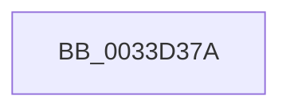

# sub_0033D37A

- RVA: `0x0033D37A`–`0x0033D3B7` (길이 `61` bytes)
- VA: `0x000000014033D37A`
- 실행 섹션: `.text`
- PDB 이름 있음: `아니요`; PDB Function 태그: `아니요`
- unwind 정보 RVA: `0x000770F0`
- 디코드: `14`개 명령, `61/61` bytes 표시
- 미해석 바이트: `0` (있으면 어셈블리에 `.byte`로 보존)

> 이 문서는 커널 이미지의 기계어와 PDB 기호를 분석해 생성했습니다. 4번과 5번은 함수 원형과 자료형을 바이너리 사용 방식에서 추정한 C 해석이며 원본 소스 복구 결과는 아닙니다.

## 1. Dependencies

- 직접 호출 지점: **1**; 고유 호출 대상: **1**
- 직접 호출자로 확인된 함수: **0**
- RIP 상대 이미지 참조: **0**

### Outgoing calls
- `0x0033D395` → [KeAcquireSpinLockRaiseToDpc](../20/KeAcquireSpinLockRaiseToDpc_function_00208470.md) (function, `0x00208470`)

### Direct callers
- 이 함수 시작 RVA로 연결되는 직접 call은 확인되지 않았습니다. 간접 호출은 완전히 역산할 수 없습니다.

### Static image references
- 디코드된 RIP-relative 메모리 참조가 없습니다.

## 2. Other-region calls and transfers

- 다른 실행 섹션으로 향하는 call: **0**
- call이 아닌 외부 분기/꼬리 이동: **1**
  - `0x0033D3B5` → [sub_0033D401](Unknown_function_0033D401.md) (`tail-transfer`)

## 3. Assembly (complete function range)

```asm
0033D37A  48 89 6C 24 58                  mov qword ptr [rsp + 0x58], rbp
0033D37F  48 83 C1 48                     add rcx, 0x48
0033D383  4C 89 6C 24 30                  mov qword ptr [rsp + 0x30], r13
0033D388  40 32 ED                        xor bpl, bpl
0033D38B  4C 89 74 24 28                  mov qword ptr [rsp + 0x28], r14
0033D390  4C 89 7C 24 20                  mov qword ptr [rsp + 0x20], r15
0033D395  E8 D6 B0 EC FF                  call 0x140208470
0033D39A  4C 8B 77 70                     mov r14, qword ptr [rdi + 0x70]
0033D39E  0F B6 D0                        movzx edx, al
0033D3A1  88 44 24 60                     mov byte ptr [rsp + 0x60], al
0033D3A5  49 8B CE                        mov rcx, r14
0033D3A8  48 A1 20 03 00 00 80 F7 FF FF   movabs rax, qword ptr [0xfffff78000000320]
0033D3B2  4D 85 F6                        test r14, r14
0033D3B5  74 4A                           je 0x14033d401
```

## 4. C-style interpretation (structured pseudocode)

```c
__int64 __fastcall sub_0033D37A(__int64 a1)
{
    __int64 result;
    __int64 v_rbp;
    unsigned __int64 v_stack_p20;
    unsigned __int64 v_stack_p28;
    unsigned __int64 v_stack_p30;
    unsigned __int64 v_stack_p58;
    unsigned __int8 v_stack_p60;

    v_stack_p58 = v_rbp;
    a1 = (a1) + (72);
    v_stack_p30 = v_r13;
    v_rbp = 0;
    v_stack_p28 = v_r14;
    v_stack_p20 = v_r15;
    result = KeAcquireSpinLockRaiseToDpc(a1, a2, a3, a4);
    v_stack_p60 = (unsigned __int8)(result);
}
```

## 5. (Beta) C Style

```c
int64_t sub_0033D37A(int64_t Arg1)
{
    int64_t result;
    int64_t local_rbp;
    uint64_t v_stack_p20;
    uint64_t v_stack_p28;
    uint64_t v_stack_p30;
    uint64_t v_stack_p58;
    uint8_t v_stack_p60;

    v_stack_p58 = local_rbp;
    Arg1 = (Arg1) + (72);
    v_stack_p30 = local_r13;
    local_rbp = 0;
    v_stack_p28 = local_r14;
    v_stack_p20 = local_r15;
    result = KeAcquireSpinLockRaiseToDpc(Arg1, a2, a3, a4);
    v_stack_p60 = (uint8_t)(result);
}
```

## 6. Execution-region graph

[열기: 2D/3D 그래프와 함수 탐색 컨트롤 패널](../../../control-panel.html?section=text&rva=0x0033D37A&view=graph)

- 2D 그래프는 위에서 아래로 흐르고, 3D 그래프는 빈 공간을 드래그해 회전합니다. Shift+드래그는 이동, 휠은 확대·축소, 함수 노드 선택은 대상 보고서 이동입니다.

### Static fallback


