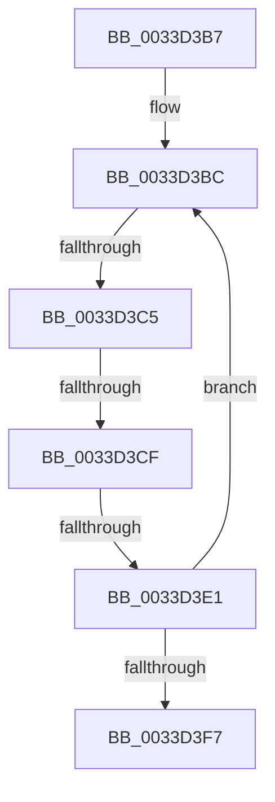

# sub_0033D3B7

- RVA: `0x0033D3B7`–`0x0033D401` (길이 `74` bytes)
- VA: `0x000000014033D3B7`
- 실행 섹션: `.text`
- PDB 이름 있음: `아니요`; PDB Function 태그: `아니요`
- unwind 정보 RVA: `0x00077110`
- 디코드: `18`개 명령, `74/74` bytes 표시
- 미해석 바이트: `0` (있으면 어셈블리에 `.byte`로 보존)

> 이 문서는 커널 이미지의 기계어와 PDB 기호를 분석해 생성했습니다. 4번과 5번은 함수 원형과 자료형을 바이너리 사용 방식에서 추정한 C 해석이며 원본 소스 복구 결과는 아닙니다.

## 1. Dependencies

- 직접 호출 지점: **1**; 고유 호출 대상: **1**
- 직접 호출자로 확인된 함수: **0**
- RIP 상대 이미지 참조: **0**

### Outgoing calls
- `0x0033D3E9` → [ExFreePoolWithTag](../../poolcode/B8/ExFreePoolWithTag_function_00B82870.md) (function, `0x00B82870`)

### Direct callers
- 이 함수 시작 RVA로 연결되는 직접 call은 확인되지 않았습니다. 간접 호출은 완전히 역산할 수 없습니다.

### Static image references
- 디코드된 RIP-relative 메모리 참조가 없습니다.

## 2. Other-region calls and transfers

- 다른 실행 섹션으로 향하는 call: **1**
  - `0x0033D3E9` → [ExFreePoolWithTag](../../poolcode/B8/ExFreePoolWithTag_function_00B82870.md) (`.text` → `POOLCODE`)
- call이 아닌 외부 분기/꼬리 이동: **3**
  - `0x0033D3BF` → [sub_0033D464 + 0xB](Unknown_function_0033D464.md) (`tail-transfer`)
  - `0x0033D3C9` → [sub_0033D464 + 0xB](Unknown_function_0033D464.md) (`tail-transfer`)
  - `0x0033D3DB` → [sub_0033D464](Unknown_function_0033D464.md) (`tail-transfer`)

## 3. Assembly (complete function range)

```asm
0033D3B7  4C 89 64 24 38                  mov qword ptr [rsp + 0x38], r12
0033D3BC  40 84 ED                        test bpl, bpl
0033D3BF  0F 85 AA 00 00 00               jne 0x14033d46f
0033D3C5  48 39 71 08                     cmp qword ptr [rcx + 8], rsi
0033D3C9  0F 85 A0 00 00 00               jne 0x14033d46f
0033D3CF  48 8B 01                        mov rax, qword ptr [rcx]
0033D3D2  33 D2                           xor edx, edx
0033D3D4  40 B5 01                        mov bpl, 1
0033D3D7  48 3B 4F 70                     cmp rcx, qword ptr [rdi + 0x70]
0033D3DB  0F 85 83 00 00 00               jne 0x14033d464
0033D3E1  48 89 47 70                     mov qword ptr [rdi + 0x70], rax
0033D3E5  4C 8D 67 70                     lea r12, [rdi + 0x70]
0033D3E9  E8 82 54 84 00                  call 0x140b82870
0033D3EE  49 8B 0C 24                     mov rcx, qword ptr [r12]
0033D3F2  48 85 C9                        test rcx, rcx
0033D3F5  75 C5                           jne 0x14033d3bc
0033D3F7  4C 8B 64 24 38                  mov r12, qword ptr [rsp + 0x38]
0033D3FC  0F B6 54 24 60                  movzx edx, byte ptr [rsp + 0x60]
```

## 4. C-style interpretation (structured pseudocode)

```c
__int64 __fastcall sub_0033D3B7(__int64 a1, int a2, __int64 a3, __int64 a4, __int64 a5, __int64 a6, __int64 a7, __int64 a8, __int64 a9, __int64 a10, __int64 a11, unsigned __int8 a12)
{
    __int64 result;
    unsigned __int64 v_stack_p38;

    v_stack_p38 = v_r12;
loc_0033D3BC:
    a2 = 0;
    *(unsigned __int64 *)(v_rdi + 112) = *(unsigned __int64 *)(a1);
    result = ExFreePoolWithTag(a1, a2, a3, a4);
    if (*(unsigned __int64 *)(v_rdi + 112) != 0) goto loc_0033D3BC;
    return result;
}
```

## 5. (Beta) C Style

```c
int64_t sub_0033D3B7(int64_t Arg1, int32_t Arg2, int64_t Arg3, int64_t Arg4, uint64_t Arg5, uint64_t Arg6, int64_t Arg7, uint64_t Arg8, uint64_t Arg9, uint64_t Arg10, uint64_t Arg11, uint8_t Arg12)
{
    int64_t result;
    uint64_t v_stack_p38;

    v_stack_p38 = local_r12;
loc_0033D3BC:
    Arg2 = 0;
    *(uint64_t *)(local_rdi + 0x70) = *(uint64_t *)(Arg1);
    result = ExFreePoolWithTag(Arg1, Arg2, Arg3, Arg4);
    if (*(uint64_t *)(local_rdi + 0x70) != 0) goto loc_0033D3BC;
    return result;
}
```

## 6. Execution-region graph

[열기: 2D/3D 그래프와 함수 탐색 컨트롤 패널](../../../control-panel.html?section=text&rva=0x0033D3B7&view=graph)

- 2D 그래프는 위에서 아래로 흐르고, 3D 그래프는 빈 공간을 드래그해 회전합니다. Shift+드래그는 이동, 휠은 확대·축소, 함수 노드 선택은 대상 보고서 이동입니다.

### Static fallback


