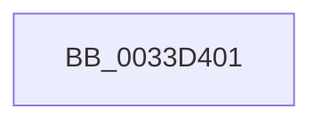

# sub_0033D401

- RVA: `0x0033D401`–`0x0033D427` (길이 `38` bytes)
- VA: `0x000000014033D401`
- 실행 섹션: `.text`
- PDB 이름 있음: `아니요`; PDB Function 태그: `아니요`
- unwind 정보 RVA: `0x00077124`
- 디코드: `8`개 명령, `38/38` bytes 표시
- 미해석 바이트: `0` (있으면 어셈블리에 `.byte`로 보존)

> 이 문서는 커널 이미지의 기계어와 PDB 기호를 분석해 생성했습니다. 4번과 5번은 함수 원형과 자료형을 바이너리 사용 방식에서 추정한 C 해석이며 원본 소스 복구 결과는 아닙니다.

## 1. Dependencies

- 직접 호출 지점: **1**; 고유 호출 대상: **1**
- 직접 호출자로 확인된 함수: **0**
- RIP 상대 이미지 참조: **0**

### Outgoing calls
- `0x0033D405` → [KeReleaseSpinLock](../39/KeReleaseSpinLock_function_00392BA0.md) (function, `0x00392BA0`)

### Direct callers
- 이 함수 시작 RVA로 연결되는 직접 call은 확인되지 않았습니다. 간접 호출은 완전히 역산할 수 없습니다.

### Static image references
- 디코드된 RIP-relative 메모리 참조가 없습니다.

## 2. Other-region calls and transfers

- 다른 실행 섹션으로 향하는 call: **0**
- call이 아닌 외부 분기/꼬리 이동: **1**
  - `0x0033D421` → [sub_0033D336 + 0x1B](Unknown_function_0033D336.md) (`tail-transfer`)

## 3. Assembly (complete function range)

```asm
0033D401  48 8D 4F 48                     lea rcx, [rdi + 0x48]
0033D405  E8 96 57 05 00                  call 0x140392ba0
0033D40A  4C 8B 7C 24 20                  mov r15, qword ptr [rsp + 0x20]
0033D40F  40 84 ED                        test bpl, bpl
0033D412  48 8B 6C 24 58                  mov rbp, qword ptr [rsp + 0x58]
0033D417  4C 8B 74 24 28                  mov r14, qword ptr [rsp + 0x28]
0033D41C  4C 8B 6C 24 30                  mov r13, qword ptr [rsp + 0x30]
0033D421  0F 85 2A FF FF FF               jne 0x14033d351
```

## 4. C-style interpretation (structured pseudocode)

```c
__int64 __fastcall sub_0033D401(__int64 a1, __int64 a2, __int64 a3, __int64 a4, __int64 a5, __int64 a6, __int64 a7, __int64 a8, __int64 a9, __int64 a10, __int64 a11)
{
    __int64 result;
    unsigned __int64 v_stack_p20;

    result = KeReleaseSpinLock(v_rdi + 72, a2, a3, a4);
}
```

## 5. (Beta) C Style

```c
int64_t sub_0033D401(int64_t Arg1, int64_t Arg2, int64_t Arg3, int64_t Arg4, int64_t Arg5, int64_t Arg6, uint64_t Arg7, uint64_t Arg8, uint64_t Arg9, uint64_t Arg10, int64_t Arg11)
{
    int64_t result;
    uint64_t v_stack_p20;

    result = KeReleaseSpinLock(local_rdi + 72, Arg2, Arg3, Arg4);
}
```

## 6. Execution-region graph

[열기: 2D/3D 그래프와 함수 탐색 컨트롤 패널](../../../control-panel.html?section=text&rva=0x0033D401&view=graph)

- 2D 그래프는 위에서 아래로 흐르고, 3D 그래프는 빈 공간을 드래그해 회전합니다. Shift+드래그는 이동, 휠은 확대·축소, 함수 노드 선택은 대상 보고서 이동입니다.

### Static fallback


