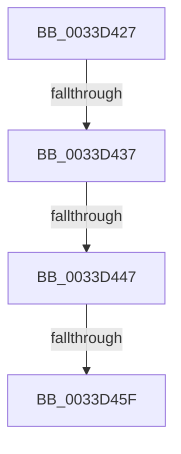

# sub_0033D427

- RVA: `0x0033D427`–`0x0033D464` (길이 `61` bytes)
- VA: `0x000000014033D427`
- 실행 섹션: `.text`
- PDB 이름 있음: `아니요`; PDB Function 태그: `아니요`
- unwind 정보 RVA: `0x00077134`
- 디코드: `13`개 명령, `61/61` bytes 표시
- 미해석 바이트: `0` (있으면 어셈블리에 `.byte`로 보존)

> 이 문서는 커널 이미지의 기계어와 PDB 기호를 분석해 생성했습니다. 4번과 5번은 함수 원형과 자료형을 바이너리 사용 방식에서 추정한 C 해석이며 원본 소스 복구 결과는 아닙니다.

## 1. Dependencies

- 직접 호출 지점: **1**; 고유 호출 대상: **1**
- 직접 호출자로 확인된 함수: **0**
- RIP 상대 이미지 참조: **1**

### Outgoing calls
- `0x0033D452` → [VfRemLockReportBadReleaseTag](../../pagevrfy/BA/VfRemLockReportBadReleaseTag_function_00BA28B8.md) (function, `0x00BA28B8`)

### Direct callers
- 이 함수 시작 RVA로 연결되는 직접 call은 확인되지 않았습니다. 간접 호출은 완전히 역산할 수 없습니다.

### Static image references
- `0x0033D437` → RVA `0x00F04A20` (`.data`; read)

## 2. Other-region calls and transfers

- 다른 실행 섹션으로 향하는 call: **1**
  - `0x0033D452` → [VfRemLockReportBadReleaseTag](../../pagevrfy/BA/VfRemLockReportBadReleaseTag_function_00BA28B8.md) (`.text` → `PAGEVRFY`)
- call이 아닌 외부 분기/꼬리 이동: **4**
  - `0x0033D431` → [sub_0033D336 + 0x1B](Unknown_function_0033D336.md) (`tail-transfer`)
  - `0x0033D441` → [sub_006E201A](../6E/Unknown_function_006E201A.md) (`tail-transfer`)
  - `0x0033D459` → [sub_0033D336 + 0x1B](Unknown_function_0033D336.md) (`tail-transfer`)
  - `0x0033D45F` → [sub_006E201A](../6E/Unknown_function_006E201A.md) (`tail-transfer`)

## 3. Assembly (complete function range)

```asm
0033D427  8B C3                           mov eax, ebx
0033D429  F0 0F C1 47 50                  lock xadd dword ptr [rdi + 0x50], eax
0033D42E  83 F8 01                        cmp eax, 1
0033D431  0F 89 1A FF FF FF               jns 0x14033d351
0033D437  F7 05 DF 75 BC 00 00 08 00 00   test dword ptr [rip + 0xbc75df], 0x800
0033D441  0F 84 D3 4B 3A 00               je 0x1406e201a
0033D447  4C 8B 44 24 48                  mov r8, qword ptr [rsp + 0x48]
0033D44C  48 8B D6                        mov rdx, rsi
0033D44F  48 8B CF                        mov rcx, rdi
0033D452  E8 61 54 86 00                  call 0x140ba28b8
0033D457  85 C0                           test eax, eax
0033D459  0F 85 F2 FE FF FF               jne 0x14033d351
0033D45F  E9 B6 4B 3A 00                  jmp 0x1406e201a
```

## 4. C-style interpretation (structured pseudocode)

```c
__int64 __fastcall sub_0033D427(__int64 a1, __int64 a2, __int64 a3, __int64 a4, __int64 a5, __int64 a6, __int64 a7, __int64 a8, __int64 a9)
{
    __int64 result;

    result = VfRemLockReportBadReleaseTag(v_rdi, v_rsi, a9, a4);
}
```

## 5. (Beta) C Style

```c
int64_t sub_0033D427(int64_t Arg1, int64_t Arg2, int64_t Arg3, int64_t Arg4, uint64_t Arg5, uint64_t Arg6, uint64_t Arg7, uint64_t Arg8, int64_t Arg9)
{
    int64_t result;

    result = VfRemLockReportBadReleaseTag(local_rdi, local_rsi, Arg9, Arg4);
}
```

## 6. Execution-region graph

[열기: 2D/3D 그래프와 함수 탐색 컨트롤 패널](../../../control-panel.html?section=text&rva=0x0033D427&view=graph)

- 2D 그래프는 위에서 아래로 흐르고, 3D 그래프는 빈 공간을 드래그해 회전합니다. Shift+드래그는 이동, 휠은 확대·축소, 함수 노드 선택은 대상 보고서 이동입니다.

### Static fallback


