# sub_0033D4D7

- RVA: `0x0033D4D7`–`0x0033DA88` (길이 `1,457` bytes)
- VA: `0x000000014033D4D7`
- 실행 섹션: `.text`
- PDB 이름 있음: `아니요`; PDB Function 태그: `아니요`
- unwind 정보 RVA: `0x000771A8`
- 디코드: `325`개 명령, `1,457/1,457` bytes 표시
- 미해석 바이트: `0` (있으면 어셈블리에 `.byte`로 보존)

> 이 문서는 커널 이미지의 기계어와 PDB 기호를 분석해 생성했습니다. 4번과 5번은 함수 원형과 자료형을 바이너리 사용 방식에서 추정한 C 해석이며 원본 소스 복구 결과는 아닙니다.

## 1. Dependencies

- 직접 호출 지점: **2**; 고유 호출 대상: **2**
- 직접 호출자로 확인된 함수: **0**
- RIP 상대 이미지 참조: **8**

### Outgoing calls
- `0x0033D9DC` → [MiUpdateLargePageCandidateValue](MiUpdateLargePageCandidateValue_function_0033EF80.md) (function, `0x0033EF80`)
- `0x0033DA44` → [MiRestoreTransitionPte](MiRestoreTransitionPte_function_0033DD90.md) (function, `0x0033DD90`)

### Direct callers
- 이 함수 시작 RVA로 연결되는 직접 call은 확인되지 않았습니다. 간접 호출은 완전히 역산할 수 없습니다.

### Static image references
- `0x0033D4E8` → RVA `0x00E301A8` (`.data`; read)
- `0x0033D64E` → RVA `0x00E30088` (`.data`; read)
- `0x0033D667` → RVA `0x00E2DBC0` (`.data`; read)
- `0x0033D673` → RVA `0x00E2DBC4` (`.data`; read)
- `0x0033D684` → RVA `0x00E2DC20` (`.data`; read)
- `0x0033D6D3` → RVA `0x00E2DBC0` (`.data`; write)
- `0x0033D710` → RVA `0x00E2DC28` (`.data`; read)
- `0x0033D9AC` → RVA `0x00FC6B06` (`ALMOSTRO`; read)

## 2. Other-region calls and transfers

- 다른 실행 섹션으로 향하는 call: **0**
- call이 아닌 외부 분기/꼬리 이동: **18**
  - `0x0033D50C` → [sub_0033DA89 + 0x8B](Unknown_function_0033DA89.md) (`tail-transfer`)
  - `0x0033D53A` → [sub_0033DA89](Unknown_function_0033DA89.md) (`tail-transfer`)
  - `0x0033D561` → [sub_0033DA89 + 0x14D](Unknown_function_0033DA89.md) (`tail-transfer`)
  - `0x0033D5A8` → [sub_0033DA89 + 0x1E0](Unknown_function_0033DA89.md) (`tail-transfer`)
  - `0x0033D6A2` → [sub_0033DA89 + 0x18](Unknown_function_0033DA89.md) (`tail-transfer`)
  - `0x0033D6C0` → [sub_0033DA89 + 0x129](Unknown_function_0033DA89.md) (`tail-transfer`)
  - `0x0033D6CD` → [sub_0033DA89 + 0x78](Unknown_function_0033DA89.md) (`tail-transfer`)
  - `0x0033D702` → [sub_0033DA89 + 0x65](Unknown_function_0033DA89.md) (`tail-transfer`)
  - `0x0033D71D` → [sub_0033DA89 + 0xA3](Unknown_function_0033DA89.md) (`tail-transfer`)
  - `0x0033D7BD` → [sub_0033DA89 + 0x1E9](Unknown_function_0033DA89.md) (`tail-transfer`)
  - `0x0033D808` → [sub_0033DA89 + 0x32](Unknown_function_0033DA89.md) (`tail-transfer`)
  - `0x0033D827` → [sub_0033DA89 + 0x164](Unknown_function_0033DA89.md) (`tail-transfer`)
  - `0x0033D950` → [sub_0033DA89 + 0x156](Unknown_function_0033DA89.md) (`tail-transfer`)
  - `0x0033D9B7` → [sub_0033DA89 + 0x1F7](Unknown_function_0033DA89.md) (`tail-transfer`)
  - `0x0033D9F4` → [sub_0033DA89 + 0x264](Unknown_function_0033DA89.md) (`tail-transfer`)
  - `0x0033DA01` → [sub_0033DA89 + 0x264](Unknown_function_0033DA89.md) (`tail-transfer`)
  - `0x0033DA12` → [sub_0033DA89 + 0x175](Unknown_function_0033DA89.md) (`tail-transfer`)
  - `0x0033DA24` → [sub_0033DA89 + 0x217](Unknown_function_0033DA89.md) (`tail-transfer`)

## 3. Assembly (complete function range)

```asm
0033D4D7  48 89 BC 24 F0 00 00 00         mov qword ptr [rsp + 0xf0], rdi
0033D4DF  48 C7 C7 FF FF FF FF            mov rdi, 0xffffffffffffffff
0033D4E6  75 36                           jne 0x14033d51e
0033D4E8  48 8B 05 B9 2C AF 00            mov rax, qword ptr [rip + 0xaf2cb9]
0033D4EF  49 8B C9                        mov rcx, r9
0033D4F2  4D 8B C4                        mov r8, r12
0033D4F5  48 C1 E9 05                     shr rcx, 5
0033D4F9  41 83 E0 1F                     and r8d, 0x1f
0033D4FD  41 8B D2                        mov edx, r10d
0033D500  4C 8D 0C 88                     lea r9, [rax + rcx*4]
0033D504  49 8D 40 01                     lea rax, [r8 + 1]
0033D508  48 83 F8 20                     cmp rax, 0x20
0033D50C  0F 87 02 06 00 00               ja 0x14033db14
0033D512  41 8B C8                        mov ecx, r8d
0033D515  41 8B C2                        mov eax, r10d
0033D518  D3 E0                           shl eax, cl
0033D51A  F0 41 09 01                     lock or dword ptr [r9], eax
0033D51E  8B 46 20                        mov eax, dword ptr [rsi + 0x20]
0033D521  48 BA FF FF FF FF FF 00 00 00   movabs rdx, 0xffffffffff
0033D52B  C1 E8 18                        shr eax, 0x18
0033D52E  48 B9 FF FF FF FF 3F 00 00 00   movabs rcx, 0x3fffffffff
0033D538  A8 08                           test al, 8
0033D53A  0F 85 49 05 00 00               jne 0x14033da89
0033D540  4C 8B 1E                        mov r11, qword ptr [rsi]
0033D543  4C 8B 4E 18                     mov r9, qword ptr [rsi + 0x18]
0033D547  4D 8B D3                        mov r10, r11
0033D54A  4D 8B C1                        mov r8, r9
0033D54D  C7 84 24 00 01 00 00 00 00 00 00  mov dword ptr [rsp + 0x100], 0
0033D558  4C 23 D2                        and r10, rdx
0033D55B  4C 23 C2                        and r8, rdx
0033D55E  4C 3B C1                        cmp r8, rcx
0033D561  0F 84 6F 06 00 00               je 0x14033dbd6
0033D567  4B 8D 14 40                     lea rdx, [r8 + r8*2]
0033D56B  48 B8 00 00 00 00 00 DE FF FF   movabs rax, 0xffffde0000000000
0033D575  48 C1 E2 04                     shl rdx, 4
0033D579  48 8B C0                        mov rax, rax
0033D57C  48 03 D0                        add rdx, rax
0033D57F  49 8B CB                        mov rcx, r11
0033D582  48 8B 02                        mov rax, qword ptr [rdx]
0033D585  48 33 C8                        xor rcx, rax
0033D588  48 B8 00 00 00 00 00 FF FF FF   movabs rax, 0xffffff0000000000
0033D592  48 23 C8                        and rcx, rax
0033D595  49 33 CB                        xor rcx, r11
0033D598  48 89 0A                        mov qword ptr [rdx], rcx
0033D59B  48 B9 FF FF FF FF 3F 00 00 00   movabs rcx, 0x3fffffffff
0033D5A5  4C 3B D1                        cmp r10, rcx
0033D5A8  0F 84 BB 06 00 00               je 0x14033dc69
0033D5AE  4F 8D 14 52                     lea r10, [r10 + r10*2]
0033D5B2  49 C1 E2 04                     shl r10, 4
0033D5B6  48 B9 18 00 00 00 00 DE FF FF   movabs rcx, 0xffffde0000000018
0033D5C0  4C 03 D1                        add r10, rcx
0033D5C3  49 BB 00 00 00 00 00 FF FF FF   movabs r11, 0xffffff0000000000
0033D5CD  49 8B 12                        mov rdx, qword ptr [r10]
0033D5D0  48 8B CA                        mov rcx, rdx
0033D5D3  48 8B C2                        mov rax, rdx
0033D5D6  49 33 C9                        xor rcx, r9
0033D5D9  49 23 CB                        and rcx, r11
0033D5DC  49 33 C9                        xor rcx, r9
0033D5DF  F0 49 0F B1 0A                  lock cmpxchg qword ptr [r10], rcx
0033D5E4  4C 8B C0                        mov r8, rax
0033D5E7  48 3B D0                        cmp rdx, rax
0033D5EA  74 20                           je 0x14033d60c
0033D5EC  0F 1F 40 00                     nop dword ptr [rax]
0033D5F0  49 8B C8                        mov rcx, r8
0033D5F3  4D 33 C1                        xor r8, r9
0033D5F6  4D 23 C3                        and r8, r11
0033D5F9  48 8B C1                        mov rax, rcx
0033D5FC  4D 33 C1                        xor r8, r9
0033D5FF  F0 4D 0F B1 02                  lock cmpxchg qword ptr [r10], r8
0033D604  4C 8B C0                        mov r8, rax
0033D607  48 3B C8                        cmp rcx, rax
0033D60A  75 E4                           jne 0x14033d5f0
0033D60C  49 C1 FE 04                     sar r14, 4
0033D610  49 BA AB AA AA AA AA AA AA AA   movabs r10, 0xaaaaaaaaaaaaaaab
0033D61A  4D 0F AF F2                     imul r14, r10
0033D61E  0F 57 C0                        xorps xmm0, xmm0
0033D621  0F 57 C9                        xorps xmm1, xmm1
0033D624  F3 0F 7F 44 24 40               movdqu xmmword ptr [rsp + 0x40], xmm0
0033D62A  F3 0F 7F 4C 24 50               movdqu xmmword ptr [rsp + 0x50], xmm1
0033D630  49 B9 00 00 00 00 00 DE FF FF   movabs r9, 0xffffde0000000000
0033D63A  4F 8D 1C 76                     lea r11, [r14 + r14*2]
0033D63E  49 C1 E3 04                     shl r11, 4
0033D642  49 8B C1                        mov rax, r9
0033D645  4D 8D 04 03                     lea r8, [r11 + rax]
0033D649  49 8B 44 03 28                  mov rax, qword ptr [r11 + rax + 0x28]
0033D64E  48 8B 0D 33 2A AF 00            mov rcx, qword ptr [rip + 0xaf2a33]
0033D655  48 C1 E8 2B                     shr rax, 0x2b
0033D659  25 FF 03 00 00                  and eax, 0x3ff
0033D65E  4C 89 44 24 38                  mov qword ptr [rsp + 0x38], r8
0033D663  48 8B 14 C1                     mov rdx, qword ptr [rcx + rax*8]
0033D667  48 63 0D 52 05 AF 00            movsxd rcx, dword ptr [rip + 0xaf0552]
0033D66E  48 89 54 24 30                  mov qword ptr [rsp + 0x30], rdx
0033D673  8B 15 4B 05 AF 00               mov edx, dword ptr [rip + 0xaf054b]
0033D679  3B CA                           cmp ecx, edx
0033D67B  77 1D                           ja 0x14033d69a
0033D67D  48 8B C1                        mov rax, rcx
0033D680  48 C1 E0 04                     shl rax, 4
0033D684  48 03 05 95 05 AF 00            add rax, qword ptr [rip + 0xaf0595]
0033D68B  4C 3B 30                        cmp r14, qword ptr [rax]
0033D68E  72 0A                           jb 0x14033d69a
0033D690  3B CA                           cmp ecx, edx
0033D692  74 5A                           je 0x14033d6ee
0033D694  4C 3B 70 10                     cmp r14, qword ptr [rax + 0x10]
0033D698  72 54                           jb 0x14033d6ee
0033D69A  45 33 D2                        xor r10d, r10d
0033D69D  41 8B CA                        mov ecx, r10d
0033D6A0  3B D1                           cmp edx, ecx
0033D6A2  0F 8C F9 03 00 00               jl 0x14033daa1
0033D6A8  44 8D 0C 11                     lea r9d, [rcx + rdx]
0033D6AC  41 D1 F9                        sar r9d, 1
0033D6AF  49 63 C1                        movsxd rax, r9d
0033D6B2  48 C1 E0 04                     shl rax, 4
0033D6B6  48 03 05 63 05 AF 00            add rax, qword ptr [rip + 0xaf0563]
0033D6BD  4C 3B 30                        cmp r14, qword ptr [rax]
0033D6C0  0F 82 EC 04 00 00               jb 0x14033dbb2
0033D6C6  44 3B 0D F7 04 AF 00            cmp r9d, dword ptr [rip + 0xaf04f7]
0033D6CD  0F 85 2E 04 00 00               jne 0x14033db01
0033D6D3  44 89 0D E6 04 AF 00            mov dword ptr [rip + 0xaf04e6], r9d
0033D6DA  49 BA AB AA AA AA AA AA AA AA   movabs r10, 0xaaaaaaaaaaaaaaab
0033D6E4  49 B9 00 00 00 00 00 DE FF FF   movabs r9, 0xffffde0000000000
0033D6EE  8B 40 08                        mov eax, dword ptr [rax + 8]
0033D6F1  45 8B 70 20                     mov r14d, dword ptr [r8 + 0x20]
0033D6F5  89 44 24 48                     mov dword ptr [rsp + 0x48], eax
0033D6F9  41 8B 40 20                     mov eax, dword ptr [r8 + 0x20]
0033D6FD  C1 E8 18                        shr eax, 0x18
0033D700  A8 08                           test al, 8
0033D702  0F 85 E6 03 00 00               jne 0x14033daee
0033D708  41 C1 EE 18                     shr r14d, 0x18
0033D70C  41 83 E6 07                     and r14d, 7
0033D710  48 83 3D 10 05 AF 00 00         cmp qword ptr [rip + 0xaf0510], 0
0033D718  44 89 74 24 4C                  mov dword ptr [rsp + 0x4c], r14d
0033D71D  0F 85 09 04 00 00               jne 0x14033db2c
0033D723  32 C9                           xor cl, cl
0033D725  4C 8B 46 28                     mov r8, qword ptr [rsi + 0x28]
0033D729  88 4C 24 50                     mov byte ptr [rsp + 0x50], cl
0033D72D  0F B6 C9                        movzx ecx, cl
0033D730  41 8B C6                        mov eax, r14d
0033D733  49 BE FF FF FF FF 3F 00 00 00   movabs r14, 0x3fffffffff
0033D73D  C7 44 24 54 09 00 00 00         mov dword ptr [rsp + 0x54], 9
0033D745  48 8D 0C CD 3B 00 00 00         lea rcx, [rcx*8 + 0x3b]
0033D74D  48 03 C8                        add rcx, rax
0033D750  8B 44 24 48                     mov eax, dword ptr [rsp + 0x48]
0033D754  48 6B D1 58                     imul rdx, rcx, 0x58
0033D758  48 69 C8 80 DF 00 00            imul rcx, rax, 0xdf80
0033D75F  48 8B 44 24 30                  mov rax, qword ptr [rsp + 0x30]
0033D764  48 03 D1                        add rdx, rcx
0033D767  48 03 50 10                     add rdx, qword ptr [rax + 0x10]
0033D76B  48 B8 00 00 00 00 00 00 80 0F   movabs rax, 0xf80000000000000
0033D775  4C 23 C0                        and r8, rax
0033D778  48 89 54 24 40                  mov qword ptr [rsp + 0x40], rdx
0033D77D  48 8B 06                        mov rax, qword ptr [rsi]
0033D780  48 C1 E8 14                     shr rax, 0x14
0033D784  4C 0B C0                        or r8, rax
0033D787  8B 46 24                        mov eax, dword ptr [rsi + 0x24]
0033D78A  48 25 00 00 E0 FF               and rax, 0xffffffffffe00000
0033D790  49 C1 E8 14                     shr r8, 0x14
0033D794  48 C1 E0 03                     shl rax, 3
0033D798  4C 0B C0                        or r8, rax
0033D79B  48 8B 46 18                     mov rax, qword ptr [rsi + 0x18]
0033D79F  44 8B 56 24                     mov r10d, dword ptr [rsi + 0x24]
0033D7A3  41 81 E2 FF FF 1F 00            and r10d, 0x1fffff
0033D7AA  48 C1 E8 28                     shr rax, 0x28
0033D7AE  49 C1 E2 13                     shl r10, 0x13
0033D7B2  25 FF FF 07 00                  and eax, 0x7ffff
0033D7B7  4C 0B D0                        or r10, rax
0033D7BA  4D 3B C6                        cmp r8, r14
0033D7BD  0F 84 AF 04 00 00               je 0x14033dc72
0033D7C3  4F 8D 0C 40                     lea r9, [r8 + r8*2]
0033D7C7  48 B8 00 00 00 00 00 DE FF FF   movabs rax, 0xffffde0000000000
0033D7D1  49 C1 E1 04                     shl r9, 4
0033D7D5  48 8B C0                        mov rax, rax
0033D7D8  4C 03 C8                        add r9, rax
0033D7DB  4D 8B DA                        mov r11, r10
0033D7DE  49 C1 E3 28                     shl r11, 0x28
0033D7E2  48 B8 FF FF FF FF FF 00 00 F8   movabs rax, 0xf80000ffffffffff
0033D7EC  49 8B CB                        mov rcx, r11
0033D7EF  49 8B 51 18                     mov rdx, qword ptr [r9 + 0x18]
0033D7F3  48 33 CA                        xor rcx, rdx
0033D7F6  48 23 C8                        and rcx, rax
0033D7F9  48 8B C2                        mov rax, rdx
0033D7FC  49 33 CB                        xor rcx, r11
0033D7FF  F0 49 0F B1 49 18               lock cmpxchg qword ptr [r9 + 0x18], rcx
0033D805  48 3B D0                        cmp rdx, rax
0033D808  0F 85 AD 02 00 00               jne 0x14033dabb
0033D80E  41 8B 41 24                     mov eax, dword ptr [r9 + 0x24]
0033D812  49 8B CA                        mov rcx, r10
0033D815  48 C1 E9 13                     shr rcx, 0x13
0033D819  25 00 00 E0 FF                  and eax, 0xffe00000
0033D81E  0B C8                           or ecx, eax
0033D820  41 89 49 24                     mov dword ptr [r9 + 0x24], ecx
0033D824  4D 3B D6                        cmp r10, r14
0033D827  0F 84 C0 03 00 00               je 0x14033dbed
0033D82D  4F 8D 0C 52                     lea r9, [r10 + r10*2]
0033D831  48 B8 00 00 00 00 00 DE FF FF   movabs rax, 0xffffde0000000000
0033D83B  49 C1 E1 04                     shl r9, 4
0033D83F  48 8B C0                        mov rax, rax
0033D842  4C 03 C8                        add r9, rax
0033D845  0F 57 C0                        xorps xmm0, xmm0
0033D848  49 8B C8                        mov rcx, r8
0033D84B  48 BA FF FF FF FF FF 00 00 00   movabs rdx, 0xffffffffff
0033D855  48 C1 E1 28                     shl rcx, 0x28
0033D859  45 33 F6                        xor r14d, r14d
0033D85C  49 BA FF FF FF FF FF FF 7F F0   movabs r10, 0xf07fffffffffffff
0033D866  4C 89 74 24 60                  mov qword ptr [rsp + 0x60], r14
0033D86B  49 8B 01                        mov rax, qword ptr [r9]
0033D86E  0F 57 C9                        xorps xmm1, xmm1
0033D871  48 23 C2                        and rax, rdx
0033D874  48 0B C8                        or rcx, rax
0033D877  41 8B 41 24                     mov eax, dword ptr [r9 + 0x24]
0033D87B  49 89 09                        mov qword ptr [r9], rcx
0033D87E  25 FF FF 1F 00                  and eax, 0x1fffff
0033D883  49 8B C8                        mov rcx, r8
0033D886  49 C1 E0 14                     shl r8, 0x14
0033D88A  48 C1 E9 18                     shr rcx, 0x18
0033D88E  C1 E1 15                        shl ecx, 0x15
0033D891  0B C8                           or ecx, eax
0033D893  41 89 49 24                     mov dword ptr [r9 + 0x24], ecx
0033D897  49 8B 51 28                     mov rdx, qword ptr [r9 + 0x28]
0033D89B  48 8B CA                        mov rcx, rdx
0033D89E  48 89 94 24 88 00 00 00         mov qword ptr [rsp + 0x88], rdx
0033D8A6  49 33 C8                        xor rcx, r8
0033D8A9  48 8B C2                        mov rax, rdx
0033D8AC  49 23 CA                        and rcx, r10
0033D8AF  49 33 C8                        xor rcx, r8
0033D8B2  F3 0F 7F 44 24 68               movdqu xmmword ptr [rsp + 0x68], xmm0
0033D8B8  F3 0F 7F 4C 24 78               movdqu xmmword ptr [rsp + 0x78], xmm1
0033D8BE  0F 11 84 24 90 00 00 00         movups xmmword ptr [rsp + 0x90], xmm0
0033D8C6  0F 11 84 24 A0 00 00 00         movups xmmword ptr [rsp + 0xa0], xmm0
0033D8CE  0F 11 84 24 B0 00 00 00         movups xmmword ptr [rsp + 0xb0], xmm0
0033D8D6  F0 49 0F B1 49 28               lock cmpxchg qword ptr [r9 + 0x28], rcx
0033D8DC  48 89 84 24 B8 00 00 00         mov qword ptr [rsp + 0xb8], rax
0033D8E4  48 3B D0                        cmp rdx, rax
0033D8E7  74 31                           je 0x14033d91a
0033D8E9  0F 1F 80 00 00 00 00            nop dword ptr [rax]
0033D8F0  48 8B C8                        mov rcx, rax
0033D8F3  48 89 84 24 88 00 00 00         mov qword ptr [rsp + 0x88], rax
0033D8FB  49 33 C8                        xor rcx, r8
0033D8FE  48 8B D0                        mov rdx, rax
0033D901  49 23 CA                        and rcx, r10
0033D904  49 33 C8                        xor rcx, r8
0033D907  F0 49 0F B1 49 28               lock cmpxchg qword ptr [r9 + 0x28], rcx
0033D90D  48 89 84 24 B8 00 00 00         mov qword ptr [rsp + 0xb8], rax
0033D915  48 3B D0                        cmp rdx, rax
0033D918  75 D6                           jne 0x14033d8f0
0033D91A  48 8B 44 24 40                  mov rax, qword ptr [rsp + 0x40]
0033D91F  F0 48 FF 08                     lock dec qword ptr [rax]
0033D923  83 BC 24 00 01 00 00 00         cmp dword ptr [rsp + 0x100], 0
0033D92B  74 20                           je 0x14033d94d
0033D92D  8B 46 20                        mov eax, dword ptr [rsi + 0x20]
0033D930  89 84 24 00 01 00 00            mov dword ptr [rsp + 0x100], eax
0033D937  C1 E8 18                        shr eax, 0x18
0033D93A  24 F7                           and al, 0xf7
0033D93C  88 84 24 03 01 00 00            mov byte ptr [rsp + 0x103], al
0033D943  8B 84 24 00 01 00 00            mov eax, dword ptr [rsp + 0x100]
0033D94A  89 46 20                        mov dword ptr [rsi + 0x20], eax
0033D94D  80 3B 00                        cmp byte ptr [rbx], 0
0033D950  0F 84 89 02 00 00               je 0x14033dbdf
0033D956  80 7B 18 00                     cmp byte ptr [rbx + 0x18], 0
0033D95A  48 B9 FF FF FF FF FF FF FF 7F   movabs rcx, 0x7fffffffffffffff
0033D964  74 0D                           je 0x14033d973
0033D966  48 8B 43 10                     mov rax, qword ptr [rbx + 0x10]
0033D96A  F0 48 21 48 18                  lock and qword ptr [rax + 0x18], rcx
0033D96F  C6 43 18 00                     mov byte ptr [rbx + 0x18], 0
0033D973  80 7B 30 00                     cmp byte ptr [rbx + 0x30], 0
0033D977  74 0D                           je 0x14033d986
0033D979  48 8B 43 28                     mov rax, qword ptr [rbx + 0x28]
0033D97D  F0 48 21 48 18                  lock and qword ptr [rax + 0x18], rcx
0033D982  C6 43 30 00                     mov byte ptr [rbx + 0x30], 0
0033D986  80 7B 48 00                     cmp byte ptr [rbx + 0x48], 0
0033D98A  74 0D                           je 0x14033d999
0033D98C  48 8B 43 40                     mov rax, qword ptr [rbx + 0x40]
0033D990  F0 48 21 48 18                  lock and qword ptr [rax + 0x18], rcx
0033D995  C6 43 48 00                     mov byte ptr [rbx + 0x48], 0
0033D999  80 7B 60 00                     cmp byte ptr [rbx + 0x60], 0
0033D99D  74 0D                           je 0x14033d9ac
0033D99F  48 8B 43 58                     mov rax, qword ptr [rbx + 0x58]
0033D9A3  F0 48 21 48 18                  lock and qword ptr [rax + 0x18], rcx
0033D9A8  C6 43 60 00                     mov byte ptr [rbx + 0x60], 0
0033D9AC  F6 05 53 91 C8 00 01            test byte ptr [rip + 0xc89153], 1
0033D9B3  49 8D 4D 20                     lea rcx, [r13 + 0x20]
0033D9B7  0F 85 C3 02 00 00               jne 0x14033dc80
0033D9BD  F0 81 21 FF FF FF BF            lock and dword ptr [rcx], 0xbfffffff
0033D9C4  F0 FF 09                        lock dec dword ptr [rcx]
0033D9C7  41 B9 02 00 00 00               mov r9d, 2
0033D9CD  4C 89 74 24 20                  mov qword ptr [rsp + 0x20], r14
0033D9D2  49 8B D4                        mov rdx, r12
0033D9D5  49 8B CF                        mov rcx, r15
0033D9D8  45 8D 41 01                     lea r8d, [r9 + 1]
0033D9DC  E8 9F 15 00 00                  call 0x14033ef80
0033D9E1  F0 49 0F C1 BF 00 49 00 00      lock xadd qword ptr [r15 + 0x4900], rdi
0033D9EA  48 FF CF                        dec rdi
0033D9ED  49 3B BF 00 41 00 00            cmp rdi, qword ptr [r15 + 0x4100]
0033D9F4  0F 84 F3 02 00 00               je 0x14033dced
0033D9FA  49 3B BF 08 41 00 00            cmp rdi, qword ptr [r15 + 0x4108]
0033DA01  0F 84 E6 02 00 00               je 0x14033dced
0033DA07  48 8D 5F 01                     lea rbx, [rdi + 1]
0033DA0B  48 81 FF 20 04 00 00            cmp rdi, 0x420
0033DA12  0F 86 E6 01 00 00               jbe 0x14033dbfe
0033DA18  BB 01 00 00 00                  mov ebx, 1
0033DA1D  48 81 FF 9F 00 00 00            cmp rdi, 0x9f
0033DA24  0F 82 76 02 00 00               jb 0x14033dca0
0033DA2A  48 8B 46 18                     mov rax, qword ptr [rsi + 0x18]
0033DA2E  48 B9 00 00 00 00 00 FF FF FF   movabs rcx, 0xffffff0000000000
0033DA38  48 23 C1                        and rax, rcx
0033DA3B  33 D2                           xor edx, edx
0033DA3D  48 8B CE                        mov rcx, rsi
0033DA40  48 89 46 18                     mov qword ptr [rsi + 0x18], rax
0033DA44  E8 47 03 00 00                  call 0x14033dd90
0033DA49  48 8B 46 28                     mov rax, qword ptr [rsi + 0x28]
0033DA4D  B9 40 1C 00 00                  mov ecx, 0x1c40
0033DA52  48 8B BC 24 F0 00 00 00         mov rdi, qword ptr [rsp + 0xf0]
0033DA5A  BA C0 3F 00 00                  mov edx, 0x3fc0
0033DA5F  48 C1 E8 3F                     shr rax, 0x3f
0033DA63  84 C0                           test al, al
0033DA65  8B C3                           mov eax, ebx
0033DA67  48 8B 9C 24 F8 00 00 00         mov rbx, qword ptr [rsp + 0xf8]
0033DA6F  0F 44 CA                        cmove ecx, edx
0033DA72  F0 4A FF 0C 39                  lock dec qword ptr [rcx + r15]
0033DA77  48 81 C4 C0 00 00 00            add rsp, 0xc0
0033DA7E  41 5F                           pop r15
0033DA80  41 5E                           pop r14
0033DA82  41 5D                           pop r13
0033DA84  41 5C                           pop r12
0033DA86  5E                              pop rsi
0033DA87  C3                              ret
```

## 4. C-style interpretation (structured pseudocode)

```c
__int64 __fastcall sub_0033D4D7(__int64 a1, __int64 a2, __int64 a3, __int64 a4, __int64 a5, __int64 a6, __int64 a7, __int64 a8, unsigned int a9, __int64 a10, __int64 a11, __int64 a12, __int64 a13, __int64 a14, __int64 a15, __int64 a16, __int64 a17, __int64 a18, __int64 a19, __int64 a20, __int64 a21, __int64 a22, __int64 a23, __int64 a24, __int64 a25, __int64 a26, __int64 a27, __int64 a28, __int64 a29, __int64 a30, __int64 a31, unsigned int a32)
{
    __int64 result;
    __int64 v_r10;
    __int64 v_r11;
    __int64 v_r14;
    __int64 v_rdi;
    __int64 v_rsp;
    unsigned int v_stack_p100;
    unsigned __int8 v_stack_p103;
    unsigned __int64 v_stack_p20;
    unsigned __int64 v_stack_p30;
    unsigned __int64 v_stack_p38;
    unsigned __int64 v_stack_p40;
    unsigned int v_stack_p48;
    unsigned int v_stack_p4C;
    unsigned __int64 v_stack_p50;
    unsigned int v_stack_p54;
    unsigned __int64 v_stack_p60;
    unsigned __int64 v_stack_p68;
    unsigned __int64 v_stack_p78;
    unsigned __int64 v_stack_p88;
    unsigned __int64 v_stack_pB8;
    unsigned __int64 v_stack_pF0;

    v_stack_pF0 = v_rdi;
    if (condition_is_not_equal) goto loc_0033D51E;
    a1 = (a4) >> (5);
    a3 = (unsigned int)((v_r12) & (31));
    result = (unsigned int)(((unsigned int)((unsigned int)(v_r10))) << ((unsigned __int8)((unsigned int)((unsigned int)(a3)))));
loc_0033D51E:
    result = (unsigned int)(((unsigned int)(*(unsigned int *)(v_rsi + 32))) >> (24));
    v_stack_p100 = 0;
    v_r10 = (*(unsigned __int64 *)(v_rsi)) & ((unsigned int)((unsigned int)(v_r10)));
    a3 = (*(unsigned __int64 *)(v_rsi + 24)) & ((unsigned int)((unsigned int)(v_r10)));
    a2 = (a3 + a3 * 2) << (4);
    a2 = (a2) + (result);
    a1 = (*(unsigned __int64 *)(v_rsi)) ^ (*(unsigned __int64 *)(a2));
    a1 = (a1) & (*(unsigned __int64 *)(a2));
    a1 = (a1) ^ (*(unsigned __int64 *)(v_rsi));
    *(unsigned __int64 *)(a2) = a1;
    v_r10 = (v_r10 + v_r10 * 2) << (4);
    v_r10 = (v_r10) + (a1);
    a1 = (*(unsigned __int64 *)(v_r10)) ^ (*(unsigned __int64 *)(v_rsi + 24));
    a1 = (a1) & (*(unsigned __int64 *)(v_rsi));
    a1 = (a1) ^ (*(unsigned __int64 *)(v_rsi + 24));
    if ((*(unsigned __int64 *)(v_r10)) == (*(unsigned __int64 *)(v_r10))) goto loc_0033D60C;
loc_0033D5F0:
    a3 = (*(unsigned __int64 *)(v_r10)) ^ (*(unsigned __int64 *)(v_rsi + 24));
    a3 = (a3) & (*(unsigned __int64 *)(v_rsi));
    a3 = (a3) ^ (*(unsigned __int64 *)(v_rsi + 24));
    if ((*(unsigned __int64 *)(v_r10)) != (*(unsigned __int64 *)(v_r10))) goto loc_0033D5F0;
loc_0033D60C:
    v_r14 = (v_r14) >> (4);
    v_r14 = (v_r14) * (v_r10);
    v_stack_p40 = v_xmm0;
    v_stack_p50 = v_xmm1;
    v_r11 = (v_r14 + v_r14 * 2) << (4);
    result = (*(unsigned __int64 *)(v_r11 + *(unsigned __int64 *)(v_rsi + 24) * 1 + 40)) >> (43);
    result = (unsigned int)((result) & (0x3FFULL));
    v_stack_p38 = v_r11 + *(unsigned __int64 *)(v_rsi + 24) * 1;
    v_stack_p30 = *(unsigned __int64 *)(*(unsigned __int64 *)(v_rip + 11479603) + result * 8);
    if (((unsigned int)((int)(*(unsigned int *)(v_rip + 11470162)))) > ((unsigned int)((unsigned int)(*(unsigned int *)(v_rip + 11470155))))) goto loc_0033D69A;
    result = ((int)(*(unsigned int *)(v_rip + 11470162))) << (4);
    result = (result) + (*(unsigned __int64 *)(v_rip + 11470229));
    if (v_r14 < (*(unsigned __int64 *)(result))) goto loc_0033D69A;
    if (((unsigned int)((int)(*(unsigned int *)(v_rip + 11470162)))) == ((unsigned int)((unsigned int)(*(unsigned int *)(v_rip + 11470155))))) goto loc_0033D6EE;
    if (v_r14 < (*(unsigned __int64 *)(result + 16))) goto loc_0033D6EE;
loc_0033D69A:
    v_r10 = 0;
    a4 = (unsigned int)((0 + (unsigned int)(*(unsigned int *)(v_rip + 11470155)) * 1) >> (1));
    result = ((int)((unsigned int)(a4))) << (4);
    result = (result) + (*(unsigned __int64 *)(v_rip + 11470179));
    *(unsigned int *)(v_rip + 11470054) = (unsigned int)(a4);
loc_0033D6EE:
    v_stack_p48 = (unsigned int)((unsigned int)(*(unsigned int *)(result + 8)));
    result = (unsigned int)(((unsigned int)(*(unsigned int *)(v_r11 + *(unsigned __int64 *)(v_rsi + 24) * 1 + 32))) >> (24));
    v_r14 = (unsigned int)(((unsigned int)(*(unsigned int *)(v_r11 + *(unsigned __int64 *)(v_rsi + 24) * 1 + 32))) >> (24));
    v_r14 = (unsigned int)((v_r14) & (7));
    v_stack_p4C = (unsigned int)(v_r14);
    a1 = 0;
    v_stack_p50 = 0;
    v_stack_p54 = 9;
    a1 = (0 * 8 + 59) + ((unsigned int)((unsigned int)(v_r14)));
    a2 = ((unsigned int)(*(unsigned int *)(v_rip + 11470155))) * (a1);
    a1 = (a1) * ((unsigned int)(a9));
    a2 = (a2) + (a1);
    a2 = (a2) + (*(unsigned __int64 *)(a6 + 16));
    a3 = (*(unsigned __int64 *)(v_rsi + 40)) & (a6);
    v_stack_p40 = a2;
    result = (*(unsigned __int64 *)(v_rsi)) >> (20);
    a3 = (a3) | (result);
    result = ((unsigned int)(*(unsigned int *)(v_rsi + 36))) & (0xFFFFFFFFFFE00000ULL);
    a3 = (a3) >> (20);
    result = (result) << (3);
    a3 = (a3) | (result);
    v_r10 = (unsigned int)(((unsigned int)(*(unsigned int *)(v_rsi + 36))) & (0x1FFFFFULL));
    result = (*(unsigned __int64 *)(v_rsi + 24)) >> (40);
    v_r10 = (v_r10) << (19);
    result = (unsigned int)((result) & (0x7FFFFULL));
    v_r10 = (v_r10) | (result);
    a4 = (a3 + a3 * 2) << (4);
    a4 = (a4) + (result);
    v_r11 = (v_r10) << (40);
    a1 = (v_r11) ^ (*(unsigned __int64 *)(a4 + 24));
    a1 = (a1) & (result);
    a1 = (a1) ^ (v_r11);
    a1 = (v_r10) >> (19);
    result = (unsigned int)(((unsigned int)(*(unsigned int *)(a4 + 36))) & (0xFFE00000ULL));
    a1 = (unsigned int)((a1) | ((unsigned int)(result)));
    *(unsigned int *)(a4 + 36) = (unsigned int)(a1);
    a4 = (v_r10 + v_r10 * 2) << (4);
    a4 = (a4) + (result);
    a1 = (a3) << (40);
    v_r14 = 0;
    v_stack_p60 = 0;
    result = (*(unsigned __int64 *)(a4)) & (*(unsigned __int64 *)(a4 + 24));
    a1 = (a1) | (result);
    *(unsigned __int64 *)(a4) = a1;
    result = (unsigned int)(((unsigned int)(*(unsigned int *)(a4 + 36))) & (0x1FFFFFULL));
    a3 = (a3) << (20);
    a1 = (a3) >> (24);
    a1 = (unsigned int)((a1) << (21));
    a1 = (unsigned int)((a1) | ((unsigned int)(result)));
    *(unsigned int *)(a4 + 36) = (unsigned int)(a1);
    v_stack_p88 = *(unsigned __int64 *)(a4 + 40);
    a1 = (*(unsigned __int64 *)(a4 + 40)) ^ (a3);
    a1 = (a1) & (v_r10);
    a1 = (a1) ^ (a3);
    v_stack_p68 = v_xmm0;
    v_stack_p78 = v_xmm1;
    a18 = v_xmm0;
    a20 = v_xmm0;
    a22 = v_xmm0;
    v_stack_pB8 = *(unsigned __int64 *)(a4 + 40);
    if ((*(unsigned __int64 *)(a4 + 40)) == (*(unsigned __int64 *)(a4 + 40))) goto loc_0033D91A;
loc_0033D8F0:
    v_stack_p88 = *(unsigned __int64 *)(a4 + 40);
    a1 = (*(unsigned __int64 *)(a4 + 40)) ^ (a3);
    a1 = (a1) & (v_r10);
    a1 = (a1) ^ (a3);
    v_stack_pB8 = *(unsigned __int64 *)(a4 + 40);
    if ((*(unsigned __int64 *)(a4 + 40)) != (*(unsigned __int64 *)(a4 + 40))) goto loc_0033D8F0;
loc_0033D91A:
    result = a8;
    if (a32 != 0) {
        result = *(unsigned int *)(v_rsi + 32);
        v_stack_p100 = (unsigned int)(result);
        result = (unsigned int)((result) >> (24));
        result = (unsigned __int8)((result) & (247));
        v_stack_p103 = (unsigned __int8)(result);
        result = a32;
        *(unsigned int *)(v_rsi + 32) = (unsigned int)(result);
    }
    if ((*(unsigned __int8 *)(v_rbx + 24)) != 0) {
        result = *(unsigned __int64 *)(v_rbx + 16);
        *(unsigned __int8 *)(v_rbx + 24) = 0;
    }
    if ((*(unsigned __int8 *)(v_rbx + 48)) != 0) {
        result = *(unsigned __int64 *)(v_rbx + 40);
        *(unsigned __int8 *)(v_rbx + 48) = 0;
    }
    if ((*(unsigned __int8 *)(v_rbx + 72)) != 0) {
        result = *(unsigned __int64 *)(v_rbx + 64);
        *(unsigned __int8 *)(v_rbx + 72) = 0;
    }
    if ((*(unsigned __int8 *)(v_rbx + 96)) != 0) {
        result = *(unsigned __int64 *)(v_rbx + 88);
        *(unsigned __int8 *)(v_rbx + 96) = 0;
    }
    v_stack_p20 = 0;
    result = MiUpdateLargePageCandidateValue(v_r15, v_r12, 2 + 1, 2);
    v_rdi = (-1) - 1;
    result = (*(unsigned __int64 *)(v_rsi + 24)) & (v_r15);
    a2 = 0;
    *(unsigned __int64 *)(v_rsi + 24) = result;
    result = MiRestoreTransitionPte(v_rsi, a2, 2 + 1, 2);
    result = (*(unsigned __int64 *)(v_rsi + 40)) >> (63);
    a1 = (unsigned int)(0x1C40ULL);
    if ((unsigned __int8)(result) == 0) { a1 = (unsigned int)((unsigned int)(0x3FC0ULL)); }
    v_rsp = (v_rsp) + (192);
    return 1;
}
```

## 5. (Beta) C Style

```c
int64_t sub_0033D4D7(int64_t Arg1, int64_t Arg2, int64_t Arg3, int64_t Arg4, uint64_t Arg5, void *Arg6, uint64_t Arg7, void *Arg8, uint32_t Arg9, uint64_t Arg10, uint64_t Arg11, uint64_t Arg12, uint64_t Arg13, uint64_t Arg14, uint64_t Arg15, uint64_t Arg16, uint64_t Arg17, int64_t Arg18, uint64_t Arg19, int64_t Arg20, uint64_t Arg21, int64_t Arg22, uint64_t Arg23, uint64_t Arg24, uint64_t Arg25, uint64_t Arg26, uint64_t Arg27, uint64_t Arg28, uint64_t Arg29, int64_t Arg30, int64_t Arg31, uint32_t Arg32)
{
    uint8_t *arg6 = (uint8_t *)Arg6;
    uint8_t *arg8 = (uint8_t *)Arg8;

    int64_t result;
    int64_t local_r10;
    int64_t local_r11;
    int64_t local_r14;
    int64_t local_rdi;
    int64_t local_rsp;
    uint32_t v_stack_p100;
    uint8_t v_stack_p103;
    uint64_t v_stack_p20;
    uint64_t v_stack_p30;
    uint64_t v_stack_p38;
    uint64_t v_stack_p40;
    uint32_t v_stack_p48;
    uint32_t v_stack_p4C;
    uint64_t v_stack_p50;
    uint32_t v_stack_p54;
    uint64_t v_stack_p60;
    uint64_t v_stack_p68;
    uint64_t v_stack_p78;
    uint64_t v_stack_p88;
    uint64_t v_stack_pB8;
    uint64_t v_stack_pF0;

    v_stack_pF0 = local_rdi;
    if (condition_is_not_equal) goto loc_0033D51E;
    Arg1 = (Arg4) >> (5);
    Arg3 = (uint32_t)((local_r12) & (31));
    result = (uint32_t)(((uint32_t)((uint32_t)(local_r10))) << ((uint8_t)((uint32_t)((uint32_t)(Arg3)))));
loc_0033D51E:
    result = (uint32_t)(((uint32_t)(*(uint32_t *)(local_rsi + 0x20))) >> (24));
    v_stack_p100 = 0;
    local_r10 = (*(uint64_t *)(local_rsi)) & ((uint32_t)((uint32_t)(local_r10)));
    Arg3 = (*(uint64_t *)(local_rsi + 0x18)) & ((uint32_t)((uint32_t)(local_r10)));
    Arg2 = (Arg3 + Arg3 * 2) << (4);
    Arg2 = (Arg2) + (result);
    Arg1 = (*(uint64_t *)(local_rsi)) ^ (*(uint64_t *)(Arg2));
    Arg1 = (Arg1) & (*(uint64_t *)(Arg2));
    Arg1 = (Arg1) ^ (*(uint64_t *)(local_rsi));
    *(uint64_t *)(Arg2) = Arg1;
    local_r10 = (local_r10 + local_r10 * 2) << (4);
    local_r10 = (local_r10) + (Arg1);
    Arg1 = (*(uint64_t *)(local_r10)) ^ (*(uint64_t *)(local_rsi + 0x18));
    Arg1 = (Arg1) & (*(uint64_t *)(local_rsi));
    Arg1 = (Arg1) ^ (*(uint64_t *)(local_rsi + 0x18));
    if ((*(uint64_t *)(local_r10)) == (*(uint64_t *)(local_r10))) goto loc_0033D60C;
loc_0033D5F0:
    Arg3 = (*(uint64_t *)(local_r10)) ^ (*(uint64_t *)(local_rsi + 0x18));
    Arg3 = (Arg3) & (*(uint64_t *)(local_rsi));
    Arg3 = (Arg3) ^ (*(uint64_t *)(local_rsi + 0x18));
    if ((*(uint64_t *)(local_r10)) != (*(uint64_t *)(local_r10))) goto loc_0033D5F0;
loc_0033D60C:
    local_r14 = (local_r14) >> (4);
    local_r14 = (local_r14) * (local_r10);
    v_stack_p40 = v_xmm0;
    v_stack_p50 = v_xmm1;
    local_r11 = (local_r14 + local_r14 * 2) << (4);
    result = (*(uint64_t *)(local_r11 + *(uint64_t *)(local_rsi + 0x18) * 1 + 0x28)) >> (43);
    result = (uint32_t)((result) & (0x3FFULL));
    v_stack_p38 = local_r11 + *(uint64_t *)(local_rsi + 0x18) * 1;
    v_stack_p30 = *(uint64_t *)(*(uint64_t *)(v_rip + 0xAF2A33) + result * 8);
    if (((uint32_t)((int32_t)(*(uint32_t *)(v_rip + 0xAF0552)))) > ((uint32_t)((uint32_t)(*(uint32_t *)(v_rip + 0xAF054B))))) goto loc_0033D69A;
    result = ((int32_t)(*(uint32_t *)(v_rip + 0xAF0552))) << (4);
    result = (result) + (*(uint64_t *)(v_rip + 0xAF0595));
    if (local_r14 < (*(uint64_t *)(result))) goto loc_0033D69A;
    if (((uint32_t)((int32_t)(*(uint32_t *)(v_rip + 0xAF0552)))) == ((uint32_t)((uint32_t)(*(uint32_t *)(v_rip + 0xAF054B))))) goto loc_0033D6EE;
    if (local_r14 < (*(uint64_t *)(result + 0x10))) goto loc_0033D6EE;
loc_0033D69A:
    local_r10 = 0;
    Arg4 = (uint32_t)((0 + (uint32_t)(*(uint32_t *)(v_rip + 0xAF054B)) * 1) >> (1));
    result = ((int32_t)((uint32_t)(Arg4))) << (4);
    result = (result) + (*(uint64_t *)(v_rip + 0xAF0563));
    *(uint32_t *)(v_rip + 0xAF04E6) = (uint32_t)(Arg4);
loc_0033D6EE:
    v_stack_p48 = (uint32_t)((uint32_t)(*(uint32_t *)(result + 0x8)));
    result = (uint32_t)(((uint32_t)(*(uint32_t *)(local_r11 + *(uint64_t *)(local_rsi + 0x18) * 1 + 0x20))) >> (24));
    local_r14 = (uint32_t)(((uint32_t)(*(uint32_t *)(local_r11 + *(uint64_t *)(local_rsi + 0x18) * 1 + 0x20))) >> (24));
    local_r14 = (uint32_t)((local_r14) & (7));
    v_stack_p4C = (uint32_t)(local_r14);
    Arg1 = 0;
    v_stack_p50 = 0;
    v_stack_p54 = 9;
    Arg1 = (0 * 8 + 59) + ((uint32_t)((uint32_t)(local_r14)));
    Arg2 = ((uint32_t)(*(uint32_t *)(v_rip + 0xAF054B))) * (Arg1);
    Arg1 = (Arg1) * ((uint32_t)(Arg9));
    Arg2 = (Arg2) + (Arg1);
    Arg2 = (Arg2) + (*(uint64_t *)(arg6 + 0x10));
    Arg3 = (*(uint64_t *)(local_rsi + 0x28)) & (Arg6);
    v_stack_p40 = Arg2;
    result = (*(uint64_t *)(local_rsi)) >> (20);
    Arg3 = (Arg3) | (result);
    result = ((uint32_t)(*(uint32_t *)(local_rsi + 0x24))) & (0xFFFFFFFFFFE00000ULL);
    Arg3 = (Arg3) >> (20);
    result = (result) << (3);
    Arg3 = (Arg3) | (result);
    local_r10 = (uint32_t)(((uint32_t)(*(uint32_t *)(local_rsi + 0x24))) & (0x1FFFFFULL));
    result = (*(uint64_t *)(local_rsi + 0x18)) >> (40);
    local_r10 = (local_r10) << (19);
    result = (uint32_t)((result) & (0x7FFFFULL));
    local_r10 = (local_r10) | (result);
    Arg4 = (Arg3 + Arg3 * 2) << (4);
    Arg4 = (Arg4) + (result);
    local_r11 = (local_r10) << (40);
    Arg1 = (local_r11) ^ (*(uint64_t *)(Arg4 + 0x18));
    Arg1 = (Arg1) & (result);
    Arg1 = (Arg1) ^ (local_r11);
    Arg1 = (local_r10) >> (19);
    result = (uint32_t)(((uint32_t)(*(uint32_t *)(Arg4 + 0x24))) & (0xFFE00000ULL));
    Arg1 = (uint32_t)((Arg1) | ((uint32_t)(result)));
    *(uint32_t *)(Arg4 + 0x24) = (uint32_t)(Arg1);
    Arg4 = (local_r10 + local_r10 * 2) << (4);
    Arg4 = (Arg4) + (result);
    Arg1 = (Arg3) << (40);
    local_r14 = 0;
    v_stack_p60 = 0;
    result = (*(uint64_t *)(Arg4)) & (*(uint64_t *)(Arg4 + 0x18));
    Arg1 = (Arg1) | (result);
    *(uint64_t *)(Arg4) = Arg1;
    result = (uint32_t)(((uint32_t)(*(uint32_t *)(Arg4 + 0x24))) & (0x1FFFFFULL));
    Arg3 = (Arg3) << (20);
    Arg1 = (Arg3) >> (24);
    Arg1 = (uint32_t)((Arg1) << (21));
    Arg1 = (uint32_t)((Arg1) | ((uint32_t)(result)));
    *(uint32_t *)(Arg4 + 0x24) = (uint32_t)(Arg1);
    v_stack_p88 = *(uint64_t *)(Arg4 + 0x28);
    Arg1 = (*(uint64_t *)(Arg4 + 0x28)) ^ (Arg3);
    Arg1 = (Arg1) & (local_r10);
    Arg1 = (Arg1) ^ (Arg3);
    v_stack_p68 = v_xmm0;
    v_stack_p78 = v_xmm1;
    Arg18 = v_xmm0;
    Arg20 = v_xmm0;
    Arg22 = v_xmm0;
    v_stack_pB8 = *(uint64_t *)(Arg4 + 0x28);
    if ((*(uint64_t *)(Arg4 + 0x28)) == (*(uint64_t *)(Arg4 + 0x28))) goto loc_0033D91A;
loc_0033D8F0:
    v_stack_p88 = *(uint64_t *)(Arg4 + 0x28);
    Arg1 = (*(uint64_t *)(Arg4 + 0x28)) ^ (Arg3);
    Arg1 = (Arg1) & (local_r10);
    Arg1 = (Arg1) ^ (Arg3);
    v_stack_pB8 = *(uint64_t *)(Arg4 + 0x28);
    if ((*(uint64_t *)(Arg4 + 0x28)) != (*(uint64_t *)(Arg4 + 0x28))) goto loc_0033D8F0;
loc_0033D91A:
    result = Arg8;
    if (Arg32 != 0) {
        result = *(uint32_t *)(local_rsi + 0x20);
        v_stack_p100 = (uint32_t)(result);
        result = (uint32_t)((result) >> (24));
        result = (uint8_t)((result) & (247));
        v_stack_p103 = (uint8_t)(result);
        result = Arg32;
        *(uint32_t *)(local_rsi + 0x20) = (uint32_t)(result);
    }
    if ((*(uint8_t *)(local_rbx + 0x18)) != 0) {
        result = *(uint64_t *)(local_rbx + 0x10);
        *(uint8_t *)(local_rbx + 0x18) = 0;
    }
    if ((*(uint8_t *)(local_rbx + 0x30)) != 0) {
        result = *(uint64_t *)(local_rbx + 0x28);
        *(uint8_t *)(local_rbx + 0x30) = 0;
    }
    if ((*(uint8_t *)(local_rbx + 0x48)) != 0) {
        result = *(uint64_t *)(local_rbx + 0x40);
        *(uint8_t *)(local_rbx + 0x48) = 0;
    }
    if ((*(uint8_t *)(local_rbx + 0x60)) != 0) {
        result = *(uint64_t *)(local_rbx + 0x58);
        *(uint8_t *)(local_rbx + 0x60) = 0;
    }
    v_stack_p20 = 0;
    result = MiUpdateLargePageCandidateValue(local_r15, local_r12, 2 + 1, 2);
    local_rdi = (-1) - 1;
    result = (*(uint64_t *)(local_rsi + 0x18)) & (local_r15);
    Arg2 = 0;
    *(uint64_t *)(local_rsi + 0x18) = result;
    result = MiRestoreTransitionPte(local_rsi, Arg2, 2 + 1, 2);
    result = (*(uint64_t *)(local_rsi + 0x28)) >> (63);
    Arg1 = (uint32_t)(0x1C40ULL);
    if ((uint8_t)(result) == 0) { Arg1 = (uint32_t)((uint32_t)(0x3FC0ULL)); }
    local_rsp = (local_rsp) + (192);
    return 1;
}
```

### 관측된 메모리 오프셋

구조체 형식이 확인되지 않은 접근은 인자 기준의 오프셋으로만 기록했습니다.

| 기준 인자 | 오프셋 표현 | 폭 (bit) | 접근 |
|---|---:|---:|---|
| `Arg6` | `+ 0x10` | `64` | `R` |
| `Arg8` | `+ 0x0` | `64` | `R/W` |

## 6. Execution-region graph

[열기: 2D/3D 그래프와 함수 탐색 컨트롤 패널](../../../control-panel.html?section=text&rva=0x0033D4D7&view=graph)

- 2D 그래프는 위에서 아래로 흐르고, 3D 그래프는 빈 공간을 드래그해 회전합니다. Shift+드래그는 이동, 휠은 확대·축소, 함수 노드 선택은 대상 보고서 이동입니다.

### Static fallback

```mermaid
flowchart TD
  bb_0033D4D7[BB_0033D4D7]
  bb_0033D4E8[BB_0033D4E8]
  bb_0033D512[BB_0033D512]
  bb_0033D51E[BB_0033D51E]
  bb_0033D540[BB_0033D540]
  bb_0033D567[BB_0033D567]
  bb_0033D5AE[BB_0033D5AE]
  bb_0033D5EC[BB_0033D5EC]
  bb_0033D5F0[BB_0033D5F0]
  bb_0033D60C[BB_0033D60C]
  bb_0033D67D[BB_0033D67D]
  bb_0033D690[BB_0033D690]
  bb_0033D694[BB_0033D694]
  bb_0033D69A[BB_0033D69A]
  bb_0033D6A8[BB_0033D6A8]
  bb_0033D6C6[BB_0033D6C6]
  bb_0033D6D3[BB_0033D6D3]
  bb_0033D6EE[BB_0033D6EE]
  bb_0033D708[BB_0033D708]
  bb_0033D723[BB_0033D723]
  bb_0033D7C3[BB_0033D7C3]
  bb_0033D80E[BB_0033D80E]
  bb_0033D82D[BB_0033D82D]
  bb_0033D8E9[BB_0033D8E9]
  bb_0033D8F0[BB_0033D8F0]
  bb_0033D91A[BB_0033D91A]
  bb_0033D92D[BB_0033D92D]
  bb_0033D94D[BB_0033D94D]
  bb_0033D956[BB_0033D956]
  bb_0033D966[BB_0033D966]
  bb_0033D973[BB_0033D973]
  bb_0033D979[BB_0033D979]
  bb_0033D986[BB_0033D986]
  bb_0033D98C[BB_0033D98C]
  bb_0033D999[BB_0033D999]
  bb_0033D99F[BB_0033D99F]
  bb_0033D9AC[BB_0033D9AC]
  bb_0033D9BD[BB_0033D9BD]
  bb_0033D9FA[BB_0033D9FA]
  bb_0033DA07[BB_0033DA07]
  bb_0033DA18[BB_0033DA18]
  bb_0033DA2A[BB_0033DA2A]
  bb_0033D4D7 -->|branch| bb_0033D51E
  bb_0033D4D7 -->|fallthrough| bb_0033D4E8
  bb_0033D4E8 -->|fallthrough| bb_0033D512
  bb_0033D512 -->|flow| bb_0033D51E
  bb_0033D51E -->|fallthrough| bb_0033D540
  bb_0033D540 -->|fallthrough| bb_0033D567
  bb_0033D567 -->|fallthrough| bb_0033D5AE
  bb_0033D5AE -->|branch| bb_0033D60C
  bb_0033D5AE -->|fallthrough| bb_0033D5EC
  bb_0033D5EC -->|flow| bb_0033D5F0
  bb_0033D5F0 -->|branch| bb_0033D5F0
  bb_0033D5F0 -->|fallthrough| bb_0033D60C
  bb_0033D60C -->|branch| bb_0033D69A
  bb_0033D60C -->|fallthrough| bb_0033D67D
  bb_0033D67D -->|branch| bb_0033D69A
  bb_0033D67D -->|fallthrough| bb_0033D690
  bb_0033D690 -->|branch| bb_0033D6EE
  bb_0033D690 -->|fallthrough| bb_0033D694
  bb_0033D694 -->|branch| bb_0033D6EE
  bb_0033D694 -->|fallthrough| bb_0033D69A
  bb_0033D69A -->|fallthrough| bb_0033D6A8
  bb_0033D6A8 -->|fallthrough| bb_0033D6C6
  bb_0033D6C6 -->|fallthrough| bb_0033D6D3
  bb_0033D6D3 -->|flow| bb_0033D6EE
  bb_0033D6EE -->|fallthrough| bb_0033D708
  bb_0033D708 -->|fallthrough| bb_0033D723
  bb_0033D723 -->|fallthrough| bb_0033D7C3
  bb_0033D7C3 -->|fallthrough| bb_0033D80E
  bb_0033D80E -->|fallthrough| bb_0033D82D
  bb_0033D82D -->|branch| bb_0033D91A
  bb_0033D82D -->|fallthrough| bb_0033D8E9
  bb_0033D8E9 -->|flow| bb_0033D8F0
  bb_0033D8F0 -->|branch| bb_0033D8F0
  bb_0033D8F0 -->|fallthrough| bb_0033D91A
  bb_0033D91A -->|branch| bb_0033D94D
  bb_0033D91A -->|fallthrough| bb_0033D92D
  bb_0033D92D -->|flow| bb_0033D94D
  bb_0033D94D -->|fallthrough| bb_0033D956
  bb_0033D956 -->|branch| bb_0033D973
  bb_0033D956 -->|fallthrough| bb_0033D966
  bb_0033D966 -->|flow| bb_0033D973
  bb_0033D973 -->|branch| bb_0033D986
  bb_0033D973 -->|fallthrough| bb_0033D979
  bb_0033D979 -->|flow| bb_0033D986
  bb_0033D986 -->|branch| bb_0033D999
  bb_0033D986 -->|fallthrough| bb_0033D98C
  bb_0033D98C -->|flow| bb_0033D999
  bb_0033D999 -->|branch| bb_0033D9AC
  bb_0033D999 -->|fallthrough| bb_0033D99F
  bb_0033D99F -->|flow| bb_0033D9AC
  bb_0033D9AC -->|fallthrough| bb_0033D9BD
  bb_0033D9BD -->|fallthrough| bb_0033D9FA
  bb_0033D9FA -->|fallthrough| bb_0033DA07
  bb_0033DA07 -->|fallthrough| bb_0033DA18
  bb_0033DA18 -->|fallthrough| bb_0033DA2A
```


