# sub_0033DA89

- RVA: `0x0033DA89`–`0x0033DD64` (길이 `731` bytes)
- VA: `0x000000014033DA89`
- 실행 섹션: `.text`
- PDB 이름 있음: `아니요`; PDB Function 태그: `아니요`
- unwind 정보 RVA: `0x000771D0`
- 디코드: `177`개 명령, `731/731` bytes 표시
- 미해석 바이트: `0` (있으면 어셈블리에 `.byte`로 보존)

> 이 문서는 커널 이미지의 기계어와 PDB 기호를 분석해 생성했습니다. 4번과 5번은 함수 원형과 자료형을 바이너리 사용 방식에서 추정한 C 해석이며 원본 소스 복구 결과는 아닙니다.

## 1. Dependencies

- 직접 호출 지점: **11**; 고유 호출 대상: **10**
- 직접 호출자로 확인된 함수: **0**
- RIP 상대 이미지 참조: **3**

### Outgoing calls
- `0x0033DA8C` → [MiUnlinkProtectedStandbyPfn](MiUnlinkProtectedStandbyPfn_function_0033C770.md) (function, `0x0033C770`)
- `0x0033DAB5` → [KeBugCheckEx](../4F/KeBugCheckEx_function_004FD660.md) (function, `0x004FD660`)
- `0x0033DB37` → [MiSearchChannelTable](MiSearchChannelTable_function_0033BE24.md) (function, `0x0033BE24`)
- `0x0033DB9F` → [MiGetPfnSlabType](../28/MiGetPfnSlabType_function_0028E2D0.md) (function, `0x0028E2D0`)
- `0x0033DBD0` → [KeBugCheckEx](../4F/KeBugCheckEx_function_004FD660.md) (function, `0x004FD660`)
- `0x0033DBE3` → [ExReleaseSpinLockExclusiveFromDpcLevel](../24/ExReleaseSpinLockExclusiveFromDpcLevel_function_002497E0.md) (function, `0x002497E0`)
- `0x0033DC15` → [MiObtainFreePages](../3B/MiObtainFreePages_function_003BB724.md) (function, `0x003BB724`)
- `0x0033DC3E` → [MiSlabDemotionLowMemoryConditionUpdate](../3B/MiSlabDemotionLowMemoryConditionUpdate_function_003BB7E0.md) (function, `0x003BB7E0`)
- `0x0033DC5F` → [KeSetEvent](KeSetEvent_function_0033F310.md) (function, `0x0033F310`)
- `0x0033DC96` → [ExpReleaseSpinLockSharedFromDpcLevelInstrumented](../2F/ExpReleaseSpinLockSharedFromDpcLevelInstrumented_function_002F0F48.md) (function, `0x002F0F48`)
- `0x0033DCF0` → [MiUpdateAvailableEventsAtDpc](../3B/MiUpdateAvailableEventsAtDpc_function_003BC804.md) (function, `0x003BC804`)

### Direct callers
- 이 함수 시작 RVA로 연결되는 직접 call은 확인되지 않았습니다. 간접 호출은 완전히 역산할 수 없습니다.

### Static image references
- `0x0033DB45` → RVA `0x00E2DCE0` (`.data`; read)
- `0x0033DB66` → RVA `0x00E35C00` (`.data`; read)
- `0x0033DC80` → RVA `0x00F0DE58` (`.data`; read)

## 2. Other-region calls and transfers

- 다른 실행 섹션으로 향하는 call: **0**
- call이 아닌 외부 분기/꼬리 이동: **27**
  - `0x0033DA9C` → [sub_0033D4D7 + 0x135](Unknown_function_0033D4D7.md) (`tail-transfer`)
  - `0x0033DAE9` → [sub_0033D4D7 + 0x337](Unknown_function_0033D4D7.md) (`tail-transfer`)
  - `0x0033DAFC` → [sub_0033D4D7 + 0x239](Unknown_function_0033D4D7.md) (`tail-transfer`)
  - `0x0033DB05` → [sub_0033D4D7 + 0x1FC](Unknown_function_0033D4D7.md) (`tail-transfer`)
  - `0x0033DB0F` → [sub_0033D4D7 + 0x1C9](Unknown_function_0033D4D7.md) (`tail-transfer`)
  - `0x0033DB27` → [sub_0033D4D7 + 0x43](Unknown_function_0033D4D7.md) (`tail-transfer`)
  - `0x0033DB40` → [sub_0033D4D7 + 0x24E](Unknown_function_0033D4D7.md) (`tail-transfer`)
  - `0x0033DB96` → [sub_0033D4D7 + 0x231](Unknown_function_0033D4D7.md) (`tail-transfer`)
  - `0x0033DBA7` → [sub_0033D4D7 + 0x231](Unknown_function_0033D4D7.md) (`tail-transfer`)
  - `0x0033DBB5` → [sub_0033DD80](Unknown_function_0033DD80.md) (`tail-transfer`)
  - `0x0033DBDA` → [sub_0033D4D7 + 0xCE](Unknown_function_0033D4D7.md) (`tail-transfer`)
  - `0x0033DBE8` → [sub_0033D4D7 + 0x4F0](Unknown_function_0033D4D7.md) (`tail-transfer`)
  - `0x0033DBF9` → [sub_0033D4D7 + 0x443](Unknown_function_0033D4D7.md) (`tail-transfer`)
  - `0x0033DC21` → [sub_0033D4D7 + 0x541](Unknown_function_0033D4D7.md) (`tail-transfer`)
  - `0x0033DC33` → [sub_0033D4D7 + 0x546](Unknown_function_0033D4D7.md) (`tail-transfer`)
  - `0x0033DC4D` → [sub_0033D4D7 + 0x546](Unknown_function_0033D4D7.md) (`tail-transfer`)
  - `0x0033DC64` → [sub_0033D4D7 + 0x546](Unknown_function_0033D4D7.md) (`tail-transfer`)
  - `0x0033DC6D` → [sub_0033D4D7 + 0x135](Unknown_function_0033D4D7.md) (`tail-transfer`)
  - `0x0033DC7B` → [sub_0033D4D7 + 0x34D](Unknown_function_0033D4D7.md) (`tail-transfer`)
  - `0x0033DC88` → [sub_0033D4D7 + 0x4E6](Unknown_function_0033D4D7.md) (`tail-transfer`)
  - `0x0033DC9B` → [sub_0033D4D7 + 0x4F0](Unknown_function_0033D4D7.md) (`tail-transfer`)
  - `0x0033DCAB` → [sub_0033D4D7 + 0x553](Unknown_function_0033D4D7.md) (`tail-transfer`)
  - `0x0033DCC4` → [sub_0033D4D7 + 0x553](Unknown_function_0033D4D7.md) (`tail-transfer`)
  - `0x0033DCE8` → [sub_0033D4D7 + 0x553](Unknown_function_0033D4D7.md) (`tail-transfer`)
  - `0x0033DCF5` → [sub_0033D4D7 + 0x530](Unknown_function_0033D4D7.md) (`tail-transfer`)
  - `0x0033DD00` → [sub_0033D4D7 + 0x553](Unknown_function_0033D4D7.md) (`tail-transfer`)
  - `0x0033DD59` → [sub_0033D4D7 + 0x47](Unknown_function_0033D4D7.md) (`tail-transfer`)

## 3. Assembly (complete function range)

```asm
0033DA89  48 8B CE                        mov rcx, rsi
0033DA8C  E8 DF EC FF FF                  call 0x14033c770
0033DA91  C7 84 24 00 01 00 00 01 00 00 00  mov dword ptr [rsp + 0x100], 1
0033DA9C  E9 6B FB FF FF                  jmp 0x14033d60c
0033DAA1  45 33 C9                        xor r9d, r9d
0033DAA4  4C 89 54 24 20                  mov qword ptr [rsp + 0x20], r10
0033DAA9  4D 8B C6                        mov r8, r14
0033DAAC  BA 80 51 00 00                  mov edx, 0x5180
0033DAB1  41 8D 49 1A                     lea ecx, [r9 + 0x1a]
0033DAB5  E8 A6 FB 1B 00                  call 0x1404fd660
0033DABA  CC                              int3
0033DABB  49 BE FF FF FF FF FF 00 00 F8   movabs r14, 0xf80000ffffffffff
0033DAC5  49 8B CB                        mov rcx, r11
0033DAC8  48 8B D0                        mov rdx, rax
0033DACB  48 33 C8                        xor rcx, rax
0033DACE  49 23 CE                        and rcx, r14
0033DAD1  49 33 CB                        xor rcx, r11
0033DAD4  F0 49 0F B1 49 18               lock cmpxchg qword ptr [r9 + 0x18], rcx
0033DADA  48 3B D0                        cmp rdx, rax
0033DADD  75 E6                           jne 0x14033dac5
0033DADF  49 BE FF FF FF FF 3F 00 00 00   movabs r14, 0x3fffffffff
0033DAE9  E9 20 FD FF FF                  jmp 0x14033d80e
0033DAEE  49 8B C1                        mov rax, r9
0033DAF1  4C 3B C0                        cmp r8, rax
0033DAF4  73 4F                           jae 0x14033db45
0033DAF6  41 BE 05 00 00 00               mov r14d, 5
0033DAFC  E9 0F FC FF FF                  jmp 0x14033d710
0033DB01  4C 3B 70 10                     cmp r14, qword ptr [rax + 0x10]
0033DB05  0F 82 C8 FB FF FF               jb 0x14033d6d3
0033DB0B  41 8D 49 01                     lea ecx, [r9 + 1]
0033DB0F  E9 8C FB FF FF                  jmp 0x14033d6a0
0033DB14  4D 85 C0                        test r8, r8
0033DB17  0F 85 EE 01 00 00               jne 0x14033dd0b
0033DB1D  48 8B CA                        mov rcx, rdx
0033DB20  41 8B C2                        mov eax, r10d
0033DB23  D3 E0                           shl eax, cl
0033DB25  FF C8                           dec eax
0033DB27  E9 EE F9 FF FF                  jmp 0x14033d51a
0033DB2C  49 C1 FB 04                     sar r11, 4
0033DB30  4D 0F AF DA                     imul r11, r10
0033DB34  49 8B CB                        mov rcx, r11
0033DB37  E8 E8 E2 FF FF                  call 0x14033be24
0033DB3C  0F B6 48 0C                     movzx ecx, byte ptr [rax + 0xc]
0033DB40  E9 E0 FB FF FF                  jmp 0x14033d725
0033DB45  48 8B 05 94 01 AF 00            mov rax, qword ptr [rip + 0xaf0194]
0033DB4C  48 8D 0C 40                     lea rcx, [rax + rax*2]
0033DB50  48 C1 E1 04                     shl rcx, 4
0033DB54  48 B8 30 00 00 00 00 DE FF FF   movabs rax, 0xffffde0000000030
0033DB5E  48 03 C8                        add rcx, rax
0033DB61  4C 3B C1                        cmp r8, rcx
0033DB64  73 90                           jae 0x14033daf6
0033DB66  48 8B 05 93 80 AF 00            mov rax, qword ptr [rip + 0xaf8093]
0033DB6D  49 8B CB                        mov rcx, r11
0033DB70  48 C1 F9 04                     sar rcx, 4
0033DB74  49 0F AF CA                     imul rcx, r10
0033DB78  48 3B C8                        cmp rcx, rax
0033DB7B  72 0F                           jb 0x14033db8c
0033DB7D  48 05 00 08 00 00               add rax, 0x800
0033DB83  48 3B C8                        cmp rcx, rax
0033DB86  0F 82 6A FF FF FF               jb 0x14033daf6
0033DB8C  41 8B C6                        mov eax, r14d
0033DB8F  C1 E8 10                        shr eax, 0x10
0033DB92  24 07                           and al, 7
0033DB94  3C 06                           cmp al, 6
0033DB96  0F 84 6C FB FF FF               je 0x14033d708
0033DB9C  49 8B C8                        mov rcx, r8
0033DB9F  E8 2C 07 F5 FF                  call 0x14028e2d0
0033DBA4  83 F8 09                        cmp eax, 9
0033DBA7  0F 85 5B FB FF FF               jne 0x14033d708
0033DBAD  E9 44 FF FF FF                  jmp 0x14033daf6
0033DBB2  45 85 C9                        test r9d, r9d
0033DBB5  0F 85 C5 01 00 00               jne 0x14033dd80
0033DBBB  4C 8B C8                        mov r9, rax
0033DBBE  4C 89 54 24 20                  mov qword ptr [rsp + 0x20], r10
0033DBC3  4D 8B C6                        mov r8, r14
0033DBC6  BA 80 51 00 00                  mov edx, 0x5180
0033DBCB  B9 1A 00 00 00                  mov ecx, 0x1a
0033DBD0  E8 8B FA 1B 00                  call 0x1404fd660
0033DBD5  CC                              int3
0033DBD6  4D 89 55 10                     mov qword ptr [r13 + 0x10], r10
0033DBDA  E9 C6 F9 FF FF                  jmp 0x14033d5a5
0033DBDF  49 8D 4D 20                     lea rcx, [r13 + 0x20]
0033DBE3  E8 F8 BB F0 FF                  call 0x1402497e0
0033DBE8  E9 DA FD FF FF                  jmp 0x14033d9c7
0033DBED  48 8B 44 24 40                  mov rax, qword ptr [rsp + 0x40]
0033DBF2  45 33 F6                        xor r14d, r14d
0033DBF5  4C 89 40 10                     mov qword ptr [rax + 0x10], r8
0033DBF9  E9 1C FD FF FF                  jmp 0x14033d91a
0033DBFE  49 8B 87 C0 44 00 00            mov rax, qword ptr [r15 + 0x44c0]
0033DC05  48 85 C0                        test rax, rax
0033DC08  74 08                           je 0x14033dc12
0033DC0A  0F B6 40 34                     movzx eax, byte ptr [rax + 0x34]
0033DC0E  84 C0                           test al, al
0033DC10  75 08                           jne 0x14033dc1a
0033DC12  49 8B CF                        mov rcx, r15
0033DC15  E8 0A DB 07 00                  call 0x1403bb724
0033DC1A  48 81 FF A0 00 00 00            cmp rdi, 0xa0
0033DC21  0F 83 F1 FD FF FF               jae 0x14033da18
0033DC27  48 81 FB A0 00 00 00            cmp rbx, 0xa0
0033DC2E  BB 01 00 00 00                  mov ebx, 1
0033DC33  0F 82 E4 FD FF FF               jb 0x14033da1d
0033DC39  8B D3                           mov edx, ebx
0033DC3B  49 8B CF                        mov rcx, r15
0033DC3E  E8 9D DB 07 00                  call 0x1403bb7e0
0033DC43  41 8B 87 B4 04 00 00            mov eax, dword ptr [r15 + 0x4b4]
0033DC4A  83 F8 FF                        cmp eax, -1
0033DC4D  0F 84 CA FD FF FF               je 0x14033da1d
0033DC53  49 8D 8F 20 04 00 00            lea rcx, [r15 + 0x420]
0033DC5A  45 33 C0                        xor r8d, r8d
0033DC5D  33 D2                           xor edx, edx
0033DC5F  E8 AC 16 00 00                  call 0x14033f310
0033DC64  E9 B4 FD FF FF                  jmp 0x14033da1d
0033DC69  4D 89 45 18                     mov qword ptr [r13 + 0x18], r8
0033DC6D  E9 9A F9 FF FF                  jmp 0x14033d60c
0033DC72  48 8B 44 24 40                  mov rax, qword ptr [rsp + 0x40]
0033DC77  4C 89 50 18                     mov qword ptr [rax + 0x18], r10
0033DC7B  E9 A4 FB FF FF                  jmp 0x14033d824
0033DC80  8B 05 D2 01 BD 00               mov eax, dword ptr [rip + 0xbd01d2]
0033DC86  85 C0                           test eax, eax
0033DC88  0F 85 2F FD FF FF               jne 0x14033d9bd
0033DC8E  48 8B 94 24 E8 00 00 00         mov rdx, qword ptr [rsp + 0xe8]
0033DC96  E8 AD 32 FB FF                  call 0x1402f0f48
0033DC9B  E9 27 FD FF FF                  jmp 0x14033d9c7
0033DCA0  F7 84 24 10 01 00 00 00 02 00 00  test dword ptr [rsp + 0x110], 0x200
0033DCAB  0F 85 79 FD FF FF               jne 0x14033da2a
0033DCB1  65 48 8B 0C 25 88 01 00 00      mov rcx, qword ptr gs:[0x188]
0033DCBA  8B 81 A4 05 00 00               mov eax, dword ptr [rcx + 0x5a4]
0033DCC0  24 0C                           and al, 0xc
0033DCC2  3C 08                           cmp al, 8
0033DCC4  0F 84 60 FD FF FF               je 0x14033da2a
0033DCCA  41 8B 47 04                     mov eax, dword ptr [r15 + 4]
0033DCCE  48 83 FF 20                     cmp rdi, 0x20
0033DCD2  72 31                           jb 0x14033dd05
0033DCD4  8B 89 A4 05 00 00               mov ecx, dword ptr [rcx + 0x5a4]
0033DCDA  F6 C1 02                        test cl, 2
0033DCDD  75 1B                           jne 0x14033dcfa
0033DCDF  A8 10                           test al, 0x10
0033DCE1  44 0F 45 F3                     cmovne r14d, ebx
0033DCE5  41 8B DE                        mov ebx, r14d
0033DCE8  E9 3D FD FF FF                  jmp 0x14033da2a
0033DCED  49 8B CF                        mov rcx, r15
0033DCF0  E8 0F EB 07 00                  call 0x1403bc804
0033DCF5  E9 0D FD FF FF                  jmp 0x14033da07
0033DCFA  48 83 FF 21                     cmp rdi, 0x21
0033DCFE  72 DF                           jb 0x14033dcdf
0033DD00  E9 25 FD FF FF                  jmp 0x14033da2a
0033DD05  A8 04                           test al, 4
0033DD07  74 CB                           je 0x14033dcd4
0033DD09  EB DA                           jmp 0x14033dce5
0033DD0B  41 8B C4                        mov eax, r12d
0033DD0E  BA 20 00 00 00                  mov edx, 0x20
0033DD13  83 E0 1F                        and eax, 0x1f
0033DD16  2B D0                           sub edx, eax
0033DD18  41 8B C2                        mov eax, r10d
0033DD1B  8B CA                           mov ecx, edx
0033DD1D  D3 E0                           shl eax, cl
0033DD1F  49 8B C8                        mov rcx, r8
0033DD22  FF C8                           dec eax
0033DD24  D3 E0                           shl eax, cl
0033DD26  F0 41 09 01                     lock or dword ptr [r9], eax
0033DD2A  8B C2                           mov eax, edx
0033DD2C  49 83 C1 04                     add r9, 4
0033DD30  49 8B D2                        mov rdx, r10
0033DD33  48 2B D0                        sub rdx, rax
0033DD36  48 83 FA 20                     cmp rdx, 0x20
0033DD3A  72 1A                           jb 0x14033dd56
0033DD3C  48 8B CA                        mov rcx, rdx
0033DD3F  48 C1 E9 05                     shr rcx, 5
0033DD43  48 6B C1 E0                     imul rax, rcx, -0x20
0033DD47  48 03 D0                        add rdx, rax
0033DD4A  41 89 39                        mov dword ptr [r9], edi
0033DD4D  49 83 C1 04                     add r9, 4
0033DD51  49 2B CA                        sub rcx, r10
0033DD54  75 F4                           jne 0x14033dd4a
0033DD56  48 85 D2                        test rdx, rdx
0033DD59  0F 84 BF F7 FF FF               je 0x14033d51e
0033DD5F  E9 B9 FD FF FF                  jmp 0x14033db1d
```

## 4. C-style interpretation (structured pseudocode)

```c
__int64 __fastcall sub_0033DA89(__int64 a1, __int64 a2, __int64 a3, int a4)
{
    __int64 result;
    unsigned int v_stack_p100;
    unsigned int v_stack_p110;
    unsigned __int64 v_stack_p20;
    unsigned __int64 v_stack_p40;
    unsigned __int64 v_stack_pE8;

    result = MiUnlinkProtectedStandbyPfn(v_rsi, a2, a3, a4);
    v_stack_p100 = 1;
}
```

## 5. (Beta) C Style

```c
int64_t sub_0033DA89(int64_t Arg1, int64_t Arg2, int64_t Arg3, int32_t Arg4)
{
    int64_t result;
    uint32_t v_stack_p100;
    uint32_t v_stack_p110;
    uint64_t v_stack_p20;
    uint64_t v_stack_p40;
    uint64_t v_stack_pE8;

    result = MiUnlinkProtectedStandbyPfn(local_rsi, Arg2, Arg3, Arg4);
    v_stack_p100 = 1;
}
```

## 6. Execution-region graph

[열기: 2D/3D 그래프와 함수 탐색 컨트롤 패널](../../../control-panel.html?section=text&rva=0x0033DA89&view=graph)

- 2D 그래프는 위에서 아래로 흐르고, 3D 그래프는 빈 공간을 드래그해 회전합니다. Shift+드래그는 이동, 휠은 확대·축소, 함수 노드 선택은 대상 보고서 이동입니다.

### Static fallback

```mermaid
flowchart TD
  bb_0033DA89[BB_0033DA89]
  bb_0033DAA1[BB_0033DAA1]
  bb_0033DAC5[BB_0033DAC5]
  bb_0033DADF[BB_0033DADF]
  bb_0033DAEE[BB_0033DAEE]
  bb_0033DAF6[BB_0033DAF6]
  bb_0033DB01[BB_0033DB01]
  bb_0033DB0B[BB_0033DB0B]
  bb_0033DB14[BB_0033DB14]
  bb_0033DB1D[BB_0033DB1D]
  bb_0033DB2C[BB_0033DB2C]
  bb_0033DB45[BB_0033DB45]
  bb_0033DB66[BB_0033DB66]
  bb_0033DB7D[BB_0033DB7D]
  bb_0033DB8C[BB_0033DB8C]
  bb_0033DB9C[BB_0033DB9C]
  bb_0033DBAD[BB_0033DBAD]
  bb_0033DBB2[BB_0033DBB2]
  bb_0033DBBB[BB_0033DBBB]
  bb_0033DBDF[BB_0033DBDF]
  bb_0033DBED[BB_0033DBED]
  bb_0033DBFE[BB_0033DBFE]
  bb_0033DC0A[BB_0033DC0A]
  bb_0033DC12[BB_0033DC12]
  bb_0033DC1A[BB_0033DC1A]
  bb_0033DC27[BB_0033DC27]
  bb_0033DC39[BB_0033DC39]
  bb_0033DC53[BB_0033DC53]
  bb_0033DC69[BB_0033DC69]
  bb_0033DC72[BB_0033DC72]
  bb_0033DC80[BB_0033DC80]
  bb_0033DC8E[BB_0033DC8E]
  bb_0033DCA0[BB_0033DCA0]
  bb_0033DCB1[BB_0033DCB1]
  bb_0033DCCA[BB_0033DCCA]
  bb_0033DCD4[BB_0033DCD4]
  bb_0033DCDF[BB_0033DCDF]
  bb_0033DCE5[BB_0033DCE5]
  bb_0033DCED[BB_0033DCED]
  bb_0033DCFA[BB_0033DCFA]
  bb_0033DD00[BB_0033DD00]
  bb_0033DD05[BB_0033DD05]
  bb_0033DD09[BB_0033DD09]
  bb_0033DD0B[BB_0033DD0B]
  bb_0033DD3C[BB_0033DD3C]
  bb_0033DD4A[BB_0033DD4A]
  bb_0033DD56[BB_0033DD56]
  bb_0033DD5F[BB_0033DD5F]
  bb_0033DAA1 -->|flow| bb_0033DAC5
  bb_0033DAC5 -->|branch| bb_0033DAC5
  bb_0033DAC5 -->|fallthrough| bb_0033DADF
  bb_0033DAEE -->|branch| bb_0033DB45
  bb_0033DAEE -->|fallthrough| bb_0033DAF6
  bb_0033DB01 -->|fallthrough| bb_0033DB0B
  bb_0033DB14 -->|branch| bb_0033DD0B
  bb_0033DB14 -->|fallthrough| bb_0033DB1D
  bb_0033DB45 -->|branch| bb_0033DAF6
  bb_0033DB45 -->|fallthrough| bb_0033DB66
  bb_0033DB66 -->|branch| bb_0033DB8C
  bb_0033DB66 -->|fallthrough| bb_0033DB7D
  bb_0033DB7D -->|branch| bb_0033DAF6
  bb_0033DB7D -->|fallthrough| bb_0033DB8C
  bb_0033DB8C -->|fallthrough| bb_0033DB9C
  bb_0033DB9C -->|fallthrough| bb_0033DBAD
  bb_0033DBAD -->|branch| bb_0033DAF6
  bb_0033DBB2 -->|fallthrough| bb_0033DBBB
  bb_0033DBFE -->|branch| bb_0033DC12
  bb_0033DBFE -->|fallthrough| bb_0033DC0A
  bb_0033DC0A -->|branch| bb_0033DC1A
  bb_0033DC0A -->|fallthrough| bb_0033DC12
  bb_0033DC12 -->|flow| bb_0033DC1A
  bb_0033DC1A -->|fallthrough| bb_0033DC27
  bb_0033DC27 -->|fallthrough| bb_0033DC39
  bb_0033DC39 -->|fallthrough| bb_0033DC53
  bb_0033DC80 -->|fallthrough| bb_0033DC8E
  bb_0033DCA0 -->|fallthrough| bb_0033DCB1
  bb_0033DCB1 -->|fallthrough| bb_0033DCCA
  bb_0033DCCA -->|branch| bb_0033DD05
  bb_0033DCCA -->|fallthrough| bb_0033DCD4
  bb_0033DCD4 -->|branch| bb_0033DCFA
  bb_0033DCD4 -->|fallthrough| bb_0033DCDF
  bb_0033DCDF -->|flow| bb_0033DCE5
  bb_0033DCFA -->|branch| bb_0033DCDF
  bb_0033DCFA -->|fallthrough| bb_0033DD00
  bb_0033DD05 -->|branch| bb_0033DCD4
  bb_0033DD05 -->|fallthrough| bb_0033DD09
  bb_0033DD09 -->|branch| bb_0033DCE5
  bb_0033DD0B -->|branch| bb_0033DD56
  bb_0033DD0B -->|fallthrough| bb_0033DD3C
  bb_0033DD3C -->|flow| bb_0033DD4A
  bb_0033DD4A -->|branch| bb_0033DD4A
  bb_0033DD4A -->|fallthrough| bb_0033DD56
  bb_0033DD56 -->|fallthrough| bb_0033DD5F
  bb_0033DD5F -->|branch| bb_0033DB1D
```


