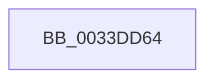

# sub_0033DD64

- RVA: `0x0033DD64`–`0x0033DD80` (길이 `28` bytes)
- VA: `0x000000014033DD64`
- 실행 섹션: `.text`
- PDB 이름 있음: `아니요`; PDB Function 태그: `아니요`
- unwind 정보 RVA: `0x000771E4`
- 디코드: `7`개 명령, `28/28` bytes 표시
- 미해석 바이트: `0` (있으면 어셈블리에 `.byte`로 보존)

> 이 문서는 커널 이미지의 기계어와 PDB 기호를 분석해 생성했습니다. 4번과 5번은 함수 원형과 자료형을 바이너리 사용 방식에서 추정한 C 해석이며 원본 소스 복구 결과는 아닙니다.

## 1. Dependencies

- 직접 호출 지점: **1**; 고유 호출 대상: **1**
- 직접 호출자로 확인된 함수: **0**
- RIP 상대 이미지 참조: **0**

### Outgoing calls
- `0x0033DD7A` → [KeBugCheckEx](../4F/KeBugCheckEx_function_004FD660.md) (function, `0x004FD660`)

### Direct callers
- 이 함수 시작 RVA로 연결되는 직접 call은 확인되지 않았습니다. 간접 호출은 완전히 역산할 수 없습니다.

### Static image references
- 디코드된 RIP-relative 메모리 참조가 없습니다.

## 2. Other-region calls and transfers

- 다른 실행 섹션으로 향하는 call: **0**
- 별도 외부 분기/꼬리 이동을 확인하지 못했습니다.

## 3. Assembly (complete function range)

```asm
0033DD64  4C 8B 89 00 49 00 00            mov r9, qword ptr [rcx + 0x4900]
0033DD6B  45 33 D2                        xor r10d, r10d
0033DD6E  4C 89 54 24 20                  mov qword ptr [rsp + 0x20], r10
0033DD73  41 8D 52 01                     lea edx, [r10 + 1]
0033DD77  8D 4A 4D                        lea ecx, [rdx + 0x4d]
0033DD7A  E8 E1 F8 1B 00                  call 0x1404fd660
0033DD7F  CC                              int3
```

## 4. C-style interpretation (structured pseudocode)

```c
__int64 __fastcall sub_0033DD64(__int64 a1)
{
    __int64 result;
    __int64 v_r10;
    unsigned __int64 v_stack_p20;

    v_r10 = 0;
    v_stack_p20 = 0;
    result = KeBugCheckEx(v_r10 + 1 + 77, v_r10 + 1, a3, *(unsigned __int64 *)(a1 + 18688));
    return result;
}
```

## 5. (Beta) C Style

```c
int64_t sub_0033DD64(void *Arg1)
{
    uint8_t *arg1 = (uint8_t *)Arg1;

    int64_t result;
    int64_t local_r10;
    uint64_t v_stack_p20;

    local_r10 = 0;
    v_stack_p20 = 0;
    result = KeBugCheckEx(local_r10 + 1 + 77, local_r10 + 1, a3, *(uint64_t *)(arg1 + 0x4900));
    return result;
}
```

### 관측된 메모리 오프셋

구조체 형식이 확인되지 않은 접근은 인자 기준의 오프셋으로만 기록했습니다.

| 기준 인자 | 오프셋 표현 | 폭 (bit) | 접근 |
|---|---:|---:|---|
| `Arg1` | `+ 0x4900` | `64` | `R` |

## 6. Execution-region graph

[열기: 2D/3D 그래프와 함수 탐색 컨트롤 패널](../../../control-panel.html?section=text&rva=0x0033DD64&view=graph)

- 2D 그래프는 위에서 아래로 흐르고, 3D 그래프는 빈 공간을 드래그해 회전합니다. Shift+드래그는 이동, 휠은 확대·축소, 함수 노드 선택은 대상 보고서 이동입니다.

### Static fallback


