# sub_0033E2D1

- RVA: `0x0033E2D1`–`0x0033E820` (길이 `1,359` bytes)
- VA: `0x000000014033E2D1`
- 실행 섹션: `.text`
- PDB 이름 있음: `아니요`; PDB Function 태그: `아니요`
- unwind 정보 RVA: `0x0007723C`
- 디코드: `298`개 명령, `1,359/1,359` bytes 표시
- 미해석 바이트: `0` (있으면 어셈블리에 `.byte`로 보존)

> 이 문서는 커널 이미지의 기계어와 PDB 기호를 분석해 생성했습니다. 4번과 5번은 함수 원형과 자료형을 바이너리 사용 방식에서 추정한 C 해석이며 원본 소스 복구 결과는 아닙니다.

## 1. Dependencies

- 직접 호출 지점: **4**; 고유 호출 대상: **4**
- 직접 호출자로 확인된 함수: **0**
- RIP 상대 이미지 참조: **5**

### Outgoing calls
- `0x0033E4CA` → [MiMapPageInHyperSpaceWorker](MiMapPageInHyperSpaceWorker_function_00332B10.md) (function, `0x00332B10`)
- `0x0033E61E` → [MiUpdateLargePageCandidateValue](MiUpdateLargePageCandidateValue_function_0033EF80.md) (function, `0x0033EF80`)
- `0x0033E6CD` → [MiSynchronizeFastPageInsert](../2B/MiSynchronizeFastPageInsert_function_002BAE80.md) (function, `0x002BAE80`)
- `0x0033E6E3` → [MiSharedInsertPfnChainInList](MiSharedInsertPfnChainInList_function_0033CA70.md) (function, `0x0033CA70`)

### Direct callers
- 이 함수 시작 RVA로 연결되는 직접 call은 확인되지 않았습니다. 간접 호출은 완전히 역산할 수 없습니다.

### Static image references
- `0x0033E30D` → RVA `0x00E30088` (`.data`; read)
- `0x0033E39B` → RVA `0x00FCF080` (`CACHEALI`; read)
- `0x0033E517` → RVA `0x00E2DC80` (`.data`; read)
- `0x0033E589` → RVA `0x00010880` (`.rdata`; read)
- `0x0033E7B2` → RVA `0x00FC6B06` (`ALMOSTRO`; read)

## 2. Other-region calls and transfers

- 다른 실행 섹션으로 향하는 call: **0**
- call이 아닌 외부 분기/꼬리 이동: **21**
  - `0x0033E341` → [sub_0033EA3A](Unknown_function_0033EA3A.md) (`tail-transfer`)
  - `0x0033E391` → [sub_0033EABD + 0x13](Unknown_function_0033EABD.md) (`tail-transfer`)
  - `0x0033E3B4` → [sub_0033EABD + 0x24](Unknown_function_0033EABD.md) (`tail-transfer`)
  - `0x0033E3BE` → [sub_0033EABD + 0x44](Unknown_function_0033EABD.md) (`tail-transfer`)
  - `0x0033E3DA` → [sub_0033EABD + 0x1EE](Unknown_function_0033EABD.md) (`tail-transfer`)
  - `0x0033E3EA` → [sub_0033EABD + 0x46A](Unknown_function_0033EABD.md) (`tail-transfer`)
  - `0x0033E3F7` → [sub_0033EABD + 0x46A](Unknown_function_0033EABD.md) (`tail-transfer`)
  - `0x0033E410` → [sub_0033EA4C + 0xD](Unknown_function_0033EA4C.md) (`tail-transfer`)
  - `0x0033E424` → [sub_0033EABD](Unknown_function_0033EABD.md) (`tail-transfer`)
  - `0x0033E43B` → [sub_0033E839 + 0xB0](Unknown_function_0033E839.md) (`tail-transfer`)
  - `0x0033E4A8` → [sub_0033E839 + 0x1AE](Unknown_function_0033E839.md) (`tail-transfer`)
  - `0x0033E50E` → [sub_0033EABD + 0x47E](Unknown_function_0033EABD.md) (`tail-transfer`)
  - `0x0033E538` → [sub_0033E839 + 0x5C](Unknown_function_0033E839.md) (`tail-transfer`)
  - `0x0033E54F` → [sub_0033E839 + 0x31](Unknown_function_0033E839.md) (`tail-transfer`)
  - `0x0033E64E` → [sub_0033E839](Unknown_function_0033E839.md) (`tail-transfer`)
  - `0x0033E67B` → [sub_0033E839 + 0x64](Unknown_function_0033E839.md) (`tail-transfer`)
  - `0x0033E683` → [sub_0033EA4C](Unknown_function_0033EA4C.md) (`tail-transfer`)
  - `0x0033E6D6` → [sub_0033EABD + 0xE9](Unknown_function_0033EABD.md) (`tail-transfer`)
  - `0x0033E746` → [sub_0033E839 + 0x27](Unknown_function_0033E839.md) (`tail-transfer`)
  - `0x0033E760` → [sub_0033EABD + 0x118](Unknown_function_0033EABD.md) (`tail-transfer`)
  - `0x0033E7BD` → [sub_0033EABD + 0x1D2](Unknown_function_0033EABD.md) (`tail-transfer`)

## 3. Assembly (complete function range)

```asm
0033E2D1  49 89 5B 10                     mov qword ptr [r11 + 0x10], rbx
0033E2D5  49 89 73 18                     mov qword ptr [r11 + 0x18], rsi
0033E2D9  48 89 44 24 78                  mov qword ptr [rsp + 0x78], rax
0033E2DE  48 8B 41 10                     mov rax, qword ptr [rcx + 0x10]
0033E2E2  4D 89 6B 20                     mov qword ptr [r11 + 0x20], r13
0033E2E6  4D 89 7B D8                     mov qword ptr [r11 - 0x28], r15
0033E2EA  48 BA 00 00 00 00 00 DE FF FF   movabs rdx, 0xffffde0000000000
0033E2F4  4C 8D 04 40                     lea r8, [rax + rax*2]
0033E2F8  49 C1 E0 04                     shl r8, 4
0033E2FC  48 8B C2                        mov rax, rdx
0033E2FF  49 8D 1C 00                     lea rbx, [r8 + rax]
0033E303  41 BB 05 00 00 00               mov r11d, 5
0033E309  48 8B 43 28                     mov rax, qword ptr [rbx + 0x28]
0033E30D  48 8B 0D 74 1D AF 00            mov rcx, qword ptr [rip + 0xaf1d74]
0033E314  44 8B 4B 20                     mov r9d, dword ptr [rbx + 0x20]
0033E318  48 C1 E8 2B                     shr rax, 0x2b
0033E31C  25 FF 03 00 00                  and eax, 0x3ff
0033E321  44 89 4C 24 34                  mov dword ptr [rsp + 0x34], r9d
0033E326  4C 8B 14 C1                     mov r10, qword ptr [rcx + rax*8]
0033E32A  48 B9 AB AA AA AA AA AA AA AA   movabs rcx, 0xaaaaaaaaaaaaaaab
0033E334  8B 43 20                        mov eax, dword ptr [rbx + 0x20]
0033E337  C1 E8 18                        shr eax, 0x18
0033E33A  4C 89 54 24 38                  mov qword ptr [rsp + 0x38], r10
0033E33F  A8 08                           test al, 8
0033E341  0F 85 F3 06 00 00               jne 0x14033ea3a
0033E347  0F B6 44 24 37                  movzx eax, byte ptr [rsp + 0x37]
0033E34C  83 E0 07                        and eax, 7
0033E34F  89 44 24 44                     mov dword ptr [rsp + 0x44], eax
0033E353  48 8B 73 28                     mov rsi, qword ptr [rbx + 0x28]
0033E357  49 8D 82 C0 4B 00 00            lea rax, [r10 + 0x4bc0]
0033E35E  44 0F B6 7B 22                  movzx r15d, byte ptr [rbx + 0x22]
0033E363  48 C1 EE 35                     shr rsi, 0x35
0033E367  83 E6 01                        and esi, 1
0033E36A  48 89 74 24 58                  mov qword ptr [rsp + 0x58], rsi
0033E36F  41 80 E7 10                     and r15b, 0x10
0033E373  75 07                           jne 0x14033e37c
0033E375  49 8D 82 40 0C 00 00            lea rax, [r10 + 0xc40]
0033E37C  4C 89 B4 24 28 01 00 00         mov qword ptr [rsp + 0x128], r14
0033E384  41 BE 04 00 00 00               mov r14d, 4
0033E38A  48 89 44 24 70                  mov qword ptr [rsp + 0x70], rax
0033E38F  85 F6                           test esi, esi
0033E391  0F 85 39 07 00 00               jne 0x14033ead0
0033E397  F0 09 34 24                     lock or dword ptr [rsp], esi
0033E39B  8B 0D DF 0C C9 00               mov ecx, dword ptr [rip + 0xc90cdf]
0033E3A1  33 D2                           xor edx, edx
0033E3A3  45 84 FF                        test r15b, r15b
0033E3A6  89 4C 24 34                     mov dword ptr [rsp + 0x34], ecx
0033E3AA  44 8B EA                        mov r13d, edx
0033E3AD  45 0F 44 EE                     cmove r13d, r14d
0033E3B1  41 8B C5                        mov eax, r13d
0033E3B4  0F 85 27 07 00 00               jne 0x14033eae1
0033E3BA  49 83 FC 01                     cmp r12, 1
0033E3BE  0F 85 3D 07 00 00               jne 0x14033eb01
0033E3C4  4D 8B F4                        mov r14, r12
0033E3C7  F0 4D 0F C1 B2 00 49 00 00      lock xadd qword ptr [r10 + 0x4900], r14
0033E3D0  49 FF C6                        inc r14
0033E3D3  49 81 FE 20 04 00 00            cmp r14, 0x420
0033E3DA  0F 86 CB 08 00 00               jbe 0x14033ecab
0033E3E0  49 FF CE                        dec r14
0033E3E3  4D 3B B2 00 41 00 00            cmp r14, qword ptr [r10 + 0x4100]
0033E3EA  0F 84 37 0B 00 00               je 0x14033ef27
0033E3F0  4D 3B B2 08 41 00 00            cmp r14, qword ptr [r10 + 0x4108]
0033E3F7  0F 84 2A 0B 00 00               je 0x14033ef27
0033E3FD  8B 4F 60                        mov ecx, dword ptr [rdi + 0x60]
0033E400  89 4C 24 40                     mov dword ptr [rsp + 0x40], ecx
0033E404  48 8B 43 28                     mov rax, qword ptr [rbx + 0x28]
0033E408  4C 8B 54 24 38                  mov r10, qword ptr [rsp + 0x38]
0033E40D  48 85 C0                        test rax, rax
0033E410  0F 89 43 06 00 00               jns 0x14033ea59
0033E416  F0 4D 01 A2 40 1C 00 00         lock add qword ptr [r10 + 0x1c40], r12
0033E41E  45 33 C0                        xor r8d, r8d
0033E421  45 85 ED                        test r13d, r13d
0033E424  0F 84 93 06 00 00               je 0x14033eabd
0033E42A  44 89 44 24 50                  mov dword ptr [rsp + 0x50], r8d
0033E42F  49 B9 FF FF FF FF FF 00 00 00   movabs r9, 0xffffffffff
0033E439  85 C9                           test ecx, ecx
0033E43B  0F 85 A8 04 00 00               jne 0x14033e8e9
0033E441  48 8B 47 10                     mov rax, qword ptr [rdi + 0x10]
0033E445  48 8D 1C 40                     lea rbx, [rax + rax*2]
0033E449  48 B8 00 00 00 00 00 DE FF FF   movabs rax, 0xffffde0000000000
0033E453  48 C1 E3 04                     shl rbx, 4
0033E457  48 8B C0                        mov rax, rax
0033E45A  48 03 D8                        add rbx, rax
0033E45D  49 BA FF FF FF FF FF 00 00 00   movabs r10, 0xffffffffff
0033E467  4C 8B DB                        mov r11, rbx
0033E46A  4D 8B C8                        mov r9, r8
0033E46D  4D 8B E8                        mov r13, r8
0033E470  48 8B 43 10                     mov rax, qword ptr [rbx + 0x10]
0033E474  48 8B 4B 28                     mov rcx, qword ptr [rbx + 0x28]
0033E478  48 C1 E8 05                     shr rax, 5
0033E47C  49 23 CA                        and rcx, r10
0033E47F  48 89 45 80                     mov qword ptr [rbp - 0x80], rax
0033E483  48 89 4C 24 58                  mov qword ptr [rsp + 0x58], rcx
0033E488  4C 89 5C 24 48                  mov qword ptr [rsp + 0x48], r11
0033E48D  4D 3B EC                        cmp r13, r12
0033E490  0F 83 BF 00 00 00               jae 0x14033e555
0033E496  4D 8B 73 08                     mov r14, qword ptr [r11 + 8]
0033E49A  41 C1 EE 03                     shr r14d, 3
0033E49E  41 81 E6 FF 01 00 00            and r14d, 0x1ff
0033E4A5  4D 85 ED                        test r13, r13
0033E4A8  0F 85 39 05 00 00               jne 0x14033e9e7
0033E4AE  4D 85 C9                        test r9, r9
0033E4B1  75 24                           jne 0x14033e4d7
0033E4B3  49 8B 43 28                     mov rax, qword ptr [r11 + 0x28]
0033E4B7  33 D2                           xor edx, edx
0033E4B9  49 23 C2                        and rax, r10
0033E4BC  41 B8 00 00 00 80               mov r8d, 0x80000000
0033E4C2  48 8B C8                        mov rcx, rax
0033E4C5  48 89 44 24 58                  mov qword ptr [rsp + 0x58], rax
0033E4CA  E8 41 46 FF FF                  call 0x140332b10
0033E4CF  4C 8B 5C 24 48                  mov r11, qword ptr [rsp + 0x48]
0033E4D4  4C 8B C8                        mov r9, rax
0033E4D7  4B 8B 0C F1                     mov rcx, qword ptr [r9 + r14*8]
0033E4DB  4F 8D 14 F1                     lea r10, [r9 + r14*8]
0033E4DF  49 BE FF FF FF FF FF 00 00 00   movabs r14, 0xffffffffff
0033E4E9  4C 8B C1                        mov r8, rcx
0033E4EC  49 C1 E8 0C                     shr r8, 0xc
0033E4F0  4D 23 C6                        and r8, r14
0033E4F3  49 BE 00 00 00 00 00 DE FF FF   movabs r14, 0xffffde0000000000
0033E4FD  4B 8D 14 40                     lea rdx, [r8 + r8*2]
0033E501  48 C1 E2 04                     shl rdx, 4
0033E505  49 8B C6                        mov rax, r14
0033E508  48 03 D0                        add rdx, rax
0033E50B  49 3B D3                        cmp rdx, r11
0033E50E  0F 85 27 0A 00 00               jne 0x14033ef3b
0033E514  8B 45 80                        mov eax, dword ptr [rbp - 0x80]
0033E517  48 8B 15 62 F7 AE 00            mov rdx, qword ptr [rip + 0xaef762]
0033E51E  83 E0 1F                        and eax, 0x1f
0033E521  49 C1 E0 07                     shl r8, 7
0033E525  49 0B C0                        or rax, r8
0033E528  48 83 C8 40                     or rax, 0x40
0033E52C  48 C1 E0 05                     shl rax, 5
0033E530  48 85 D2                        test rdx, rdx
0033E533  74 0D                           je 0x14033e542
0033E535  48 85 C2                        test rdx, rax
0033E538  0F 84 57 03 00 00               je 0x14033e895
0033E53E  48 83 C8 10                     or rax, 0x10
0033E542  49 89 02                        mov qword ptr [r10], rax
0033E545  49 8D 45 01                     lea rax, [r13 + 1]
0033E549  4C 8B E8                        mov r13, rax
0033E54C  49 3B C4                        cmp rax, r12
0033E54F  0F 85 15 03 00 00               jne 0x14033e86a
0033E555  48 B8 F8 FF FF FF 7F 00 00 00   movabs rax, 0x7ffffffff8
0033E55F  49 C1 E9 09                     shr r9, 9
0033E563  4C 23 C8                        and r9, rax
0033E566  48 B8 00 00 00 00 80 F6 FF FF   movabs rax, 0xfffff68000000000
0033E570  48 8B C0                        mov rax, rax
0033E573  4C 03 C8                        add r9, rax
0033E576  65 48 8B 04 25 20 00 00 00      mov rax, qword ptr gs:[0x20]
0033E57F  45 33 ED                        xor r13d, r13d
0033E582  48 8B 88 38 88 00 00            mov rcx, qword ptr [rax + 0x8838]
0033E589  48 8B 05 F0 22 CD FF            mov rax, qword ptr [rip - 0x32dd10]
0033E590  4C 89 29                        mov qword ptr [rcx], r13
0033E593  49 89 01                        mov qword ptr [r9], rax
0033E596  49 B9 FF FF FF FF FF 00 00 00   movabs r9, 0xffffffffff
0033E5A0  48 8B 57 10                     mov rdx, qword ptr [rdi + 0x10]
0033E5A4  49 B8 FF FF FF FF 3F 00 00 00   movabs r8, 0x3fffffffff
0033E5AE  49 3B D0                        cmp rdx, r8
0033E5B1  0F 84 C1 00 00 00               je 0x14033e678
0033E5B7  4C 8B 64 24 38                  mov r12, qword ptr [rsp + 0x38]
0033E5BC  49 BA FF FF FF FF FF FF FF C7   movabs r10, 0xc7ffffffffffffff
0033E5C6  44 8B 74 24 34                  mov r14d, dword ptr [rsp + 0x34]
0033E5CB  0F 1F 44 00 00                  nop dword ptr [rax + rax]
0033E5D0  48 8D 1C 52                     lea rbx, [rdx + rdx*2]
0033E5D4  48 B8 00 00 00 00 00 DE FF FF   movabs rax, 0xffffde0000000000
0033E5DE  48 C1 E3 04                     shl rbx, 4
0033E5E2  48 8B C0                        mov rax, rax
0033E5E5  48 03 D8                        add rbx, rax
0033E5E8  48 8B 3B                        mov rdi, qword ptr [rbx]
0033E5EB  49 23 F9                        and rdi, r9
0033E5EE  85 F6                           test esi, esi
0033E5F0  75 4F                           jne 0x14033e641
0033E5F2  48 8B 43 18                     mov rax, qword ptr [rbx + 0x18]
0033E5F6  41 B9 03 00 00 00               mov r9d, 3
0033E5FC  4D 8B C6                        mov r8, r14
0033E5FF  4C 89 6C 24 20                  mov qword ptr [rsp + 0x20], r13
0033E604  49 C1 E0 3B                     shl r8, 0x3b
0033E608  49 8B C8                        mov rcx, r8
0033E60B  48 33 C8                        xor rcx, rax
0033E60E  49 23 CA                        and rcx, r10
0033E611  49 33 C8                        xor rcx, r8
0033E614  45 8B C1                        mov r8d, r9d
0033E617  48 89 4B 18                     mov qword ptr [rbx + 0x18], rcx
0033E61B  49 8B CC                        mov rcx, r12
0033E61E  E8 5D 09 00 00                  call 0x14033ef80
0033E623  49 B8 FF FF FF FF 3F 00 00 00   movabs r8, 0x3fffffffff
0033E62D  49 B9 FF FF FF FF FF 00 00 00   movabs r9, 0xffffffffff
0033E637  49 BA FF FF FF FF FF FF FF C7   movabs r10, 0xc7ffffffffffffff
0033E641  8B 43 20                        mov eax, dword ptr [rbx + 0x20]
0033E644  89 44 24 34                     mov dword ptr [rsp + 0x34], eax
0033E648  C1 E8 10                        shr eax, 0x10
0033E64B  45 84 FF                        test r15b, r15b
0033E64E  0F 85 E5 01 00 00               jne 0x14033e839
0033E654  24 FA                           and al, 0xfa
0033E656  0C 02                           or al, 2
0033E658  88 44 24 36                     mov byte ptr [rsp + 0x36], al
0033E65C  8B 44 24 34                     mov eax, dword ptr [rsp + 0x34]
0033E660  89 43 20                        mov dword ptr [rbx + 0x20], eax
0033E663  48 8B D7                        mov rdx, rdi
0033E666  49 3B F8                        cmp rdi, r8
0033E669  0F 85 61 FF FF FF               jne 0x14033e5d0
0033E66F  4C 8B 65 88                     mov r12, qword ptr [rbp - 0x78]
0033E673  48 8B 7C 24 68                  mov rdi, qword ptr [rsp + 0x68]
0033E678  45 84 FF                        test r15b, r15b
0033E67B  0F 85 1C 02 00 00               jne 0x14033e89d
0033E681  85 F6                           test esi, esi
0033E683  0F 85 C3 03 00 00               jne 0x14033ea4c
0033E689  8B 44 24 44                     mov eax, dword ptr [rsp + 0x44]
0033E68D  B9 05 00 00 00                  mov ecx, 5
0033E692  4C 8B 74 24 78                  mov r14, qword ptr [rsp + 0x78]
0033E697  41 B9 09 00 00 00               mov r9d, 9
0033E69D  48 8B 74 24 38                  mov rsi, qword ptr [rsp + 0x38]
0033E6A2  4D 85 F6                        test r14, r14
0033E6A5  4C 8B C3                        mov r8, rbx
0033E6A8  0F 45 C1                        cmovne eax, ecx
0033E6AB  48 6B C8 58                     imul rcx, rax, 0x58
0033E6AF  48 8D 45 A0                     lea rax, [rbp - 0x60]
0033E6B3  48 89 44 24 28                  mov qword ptr [rsp + 0x28], rax
0033E6B8  4C 8D BE C0 0C 00 00            lea r15, [rsi + 0xcc0]
0033E6BF  4C 03 F9                        add r15, rcx
0033E6C2  4C 89 74 24 20                  mov qword ptr [rsp + 0x20], r14
0033E6C7  49 8B D7                        mov rdx, r15
0033E6CA  48 8B CE                        mov rcx, rsi
0033E6CD  E8 AE C7 F7 FF                  call 0x1402bae80
0033E6D2  80 7D A0 00                     cmp byte ptr [rbp - 0x60], 0
0033E6D6  0F 84 CA 04 00 00               je 0x14033eba6
0033E6DC  48 8D 55 A0                     lea rdx, [rbp - 0x60]
0033E6E0  48 8B CF                        mov rcx, rdi
0033E6E3  E8 88 E3 FF FF                  call 0x14033ca70
0033E6E8  F0 4D 01 27                     lock add qword ptr [r15], r12
0033E6EC  41 B0 01                        mov r8b, 1
0033E6EF  8B 5C 24 40                     mov ebx, dword ptr [rsp + 0x40]
0033E6F3  49 B9 FF FF FF FF FF FF FF 7F   movabs r9, 0x7fffffffffffffff
0033E6FD  83 FB 03                        cmp ebx, 3
0033E700  74 55                           je 0x14033e757
0033E702  48 8B 47 10                     mov rax, qword ptr [rdi + 0x10]
0033E706  49 BE FF FF FF FF FF 00 00 00   movabs r14, 0xffffffffff
0033E710  8B 54 24 60                     mov edx, dword ptr [rsp + 0x60]
0033E714  0F 1F 40 00                     nop dword ptr [rax]
0033E718  0F 1F 84 00 00 00 00 00         nop dword ptr [rax + rax]
0033E720  48 8D 0C 40                     lea rcx, [rax + rax*2]
0033E724  48 B8 00 00 00 00 00 DE FF FF   movabs rax, 0xffffde0000000000
0033E72E  48 C1 E1 04                     shl rcx, 4
0033E732  48 8B C0                        mov rax, rax
0033E735  48 03 C8                        add rcx, rax
0033E738  48 8B 01                        mov rax, qword ptr [rcx]
0033E73B  49 23 C6                        and rax, r14
0033E73E  85 D2                           test edx, edx
0033E740  75 0A                           jne 0x14033e74c
0033E742  49 83 FC 01                     cmp r12, 1
0033E746  0F 84 14 01 00 00               je 0x14033e860
0033E74C  F0 4C 21 49 18                  lock and qword ptr [rcx + 0x18], r9
0033E751  49 83 EC 01                     sub r12, 1
0033E755  75 C9                           jne 0x14033e720
0033E757  45 84 C0                        test r8b, r8b
0033E75A  74 71                           je 0x14033e7cd
0033E75C  80 7D A0 00                     cmp byte ptr [rbp - 0x60], 0
0033E760  0F 84 6F 04 00 00               je 0x14033ebd5
0033E766  80 7D B8 00                     cmp byte ptr [rbp - 0x48], 0
0033E76A  74 0D                           je 0x14033e779
0033E76C  48 8B 45 B0                     mov rax, qword ptr [rbp - 0x50]
0033E770  F0 4C 21 48 18                  lock and qword ptr [rax + 0x18], r9
0033E775  C6 45 B8 00                     mov byte ptr [rbp - 0x48], 0
0033E779  80 7D D0 00                     cmp byte ptr [rbp - 0x30], 0
0033E77D  74 0D                           je 0x14033e78c
0033E77F  48 8B 45 C8                     mov rax, qword ptr [rbp - 0x38]
0033E783  F0 4C 21 48 18                  lock and qword ptr [rax + 0x18], r9
0033E788  C6 45 D0 00                     mov byte ptr [rbp - 0x30], 0
0033E78C  80 7D E8 00                     cmp byte ptr [rbp - 0x18], 0
0033E790  74 0D                           je 0x14033e79f
0033E792  48 8B 45 E0                     mov rax, qword ptr [rbp - 0x20]
0033E796  F0 4C 21 48 18                  lock and qword ptr [rax + 0x18], r9
0033E79B  C6 45 E8 00                     mov byte ptr [rbp - 0x18], 0
0033E79F  80 7D 00 00                     cmp byte ptr [rbp], 0
0033E7A3  74 0D                           je 0x14033e7b2
0033E7A5  48 8B 45 F8                     mov rax, qword ptr [rbp - 8]
0033E7A9  F0 4C 21 48 18                  lock and qword ptr [rax + 0x18], r9
0033E7AE  C6 45 00 00                     mov byte ptr [rbp], 0
0033E7B2  F6 05 4D 83 C8 00 01            test byte ptr [rip + 0xc8834d], 1
0033E7B9  49 8D 4F 20                     lea rcx, [r15 + 0x20]
0033E7BD  0F 85 CC 04 00 00               jne 0x14033ec8f
0033E7C3  F0 81 21 FF FF FF BF            lock and dword ptr [rcx], 0xbfffffff
0033E7CA  F0 FF 09                        lock dec dword ptr [rcx]
0033E7CD  8B 47 60                        mov eax, dword ptr [rdi + 0x60]
0033E7D0  48 BA FF FF FF FF 3F 00 00 00   movabs rdx, 0x3fffffffff
0033E7DA  48 8B 4F 58                     mov rcx, qword ptr [rdi + 0x58]
0033E7DE  4C 8B B4 24 28 01 00 00         mov r14, qword ptr [rsp + 0x128]
0033E7E6  48 8B B4 24 60 01 00 00         mov rsi, qword ptr [rsp + 0x160]
0033E7EE  48 8B 9C 24 58 01 00 00         mov rbx, qword ptr [rsp + 0x158]
0033E7F6  4C 8B BC 24 20 01 00 00         mov r15, qword ptr [rsp + 0x120]
0033E7FE  4C 89 2F                        mov qword ptr [rdi], r13
0033E801  44 89 6F 0C                     mov dword ptr [rdi + 0xc], r13d
0033E805  48 89 57 10                     mov qword ptr [rdi + 0x10], rdx
0033E809  48 89 57 18                     mov qword ptr [rdi + 0x18], rdx
0033E80D  44 89 6F 20                     mov dword ptr [rdi + 0x20], r13d
0033E811  4C 8B AC 24 68 01 00 00         mov r13, qword ptr [rsp + 0x168]
0033E819  89 47 60                        mov dword ptr [rdi + 0x60], eax
0033E81C  48 89 4F 58                     mov qword ptr [rdi + 0x58], rcx
```

## 4. C-style interpretation (structured pseudocode)

```c
__int64 __fastcall sub_0033E2D1(__int64 a1, __int64 a2, __int64 a3, __int64 a4, __int64 a5, __int64 a6, __int64 a7, unsigned int a8, __int64 a9, __int64 a10, __int64 a11, unsigned int a12, __int64 a13, __int64 a14, __int64 a15, __int64 a16, __int64 a17, __int64 a18, __int64 a19, __int64 a20, __int64 a21, __int64 a22, __int64 a23, __int64 a24, __int64 a25, __int64 a26, __int64 a27, __int64 a28, __int64 a29, __int64 a30, __int64 a31, __int64 a32, __int64 a33, __int64 a34, __int64 a35, __int64 a36, __int64 a37, __int64 a38, __int64 a39, __int64 a40, __int64 a41, __int64 a42, __int64 a43, __int64 a44, __int64 a45)
{
    __int64 result;
    __int64 v_r11;
    __int64 v_r12;
    __int64 v_r13;
    __int64 v_r14;
    __int64 v_r15;
    __int64 v_rbx;
    __int64 v_rdi;
    __int64 v_rsi;
    unsigned int v_stack_p0;
    unsigned __int64 v_stack_p128;
    unsigned __int64 v_stack_p20;
    unsigned __int64 v_stack_p28;
    unsigned int v_stack_p34;
    unsigned __int8 v_stack_p36;
    unsigned __int8 v_stack_p37;
    unsigned __int64 v_stack_p38;
    unsigned int v_stack_p40;
    unsigned int v_stack_p44;
    unsigned __int64 v_stack_p48;
    unsigned int v_stack_p50;
    unsigned __int64 v_stack_p58;
    unsigned __int64 v_stack_p70;
    unsigned __int64 v_stack_p78;

    *(unsigned __int64 *)(v_r11 + 16) = v_rbx;
    *(unsigned __int64 *)(v_r11 + 24) = v_rsi;
    v_stack_p78 = result;
    *(unsigned __int64 *)(v_r11 + 32) = v_r13;
    *(unsigned __int64 *)(v_r11 - 40) = v_r15;
    a3 = (*(unsigned __int64 *)(a1 + 16) + *(unsigned __int64 *)(a1 + 16) * 2) << (4);
    result = (*(unsigned __int64 *)(a3 + a2 * 1 + 40)) >> (43);
    result = (unsigned int)((result) & (0x3FFULL));
    v_stack_p34 = (unsigned int)((unsigned int)(*(unsigned int *)(a3 + a2 * 1 + 32)));
    result = (unsigned int)(((unsigned int)(*(unsigned int *)(a3 + a2 * 1 + 32))) >> (24));
    v_stack_p38 = *(unsigned __int64 *)(*(unsigned __int64 *)(v_rip + 11476340) + result * 8);
    result = (unsigned int)((v_stack_p37) & (7));
    v_stack_p44 = (unsigned int)(result);
    v_rsi = (*(unsigned __int64 *)(a3 + a2 * 1 + 40)) >> (53);
    v_rsi = (unsigned int)((v_rsi) & (1));
    v_stack_p58 = v_rsi;
    v_r15 = (unsigned __int8)((*(unsigned __int8 *)(a3 + a2 * 1 + 34)) & (16));
    result = *(unsigned __int64 *)(*(unsigned __int64 *)(v_rip + 11476340) + result * 8) + 19392;
    if (!(condition_is_not_equal)) {
        result = *(unsigned __int64 *)(*(unsigned __int64 *)(v_rip + 11476340) + result * 8) + 3136;
    }
    v_stack_p128 = v_r14;
    v_stack_p70 = result;
    a2 = 0;
    v_stack_p34 = (unsigned int)((unsigned int)(*(unsigned int *)(v_rip + 13176031)));
    v_r13 = 0;
    if ((unsigned __int8)(v_r15) == 0) { v_r13 = 4; }
    v_r14 = (v_r12) + 1;
    v_r14 = (v_r14) - 1;
    v_stack_p40 = (unsigned int)((unsigned int)(*(unsigned int *)(v_rdi + 96)));
    a3 = 0;
    v_stack_p50 = 0;
    v_rbx = (*(unsigned __int64 *)(v_rdi + 16) + *(unsigned __int64 *)(v_rdi + 16) * 2) << (4);
    v_rbx = (v_rbx) + (*(unsigned __int64 *)(v_rdi + 16));
    result = (*(unsigned __int64 *)(v_rbx + 16)) >> (5);
    a1 = (*(unsigned __int64 *)(v_rbx + 40)) & (a7);
    *(unsigned __int64 *)(v_rbp - 128) = result;
    v_stack_p58 = a1;
    v_stack_p48 = v_rbx;
    if (0 >= v_r12) goto loc_0033E555;
    v_r14 = (unsigned int)((*(unsigned __int64 *)(v_rbx + 8)) >> (3));
    v_r14 = (unsigned int)((v_r14) & (511));
    v_r11 = v_rbx;
    if (0 == 0) {
        result = *(unsigned __int64 *)(v_rbx + 40);
        a2 = 0;
        result = (result) & (a7);
        a3 = 0x80000000ULL;
        a1 = result;
        v_stack_p58 = result;
        result = MiMapPageInHyperSpaceWorker(a1, a2, a3, 0);
        v_r11 = a9;
        a4 = result;
    }
    a3 = (*(unsigned __int64 *)(a4 + v_r14 * 8)) >> (12);
    a3 = (a3) & (v_r14);
    a2 = (a3 + a3 * 2) << (4);
    a2 = (a2) + (v_r14);
    result = (unsigned int)(((unsigned int)(*(unsigned int *)(v_rbp - 128))) & (31));
    a3 = (a3) << (7);
    result = (result) | (a3);
    result = (result) | (64);
    result = (result) << (5);
    if (*(unsigned __int64 *)(v_rip + 11466594) == 0) goto loc_0033E542;
    result = (result) | (16);
loc_0033E542:
    *(unsigned __int64 *)(a4 + v_r14 * 8) = result;
loc_0033E555:
    a4 = (a4) >> (9);
    a4 = (a4) & (0 + 1);
    a4 = (a4) + (0 + 1);
    v_r13 = 0;
    *(unsigned __int64 *)(*(unsigned __int64 *)(*(unsigned __int64 *)(gs_base + (0 + 32)) + 34872)) = 0;
    *(unsigned __int64 *)(a4) = *(unsigned __int64 *)(v_rip - 3333392);
    if ((*(unsigned __int64 *)(v_rdi + 16)) == a3) goto loc_0033E678;
loc_0033E5D0:
    v_rbx = (*(unsigned __int64 *)(v_rdi + 16) + *(unsigned __int64 *)(v_rdi + 16) * 2) << (4);
    v_rbx = (v_rbx) + (*(unsigned __int64 *)(v_rip - 3333392));
    v_rdi = (*(unsigned __int64 *)(v_rbx)) & (a4);
    result = *(unsigned __int64 *)(v_rip - 3333392);
    if ((unsigned int)(v_rsi) == 0) {
        result = *(unsigned __int64 *)(v_rbx + 24);
        a4 = 3;
        a3 = (unsigned int)(v_stack_p34);
        v_stack_p20 = 0;
        a3 = (a3) << (59);
        a1 = a3;
        a1 = (a1) ^ (result);
        a1 = (a1) & (a4 + v_r14 * 8);
        a1 = (a1) ^ (a3);
        a3 = (unsigned int)(a4);
        *(unsigned __int64 *)(v_rbx + 24) = a1;
        a1 = a7;
        result = MiUpdateLargePageCandidateValue(a1, *(unsigned __int64 *)(v_rdi + 16), a3, a4);
    }
    v_stack_p34 = (unsigned int)((unsigned int)(*(unsigned int *)(v_rbx + 32)));
    result = (unsigned int)(((unsigned int)(*(unsigned int *)(v_rbx + 32))) >> (16));
    result = (unsigned __int8)((result) & (250));
    result = (unsigned __int8)((result) | (2));
    v_stack_p36 = (unsigned __int8)(result);
    *(unsigned int *)(v_rbx + 32) = (unsigned int)((unsigned int)(v_stack_p34));
    if (v_rdi != a3) goto loc_0033E5D0;
loc_0033E678:
    result = (unsigned int)(v_stack_p44);
    if (a15 != 0) { result = 5; }
    a1 = (5) * (result);
    v_stack_p28 = v_rbp - 96;
    v_r15 = (a7 + 3264) + (a1);
    v_stack_p20 = a15;
    result = MiSynchronizeFastPageInsert(a7, v_r15, v_rbx, 9);
    result = MiSharedInsertPfnChainInList(a13, v_rbp - 96, v_rbx, 9);
    if (((unsigned int)((unsigned int)(a8))) == 3) goto loc_0033E757;
loc_0033E720:
    a1 = (*(unsigned __int64 *)(a13 + 16) + *(unsigned __int64 *)(a13 + 16) * 2) << (4);
    a1 = (a1) + (*(unsigned __int64 *)(a13 + 16));
    result = (*(unsigned __int64 *)(a1)) & (a15);
    if ((unsigned int)((unsigned int)(a12)) != 0) goto loc_0033E74C;
loc_0033E74C:
    v_r12 = (*(unsigned __int64 *)(v_rbp - 120)) - (1);
    if (condition_is_not_equal) goto loc_0033E720;
loc_0033E757:
    if (1 == 0) goto loc_0033E7CD;
    if ((*(unsigned __int8 *)(v_rbp - 72)) != 0) {
        result = *(unsigned __int64 *)(v_rbp - 80);
        *(unsigned __int8 *)(v_rbp - 72) = 0;
    }
    if ((*(unsigned __int8 *)(v_rbp - 48)) != 0) {
        result = *(unsigned __int64 *)(v_rbp - 56);
        *(unsigned __int8 *)(v_rbp - 48) = 0;
    }
    if ((*(unsigned __int8 *)(v_rbp - 24)) != 0) {
        result = *(unsigned __int64 *)(v_rbp - 32);
        *(unsigned __int8 *)(v_rbp - 24) = 0;
    }
    if ((*(unsigned __int8 *)(v_rbp)) != 0) {
        result = *(unsigned __int64 *)(v_rbp - 8);
        *(unsigned __int8 *)(v_rbp) = 0;
    }
loc_0033E7CD:
    *(unsigned __int64 *)(a13) = 0;
    *(unsigned int *)(a13 + 12) = 0;
    *(unsigned __int64 *)(a13 + 16) = (unsigned int)(a12);
    *(unsigned __int64 *)(a13 + 24) = (unsigned int)(a12);
    *(unsigned int *)(a13 + 32) = 0;
    *(unsigned int *)(a13 + 96) = (unsigned int)((unsigned int)(*(unsigned int *)(a13 + 96)));
    *(unsigned __int64 *)(a13 + 88) = *(unsigned __int64 *)(a13 + 88);
    return (unsigned int)(*(unsigned int *)(a13 + 96));
}
```

## 5. (Beta) C Style

```c
int64_t sub_0033E2D1(void *Arg1, int64_t Arg2, int64_t Arg3, int64_t Arg4, uint64_t Arg5, uint64_t Arg6, void *Arg7, uint32_t Arg8, int64_t Arg9, uint64_t Arg10, uint64_t Arg11, uint32_t Arg12, int64_t Arg13, uint64_t Arg14, int64_t Arg15, uint64_t Arg16, uint64_t Arg17, uint64_t Arg18, uint64_t Arg19, uint64_t Arg20, uint64_t Arg21, uint64_t Arg22, uint64_t Arg23, uint64_t Arg24, uint64_t Arg25, uint64_t Arg26, uint64_t Arg27, uint64_t Arg28, uint64_t Arg29, uint64_t Arg30, uint64_t Arg31, uint64_t Arg32, uint64_t Arg33, uint64_t Arg34, uint64_t Arg35, int64_t Arg36, int64_t Arg37, uint64_t Arg38, uint64_t Arg39, uint64_t Arg40, uint64_t Arg41, uint64_t Arg42, int64_t Arg43, int64_t Arg44, int64_t Arg45)
{
    uint8_t *arg1 = (uint8_t *)Arg1;
    uint8_t *arg7 = (uint8_t *)Arg7;

    int64_t result;
    int64_t local_r11;
    int64_t local_r12;
    int64_t local_r13;
    int64_t local_r14;
    int64_t local_r15;
    int64_t local_rbx;
    int64_t local_rdi;
    int64_t local_rsi;
    uint32_t v_stack_p0;
    uint64_t v_stack_p128;
    uint64_t v_stack_p20;
    uint64_t v_stack_p28;
    uint32_t v_stack_p34;
    uint8_t v_stack_p36;
    uint8_t v_stack_p37;
    uint64_t v_stack_p38;
    uint32_t v_stack_p40;
    uint32_t v_stack_p44;
    uint64_t v_stack_p48;
    uint32_t v_stack_p50;
    uint64_t v_stack_p58;
    uint64_t v_stack_p70;
    uint64_t v_stack_p78;

    *(uint64_t *)(local_r11 + 0x10) = local_rbx;
    *(uint64_t *)(local_r11 + 0x18) = local_rsi;
    v_stack_p78 = result;
    *(uint64_t *)(local_r11 + 0x20) = local_r13;
    *(uint64_t *)(local_r11 - 0x28) = local_r15;
    Arg3 = (*(uint64_t *)(arg1 + 0x10) + *(uint64_t *)(arg1 + 0x10) * 2) << (4);
    result = (*(uint64_t *)(Arg3 + Arg2 * 1 + 0x28)) >> (43);
    result = (uint32_t)((result) & (0x3FFULL));
    v_stack_p34 = (uint32_t)((uint32_t)(*(uint32_t *)(Arg3 + Arg2 * 1 + 0x20)));
    result = (uint32_t)(((uint32_t)(*(uint32_t *)(Arg3 + Arg2 * 1 + 0x20))) >> (24));
    v_stack_p38 = *(uint64_t *)(*(uint64_t *)(v_rip + 0xAF1D74) + result * 8);
    result = (uint32_t)((v_stack_p37) & (7));
    v_stack_p44 = (uint32_t)(result);
    local_rsi = (*(uint64_t *)(Arg3 + Arg2 * 1 + 0x28)) >> (53);
    local_rsi = (uint32_t)((local_rsi) & (1));
    v_stack_p58 = local_rsi;
    local_r15 = (uint8_t)((*(uint8_t *)(Arg3 + Arg2 * 1 + 0x22)) & (16));
    result = *(uint64_t *)(*(uint64_t *)(v_rip + 0xAF1D74) + result * 8) + 19392;
    if (!(condition_is_not_equal)) {
        result = *(uint64_t *)(*(uint64_t *)(v_rip + 0xAF1D74) + result * 8) + 3136;
    }
    v_stack_p128 = local_r14;
    v_stack_p70 = result;
    Arg2 = 0;
    v_stack_p34 = (uint32_t)((uint32_t)(*(uint32_t *)(v_rip + 0xC90CDF)));
    local_r13 = 0;
    if ((uint8_t)(local_r15) == 0) { local_r13 = 4; }
    local_r14 = (local_r12) + 1;
    local_r14 = (local_r14) - 1;
    v_stack_p40 = (uint32_t)((uint32_t)(*(uint32_t *)(local_rdi + 0x60)));
    Arg3 = 0;
    v_stack_p50 = 0;
    local_rbx = (*(uint64_t *)(local_rdi + 0x10) + *(uint64_t *)(local_rdi + 0x10) * 2) << (4);
    local_rbx = (local_rbx) + (*(uint64_t *)(local_rdi + 0x10));
    result = (*(uint64_t *)(local_rbx + 0x10)) >> (5);
    Arg1 = (*(uint64_t *)(local_rbx + 0x28)) & (Arg7);
    *(uint64_t *)(local_rbp - 0x80) = result;
    v_stack_p58 = Arg1;
    v_stack_p48 = local_rbx;
    if (0 >= local_r12) goto loc_0033E555;
    local_r14 = (uint32_t)((*(uint64_t *)(local_rbx + 0x8)) >> (3));
    local_r14 = (uint32_t)((local_r14) & (511));
    local_r11 = local_rbx;
    if (0 == 0) {
        result = *(uint64_t *)(local_rbx + 0x28);
        Arg2 = 0;
        result = (result) & (Arg7);
        Arg3 = 0x80000000ULL;
        Arg1 = result;
        v_stack_p58 = result;
        result = MiMapPageInHyperSpaceWorker(Arg1, Arg2, Arg3, 0);
        local_r11 = Arg9;
        Arg4 = result;
    }
    Arg3 = (*(uint64_t *)(Arg4 + local_r14 * 8)) >> (12);
    Arg3 = (Arg3) & (local_r14);
    Arg2 = (Arg3 + Arg3 * 2) << (4);
    Arg2 = (Arg2) + (local_r14);
    result = (uint32_t)(((uint32_t)(*(uint32_t *)(local_rbp - 0x80))) & (31));
    Arg3 = (Arg3) << (7);
    result = (result) | (Arg3);
    result = (result) | (64);
    result = (result) << (5);
    if (*(uint64_t *)(v_rip + 0xAEF762) == 0) goto loc_0033E542;
    result = (result) | (16);
loc_0033E542:
    *(uint64_t *)(Arg4 + local_r14 * 8) = result;
loc_0033E555:
    Arg4 = (Arg4) >> (9);
    Arg4 = (Arg4) & (0 + 1);
    Arg4 = (Arg4) + (0 + 1);
    local_r13 = 0;
    *(uint64_t *)(*(uint64_t *)(*(uint64_t *)(gs_base + (0 + 0x20)) + 0x8838)) = 0;
    *(uint64_t *)(Arg4) = *(uint64_t *)(v_rip - 0x32DD10);
    if ((*(uint64_t *)(local_rdi + 0x10)) == Arg3) goto loc_0033E678;
loc_0033E5D0:
    local_rbx = (*(uint64_t *)(local_rdi + 0x10) + *(uint64_t *)(local_rdi + 0x10) * 2) << (4);
    local_rbx = (local_rbx) + (*(uint64_t *)(v_rip - 0x32DD10));
    local_rdi = (*(uint64_t *)(local_rbx)) & (Arg4);
    result = *(uint64_t *)(v_rip - 0x32DD10);
    if ((uint32_t)(local_rsi) == 0) {
        result = *(uint64_t *)(local_rbx + 0x18);
        Arg4 = 3;
        Arg3 = (uint32_t)(v_stack_p34);
        v_stack_p20 = 0;
        Arg3 = (Arg3) << (59);
        Arg1 = Arg3;
        Arg1 = (Arg1) ^ (result);
        Arg1 = (Arg1) & (Arg4 + local_r14 * 8);
        Arg1 = (Arg1) ^ (Arg3);
        Arg3 = (uint32_t)(Arg4);
        *(void **)(local_rbx + 0x18) = Arg1;
        Arg1 = Arg7;
        result = MiUpdateLargePageCandidateValue(Arg1, *(uint64_t *)(local_rdi + 0x10), Arg3, Arg4);
    }
    v_stack_p34 = (uint32_t)((uint32_t)(*(uint32_t *)(local_rbx + 0x20)));
    result = (uint32_t)(((uint32_t)(*(uint32_t *)(local_rbx + 0x20))) >> (16));
    result = (uint8_t)((result) & (250));
    result = (uint8_t)((result) | (2));
    v_stack_p36 = (uint8_t)(result);
    *(uint32_t *)(local_rbx + 0x20) = (uint32_t)((uint32_t)(v_stack_p34));
    if (local_rdi != Arg3) goto loc_0033E5D0;
loc_0033E678:
    result = (uint32_t)(v_stack_p44);
    if (Arg15 != 0) { result = 5; }
    Arg1 = (5) * (result);
    v_stack_p28 = local_rbp - 96;
    local_r15 = (Arg7 + 3264) + (Arg1);
    v_stack_p20 = Arg15;
    result = MiSynchronizeFastPageInsert(Arg7, local_r15, local_rbx, 9);
    result = MiSharedInsertPfnChainInList(Arg13, local_rbp - 96, local_rbx, 9);
    if (((uint32_t)((uint32_t)(Arg8))) == 3) goto loc_0033E757;
loc_0033E720:
    Arg1 = (*(uint64_t *)(Arg13 + 0x10) + *(uint64_t *)(Arg13 + 0x10) * 2) << (4);
    Arg1 = (Arg1) + (*(uint64_t *)(Arg13 + 0x10));
    result = (*(uint64_t *)(arg1)) & (Arg15);
    if ((uint32_t)((uint32_t)(Arg12)) != 0) goto loc_0033E74C;
loc_0033E74C:
    local_r12 = (*(uint64_t *)(local_rbp - 0x78)) - (1);
    if (condition_is_not_equal) goto loc_0033E720;
loc_0033E757:
    if (1 == 0) goto loc_0033E7CD;
    if ((*(uint8_t *)(local_rbp - 0x48)) != 0) {
        result = *(uint64_t *)(local_rbp - 0x50);
        *(uint8_t *)(local_rbp - 0x48) = 0;
    }
    if ((*(uint8_t *)(local_rbp - 0x30)) != 0) {
        result = *(uint64_t *)(local_rbp - 0x38);
        *(uint8_t *)(local_rbp - 0x30) = 0;
    }
    if ((*(uint8_t *)(local_rbp - 0x18)) != 0) {
        result = *(uint64_t *)(local_rbp - 0x20);
        *(uint8_t *)(local_rbp - 0x18) = 0;
    }
    if ((*(uint8_t *)(local_rbp)) != 0) {
        result = *(uint64_t *)(local_rbp - 0x8);
        *(uint8_t *)(local_rbp) = 0;
    }
loc_0033E7CD:
    *(uint64_t *)(Arg13) = 0;
    *(uint32_t *)(Arg13 + 0xC) = 0;
    *(uint64_t *)(Arg13 + 0x10) = (uint32_t)(Arg12);
    *(uint64_t *)(Arg13 + 0x18) = (uint32_t)(Arg12);
    *(uint32_t *)(Arg13 + 0x20) = 0;
    *(uint32_t *)(Arg13 + 0x60) = (uint32_t)((uint32_t)(*(uint32_t *)(Arg13 + 0x60)));
    *(uint64_t *)(Arg13 + 0x58) = *(uint64_t *)(Arg13 + 0x58);
    return (uint32_t)(*(uint32_t *)(Arg13 + 0x60));
}
```

### 관측된 메모리 오프셋

구조체 형식이 확인되지 않은 접근은 인자 기준의 오프셋으로만 기록했습니다.

| 기준 인자 | 오프셋 표현 | 폭 (bit) | 접근 |
|---|---:|---:|---|
| `Arg1` | `+ 0x10` | `64` | `R` |
| `Arg7` | `+ 0x0` | `32` | `R/W` |
| `Arg7` | `+ 0x0` | `64` | `R/W` |
| `Arg7` | `+ 0x20` | `64` | `R` |
| `Arg7` | `+ 0xCC0` | `64` | `R` |
| `Arg7` | `+ 0x1C40` | `64` | `R/W` |

## 6. Execution-region graph

[열기: 2D/3D 그래프와 함수 탐색 컨트롤 패널](../../../control-panel.html?section=text&rva=0x0033E2D1&view=graph)

- 2D 그래프는 위에서 아래로 흐르고, 3D 그래프는 빈 공간을 드래그해 회전합니다. Shift+드래그는 이동, 휠은 확대·축소, 함수 노드 선택은 대상 보고서 이동입니다.

### Static fallback

```mermaid
flowchart TD
  bb_0033E2D1[BB_0033E2D1]
  bb_0033E347[BB_0033E347]
  bb_0033E375[BB_0033E375]
  bb_0033E37C[BB_0033E37C]
  bb_0033E397[BB_0033E397]
  bb_0033E3BA[BB_0033E3BA]
  bb_0033E3C4[BB_0033E3C4]
  bb_0033E3E0[BB_0033E3E0]
  bb_0033E3F0[BB_0033E3F0]
  bb_0033E3FD[BB_0033E3FD]
  bb_0033E416[BB_0033E416]
  bb_0033E42A[BB_0033E42A]
  bb_0033E441[BB_0033E441]
  bb_0033E496[BB_0033E496]
  bb_0033E4AE[BB_0033E4AE]
  bb_0033E4B3[BB_0033E4B3]
  bb_0033E4D7[BB_0033E4D7]
  bb_0033E514[BB_0033E514]
  bb_0033E535[BB_0033E535]
  bb_0033E53E[BB_0033E53E]
  bb_0033E542[BB_0033E542]
  bb_0033E555[BB_0033E555]
  bb_0033E5B7[BB_0033E5B7]
  bb_0033E5D0[BB_0033E5D0]
  bb_0033E5F2[BB_0033E5F2]
  bb_0033E641[BB_0033E641]
  bb_0033E654[BB_0033E654]
  bb_0033E66F[BB_0033E66F]
  bb_0033E678[BB_0033E678]
  bb_0033E681[BB_0033E681]
  bb_0033E689[BB_0033E689]
  bb_0033E6DC[BB_0033E6DC]
  bb_0033E702[BB_0033E702]
  bb_0033E720[BB_0033E720]
  bb_0033E742[BB_0033E742]
  bb_0033E74C[BB_0033E74C]
  bb_0033E757[BB_0033E757]
  bb_0033E75C[BB_0033E75C]
  bb_0033E766[BB_0033E766]
  bb_0033E76C[BB_0033E76C]
  bb_0033E779[BB_0033E779]
  bb_0033E77F[BB_0033E77F]
  bb_0033E78C[BB_0033E78C]
  bb_0033E792[BB_0033E792]
  bb_0033E79F[BB_0033E79F]
  bb_0033E7A5[BB_0033E7A5]
  bb_0033E7B2[BB_0033E7B2]
  bb_0033E7C3[BB_0033E7C3]
  bb_0033E7CD[BB_0033E7CD]
  bb_0033E2D1 -->|fallthrough| bb_0033E347
  bb_0033E347 -->|branch| bb_0033E37C
  bb_0033E347 -->|fallthrough| bb_0033E375
  bb_0033E375 -->|flow| bb_0033E37C
  bb_0033E37C -->|fallthrough| bb_0033E397
  bb_0033E397 -->|fallthrough| bb_0033E3BA
  bb_0033E3BA -->|fallthrough| bb_0033E3C4
  bb_0033E3C4 -->|fallthrough| bb_0033E3E0
  bb_0033E3E0 -->|fallthrough| bb_0033E3F0
  bb_0033E3F0 -->|fallthrough| bb_0033E3FD
  bb_0033E3FD -->|fallthrough| bb_0033E416
  bb_0033E416 -->|fallthrough| bb_0033E42A
  bb_0033E42A -->|fallthrough| bb_0033E441
  bb_0033E441 -->|branch| bb_0033E555
  bb_0033E441 -->|fallthrough| bb_0033E496
  bb_0033E496 -->|fallthrough| bb_0033E4AE
  bb_0033E4AE -->|branch| bb_0033E4D7
  bb_0033E4AE -->|fallthrough| bb_0033E4B3
  bb_0033E4B3 -->|flow| bb_0033E4D7
  bb_0033E4D7 -->|fallthrough| bb_0033E514
  bb_0033E514 -->|branch| bb_0033E542
  bb_0033E514 -->|fallthrough| bb_0033E535
  bb_0033E535 -->|fallthrough| bb_0033E53E
  bb_0033E53E -->|flow| bb_0033E542
  bb_0033E542 -->|fallthrough| bb_0033E555
  bb_0033E555 -->|branch| bb_0033E678
  bb_0033E555 -->|fallthrough| bb_0033E5B7
  bb_0033E5B7 -->|flow| bb_0033E5D0
  bb_0033E5D0 -->|branch| bb_0033E641
  bb_0033E5D0 -->|fallthrough| bb_0033E5F2
  bb_0033E5F2 -->|flow| bb_0033E641
  bb_0033E641 -->|fallthrough| bb_0033E654
  bb_0033E654 -->|branch| bb_0033E5D0
  bb_0033E654 -->|fallthrough| bb_0033E66F
  bb_0033E66F -->|flow| bb_0033E678
  bb_0033E678 -->|fallthrough| bb_0033E681
  bb_0033E681 -->|fallthrough| bb_0033E689
  bb_0033E689 -->|fallthrough| bb_0033E6DC
  bb_0033E6DC -->|branch| bb_0033E757
  bb_0033E6DC -->|fallthrough| bb_0033E702
  bb_0033E702 -->|flow| bb_0033E720
  bb_0033E720 -->|branch| bb_0033E74C
  bb_0033E720 -->|fallthrough| bb_0033E742
  bb_0033E742 -->|fallthrough| bb_0033E74C
  bb_0033E74C -->|branch| bb_0033E720
  bb_0033E74C -->|fallthrough| bb_0033E757
  bb_0033E757 -->|branch| bb_0033E7CD
  bb_0033E757 -->|fallthrough| bb_0033E75C
  bb_0033E75C -->|fallthrough| bb_0033E766
  bb_0033E766 -->|branch| bb_0033E779
  bb_0033E766 -->|fallthrough| bb_0033E76C
  bb_0033E76C -->|flow| bb_0033E779
  bb_0033E779 -->|branch| bb_0033E78C
  bb_0033E779 -->|fallthrough| bb_0033E77F
  bb_0033E77F -->|flow| bb_0033E78C
  bb_0033E78C -->|branch| bb_0033E79F
  bb_0033E78C -->|fallthrough| bb_0033E792
  bb_0033E792 -->|flow| bb_0033E79F
  bb_0033E79F -->|branch| bb_0033E7B2
  bb_0033E79F -->|fallthrough| bb_0033E7A5
  bb_0033E7A5 -->|flow| bb_0033E7B2
  bb_0033E7B2 -->|fallthrough| bb_0033E7C3
  bb_0033E7C3 -->|flow| bb_0033E7CD
```


