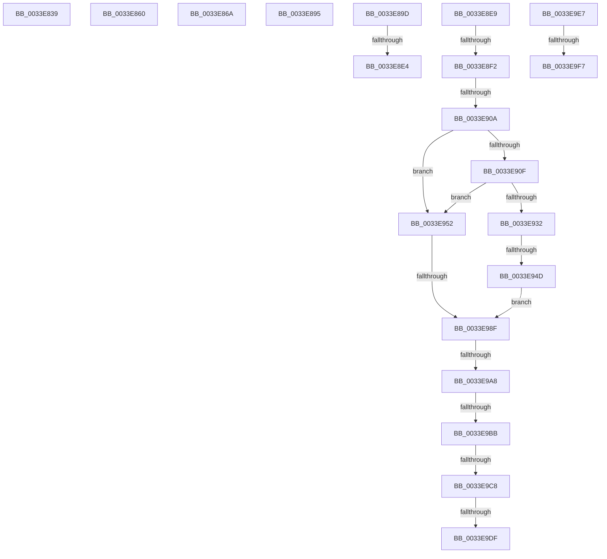

# sub_0033E839

- RVA: `0x0033E839`–`0x0033EA3A` (길이 `513` bytes)
- VA: `0x000000014033E839`
- 실행 섹션: `.text`
- PDB 이름 있음: `아니요`; PDB Function 태그: `아니요`
- unwind 정보 RVA: `0x00077274`
- 디코드: `108`개 명령, `513/513` bytes 표시
- 미해석 바이트: `0` (있으면 어셈블리에 `.byte`로 보존)

> 이 문서는 커널 이미지의 기계어와 PDB 기호를 분석해 생성했습니다. 4번과 5번은 함수 원형과 자료형을 바이너리 사용 방식에서 추정한 C 해석이며 원본 소스 복구 결과는 아닙니다.

## 1. Dependencies

- 직접 호출 지점: **2**; 고유 호출 대상: **2**
- 직접 호출자로 확인된 함수: **0**
- RIP 상대 이미지 참조: **2**

### Outgoing calls
- `0x0033E8D5` → [ExAcquireSpinLockExclusiveAtDpcLevel](../24/ExAcquireSpinLockExclusiveAtDpcLevel_function_00248E80.md) (function, `0x00248E80`)
- `0x0033E972` → [MiSignalCommitSignals](../24/MiSignalCommitSignals_function_00249090.md) (function, `0x00249090`)

### Direct callers
- 이 함수 시작 RVA로 연결되는 직접 call은 확인되지 않았습니다. 간접 호출은 완전히 역산할 수 없습니다.

### Static image references
- `0x0033E8FA` → RVA `0x00E38D00` (`.data`; read)
- `0x0033EA28` → RVA `0x00010880` (`.rdata`; read)

## 2. Other-region calls and transfers

- 다른 실행 섹션으로 향하는 call: **0**
- call이 아닌 외부 분기/꼬리 이동: **17**
  - `0x0033E85B` → [sub_0033E2D1 + 0x392](Unknown_function_0033E2D1.md) (`tail-transfer`)
  - `0x0033E865` → [sub_0033E2D1 + 0x486](Unknown_function_0033E2D1.md) (`tail-transfer`)
  - `0x0033E890` → [sub_0033E2D1 + 0x1B7](Unknown_function_0033E2D1.md) (`tail-transfer`)
  - `0x0033E898` → [sub_0033E2D1 + 0x271](Unknown_function_0033E2D1.md) (`tail-transfer`)
  - `0x0033E8DE` → [sub_0033E2D1 + 0x40B](Unknown_function_0033E2D1.md) (`tail-transfer`)
  - `0x0033E8E4` → [sub_0033EABD + 0x108](Unknown_function_0033EABD.md) (`tail-transfer`)
  - `0x0033E8EC` → [sub_0033EABD + 0x1CA](Unknown_function_0033EABD.md) (`tail-transfer`)
  - `0x0033E904` → [sub_0033EABD + 0x2B8](Unknown_function_0033EABD.md) (`tail-transfer`)
  - `0x0033E947` → [sub_0033EABD + 0x1B4](Unknown_function_0033EABD.md) (`tail-transfer`)
  - `0x0033E989` → [sub_0033EABD + 0xD9](Unknown_function_0033EABD.md) (`tail-transfer`)
  - `0x0033E9A2` → [sub_0033EABD + 0x1A1](Unknown_function_0033EABD.md) (`tail-transfer`)
  - `0x0033E9B5` → [sub_0033EABD + 0xA9](Unknown_function_0033EABD.md) (`tail-transfer`)
  - `0x0033E9C2` → [sub_0033EABD + 0xA9](Unknown_function_0033EABD.md) (`tail-transfer`)
  - `0x0033E9D9` → [sub_0033EABD + 0x193](Unknown_function_0033EABD.md) (`tail-transfer`)
  - `0x0033E9E2` → [sub_0033E2D1 + 0x2C5](Unknown_function_0033E2D1.md) (`tail-transfer`)
  - `0x0033E9F1` → [sub_0033E2D1 + 0x1DD](Unknown_function_0033E2D1.md) (`tail-transfer`)
  - `0x0033EA35` → [sub_0033E2D1 + 0x1E2](Unknown_function_0033E2D1.md) (`tail-transfer`)

## 3. Assembly (complete function range)

```asm
0033E839  24 FB                           and al, 0xfb
0033E83B  0C 03                           or al, 3
0033E83D  88 44 24 36                     mov byte ptr [rsp + 0x36], al
0033E841  8B 44 24 34                     mov eax, dword ptr [rsp + 0x34]
0033E845  89 43 20                        mov dword ptr [rbx + 0x20], eax
0033E848  0F B6 43 24                     movzx eax, byte ptr [rbx + 0x24]
0033E84C  0F B6 C8                        movzx ecx, al
0033E84F  32 4C 24 50                     xor cl, byte ptr [rsp + 0x50]
0033E853  80 E1 0F                        and cl, 0xf
0033E856  32 C8                           xor cl, al
0033E858  88 4B 24                        mov byte ptr [rbx + 0x24], cl
0033E85B  E9 03 FE FF FF                  jmp 0x14033e663
0033E860  F0 4C 21 49 18                  lock and qword ptr [rcx + 0x18], r9
0033E865  E9 ED FE FF FF                  jmp 0x14033e757
0033E86A  49 8B 03                        mov rax, qword ptr [r11]
0033E86D  49 BA FF FF FF FF FF 00 00 00   movabs r10, 0xffffffffff
0033E877  49 23 C2                        and rax, r10
0033E87A  4C 8D 1C 40                     lea r11, [rax + rax*2]
0033E87E  49 C1 E3 04                     shl r11, 4
0033E882  49 8B C6                        mov rax, r14
0033E885  48 8B 4C 24 58                  mov rcx, qword ptr [rsp + 0x58]
0033E88A  4C 03 D8                        add r11, rax
0033E88D  45 33 C0                        xor r8d, r8d
0033E890  E9 F3 FB FF FF                  jmp 0x14033e488
0033E895  48 0B C2                        or rax, rdx
0033E898  E9 A5 FC FF FF                  jmp 0x14033e542
0033E89D  4C 8B 74 24 38                  mov r14, qword ptr [rsp + 0x38]
0033E8A2  F0 4D 01 A6 C0 4B 00 00         lock add qword ptr [r14 + 0x4bc0], r12
0033E8AA  65 48 8B 04 25 88 01 00 00      mov rax, qword ptr gs:[0x188]
0033E8B3  48 8B 88 B8 00 00 00            mov rcx, qword ptr [rax + 0xb8]
0033E8BA  F0 44 01 A1 50 05 00 00         lock add dword ptr [rcx + 0x550], r12d
0033E8C2  8B 44 24 50                     mov eax, dword ptr [rsp + 0x50]
0033E8C6  48 83 C0 40                     add rax, 0x40
0033E8CA  4C 6B F8 58                     imul r15, rax, 0x58
0033E8CE  4D 03 FE                        add r15, r14
0033E8D1  49 8D 4F 20                     lea rcx, [r15 + 0x20]
0033E8D5  E8 A6 A5 F0 FF                  call 0x140248e80
0033E8DA  80 7D A0 00                     cmp byte ptr [rbp - 0x60], 0
0033E8DE  0F 85 F8 FD FF FF               jne 0x14033e6dc
0033E8E4  E9 DC 02 00 00                  jmp 0x14033ebc5
0033E8E9  83 F9 01                        cmp ecx, 1
0033E8EC  0F 85 95 03 00 00               jne 0x14033ec87
0033E8F2  49 83 BA 08 42 00 00 00         cmp qword ptr [r10 + 0x4208], 0
0033E8FA  48 8D 0D FF A3 AF 00            lea rcx, [rip + 0xafa3ff]
0033E901  4D 8B F4                        mov r14, r12
0033E904  0F 85 6B 04 00 00               jne 0x14033ed75
0033E90A  4C 3B D1                        cmp r10, rcx
0033E90D  75 43                           jne 0x14033e952
0033E90F  65 48 8B 14 25 20 00 00 00      mov rdx, qword ptr gs:[0x20]
0033E918  0F 0D 8A 98 8B 00 00            prefetchw byte ptr [rdx + 0x8b98]
0033E91F  44 8B 82 98 8B 00 00            mov r8d, dword ptr [rdx + 0x8b98]
0033E926  4B 8D 04 30                     lea rax, [r8 + r14]
0033E92A  48 3D 00 01 00 00               cmp rax, 0x100
0033E930  77 20                           ja 0x14033e952
0033E932  43 8D 0C 30                     lea ecx, [r8 + r14]
0033E936  41 8B C0                        mov eax, r8d
0033E939  F0 0F B1 8A 98 8B 00 00         lock cmpxchg dword ptr [rdx + 0x8b98], ecx
0033E941  48 63 C8                        movsxd rcx, eax
0033E944  49 3B C8                        cmp rcx, r8
0033E947  0F 85 24 03 00 00               jne 0x14033ec71
0033E94D  4D 8B CC                        mov r9, r12
0033E950  EB 3D                           jmp 0x14033e98f
0033E952  4D 8B C6                        mov r8, r14
0033E955  49 F7 D8                        neg r8
0033E958  F0 4D 01 82 80 4B 00 00         lock add qword ptr [r10 + 0x4b80], r8
0033E960  F0 4D 0F C1 82 40 4B 00 00      lock xadd qword ptr [r10 + 0x4b40], r8
0033E969  49 8B D0                        mov rdx, r8
0033E96C  49 8B CA                        mov rcx, r10
0033E96F  49 2B D6                        sub rdx, r14
0033E972  E8 19 A7 F0 FF                  call 0x140249090
0033E977  4C 8B 54 24 38                  mov r10, qword ptr [rsp + 0x38]
0033E97C  48 8D 05 7D A3 AF 00            lea rax, [rip + 0xafa37d]
0033E983  4D 8B CC                        mov r9, r12
0033E986  4C 3B D0                        cmp r10, rax
0033E989  0F 85 07 02 00 00               jne 0x14033eb96
0033E98F  65 4C 8B 04 25 20 00 00 00      mov r8, qword ptr gs:[0x20]
0033E998  41 8B 90 9C 8B 00 00            mov edx, dword ptr [r8 + 0x8b9c]
0033E99F  83 FA FF                        cmp edx, -1
0033E9A2  0F 84 B6 02 00 00               je 0x14033ec5e
0033E9A8  48 63 CA                        movsxd rcx, edx
0033E9AB  49 03 CC                        add rcx, r12
0033E9AE  48 81 F9 00 01 00 00            cmp rcx, 0x100
0033E9B5  0F 87 AB 01 00 00               ja 0x14033eb66
0033E9BB  49 81 FC 00 00 08 00            cmp r12, 0x80000
0033E9C2  0F 83 9E 01 00 00               jae 0x14033eb66
0033E9C8  42 8D 0C 22                     lea ecx, [rdx + r12]
0033E9CC  8B C2                           mov eax, edx
0033E9CE  F0 41 0F B1 88 9C 8B 00 00      lock cmpxchg dword ptr [r8 + 0x8b9c], ecx
0033E9D7  8B D0                           mov edx, eax
0033E9D9  0F 85 71 02 00 00               jne 0x14033ec50
0033E9DF  45 33 ED                        xor r13d, r13d
0033E9E2  E9 AF FB FF FF                  jmp 0x14033e596
0033E9E7  49 8B 43 28                     mov rax, qword ptr [r11 + 0x28]
0033E9EB  49 23 C2                        and rax, r10
0033E9EE  48 3B C1                        cmp rax, rcx
0033E9F1  0F 84 B7 FA FF FF               je 0x14033e4ae
0033E9F7  48 B8 F8 FF FF FF 7F 00 00 00   movabs rax, 0x7ffffffff8
0033EA01  49 C1 E9 09                     shr r9, 9
0033EA05  4C 23 C8                        and r9, rax
0033EA08  48 B8 00 00 00 00 80 F6 FF FF   movabs rax, 0xfffff68000000000
0033EA12  48 8B C0                        mov rax, rax
0033EA15  4C 03 C8                        add r9, rax
0033EA18  65 48 8B 04 25 20 00 00 00      mov rax, qword ptr gs:[0x20]
0033EA21  48 8B 88 38 88 00 00            mov rcx, qword ptr [rax + 0x8838]
0033EA28  48 8B 05 51 1E CD FF            mov rax, qword ptr [rip - 0x32e1af]
0033EA2F  4C 89 01                        mov qword ptr [rcx], r8
0033EA32  49 89 01                        mov qword ptr [r9], rax
0033EA35  E9 79 FA FF FF                  jmp 0x14033e4b3
```

## 4. C-style interpretation (structured pseudocode)

```c
__int64 __fastcall sub_0033E839(__int64 a1, __int64 a2, int a3, __int64 a4, __int64 a5, __int64 a6, __int64 a7, __int64 a8, __int64 a9, unsigned __int8 a10)
{
    __int64 result;
    unsigned int v_stack_p34;
    unsigned __int8 v_stack_p36;
    unsigned __int64 v_stack_p38;
    unsigned int v_stack_p50;
    unsigned __int64 v_stack_p58;

    result = (unsigned __int8)((result) & (251));
    result = (unsigned __int8)((result) | (3));
    v_stack_p36 = (unsigned __int8)(result);
    *(unsigned int *)(v_rbx + 32) = (unsigned int)((unsigned int)(v_stack_p34));
    a1 = (unsigned __int8)(((unsigned __int8)(*(unsigned __int8 *)(v_rbx + 36))) ^ (a10));
    a1 = (unsigned __int8)((a1) & (15));
    a1 = (unsigned __int8)((a1) ^ ((unsigned __int8)(*(unsigned __int8 *)(v_rbx + 36))));
    *(unsigned __int8 *)(v_rbx + 36) = (unsigned __int8)(a1);
}
```

## 5. (Beta) C Style

```c
int64_t sub_0033E839(int64_t Arg1, int64_t Arg2, int32_t Arg3, int64_t Arg4, uint64_t Arg5, uint64_t Arg6, uint64_t Arg7, uint64_t Arg8, uint64_t Arg9, uint8_t Arg10)
{
    int64_t result;
    uint32_t v_stack_p34;
    uint8_t v_stack_p36;
    uint64_t v_stack_p38;
    uint32_t v_stack_p50;
    uint64_t v_stack_p58;

    result = (uint8_t)((result) & (251));
    result = (uint8_t)((result) | (3));
    v_stack_p36 = (uint8_t)(result);
    *(uint32_t *)(local_rbx + 0x20) = (uint32_t)((uint32_t)(v_stack_p34));
    Arg1 = (uint8_t)(((uint8_t)(*(uint8_t *)(local_rbx + 0x24))) ^ (Arg10));
    Arg1 = (uint8_t)((Arg1) & (15));
    Arg1 = (uint8_t)((Arg1) ^ ((uint8_t)(*(uint8_t *)(local_rbx + 0x24))));
    *(uint8_t *)(local_rbx + 0x24) = (uint8_t)(Arg1);
}
```

## 6. Execution-region graph

[열기: 2D/3D 그래프와 함수 탐색 컨트롤 패널](../../../control-panel.html?section=text&rva=0x0033E839&view=graph)

- 2D 그래프는 위에서 아래로 흐르고, 3D 그래프는 빈 공간을 드래그해 회전합니다. Shift+드래그는 이동, 휠은 확대·축소, 함수 노드 선택은 대상 보고서 이동입니다.

### Static fallback


