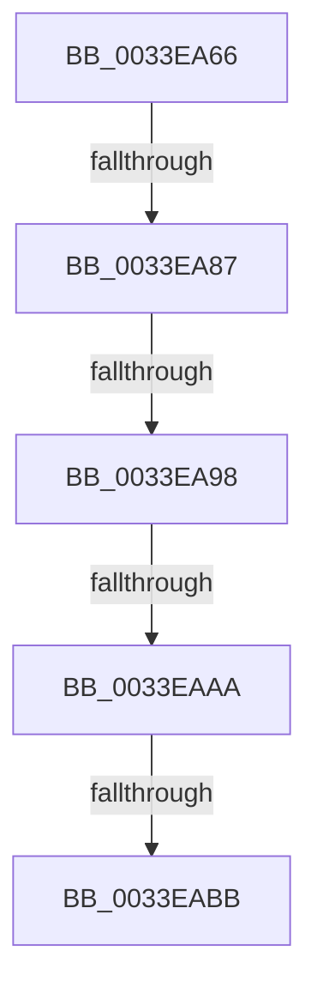

# sub_0033EA66

- RVA: `0x0033EA66`–`0x0033EABD` (길이 `87` bytes)
- VA: `0x000000014033EA66`
- 실행 섹션: `.text`
- PDB 이름 있음: `아니요`; PDB Function 태그: `아니요`
- unwind 정보 RVA: `0x000772DC`
- 디코드: `21`개 명령, `87/87` bytes 표시
- 미해석 바이트: `0` (있으면 어셈블리에 `.byte`로 보존)

> 이 문서는 커널 이미지의 기계어와 PDB 기호를 분석해 생성했습니다. 4번과 5번은 함수 원형과 자료형을 바이너리 사용 방식에서 추정한 C 해석이며 원본 소스 복구 결과는 아닙니다.

## 1. Dependencies

- 직접 호출 지점: **2**; 고유 호출 대상: **2**
- 직접 호출자로 확인된 함수: **0**
- RIP 상대 이미지 참조: **1**

### Outgoing calls
- `0x0033EA8F` → [MiIsDecayPfn](../2B/MiIsDecayPfn_function_002B9240.md) (function, `0x002B9240`)
- `0x0033EAAD` → [MiGetPfnSlabType](../28/MiGetPfnSlabType_function_0028E2D0.md) (function, `0x0028E2D0`)

### Direct callers
- 이 함수 시작 RVA로 연결되는 직접 call은 확인되지 않았습니다. 간접 호출은 완전히 역산할 수 없습니다.

### Static image references
- `0x0033EA66` → RVA `0x00E2DCE0` (`.data`; read)

## 2. Other-region calls and transfers

- 다른 실행 섹션으로 향하는 call: **0**
- call이 아닌 외부 분기/꼬리 이동: **5**
  - `0x0033EA85` → [sub_0033EA3A + 0x8](Unknown_function_0033EA3A.md) (`tail-transfer`)
  - `0x0033EA96` → [sub_0033EA3A + 0x8](Unknown_function_0033EA3A.md) (`tail-transfer`)
  - `0x0033EAA4` → [sub_0033E2D1 + 0x76](Unknown_function_0033E2D1.md) (`tail-transfer`)
  - `0x0033EAB5` → [sub_0033E2D1 + 0x76](Unknown_function_0033E2D1.md) (`tail-transfer`)
  - `0x0033EABB` → [sub_0033EA3A + 0x8](Unknown_function_0033EA3A.md) (`tail-transfer`)

## 3. Assembly (complete function range)

```asm
0033EA66  48 8B 05 73 F2 AE 00            mov rax, qword ptr [rip + 0xaef273]
0033EA6D  48 8D 14 40                     lea rdx, [rax + rax*2]
0033EA71  48 C1 E2 04                     shl rdx, 4
0033EA75  48 B8 30 00 00 00 00 DE FF FF   movabs rax, 0xffffde0000000030
0033EA7F  48 03 D0                        add rdx, rax
0033EA82  48 3B DA                        cmp rbx, rdx
0033EA85  73 BB                           jae 0x14033ea42
0033EA87  49 C1 F8 04                     sar r8, 4
0033EA8B  49 0F AF C8                     imul rcx, r8
0033EA8F  E8 AC A7 F7 FF                  call 0x1402b9240
0033EA94  85 C0                           test eax, eax
0033EA96  75 AA                           jne 0x14033ea42
0033EA98  41 C1 E9 10                     shr r9d, 0x10
0033EA9C  41 80 E1 07                     and r9b, 7
0033EAA0  41 80 F9 06                     cmp r9b, 6
0033EAA4  0F 84 9D F8 FF FF               je 0x14033e347
0033EAAA  48 8B CB                        mov rcx, rbx
0033EAAD  E8 1E F8 F4 FF                  call 0x14028e2d0
0033EAB2  83 F8 09                        cmp eax, 9
0033EAB5  0F 85 8C F8 FF FF               jne 0x14033e347
0033EABB  EB 85                           jmp 0x14033ea42
```

## 4. C-style interpretation (structured pseudocode)

```c
__int64 __fastcall sub_0033EA66(__int64 a1, __int64 a2, __int64 a3, int a4)
{
    __int64 result;

    a2 = (*(unsigned __int64 *)(v_rip + 11465331) + *(unsigned __int64 *)(v_rip + 11465331) * 2) << (4);
    a2 = (a2) + (*(unsigned __int64 *)(v_rip + 11465331));
    a3 = (a3) >> (4);
    a1 = (a1) * (a3);
    result = MiIsDecayPfn(a1, a2, a3, a4);
    a4 = (unsigned int)((a4) >> (16));
    a4 = (unsigned __int8)((a4) & (7));
    result = MiGetPfnSlabType(v_rbx, a2, a3, a4);
}
```

## 5. (Beta) C Style

```c
int64_t sub_0033EA66(int64_t Arg1, int64_t Arg2, int64_t Arg3, int32_t Arg4)
{
    int64_t result;

    Arg2 = (*(uint64_t *)(v_rip + 0xAEF273) + *(uint64_t *)(v_rip + 0xAEF273) * 2) << (4);
    Arg2 = (Arg2) + (*(uint64_t *)(v_rip + 0xAEF273));
    Arg3 = (Arg3) >> (4);
    Arg1 = (Arg1) * (Arg3);
    result = MiIsDecayPfn(Arg1, Arg2, Arg3, Arg4);
    Arg4 = (uint32_t)((Arg4) >> (16));
    Arg4 = (uint8_t)((Arg4) & (7));
    result = MiGetPfnSlabType(local_rbx, Arg2, Arg3, Arg4);
}
```

## 6. Execution-region graph

[열기: 2D/3D 그래프와 함수 탐색 컨트롤 패널](../../../control-panel.html?section=text&rva=0x0033EA66&view=graph)

- 2D 그래프는 위에서 아래로 흐르고, 3D 그래프는 빈 공간을 드래그해 회전합니다. Shift+드래그는 이동, 휠은 확대·축소, 함수 노드 선택은 대상 보고서 이동입니다.

### Static fallback


