# sub_0033EFBD

- RVA: `0x0033EFBD`–`0x0033F16C` (길이 `431` bytes)
- VA: `0x000000014033EFBD`
- 실행 섹션: `.text`
- PDB 이름 있음: `아니요`; PDB Function 태그: `아니요`
- unwind 정보 RVA: `0x00077334`
- 디코드: `107`개 명령, `431/431` bytes 표시
- 미해석 바이트: `0` (있으면 어셈블리에 `.byte`로 보존)

> 이 문서는 커널 이미지의 기계어와 PDB 기호를 분석해 생성했습니다. 4번과 5번은 함수 원형과 자료형을 바이너리 사용 방식에서 추정한 C 해석이며 원본 소스 복구 결과는 아닙니다.

## 1. Dependencies

- 직접 호출 지점: **1**; 고유 호출 대상: **1**
- 직접 호출자로 확인된 함수: **0**
- RIP 상대 이미지 참조: **6**

### Outgoing calls
- `0x0033F0F1` → [KeSetEvent](KeSetEvent_function_0033F310.md) (function, `0x0033F310`)

### Direct callers
- 이 함수 시작 RVA로 연결되는 직접 call은 확인되지 않았습니다. 간접 호출은 완전히 역산할 수 없습니다.

### Static image references
- `0x0033EFCB` → RVA `0x00E3CCF8` (`.data`; read)
- `0x0033F011` → RVA `0x00E2DBC0` (`.data`; read)
- `0x0033F018` → RVA `0x00E2DBC4` (`.data`; read)
- `0x0033F029` → RVA `0x00E2DC20` (`.data`; read)
- `0x0033F075` → RVA `0x00E2DBC0` (`.data`; write)
- `0x0033F08A` → RVA `0x00E38D10` (`.data`; read)

## 2. Other-region calls and transfers

- 다른 실행 섹션으로 향하는 call: **0**
- call이 아닌 외부 분기/꼬리 이동: **8**
  - `0x0033EFC5` → [sub_0033F181 + 0x3B](Unknown_function_0033F181.md) (`tail-transfer`)
  - `0x0033F044` → [sub_0033F181 + 0x10](Unknown_function_0033F181.md) (`tail-transfer`)
  - `0x0033F062` → [sub_0033F181 + 0x4D](Unknown_function_0033F181.md) (`tail-transfer`)
  - `0x0033F06F` → [sub_0033F181 + 0x28](Unknown_function_0033F181.md) (`tail-transfer`)
  - `0x0033F0CE` → [sub_0033F181 + 0x71](Unknown_function_0033F181.md) (`tail-transfer`)
  - `0x0033F0FC` → [sub_0033F181 + 0x84](Unknown_function_0033F181.md) (`tail-transfer`)
  - `0x0033F128` → [sub_0033F181 + 0x6](Unknown_function_0033F181.md) (`tail-transfer`)
  - `0x0033F155` → [sub_0033F181](Unknown_function_0033F181.md) (`tail-transfer`)

## 3. Assembly (complete function range)

```asm
0033EFBD  48 89 5C 24 50                  mov qword ptr [rsp + 0x50], rbx
0033EFC2  83 FD 03                        cmp ebp, 3
0033EFC5  0F 85 F1 01 00 00               jne 0x14033f1bc
0033EFCB  48 8B 05 26 DD AF 00            mov rax, qword ptr [rip + 0xafdd26]
0033EFD2  41 8B CF                        mov ecx, r15d
0033EFD5  D1 E9                           shr ecx, 1
0033EFD7  66 F7 D1                        not cx
0033EFDA  48 C1 EA 04                     shr rdx, 4
0033EFDE  66 83 E1 01                     and cx, 1
0033EFE2  66 83 C9 20                     or cx, 0x20
0033EFE6  4C 8D 04 50                     lea r8, [rax + rdx*2]
0033EFEA  41 F6 C7 01                     test r15b, 1
0033EFEE  75 03                           jne 0x14033eff3
0033EFF0  66 F7 D9                        neg cx
0033EFF3  0F B7 C1                        movzx eax, cx
0033EFF6  66 F0 41 0F C1 00               lock xadd word ptr [r8], ax
0033EFFC  66 03 C1                        add ax, cx
0033EFFF  BB 01 00 00 00                  mov ebx, 1
0033F004  83 E0 1F                        and eax, 0x1f
0033F007  48 83 F8 10                     cmp rax, 0x10
0033F00B  0F 85 E7 00 00 00               jne 0x14033f0f8
0033F011  48 63 15 A8 EB AE 00            movsxd rdx, dword ptr [rip + 0xaeeba8]
0033F018  8B 0D A6 EB AE 00               mov ecx, dword ptr [rip + 0xaeeba6]
0033F01E  3B D1                           cmp edx, ecx
0033F020  77 1D                           ja 0x14033f03f
0033F022  48 8B C2                        mov rax, rdx
0033F025  48 C1 E0 04                     shl rax, 4
0033F029  48 03 05 F0 EB AE 00            add rax, qword ptr [rip + 0xaeebf0]
0033F030  48 3B 38                        cmp rdi, qword ptr [rax]
0033F033  72 0A                           jb 0x14033f03f
0033F035  3B D1                           cmp edx, ecx
0033F037  74 43                           je 0x14033f07c
0033F039  48 3B 78 10                     cmp rdi, qword ptr [rax + 0x10]
0033F03D  72 3D                           jb 0x14033f07c
0033F03F  41 8B D1                        mov edx, r9d
0033F042  3B CA                           cmp ecx, edx
0033F044  0F 8C 47 01 00 00               jl 0x14033f191
0033F04A  44 8D 04 0A                     lea r8d, [rdx + rcx]
0033F04E  41 D1 F8                        sar r8d, 1
0033F051  49 63 C0                        movsxd rax, r8d
0033F054  48 C1 E0 04                     shl rax, 4
0033F058  48 03 05 C1 EB AE 00            add rax, qword ptr [rip + 0xaeebc1]
0033F05F  48 3B 38                        cmp rdi, qword ptr [rax]
0033F062  0F 82 66 01 00 00               jb 0x14033f1ce
0033F068  44 3B 05 55 EB AE 00            cmp r8d, dword ptr [rip + 0xaeeb55]
0033F06F  0F 85 34 01 00 00               jne 0x14033f1a9
0033F075  44 89 05 44 EB AE 00            mov dword ptr [rip + 0xaeeb44], r8d
0033F07C  8B 40 08                        mov eax, dword ptr [rax + 8]
0033F07F  48 8B 56 10                     mov rdx, qword ptr [rsi + 0x10]
0033F083  48 69 C8 80 DF 00 00            imul rcx, rax, 0xdf80
0033F08A  48 8B 05 7F 9C AF 00            mov rax, qword ptr [rip + 0xaf9c7f]
0033F091  F0 48 FF 84 0A 40 DF 00 00      lock inc qword ptr [rdx + rcx + 0xdf40]
0033F09A  F0 48 FF 84 01 28 DF 00 00      lock inc qword ptr [rcx + rax + 0xdf28]
0033F0A3  48 8B 86 30 40 00 00            mov rax, qword ptr [rsi + 0x4030]
0033F0AA  4C 8B D7                        mov r10, rdi
0033F0AD  49 C1 EA 0D                     shr r10, 0xd
0033F0B1  48 8B D3                        mov rdx, rbx
0033F0B4  4D 8B CA                        mov r9, r10
0033F0B7  49 8B CA                        mov rcx, r10
0033F0BA  48 C1 E9 05                     shr rcx, 5
0033F0BE  41 83 E1 1F                     and r9d, 0x1f
0033F0C2  4C 8D 04 88                     lea r8, [rax + rcx*4]
0033F0C6  49 8D 41 01                     lea rax, [r9 + 1]
0033F0CA  48 83 F8 20                     cmp rax, 0x20
0033F0CE  0F 87 1E 01 00 00               ja 0x14033f1f2
0033F0D4  41 8B C9                        mov ecx, r9d
0033F0D7  8B C3                           mov eax, ebx
0033F0D9  D3 E0                           shl eax, cl
0033F0DB  F0 41 09 00                     lock or dword ptr [r8], eax
0033F0DF  48 8D 8E C0 40 00 00            lea rcx, [rsi + 0x40c0]
0033F0E6  83 79 04 00                     cmp dword ptr [rcx + 4], 0
0033F0EA  75 16                           jne 0x14033f102
0033F0EC  45 33 C0                        xor r8d, r8d
0033F0EF  33 D2                           xor edx, edx
0033F0F1  E8 1A 02 00 00                  call 0x14033f310
0033F0F6  EB 0A                           jmp 0x14033f102
0033F0F8  48 83 F8 0F                     cmp rax, 0xf
0033F0FC  0F 84 03 01 00 00               je 0x14033f205
0033F102  8B CB                           mov ecx, ebx
0033F104  41 F6 C7 01                     test r15b, 1
0033F108  75 05                           jne 0x14033f10f
0033F10A  66 F7 DB                        neg bx
0033F10D  F7 D9                           neg ecx
0033F10F  48 8B 86 00 40 00 00            mov rax, qword ptr [rsi + 0x4000]
0033F116  48 8B D7                        mov rdx, rdi
0033F119  48 C1 EA 09                     shr rdx, 9
0033F11D  80 BE E6 3E 00 00 01            cmp byte ptr [rsi + 0x3ee6], 1
0033F124  4C 8D 04 50                     lea r8, [rax + rdx*2]
0033F128  74 5D                           je 0x14033f187
0033F12A  0F B7 C3                        movzx eax, bx
0033F12D  66 F0 41 0F C1 00               lock xadd word ptr [r8], ax
0033F133  66 03 C3                        add ax, bx
0033F136  83 FD 02                        cmp ebp, 2
0033F139  75 04                           jne 0x14033f13f
0033F13B  66 41 89 06                     mov word ptr [r14], ax
0033F13F  48 8B 86 38 40 00 00            mov rax, qword ptr [rsi + 0x4038]
0033F146  48 C1 EF 12                     shr rdi, 0x12
0033F14A  80 BE E6 3E 00 00 01            cmp byte ptr [rsi + 0x3ee6], 1
0033F151  48 8D 14 B8                     lea rdx, [rax + rdi*4]
0033F155  74 2A                           je 0x14033f181
0033F157  8B C1                           mov eax, ecx
0033F159  F0 0F C1 02                     lock xadd dword ptr [rdx], eax
0033F15D  03 C1                           add eax, ecx
0033F15F  83 FD 01                        cmp ebp, 1
0033F162  75 03                           jne 0x14033f167
0033F164  41 89 06                        mov dword ptr [r14], eax
0033F167  48 8B 5C 24 50                  mov rbx, qword ptr [rsp + 0x50]
```

## 4. C-style interpretation (structured pseudocode)

```c
__int64 __fastcall sub_0033EFBD(__int64 a1, __int64 a2, __int64 a3, int a4, __int64 a5, __int64 a6, __int64 a7, __int64 a8, __int64 a9, __int64 a10)
{
    __int64 result;
    __int64 v_r10;
    __int64 v_rbx;
    __int64 v_rdi;
    unsigned __int64 v_stack_p50;

    v_stack_p50 = v_rbx;
    a1 = (unsigned int)(((unsigned int)((unsigned int)(v_r15))) >> (1));
    a1 = (unsigned __int16)(~(a1));
    a2 = (a2) >> (4);
    a1 = (unsigned __int16)((a1) & (1));
    a1 = (unsigned __int16)((a1) | (32));
    if ((((unsigned __int8)(v_r15)) & (1)) == 0) {
        a1 = (unsigned __int16)(-(a1));
    }
    result = (unsigned __int16)(((unsigned __int16)(a1)) + ((unsigned __int16)(a1)));
    result = (unsigned int)((result) & (31));
    if (result != 16) goto loc_0033F0F8;
    if (((unsigned int)((int)(*(unsigned int *)(v_rip + 11463592)))) > ((unsigned int)((unsigned int)(*(unsigned int *)(v_rip + 11463590))))) goto loc_0033F03F;
    result = ((int)(*(unsigned int *)(v_rip + 11463592))) << (4);
    result = (result) + (*(unsigned __int64 *)(v_rip + 11463664));
    if (v_rdi < (*(unsigned __int64 *)(result))) goto loc_0033F03F;
    if (((unsigned int)((int)(*(unsigned int *)(v_rip + 11463592)))) == ((unsigned int)((unsigned int)(*(unsigned int *)(v_rip + 11463590))))) goto loc_0033F07C;
    if (v_rdi < (*(unsigned __int64 *)(result + 16))) goto loc_0033F07C;
loc_0033F03F:
    a3 = (unsigned int)(((unsigned int)(a4) + (unsigned int)(*(unsigned int *)(v_rip + 11463590)) * 1) >> (1));
    result = ((int)((unsigned int)(a3))) << (4);
    result = (result) + (*(unsigned __int64 *)(v_rip + 11463617));
    *(unsigned int *)(v_rip + 11463492) = (unsigned int)(a3);
loc_0033F07C:
    a1 = ((unsigned int)(*(unsigned int *)(v_rip + 11463590))) * ((unsigned int)(*(unsigned int *)(result + 8)));
    v_r10 = (v_rdi) >> (13);
    a1 = (v_r10) >> (5);
    a4 = (unsigned int)((v_r10) & (31));
    result = (unsigned int)((1) << ((unsigned __int8)((unsigned int)(a4))));
    if ((*(unsigned int *)(v_rsi + 16576 + 4)) != 0) goto loc_0033F102;
    a3 = 0;
    a2 = 0;
    result = KeSetEvent(v_rsi + 16576, a2, a3, a4);
    goto loc_0033F102;
loc_0033F0F8:
loc_0033F102:
    v_rbx = 1;
    if ((((unsigned __int8)(v_r15)) & (1)) == 0) {
        v_rbx = (unsigned __int16)(-(1));
        a1 = (unsigned int)(-(1));
    }
    a2 = (v_rdi) >> (9);
    result = (unsigned __int16)(((unsigned __int16)(v_rbx)) + ((unsigned __int16)(v_rbx)));
    if (((unsigned int)(v_rbp)) == 2) {
        *(unsigned __int16 *)(v_r14) = (unsigned __int16)(result);
    }
    v_rdi = (v_rdi) >> (18);
    result = (unsigned int)(((unsigned int)((unsigned int)(a1))) + ((unsigned int)(a1)));
    if (((unsigned int)(v_rbp)) == 1) {
        *(unsigned int *)(v_r14) = (unsigned int)(result);
    }
    return result;
}
```

## 5. (Beta) C Style

```c
int64_t sub_0033EFBD(int64_t Arg1, int64_t Arg2, int64_t Arg3, void *Arg4, uint64_t Arg5, uint64_t Arg6, uint64_t Arg7, uint64_t Arg8, uint64_t Arg9, int64_t Arg10)
{
    uint8_t *arg4 = (uint8_t *)Arg4;

    int64_t result;
    int64_t local_r10;
    int64_t local_rbx;
    int64_t local_rdi;
    uint64_t v_stack_p50;

    v_stack_p50 = local_rbx;
    Arg1 = (uint32_t)(((uint32_t)((uint32_t)(local_r15))) >> (1));
    Arg1 = (uint16_t)(~(Arg1));
    Arg2 = (Arg2) >> (4);
    Arg1 = (uint16_t)((Arg1) & (1));
    Arg1 = (uint16_t)((Arg1) | (32));
    if ((((uint8_t)(local_r15)) & (1)) == 0) {
        Arg1 = (uint16_t)(-(Arg1));
    }
    result = (uint16_t)(((uint16_t)(Arg1)) + ((uint16_t)(Arg1)));
    result = (uint32_t)((result) & (31));
    if (result != 16) goto loc_0033F0F8;
    if (((uint32_t)((int32_t)(*(uint32_t *)(v_rip + 0xAEEBA8)))) > ((uint32_t)((uint32_t)(*(uint32_t *)(v_rip + 0xAEEBA6))))) goto loc_0033F03F;
    result = ((int32_t)(*(uint32_t *)(v_rip + 0xAEEBA8))) << (4);
    result = (result) + (*(uint64_t *)(v_rip + 0xAEEBF0));
    if (local_rdi < (*(uint64_t *)(result))) goto loc_0033F03F;
    if (((uint32_t)((int32_t)(*(uint32_t *)(v_rip + 0xAEEBA8)))) == ((uint32_t)((uint32_t)(*(uint32_t *)(v_rip + 0xAEEBA6))))) goto loc_0033F07C;
    if (local_rdi < (*(uint64_t *)(result + 0x10))) goto loc_0033F07C;
loc_0033F03F:
    Arg3 = (uint32_t)(((uint32_t)(Arg4) + (uint32_t)(*(uint32_t *)(v_rip + 0xAEEBA6)) * 1) >> (1));
    result = ((int32_t)((uint32_t)(Arg3))) << (4);
    result = (result) + (*(uint64_t *)(v_rip + 0xAEEBC1));
    *(uint32_t *)(v_rip + 0xAEEB44) = (uint32_t)(Arg3);
loc_0033F07C:
    Arg1 = ((uint32_t)(*(uint32_t *)(v_rip + 0xAEEBA6))) * ((uint32_t)(*(uint32_t *)(result + 0x8)));
    local_r10 = (local_rdi) >> (13);
    Arg1 = (local_r10) >> (5);
    Arg4 = (uint32_t)((local_r10) & (31));
    result = (uint32_t)((1) << ((uint8_t)((uint32_t)(Arg4))));
    if ((*(uint32_t *)(local_rsi + 0x40C0 + 0x4)) != 0) goto loc_0033F102;
    Arg3 = 0;
    Arg2 = 0;
    result = KeSetEvent(local_rsi + 16576, Arg2, Arg3, Arg4);
    goto loc_0033F102;
loc_0033F0F8:
loc_0033F102:
    local_rbx = 1;
    if ((((uint8_t)(local_r15)) & (1)) == 0) {
        local_rbx = (uint16_t)(-(1));
        Arg1 = (uint32_t)(-(1));
    }
    Arg2 = (local_rdi) >> (9);
    result = (uint16_t)(((uint16_t)(local_rbx)) + ((uint16_t)(local_rbx)));
    if (((uint32_t)(local_rbp)) == 2) {
        *(uint16_t *)(local_r14) = (uint16_t)(result);
    }
    local_rdi = (local_rdi) >> (18);
    result = (uint32_t)(((uint32_t)((uint32_t)(Arg1))) + ((uint32_t)(Arg1)));
    if (((uint32_t)(local_rbp)) == 1) {
        *(uint32_t *)(local_r14) = (uint32_t)(result);
    }
    return result;
}
```

### 관측된 메모리 오프셋

구조체 형식이 확인되지 않은 접근은 인자 기준의 오프셋으로만 기록했습니다.

| 기준 인자 | 오프셋 표현 | 폭 (bit) | 접근 |
|---|---:|---:|---|
| `Arg4` | `+ 0x0 + rcx*1` | `32` | `R` |

## 6. Execution-region graph

[열기: 2D/3D 그래프와 함수 탐색 컨트롤 패널](../../../control-panel.html?section=text&rva=0x0033EFBD&view=graph)

- 2D 그래프는 위에서 아래로 흐르고, 3D 그래프는 빈 공간을 드래그해 회전합니다. Shift+드래그는 이동, 휠은 확대·축소, 함수 노드 선택은 대상 보고서 이동입니다.

### Static fallback

```mermaid
flowchart TD
  bb_0033EFBD[BB_0033EFBD]
  bb_0033EFCB[BB_0033EFCB]
  bb_0033EFF0[BB_0033EFF0]
  bb_0033EFF3[BB_0033EFF3]
  bb_0033F011[BB_0033F011]
  bb_0033F022[BB_0033F022]
  bb_0033F035[BB_0033F035]
  bb_0033F039[BB_0033F039]
  bb_0033F03F[BB_0033F03F]
  bb_0033F04A[BB_0033F04A]
  bb_0033F068[BB_0033F068]
  bb_0033F075[BB_0033F075]
  bb_0033F07C[BB_0033F07C]
  bb_0033F0D4[BB_0033F0D4]
  bb_0033F0EC[BB_0033F0EC]
  bb_0033F0F8[BB_0033F0F8]
  bb_0033F102[BB_0033F102]
  bb_0033F10A[BB_0033F10A]
  bb_0033F10F[BB_0033F10F]
  bb_0033F12A[BB_0033F12A]
  bb_0033F13B[BB_0033F13B]
  bb_0033F13F[BB_0033F13F]
  bb_0033F157[BB_0033F157]
  bb_0033F164[BB_0033F164]
  bb_0033F167[BB_0033F167]
  bb_0033EFBD -->|fallthrough| bb_0033EFCB
  bb_0033EFCB -->|branch| bb_0033EFF3
  bb_0033EFCB -->|fallthrough| bb_0033EFF0
  bb_0033EFF0 -->|flow| bb_0033EFF3
  bb_0033EFF3 -->|branch| bb_0033F0F8
  bb_0033EFF3 -->|fallthrough| bb_0033F011
  bb_0033F011 -->|branch| bb_0033F03F
  bb_0033F011 -->|fallthrough| bb_0033F022
  bb_0033F022 -->|branch| bb_0033F03F
  bb_0033F022 -->|fallthrough| bb_0033F035
  bb_0033F035 -->|branch| bb_0033F07C
  bb_0033F035 -->|fallthrough| bb_0033F039
  bb_0033F039 -->|branch| bb_0033F07C
  bb_0033F039 -->|fallthrough| bb_0033F03F
  bb_0033F03F -->|fallthrough| bb_0033F04A
  bb_0033F04A -->|fallthrough| bb_0033F068
  bb_0033F068 -->|fallthrough| bb_0033F075
  bb_0033F075 -->|flow| bb_0033F07C
  bb_0033F07C -->|fallthrough| bb_0033F0D4
  bb_0033F0D4 -->|branch| bb_0033F102
  bb_0033F0D4 -->|fallthrough| bb_0033F0EC
  bb_0033F0EC -->|branch| bb_0033F102
  bb_0033F0F8 -->|fallthrough| bb_0033F102
  bb_0033F102 -->|branch| bb_0033F10F
  bb_0033F102 -->|fallthrough| bb_0033F10A
  bb_0033F10A -->|flow| bb_0033F10F
  bb_0033F10F -->|fallthrough| bb_0033F12A
  bb_0033F12A -->|branch| bb_0033F13F
  bb_0033F12A -->|fallthrough| bb_0033F13B
  bb_0033F13B -->|flow| bb_0033F13F
  bb_0033F13F -->|fallthrough| bb_0033F157
  bb_0033F157 -->|branch| bb_0033F167
  bb_0033F157 -->|fallthrough| bb_0033F164
  bb_0033F164 -->|flow| bb_0033F167
```


