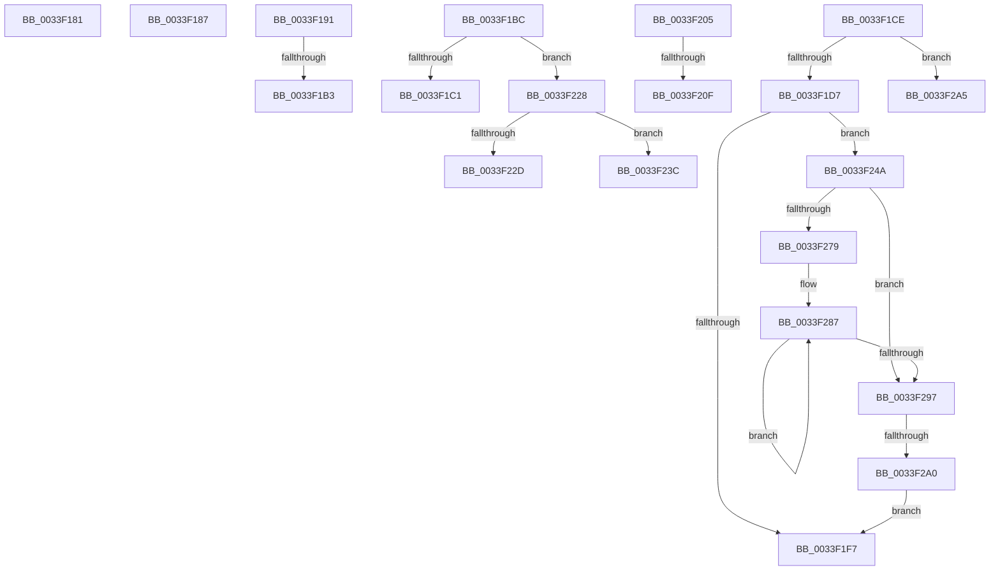

# sub_0033F181

- RVA: `0x0033F181`–`0x0033F2AE` (길이 `301` bytes)
- VA: `0x000000014033F181`
- 실행 섹션: `.text`
- PDB 이름 있음: `아니요`; PDB Function 태그: `아니요`
- unwind 정보 RVA: `0x0007735C`
- 디코드: `82`개 명령, `301/301` bytes 표시
- 미해석 바이트: `0` (있으면 어셈블리에 `.byte`로 보존)

> 이 문서는 커널 이미지의 기계어와 PDB 기호를 분석해 생성했습니다. 4번과 5번은 함수 원형과 자료형을 바이너리 사용 방식에서 추정한 C 해석이며 원본 소스 복구 결과는 아닙니다.

## 1. Dependencies

- 직접 호출 지점: **3**; 고유 호출 대상: **2**
- 직접 호출자로 확인된 함수: **0**
- RIP 상대 이미지 참조: **0**

### Outgoing calls
- `0x0033F1A3` → [KeBugCheckEx](../4F/KeBugCheckEx_function_004FD660.md) (function, `0x004FD660`)
- `0x0033F1EC` → [KeBugCheckEx](../4F/KeBugCheckEx_function_004FD660.md) (function, `0x004FD660`)
- `0x0033F21E` → [MiRecordLargePageCandidate](../37/MiRecordLargePageCandidate_function_0037A624.md) (function, `0x0037A624`)

### Direct callers
- 이 함수 시작 RVA로 연결되는 직접 call은 확인되지 않았습니다. 간접 호출은 완전히 역산할 수 없습니다.

### Static image references
- 디코드된 RIP-relative 메모리 참조가 없습니다.

## 2. Other-region calls and transfers

- 다른 실행 섹션으로 향하는 call: **0**
- call이 아닌 외부 분기/꼬리 이동: **12**
  - `0x0033F185` → [sub_0033EFBD + 0x1A2](Unknown_function_0033EFBD.md) (`tail-transfer`)
  - `0x0033F18F` → [sub_0033EFBD + 0x179](Unknown_function_0033EFBD.md) (`tail-transfer`)
  - `0x0033F1AD` → [sub_0033EFBD + 0xB8](Unknown_function_0033EFBD.md) (`tail-transfer`)
  - `0x0033F1B7` → [sub_0033EFBD + 0x85](Unknown_function_0033EFBD.md) (`tail-transfer`)
  - `0x0033F1C9` → [sub_0033EFBD + 0x147](Unknown_function_0033EFBD.md) (`tail-transfer`)
  - `0x0033F200` → [sub_0033EFBD + 0x11E](Unknown_function_0033EFBD.md) (`tail-transfer`)
  - `0x0033F209` → [sub_0033EFBD + 0x145](Unknown_function_0033EFBD.md) (`tail-transfer`)
  - `0x0033F223` → [sub_0033EFBD + 0x145](Unknown_function_0033EFBD.md) (`tail-transfer`)
  - `0x0033F237` → [sub_0033EFBD + 0x147](Unknown_function_0033EFBD.md) (`tail-transfer`)
  - `0x0033F245` → [sub_0033EFBD + 0x147](Unknown_function_0033EFBD.md) (`tail-transfer`)
  - `0x0033F29A` → [sub_0033EFBD + 0x122](Unknown_function_0033EFBD.md) (`tail-transfer`)
  - `0x0033F2A9` → [sub_0033EFBD + 0x85](Unknown_function_0033EFBD.md) (`tail-transfer`)

## 3. Assembly (complete function range)

```asm
0033F181  01 0A                           add dword ptr [rdx], ecx
0033F183  8B 02                           mov eax, dword ptr [rdx]
0033F185  EB D8                           jmp 0x14033f15f
0033F187  66 41 01 18                     add word ptr [r8], bx
0033F18B  41 0F B7 00                     movzx eax, word ptr [r8]
0033F18F  EB A5                           jmp 0x14033f136
0033F191  4C 8B C7                        mov r8, rdi
0033F194  4C 89 4C 24 20                  mov qword ptr [rsp + 0x20], r9
0033F199  BA 80 51 00 00                  mov edx, 0x5180
0033F19E  B9 1A 00 00 00                  mov ecx, 0x1a
0033F1A3  E8 B8 E4 1B 00                  call 0x1404fd660
0033F1A8  CC                              int3
0033F1A9  48 3B 78 10                     cmp rdi, qword ptr [rax + 0x10]
0033F1AD  0F 82 C2 FE FF FF               jb 0x14033f075
0033F1B3  41 8D 50 01                     lea edx, [r8 + 1]
0033F1B7  E9 86 FE FF FF                  jmp 0x14033f042
0033F1BC  83 FD 02                        cmp ebp, 2
0033F1BF  75 67                           jne 0x14033f228
0033F1C1  BB 10 04 00 00                  mov ebx, 0x410
0033F1C6  8D 4D 0E                        lea ecx, [rbp + 0xe]
0033F1C9  E9 36 FF FF FF                  jmp 0x14033f104
0033F1CE  45 85 C0                        test r8d, r8d
0033F1D1  0F 85 CE 00 00 00               jne 0x14033f2a5
0033F1D7  4C 89 4C 24 20                  mov qword ptr [rsp + 0x20], r9
0033F1DC  4C 8B C7                        mov r8, rdi
0033F1DF  4C 8B C8                        mov r9, rax
0033F1E2  BA 80 51 00 00                  mov edx, 0x5180
0033F1E7  B9 1A 00 00 00                  mov ecx, 0x1a
0033F1EC  E8 6F E4 1B 00                  call 0x1404fd660
0033F1F1  CC                              int3
0033F1F2  4D 85 C9                        test r9, r9
0033F1F5  75 53                           jne 0x14033f24a
0033F1F7  48 8B CA                        mov rcx, rdx
0033F1FA  8B C3                           mov eax, ebx
0033F1FC  D3 E0                           shl eax, cl
0033F1FE  FF C8                           dec eax
0033F200  E9 D6 FE FF FF                  jmp 0x14033f0db
0033F205  41 F6 C7 03                     test r15b, 3
0033F209  0F 85 F3 FE FF FF               jne 0x14033f102
0033F20F  44 8B CB                        mov r9d, ebx
0033F212  41 B8 02 00 00 00               mov r8d, 2
0033F218  48 8B D7                        mov rdx, rdi
0033F21B  48 8B CE                        mov rcx, rsi
0033F21E  E8 01 B4 03 00                  call 0x14037a624
0033F223  E9 DA FE FF FF                  jmp 0x14033f102
0033F228  83 FD 01                        cmp ebp, 1
0033F22B  75 0F                           jne 0x14033f23c
0033F22D  BB 00 02 00 00                  mov ebx, 0x200
0033F232  B9 00 02 08 00                  mov ecx, 0x80200
0033F237  E9 C8 FE FF FF                  jmp 0x14033f104
0033F23C  41 0F B7 D9                     movzx ebx, r9w
0033F240  B9 00 00 04 00                  mov ecx, 0x40000
0033F245  E9 BA FE FF FF                  jmp 0x14033f104
0033F24A  41 83 E2 1F                     and r10d, 0x1f
0033F24E  BA 20 00 00 00                  mov edx, 0x20
0033F253  41 2B D2                        sub edx, r10d
0033F256  8B C3                           mov eax, ebx
0033F258  8B CA                           mov ecx, edx
0033F25A  D3 E0                           shl eax, cl
0033F25C  49 8B C9                        mov rcx, r9
0033F25F  FF C8                           dec eax
0033F261  D3 E0                           shl eax, cl
0033F263  F0 41 09 00                     lock or dword ptr [r8], eax
0033F267  8B C2                           mov eax, edx
0033F269  49 83 C0 04                     add r8, 4
0033F26D  48 8B D3                        mov rdx, rbx
0033F270  48 2B D0                        sub rdx, rax
0033F273  48 83 FA 20                     cmp rdx, 0x20
0033F277  72 1E                           jb 0x14033f297
0033F279  48 8B CA                        mov rcx, rdx
0033F27C  48 C1 E9 05                     shr rcx, 5
0033F280  48 6B C1 E0                     imul rax, rcx, -0x20
0033F284  48 03 D0                        add rdx, rax
0033F287  41 C7 00 FF FF FF FF            mov dword ptr [r8], 0xffffffff
0033F28E  49 83 C0 04                     add r8, 4
0033F292  48 2B CB                        sub rcx, rbx
0033F295  75 F0                           jne 0x14033f287
0033F297  48 85 D2                        test rdx, rdx
0033F29A  0F 84 3F FE FF FF               je 0x14033f0df
0033F2A0  E9 52 FF FF FF                  jmp 0x14033f1f7
0033F2A5  41 8D 48 FF                     lea ecx, [r8 - 1]
0033F2A9  E9 94 FD FF FF                  jmp 0x14033f042
```

## 4. C-style interpretation (structured pseudocode)

```c
__int64 __fastcall sub_0033F181(int a1, __int64 a2, __int64 a3, __int64 a4)
{
    unsigned __int64 v_stack_p20;
}
```

## 5. (Beta) C Style

```c
int64_t sub_0033F181(int32_t Arg1, void *Arg2, int64_t Arg3, int64_t Arg4)
{
    uint8_t *arg2 = (uint8_t *)Arg2;

    uint64_t v_stack_p20;
}
```

### 관측된 메모리 오프셋

구조체 형식이 확인되지 않은 접근은 인자 기준의 오프셋으로만 기록했습니다.

| 기준 인자 | 오프셋 표현 | 폭 (bit) | 접근 |
|---|---:|---:|---|
| `Arg2` | `+ 0x0` | `32` | `R` |
| `Arg2` | `+ 0x0` | `32` | `R/W` |

## 6. Execution-region graph

[열기: 2D/3D 그래프와 함수 탐색 컨트롤 패널](../../../control-panel.html?section=text&rva=0x0033F181&view=graph)

- 2D 그래프는 위에서 아래로 흐르고, 3D 그래프는 빈 공간을 드래그해 회전합니다. Shift+드래그는 이동, 휠은 확대·축소, 함수 노드 선택은 대상 보고서 이동입니다.

### Static fallback


