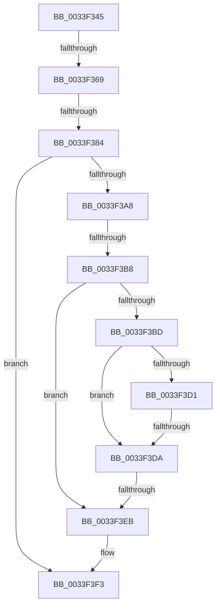

# sub_0033F345

- RVA: `0x0033F345`–`0x0033F446` (길이 `257` bytes)
- VA: `0x000000014033F345`
- 실행 섹션: `.text`
- PDB 이름 있음: `아니요`; PDB Function 태그: `아니요`
- unwind 정보 RVA: `0x00077380`
- 디코드: `60`개 명령, `257/257` bytes 표시
- 미해석 바이트: `0` (있으면 어셈블리에 `.byte`로 보존)

> 이 문서는 커널 이미지의 기계어와 PDB 기호를 분석해 생성했습니다. 4번과 5번은 함수 원형과 자료형을 바이너리 사용 방식에서 추정한 C 해석이며 원본 소스 복구 결과는 아닙니다.

## 1. Dependencies

- 직접 호출 지점: **1**; 고유 호출 대상: **1**
- 직접 호출자로 확인된 함수: **0**
- RIP 상대 이미지 참조: **1**

### Outgoing calls
- `0x0033F41C` → [KiExitDispatcher](../25/KiExitDispatcher_function_00251CF0.md) (function, `0x00251CF0`)

### Direct callers
- 이 함수 시작 RVA로 연결되는 직접 call은 확인되지 않았습니다. 간접 호출은 완전히 역산할 수 없습니다.

### Static image references
- `0x0033F35C` → RVA `0x00FC6D20` (`ALMOSTRO`; read)

## 2. Other-region calls and transfers

- 다른 실행 섹션으로 향하는 call: **0**
- call이 아닌 외부 분기/꼬리 이동: **5**
  - `0x0033F363` → [sub_0033F613](Unknown_function_0033F613.md) (`tail-transfer`)
  - `0x0033F37E` → [sub_0033F820](Unknown_function_0033F820.md) (`tail-transfer`)
  - `0x0033F3B2` → [sub_0033F467 + 0x4C](Unknown_function_0033F467.md) (`tail-transfer`)
  - `0x0033F3D4` → [sub_0033F623](Unknown_function_0033F623.md) (`tail-transfer`)
  - `0x0033F3E5` → [sub_0033F9A3 + 0xEE](Unknown_function_0033F9A3.md) (`tail-transfer`)

## 3. Assembly (complete function range)

```asm
0033F345  48 89 5C 24 60                  mov qword ptr [rsp + 0x60], rbx
0033F34A  44 0F 20 C0                     mov rax, cr8
0033F34E  48 89 44 24 38                  mov qword ptr [rsp + 0x38], rax
0033F353  B9 02 00 00 00                  mov ecx, 2
0033F358  44 0F 22 C1                     mov cr8, rcx
0033F35C  83 3D BD 79 C8 00 00            cmp dword ptr [rip + 0xc879bd], 0
0033F363  0F 85 AA 02 00 00               jne 0x14033f613
0033F369  65 4C 8B 14 25 20 00 00 00      mov r10, qword ptr gs:[0x20]
0033F372  33 DB                           xor ebx, ebx
0033F374  F0 0F BA 2E 07                  lock bts dword ptr [rsi], 7
0033F379  4C 89 54 24 30                  mov qword ptr [rsp + 0x30], r10
0033F37E  0F 82 9C 04 00 00               jb 0x14033f820
0033F384  41 8B 07                        mov eax, dword ptr [r15]
0033F387  4C 89 64 24 58                  mov qword ptr [rsp + 0x58], r12
0033F38C  4C 89 6C 24 50                  mov qword ptr [rsp + 0x50], r13
0033F391  4C 89 74 24 48                  mov qword ptr [rsp + 0x48], r14
0033F396  89 84 24 90 00 00 00            mov dword ptr [rsp + 0x90], eax
0033F39D  41 C7 07 01 00 00 00            mov dword ptr [r15], 1
0033F3A4  85 C0                           test eax, eax
0033F3A6  75 4B                           jne 0x14033f3f3
0033F3A8  4C 8B 66 08                     mov r12, qword ptr [rsi + 8]
0033F3AC  48 8D 46 08                     lea rax, [rsi + 8]
0033F3B0  85 FF                           test edi, edi
0033F3B2  0F 85 FB 00 00 00               jne 0x14033f4b3
0033F3B8  4C 3B E0                        cmp r12, rax
0033F3BB  74 2E                           je 0x14033f3eb
0033F3BD  49 8B 04 24                     mov rax, qword ptr [r12]
0033F3C1  49 8B FC                        mov rdi, r12
0033F3C4  4C 8B E0                        mov r12, rax
0033F3C7  48 8B 4F 08                     mov rcx, qword ptr [rdi + 8]
0033F3CB  48 39 78 08                     cmp qword ptr [rax + 8], rdi
0033F3CF  75 09                           jne 0x14033f3da
0033F3D1  48 39 39                        cmp qword ptr [rcx], rdi
0033F3D4  0F 84 49 02 00 00               je 0x14033f623
0033F3DA  B9 03 00 00 00                  mov ecx, 3
0033F3DF  CD 29                           int 0x29
0033F3E1  41 83 2F 01                     sub dword ptr [r15], 1
0033F3E5  0F 85 A6 06 00 00               jne 0x14033fa91
0033F3EB  0F B6 AC 24 A0 00 00 00         movzx ebp, byte ptr [rsp + 0xa0]
0033F3F3  F0 81 26 7F FF FF FF            lock and dword ptr [rsi], 0xffffff7f
0033F3FA  48 8B 44 24 38                  mov rax, qword ptr [rsp + 0x38]
0033F3FF  40 F6 DD                        neg bpl
0033F402  44 8B 8C 24 98 00 00 00         mov r9d, dword ptr [rsp + 0x98]
0033F40A  41 B8 01 00 00 00               mov r8d, 1
0033F410  1B D2                           sbb edx, edx
0033F412  88 44 24 20                     mov byte ptr [rsp + 0x20], al
0033F416  83 E2 03                        and edx, 3
0033F419  49 8B CA                        mov rcx, r10
0033F41C  E8 CF 28 F1 FF                  call 0x140251cf0
0033F421  8B 84 24 90 00 00 00            mov eax, dword ptr [rsp + 0x90]
0033F428  4C 8B 6C 24 50                  mov r13, qword ptr [rsp + 0x50]
0033F42D  4C 8B 64 24 58                  mov r12, qword ptr [rsp + 0x58]
0033F432  4C 8B 74 24 48                  mov r14, qword ptr [rsp + 0x48]
0033F437  48 8B 5C 24 60                  mov rbx, qword ptr [rsp + 0x60]
0033F43C  48 83 C4 68                     add rsp, 0x68
0033F440  41 5F                           pop r15
0033F442  5F                              pop rdi
0033F443  5E                              pop rsi
0033F444  5D                              pop rbp
0033F445  C3                              ret
```

## 4. C-style interpretation (structured pseudocode)

```c
__int64 __fastcall sub_0033F345(__int64 a1, int a2, __int64 a3, __int64 a4, __int64 a5, __int64 a6, __int64 a7, __int64 a8, __int64 a9, __int64 a10, __int64 a11, __int64 a12, __int64 a13, __int64 a14, __int64 a15, __int64 a16, __int64 a17, unsigned int a18, unsigned int a19, unsigned __int8 a20)
{
    __int64 result;
    __int64 v_rbp;
    __int64 v_rbx;
    __int64 v_rsp;
    unsigned __int8 v_stack_p20;
    unsigned __int64 v_stack_p30;
    unsigned __int64 v_stack_p38;
    unsigned __int64 v_stack_p48;
    unsigned __int64 v_stack_p50;
    unsigned __int64 v_stack_p58;
    unsigned __int64 v_stack_p60;
    unsigned int v_stack_p90;

    v_stack_p60 = v_rbx;
    v_stack_p38 = v_cr8;
    v_rbx = 0;
    v_stack_p30 = *(unsigned __int64 *)(gs_base + (0 + 32));
    v_stack_p58 = v_r12;
    v_stack_p50 = v_r13;
    v_stack_p48 = v_r14;
    v_stack_p90 = (unsigned int)((unsigned int)(*(unsigned int *)(v_r15)));
    *(unsigned int *)(v_r15) = 1;
    if ((unsigned int)((unsigned int)(*(unsigned int *)(v_r15))) != 0) goto loc_0033F3F3;
    if ((*(unsigned __int64 *)(v_rsi + 8)) == (v_rsi + 8)) goto loc_0033F3EB;
    if ((*(unsigned __int64 *)(*(unsigned __int64 *)(*(unsigned __int64 *)(v_rsi + 8)) + 8)) != (*(unsigned __int64 *)(v_rsi + 8))) goto loc_0033F3DA;
loc_0033F3DA:
loc_0033F3EB:
loc_0033F3F3:
    v_rbp = (unsigned __int8)(-(a20));
    v_stack_p20 = (unsigned __int8)(a7);
    a2 = (unsigned int)((a2) & (3));
    result = KiExitDispatcher(*(unsigned __int64 *)(gs_base + (0 + 32)), a2, 1, (unsigned int)(a19));
    v_rsp = (v_rsp) + (104);
    return (unsigned int)(a18);
}
```

## 5. (Beta) C Style

```c
int64_t sub_0033F345(int64_t Arg1, int32_t Arg2, int64_t Arg3, int64_t Arg4, uint64_t Arg5, uint64_t Arg6, int64_t Arg7, uint64_t Arg8, int64_t Arg9, int64_t Arg10, int64_t Arg11, int64_t Arg12, uint64_t Arg13, uint64_t Arg14, uint64_t Arg15, uint64_t Arg16, uint64_t Arg17, uint32_t Arg18, uint32_t Arg19, uint8_t Arg20)
{
    int64_t result;
    int64_t local_rbp;
    int64_t local_rbx;
    int64_t local_rsp;
    uint8_t v_stack_p20;
    uint64_t v_stack_p30;
    uint64_t v_stack_p38;
    uint64_t v_stack_p48;
    uint64_t v_stack_p50;
    uint64_t v_stack_p58;
    uint64_t v_stack_p60;
    uint32_t v_stack_p90;

    v_stack_p60 = local_rbx;
    v_stack_p38 = v_cr8;
    local_rbx = 0;
    v_stack_p30 = *(uint64_t *)(gs_base + (0 + 0x20));
    v_stack_p58 = local_r12;
    v_stack_p50 = local_r13;
    v_stack_p48 = local_r14;
    v_stack_p90 = (uint32_t)((uint32_t)(*(uint32_t *)(local_r15)));
    *(uint32_t *)(local_r15) = 1;
    if ((uint32_t)((uint32_t)(*(uint32_t *)(local_r15))) != 0) goto loc_0033F3F3;
    if ((*(uint64_t *)(local_rsi + 0x8)) == (local_rsi + 8)) goto loc_0033F3EB;
    if ((*(uint64_t *)(*(uint64_t *)(*(uint64_t *)(local_rsi + 0x8)) + 0x8)) != (*(uint64_t *)(local_rsi + 0x8))) goto loc_0033F3DA;
loc_0033F3DA:
loc_0033F3EB:
loc_0033F3F3:
    local_rbp = (uint8_t)(-(Arg20));
    v_stack_p20 = (uint8_t)(Arg7);
    Arg2 = (uint32_t)((Arg2) & (3));
    result = KiExitDispatcher(*(uint64_t *)(gs_base + (0 + 0x20)), Arg2, 1, (uint32_t)(Arg19));
    local_rsp = (local_rsp) + (104);
    return (uint32_t)(Arg18);
}
```

## 6. Execution-region graph

[열기: 2D/3D 그래프와 함수 탐색 컨트롤 패널](../../../control-panel.html?section=text&rva=0x0033F345&view=graph)

- 2D 그래프는 위에서 아래로 흐르고, 3D 그래프는 빈 공간을 드래그해 회전합니다. Shift+드래그는 이동, 휠은 확대·축소, 함수 노드 선택은 대상 보고서 이동입니다.

### Static fallback


