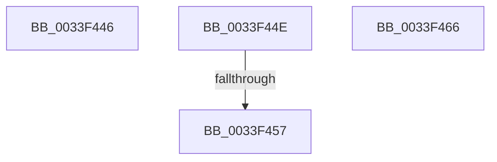

# sub_0033F446

- RVA: `0x0033F446`–`0x0033F467` (길이 `33` bytes)
- VA: `0x000000014033F446`
- 실행 섹션: `.text`
- PDB 이름 있음: `아니요`; PDB Function 태그: `아니요`
- unwind 정보 RVA: `0x000773A4`
- 디코드: `13`개 명령, `33/33` bytes 표시
- 미해석 바이트: `0` (있으면 어셈블리에 `.byte`로 보존)

> 이 문서는 커널 이미지의 기계어와 PDB 기호를 분석해 생성했습니다. 4번과 5번은 함수 원형과 자료형을 바이너리 사용 방식에서 추정한 C 해석이며 원본 소스 복구 결과는 아닙니다.

## 1. Dependencies

- 직접 호출 지점: **0**; 고유 호출 대상: **0**
- 직접 호출자로 확인된 함수: **0**
- RIP 상대 이미지 참조: **0**

### Outgoing calls
- 직접 디코드된 call 명령이 없습니다.

### Direct callers
- 이 함수 시작 RVA로 연결되는 직접 call은 확인되지 않았습니다. 간접 호출은 완전히 역산할 수 없습니다.

### Static image references
- 디코드된 RIP-relative 메모리 참조가 없습니다.

## 2. Other-region calls and transfers

- 다른 실행 섹션으로 향하는 call: **0**
- call이 아닌 외부 분기/꼬리 이동: **2**
  - `0x0033F449` → [sub_0033F345](Unknown_function_0033F345.md) (`tail-transfer`)
  - `0x0033F451` → [KeSetEvent + 0x30](KeSetEvent_function_0033F310.md) (`tail-transfer`)

## 3. Assembly (complete function range)

```asm
0033F446  CC                              int3
0033F447  33 FF                           xor edi, edi
0033F449  E9 F7 FE FF FF                  jmp 0x14033f345
0033F44E  45 84 C0                        test r8b, r8b
0033F451  0F 85 E9 FE FF FF               jne 0x14033f340
0033F457  B8 01 00 00 00                  mov eax, 1
0033F45C  48 83 C4 68                     add rsp, 0x68
0033F460  41 5F                           pop r15
0033F462  5F                              pop rdi
0033F463  5E                              pop rsi
0033F464  5D                              pop rbp
0033F465  C3                              ret
0033F466  CC                              int3
```

## 4. C-style interpretation (structured pseudocode)

```c
__int64 __fastcall sub_0033F446(__int64 a1, __int64 a2, unsigned __int8 a3)
{
    __int64 v_rdi;

    v_rdi = 0;
}
```

## 5. (Beta) C Style

```c
int64_t sub_0033F446(int64_t Arg1, int64_t Arg2, uint8_t Arg3)
{
    int64_t local_rdi;

    local_rdi = 0;
}
```

## 6. Execution-region graph

[열기: 2D/3D 그래프와 함수 탐색 컨트롤 패널](../../../control-panel.html?section=text&rva=0x0033F446&view=graph)

- 2D 그래프는 위에서 아래로 흐르고, 3D 그래프는 빈 공간을 드래그해 회전합니다. Shift+드래그는 이동, 휠은 확대·축소, 함수 노드 선택은 대상 보고서 이동입니다.

### Static fallback


