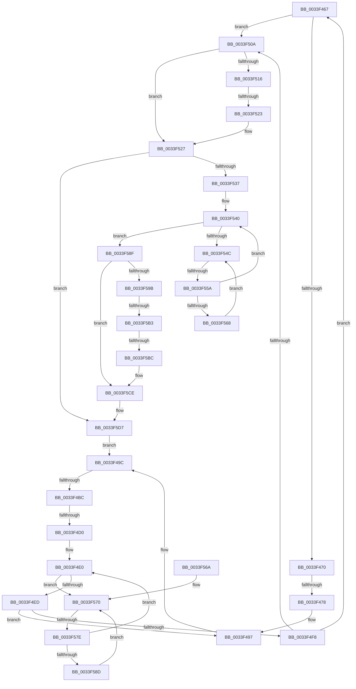

# sub_0033F467

- RVA: `0x0033F467`–`0x0033F613` (길이 `428` bytes)
- VA: `0x000000014033F467`
- 실행 섹션: `.text`
- PDB 이름 있음: `아니요`; PDB Function 태그: `아니요`
- unwind 정보 RVA: `0x000773B8`
- 디코드: `93`개 명령, `428/428` bytes 표시
- 미해석 바이트: `0` (있으면 어셈블리에 `.byte`로 보존)

> 이 문서는 커널 이미지의 기계어와 PDB 기호를 분석해 생성했습니다. 4번과 5번은 함수 원형과 자료형을 바이너리 사용 방식에서 추정한 C 해석이며 원본 소스 복구 결과는 아닙니다.

## 1. Dependencies

- 직접 호출 지점: **1**; 고유 호출 대상: **1**
- 직접 호출자로 확인된 함수: **0**
- RIP 상대 이미지 참조: **1**

### Outgoing calls
- `0x0033F5DA` → [KiEnterDeferredReadyState](../39/KiEnterDeferredReadyState_function_00397420.md) (function, `0x00397420`)

### Direct callers
- 이 함수 시작 RVA로 연결되는 직접 call은 확인되지 않았습니다. 간접 호출은 완전히 역산할 수 없습니다.

### Static image references
- `0x0033F54E` → RVA `0x00FC52AC` (`ALMOSTRO`; reference)

## 2. Other-region calls and transfers

- 다른 실행 섹션으로 향하는 call: **0**
- call이 아닌 외부 분기/꼬리 이동: **8**
  - `0x0033F472` → [sub_0033F9A3 + 0x64](Unknown_function_0033F9A3.md) (`tail-transfer`)
  - `0x0033F4B6` → [sub_0033F623 + 0x1EB](Unknown_function_0033F623.md) (`tail-transfer`)
  - `0x0033F4CA` → [sub_0033F84B + 0x4C](Unknown_function_0033F84B.md) (`tail-transfer`)
  - `0x0033F51D` → [sub_0033F84B + 0x96](Unknown_function_0033F84B.md) (`tail-transfer`)
  - `0x0033F554` → [sub_0033F84B + 0x10A](Unknown_function_0033F84B.md) (`tail-transfer`)
  - `0x0033F578` → [sub_0033F84B + 0xE3](Unknown_function_0033F84B.md) (`tail-transfer`)
  - `0x0033F5AD` → [sub_0033F345 + 0x95](Unknown_function_0033F345.md) (`tail-transfer`)
  - `0x0033F5B6` → [sub_0033F345 + 0x95](Unknown_function_0033F345.md) (`tail-transfer`)

## 3. Assembly (complete function range)

```asm
0033F467  83 F8 04                        cmp eax, 4
0033F46A  0F 84 9A 00 00 00               je 0x14033f50a
0033F470  85 C0                           test eax, eax
0033F472  0F 85 8F 05 00 00               jne 0x14033fa07
0033F478  80 E1 FA                        and cl, 0xfa
0033F47B  80 C9 02                        or cl, 2
0033F47E  88 4B 70                        mov byte ptr [rbx + 0x70], cl
0033F481  4C 89 AB C8 00 00 00            mov qword ptr [rbx + 0xc8], r13
0033F488  48 C7 83 D0 03 00 00 00 00 00 00  mov qword ptr [rbx + 0x3d0], 0
0033F493  41 88 46 11                     mov byte ptr [r14 + 0x11], al
0033F497  4C 8B 54 24 30                  mov r10, qword ptr [rsp + 0x30]
0033F49C  48 C7 43 40 00 00 00 00         mov qword ptr [rbx + 0x40], 0
0033F4A4  41 0F B6 46 11                  movzx eax, byte ptr [r14 + 0x11]
0033F4A9  FE C0                           inc al
0033F4AB  41 88 46 11                     mov byte ptr [r14 + 0x11], al
0033F4AF  48 8D 46 08                     lea rax, [rsi + 8]
0033F4B3  4C 3B E0                        cmp r12, rax
0033F4B6  0F 84 52 03 00 00               je 0x14033f80e
0033F4BC  4D 8B F4                        mov r14, r12
0033F4BF  4D 8B 24 24                     mov r12, qword ptr [r12]
0033F4C3  41 0F B6 46 10                  movzx eax, byte ptr [r14 + 0x10]
0033F4C8  3C 01                           cmp al, 1
0033F4CA  0F 85 C7 03 00 00               jne 0x14033f897
0033F4D0  45 0F B7 6E 12                  movzx r13d, word ptr [r14 + 0x12]
0033F4D5  33 FF                           xor edi, edi
0033F4D7  49 8B 5E 18                     mov rbx, qword ptr [r14 + 0x18]
0033F4DB  0F 1F 44 00 00                  nop dword ptr [rax + rax]
0033F4E0  F0 48 0F BA 6B 40 00            lock bts qword ptr [rbx + 0x40], 0
0033F4E7  0F 82 83 00 00 00               jb 0x14033f570
0033F4ED  0F B6 83 84 01 00 00            movzx eax, byte ptr [rbx + 0x184]
0033F4F4  3C 05                           cmp al, 5
0033F4F6  75 9F                           jne 0x14033f497
0033F4F8  0F B6 4B 70                     movzx ecx, byte ptr [rbx + 0x70]
0033F4FC  8B C1                           mov eax, ecx
0033F4FE  83 E0 07                        and eax, 7
0033F501  83 F8 01                        cmp eax, 1
0033F504  0F 85 5D FF FF FF               jne 0x14033f467
0033F50A  48 8B 93 E8 00 00 00            mov rdx, qword ptr [rbx + 0xe8]
0033F511  48 85 D2                        test rdx, rdx
0033F514  74 11                           je 0x14033f527
0033F516  0F B6 02                        movzx eax, byte ptr [rdx]
0033F519  24 7F                           and al, 0x7f
0033F51B  3C 15                           cmp al, 0x15
0033F51D  0F 84 BE 03 00 00               je 0x14033f8e1
0033F523  F0 FF 42 28                     lock inc dword ptr [rdx + 0x28]
0033F527  48 8B BB C8 02 00 00            mov rdi, qword ptr [rbx + 0x2c8]
0033F52E  48 85 FF                        test rdi, rdi
0033F531  0F 84 A0 00 00 00               je 0x14033f5d7
0033F537  33 ED                           xor ebp, ebp
0033F539  0F 1F 80 00 00 00 00            nop dword ptr [rax]
0033F540  F0 48 0F BA AF D0 83 00 00 00   lock bts qword ptr [rdi + 0x83d0], 0
0033F54A  73 43                           jae 0x14033f58f
0033F54C  FF C5                           inc ebp
0033F54E  85 2D 58 5D C8 00               test dword ptr [rip + 0xc85d58], ebp
0033F554  0F 84 FB 03 00 00               je 0x14033f955
0033F55A  F3 90                           pause
0033F55C  48 8B 87 D0 83 00 00            mov rax, qword ptr [rdi + 0x83d0]
0033F563  48 85 C0                        test rax, rax
0033F566  74 D8                           je 0x14033f540
0033F568  EB E2                           jmp 0x14033f54c
0033F56A  66 0F 1F 44 00 00               nop word ptr [rax + rax]
0033F570  FF C7                           inc edi
0033F572  85 3D 34 5D C8 00               test dword ptr [rip + 0xc85d34], edi
0033F578  0F 84 B0 03 00 00               je 0x14033f92e
0033F57E  F3 90                           pause
0033F580  48 8B 43 40                     mov rax, qword ptr [rbx + 0x40]
0033F584  48 85 C0                        test rax, rax
0033F587  0F 84 53 FF FF FF               je 0x14033f4e0
0033F58D  EB E1                           jmp 0x14033f570
0033F58F  48 8B 83 C8 02 00 00            mov rax, qword ptr [rbx + 0x2c8]
0033F596  48 85 C0                        test rax, rax
0033F599  74 33                           je 0x14033f5ce
0033F59B  48 8D 83 D8 00 00 00            lea rax, [rbx + 0xd8]
0033F5A2  48 8B 10                        mov rdx, qword ptr [rax]
0033F5A5  48 8B 48 08                     mov rcx, qword ptr [rax + 8]
0033F5A9  48 39 42 08                     cmp qword ptr [rdx + 8], rax
0033F5AD  0F 85 27 FE FF FF               jne 0x14033f3da
0033F5B3  48 39 01                        cmp qword ptr [rcx], rax
0033F5B6  0F 85 1E FE FF FF               jne 0x14033f3da
0033F5BC  48 89 11                        mov qword ptr [rcx], rdx
0033F5BF  48 89 4A 08                     mov qword ptr [rdx + 8], rcx
0033F5C3  48 C7 83 C8 02 00 00 00 00 00 00  mov qword ptr [rbx + 0x2c8], 0
0033F5CE  F0 48 83 A7 D0 83 00 00 00      lock and qword ptr [rdi + 0x83d0], 0
0033F5D7  48 8B CB                        mov rcx, rbx
0033F5DA  E8 41 7E 05 00                  call 0x140397420
0033F5DF  4C 8B 54 24 30                  mov r10, qword ptr [rsp + 0x30]
0033F5E4  48 8D 8B D8 00 00 00            lea rcx, [rbx + 0xd8]
0033F5EB  49 8B 82 08 2D 00 00            mov rax, qword ptr [r10 + 0x2d08]
0033F5F2  48 89 01                        mov qword ptr [rcx], rax
0033F5F5  49 89 8A 08 2D 00 00            mov qword ptr [r10 + 0x2d08], rcx
0033F5FC  4C 89 AB C8 00 00 00            mov qword ptr [rbx + 0xc8], r13
0033F603  48 C7 83 D0 03 00 00 00 00 00 00  mov qword ptr [rbx + 0x3d0], 0
0033F60E  E9 89 FE FF FF                  jmp 0x14033f49c
```

## 4. C-style interpretation (structured pseudocode)

```c
__int64 __fastcall sub_0033F467(unsigned __int8 a1, __int64 a2, __int64 a3, __int64 a4, __int64 a5, __int64 a6)
{
    __int64 result;
    __int64 v_rbp;
    __int64 v_rdi;

    if (((unsigned int)(result)) == 4) goto loc_0033F50A;
    a1 = (unsigned __int8)((a1) & (250));
    a1 = (unsigned __int8)((a1) | (2));
    *(unsigned __int8 *)(v_rbx + 112) = a1;
    *(unsigned __int64 *)(v_rbx + 200) = v_r13;
    *(unsigned __int64 *)(v_rbx + 976) = 0;
    *(unsigned __int8 *)(v_r14 + 17) = (unsigned __int8)(result);
loc_0033F497:
loc_0033F49C:
    *(unsigned __int64 *)(v_rbx + 64) = 0;
    result = (unsigned __int8)((*(unsigned __int8 *)(v_r14 + 17)) + 1);
    *(unsigned __int8 *)(v_r14 + 17) = (unsigned __int8)(result);
    v_rdi = 0;
loc_0033F4E0:
    if (condition_is_below) goto loc_0033F570;
    if (((unsigned __int8)(*(unsigned __int8 *)(*(unsigned __int64 *)(v_r12 + 24) + 388))) != 5) goto loc_0033F497;
    result = (unsigned int)(((unsigned int)((unsigned int)(*(unsigned __int8 *)(*(unsigned __int64 *)(v_r12 + 24) + 112)))) & (7));
    if (((unsigned int)(result)) != 1) goto loc_0033F467;
loc_0033F50A:
    if (*(unsigned __int64 *)(*(unsigned __int64 *)(v_r12 + 24) + 232) == 0) goto loc_0033F527;
    result = (unsigned __int8)((*(unsigned __int8 *)(*(unsigned __int64 *)(*(unsigned __int64 *)(v_r12 + 24) + 232))) & (127));
loc_0033F527:
    if (*(unsigned __int64 *)(*(unsigned __int64 *)(v_r12 + 24) + 712) == 0) goto loc_0033F5D7;
    v_rbp = 0;
loc_0033F540:
    if (condition_is_above_or_equal) goto loc_0033F58F;
loc_0033F54C:
    v_rbp = (unsigned int)((v_rbp) + 1);
    if (*(unsigned __int64 *)(*(unsigned __int64 *)(*(unsigned __int64 *)(v_r12 + 24) + 712) + 33744) == 0) goto loc_0033F540;
    goto loc_0033F54C;
loc_0033F570:
    v_rdi = (unsigned int)((*(unsigned __int64 *)(*(unsigned __int64 *)(v_r12 + 24) + 712)) + 1);
    if (*(unsigned __int64 *)(*(unsigned __int64 *)(v_r12 + 24) + 64) == 0) goto loc_0033F4E0;
    goto loc_0033F570;
loc_0033F58F:
    if (*(unsigned __int64 *)(*(unsigned __int64 *)(v_r12 + 24) + 712) == 0) goto loc_0033F5CE;
    *(unsigned __int64 *)(*(unsigned __int64 *)(*(unsigned __int64 *)(v_r12 + 24) + 216 + 8)) = *(unsigned __int64 *)(*(unsigned __int64 *)(v_r12 + 24) + 216);
    *(unsigned __int64 *)(*(unsigned __int64 *)(*(unsigned __int64 *)(v_r12 + 24) + 216) + 8) = *(unsigned __int64 *)(*(unsigned __int64 *)(v_r12 + 24) + 216 + 8);
    *(unsigned __int64 *)(*(unsigned __int64 *)(v_r12 + 24) + 712) = 0;
loc_0033F5CE:
loc_0033F5D7:
    result = KiEnterDeferredReadyState(*(unsigned __int64 *)(v_r12 + 24), *(unsigned __int64 *)(*(unsigned __int64 *)(v_r12 + 24) + 216), a3, a4);
    *(unsigned __int64 *)(*(unsigned __int64 *)(v_r12 + 24) + 216) = *(unsigned __int64 *)(a6 + 11528);
    *(unsigned __int64 *)(a6 + 11528) = *(unsigned __int64 *)(v_r12 + 24) + 216;
    *(unsigned __int64 *)(*(unsigned __int64 *)(v_r12 + 24) + 200) = *(unsigned __int16 *)(v_r12 + 18);
    *(unsigned __int64 *)(*(unsigned __int64 *)(v_r12 + 24) + 976) = 0;
    goto loc_0033F49C;
}
```

## 5. (Beta) C Style

```c
int64_t sub_0033F467(uint8_t Arg1, int64_t Arg2, int64_t Arg3, int64_t Arg4, uint64_t Arg5, void *Arg6)
{
    uint8_t *arg6 = (uint8_t *)Arg6;

    int64_t result;
    int64_t local_rbp;
    int64_t local_rdi;

    if (((uint32_t)(result)) == 4) goto loc_0033F50A;
    Arg1 = (uint8_t)((Arg1) & (250));
    Arg1 = (uint8_t)((Arg1) | (2));
    *(uint8_t *)(local_rbx + 0x70) = Arg1;
    *(uint64_t *)(local_rbx + 0xC8) = local_r13;
    *(uint64_t *)(local_rbx + 0x3D0) = 0;
    *(uint8_t *)(local_r14 + 0x11) = (uint8_t)(result);
loc_0033F497:
loc_0033F49C:
    *(uint64_t *)(local_rbx + 0x40) = 0;
    result = (uint8_t)((*(uint8_t *)(local_r14 + 0x11)) + 1);
    *(uint8_t *)(local_r14 + 0x11) = (uint8_t)(result);
    local_rdi = 0;
loc_0033F4E0:
    if (condition_is_below) goto loc_0033F570;
    if (((uint8_t)(*(uint8_t *)(*(uint64_t *)(local_r12 + 0x18) + 0x184))) != 5) goto loc_0033F497;
    result = (uint32_t)(((uint32_t)((uint32_t)(*(uint8_t *)(*(uint64_t *)(local_r12 + 0x18) + 0x70)))) & (7));
    if (((uint32_t)(result)) != 1) goto loc_0033F467;
loc_0033F50A:
    if (*(uint64_t *)(*(uint64_t *)(local_r12 + 0x18) + 0xE8) == 0) goto loc_0033F527;
    result = (uint8_t)((*(uint8_t *)(*(uint64_t *)(*(uint64_t *)(local_r12 + 0x18) + 0xE8))) & (127));
loc_0033F527:
    if (*(uint64_t *)(*(uint64_t *)(local_r12 + 0x18) + 0x2C8) == 0) goto loc_0033F5D7;
    local_rbp = 0;
loc_0033F540:
    if (condition_is_above_or_equal) goto loc_0033F58F;
loc_0033F54C:
    local_rbp = (uint32_t)((local_rbp) + 1);
    if (*(uint64_t *)(*(uint64_t *)(*(uint64_t *)(local_r12 + 0x18) + 0x2C8) + 0x83D0) == 0) goto loc_0033F540;
    goto loc_0033F54C;
loc_0033F570:
    local_rdi = (uint32_t)((*(uint64_t *)(*(uint64_t *)(local_r12 + 0x18) + 0x2C8)) + 1);
    if (*(uint64_t *)(*(uint64_t *)(local_r12 + 0x18) + 0x40) == 0) goto loc_0033F4E0;
    goto loc_0033F570;
loc_0033F58F:
    if (*(uint64_t *)(*(uint64_t *)(local_r12 + 0x18) + 0x2C8) == 0) goto loc_0033F5CE;
    *(uint64_t *)(*(uint64_t *)(*(uint64_t *)(local_r12 + 0x18) + 0xD8 + 0x8)) = *(uint64_t *)(*(uint64_t *)(local_r12 + 0x18) + 0xD8);
    *(uint64_t *)(*(uint64_t *)(*(uint64_t *)(local_r12 + 0x18) + 0xD8) + 0x8) = *(uint64_t *)(*(uint64_t *)(local_r12 + 0x18) + 0xD8 + 0x8);
    *(uint64_t *)(*(uint64_t *)(local_r12 + 0x18) + 0x2C8) = 0;
loc_0033F5CE:
loc_0033F5D7:
    result = KiEnterDeferredReadyState(*(uint64_t *)(local_r12 + 0x18), *(uint64_t *)(*(uint64_t *)(local_r12 + 0x18) + 0xD8), Arg3, Arg4);
    *(uint64_t *)(*(uint64_t *)(local_r12 + 0x18) + 0xD8) = *(uint64_t *)(arg6 + 0x2D08);
    *(uint64_t *)(arg6 + 0x2D08) = *(uint64_t *)(local_r12 + 0x18) + 216;
    *(uint64_t *)(*(uint64_t *)(local_r12 + 0x18) + 0xC8) = *(uint16_t *)(local_r12 + 0x12);
    *(uint64_t *)(*(uint64_t *)(local_r12 + 0x18) + 0x3D0) = 0;
    goto loc_0033F49C;
}
```

### 관측된 메모리 오프셋

구조체 형식이 확인되지 않은 접근은 인자 기준의 오프셋으로만 기록했습니다.

| 기준 인자 | 오프셋 표현 | 폭 (bit) | 접근 |
|---|---:|---:|---|
| `Arg6` | `+ 0x2D08` | `64` | `R` |
| `Arg6` | `+ 0x2D08` | `64` | `W` |

## 6. Execution-region graph

[열기: 2D/3D 그래프와 함수 탐색 컨트롤 패널](../../../control-panel.html?section=text&rva=0x0033F467&view=graph)

- 2D 그래프는 위에서 아래로 흐르고, 3D 그래프는 빈 공간을 드래그해 회전합니다. Shift+드래그는 이동, 휠은 확대·축소, 함수 노드 선택은 대상 보고서 이동입니다.

### Static fallback


