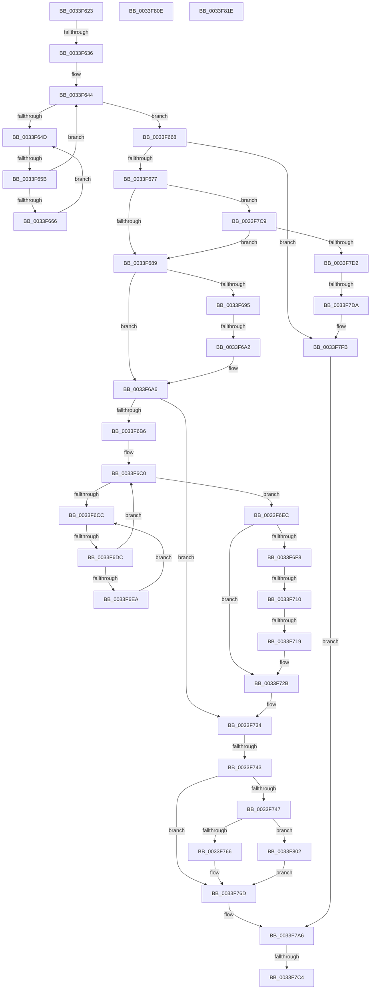

# sub_0033F623

- RVA: `0x0033F623`–`0x0033F820` (길이 `509` bytes)
- VA: `0x000000014033F623`
- 실행 섹션: `.text`
- PDB 이름 있음: `아니요`; PDB Function 태그: `아니요`
- unwind 정보 RVA: `0x000773EC`
- 디코드: `112`개 명령, `509/509` bytes 표시
- 미해석 바이트: `0` (있으면 어셈블리에 `.byte`로 보존)

> 이 문서는 커널 이미지의 기계어와 PDB 기호를 분석해 생성했습니다. 4번과 5번은 함수 원형과 자료형을 바이너리 사용 방식에서 추정한 C 해석이며 원본 소스 복구 결과는 아닙니다.

## 1. Dependencies

- 직접 호출 지점: **0**; 고유 호출 대상: **0**
- 직접 호출자로 확인된 함수: **0**
- RIP 상대 이미지 참조: **1**

### Outgoing calls
- 직접 디코드된 call 명령이 없습니다.

### Direct callers
- 이 함수 시작 RVA로 연결되는 직접 call은 확인되지 않았습니다. 간접 호출은 완전히 역산할 수 없습니다.

### Static image references
- `0x0033F64F` → RVA `0x00FC52AC` (`ALMOSTRO`; reference)

## 2. Other-region calls and transfers

- 다른 실행 섹션으로 향하는 call: **0**
- call이 아닌 외부 분기/꼬리 이동: **11**
  - `0x0033F630` → [sub_0033F84B](Unknown_function_0033F84B.md) (`tail-transfer`)
  - `0x0033F655` → [sub_0033F84B + 0x6F](Unknown_function_0033F84B.md) (`tail-transfer`)
  - `0x0033F69C` → [sub_0033F84B + 0x30](Unknown_function_0033F84B.md) (`tail-transfer`)
  - `0x0033F6D6` → [sub_0033F84B + 0xBB](Unknown_function_0033F84B.md) (`tail-transfer`)
  - `0x0033F70A` → [sub_0033F345 + 0x95](Unknown_function_0033F345.md) (`tail-transfer`)
  - `0x0033F713` → [sub_0033F345 + 0x95](Unknown_function_0033F345.md) (`tail-transfer`)
  - `0x0033F73D` → [sub_0033F84B + 0xB2](Unknown_function_0033F84B.md) (`tail-transfer`)
  - `0x0033F7BE` → [sub_0033F345 + 0x73](Unknown_function_0033F345.md) (`tail-transfer`)
  - `0x0033F7C4` → [sub_0033F345 + 0x9C](Unknown_function_0033F345.md) (`tail-transfer`)
  - `0x0033F7D4` → [sub_0033F9A3 + 0x4C](Unknown_function_0033F9A3.md) (`tail-transfer`)
  - `0x0033F819` → [sub_0033F345 + 0xA6](Unknown_function_0033F345.md) (`tail-transfer`)

## 3. Assembly (complete function range)

```asm
0033F623  48 89 01                        mov qword ptr [rcx], rax
0033F626  48 89 48 08                     mov qword ptr [rax + 8], rcx
0033F62A  0F B6 47 10                     movzx eax, byte ptr [rdi + 0x10]
0033F62E  3C 01                           cmp al, 1
0033F630  0F 85 15 02 00 00               jne 0x14033f84b
0033F636  44 0F B7 6F 12                  movzx r13d, word ptr [rdi + 0x12]
0033F63B  45 32 F6                        xor r14b, r14b
0033F63E  48 8B 5F 18                     mov rbx, qword ptr [rdi + 0x18]
0033F642  33 ED                           xor ebp, ebp
0033F644  F0 48 0F BA 6B 40 00            lock bts qword ptr [rbx + 0x40], 0
0033F64B  73 1B                           jae 0x14033f668
0033F64D  FF C5                           inc ebp
0033F64F  85 2D 57 5C C8 00               test dword ptr [rip + 0xc85c57], ebp
0033F655  0F 84 5F 02 00 00               je 0x14033f8ba
0033F65B  F3 90                           pause
0033F65D  48 8B 43 40                     mov rax, qword ptr [rbx + 0x40]
0033F661  48 85 C0                        test rax, rax
0033F664  74 DE                           je 0x14033f644
0033F666  EB E5                           jmp 0x14033f64d
0033F668  0F B6 83 84 01 00 00            movzx eax, byte ptr [rbx + 0x184]
0033F66F  3C 05                           cmp al, 5
0033F671  0F 85 84 01 00 00               jne 0x14033f7fb
0033F677  0F B6 4B 70                     movzx ecx, byte ptr [rbx + 0x70]
0033F67B  8B C1                           mov eax, ecx
0033F67D  83 E0 07                        and eax, 7
0033F680  83 F8 01                        cmp eax, 1
0033F683  0F 85 40 01 00 00               jne 0x14033f7c9
0033F689  48 8B 93 E8 00 00 00            mov rdx, qword ptr [rbx + 0xe8]
0033F690  48 85 D2                        test rdx, rdx
0033F693  74 11                           je 0x14033f6a6
0033F695  0F B6 02                        movzx eax, byte ptr [rdx]
0033F698  24 7F                           and al, 0x7f
0033F69A  3C 15                           cmp al, 0x15
0033F69C  0F 84 D9 01 00 00               je 0x14033f87b
0033F6A2  F0 FF 42 28                     lock inc dword ptr [rdx + 0x28]
0033F6A6  48 8B AB C8 02 00 00            mov rbp, qword ptr [rbx + 0x2c8]
0033F6AD  48 85 ED                        test rbp, rbp
0033F6B0  0F 84 7E 00 00 00               je 0x14033f734
0033F6B6  45 33 F6                        xor r14d, r14d
0033F6B9  0F 1F 80 00 00 00 00            nop dword ptr [rax]
0033F6C0  F0 48 0F BA AD D0 83 00 00 00   lock bts qword ptr [rbp + 0x83d0], 0
0033F6CA  73 20                           jae 0x14033f6ec
0033F6CC  41 FF C6                        inc r14d
0033F6CF  44 85 35 D6 5B C8 00            test dword ptr [rip + 0xc85bd6], r14d
0033F6D6  0F 84 2A 02 00 00               je 0x14033f906
0033F6DC  F3 90                           pause
0033F6DE  48 8B 85 D0 83 00 00            mov rax, qword ptr [rbp + 0x83d0]
0033F6E5  48 85 C0                        test rax, rax
0033F6E8  74 D6                           je 0x14033f6c0
0033F6EA  EB E0                           jmp 0x14033f6cc
0033F6EC  48 8B 83 C8 02 00 00            mov rax, qword ptr [rbx + 0x2c8]
0033F6F3  48 85 C0                        test rax, rax
0033F6F6  74 33                           je 0x14033f72b
0033F6F8  48 8D 83 D8 00 00 00            lea rax, [rbx + 0xd8]
0033F6FF  48 8B 10                        mov rdx, qword ptr [rax]
0033F702  48 8B 48 08                     mov rcx, qword ptr [rax + 8]
0033F706  48 39 42 08                     cmp qword ptr [rdx + 8], rax
0033F70A  0F 85 CA FC FF FF               jne 0x14033f3da
0033F710  48 39 01                        cmp qword ptr [rcx], rax
0033F713  0F 85 C1 FC FF FF               jne 0x14033f3da
0033F719  48 89 11                        mov qword ptr [rcx], rdx
0033F71C  48 89 4A 08                     mov qword ptr [rdx + 8], rcx
0033F720  48 C7 83 C8 02 00 00 00 00 00 00  mov qword ptr [rbx + 0x2c8], 0
0033F72B  F0 48 83 A5 D0 83 00 00 00      lock and qword ptr [rbp + 0x83d0], 0
0033F734  0F B6 83 84 01 00 00            movzx eax, byte ptr [rbx + 0x184]
0033F73B  3C 01                           cmp al, 1
0033F73D  0F 84 BA 01 00 00               je 0x14033f8fd
0033F743  3C 05                           cmp al, 5
0033F745  75 26                           jne 0x14033f76d
0033F747  48 B8 20 03 00 00 80 F7 FF FF   movabs rax, 0xfffff78000000320
0033F751  8B 08                           mov ecx, dword ptr [rax]
0033F753  2B 8B B4 01 00 00               sub ecx, dword ptr [rbx + 0x1b4]
0033F759  80 BB 87 01 00 00 00            cmp byte ptr [rbx + 0x187], 0
0033F760  0F 84 9C 00 00 00               je 0x14033f802
0033F766  48 01 8B E8 03 00 00            add qword ptr [rbx + 0x3e8], rcx
0033F76D  4C 8B 54 24 30                  mov r10, qword ptr [rsp + 0x30]
0033F772  48 8D 8B D8 00 00 00            lea rcx, [rbx + 0xd8]
0033F779  C6 83 84 01 00 00 07            mov byte ptr [rbx + 0x184], 7
0033F780  41 B6 01                        mov r14b, 1
0033F783  49 8B 82 08 2D 00 00            mov rax, qword ptr [r10 + 0x2d08]
0033F78A  48 89 01                        mov qword ptr [rcx], rax
0033F78D  49 89 8A 08 2D 00 00            mov qword ptr [r10 + 0x2d08], rcx
0033F794  4C 89 AB C8 00 00 00            mov qword ptr [rbx + 0xc8], r13
0033F79B  48 C7 83 D0 03 00 00 00 00 00 00  mov qword ptr [rbx + 0x3d0], 0
0033F7A6  48 C7 43 40 00 00 00 00         mov qword ptr [rbx + 0x40], 0
0033F7AE  0F B6 47 11                     movzx eax, byte ptr [rdi + 0x11]
0033F7B2  FE C0                           inc al
0033F7B4  88 47 11                        mov byte ptr [rdi + 0x11], al
0033F7B7  48 8D 46 08                     lea rax, [rsi + 8]
0033F7BB  45 84 F6                        test r14b, r14b
0033F7BE  0F 84 F4 FB FF FF               je 0x14033f3b8
0033F7C4  E9 18 FC FF FF                  jmp 0x14033f3e1
0033F7C9  83 F8 04                        cmp eax, 4
0033F7CC  0F 84 B7 FE FF FF               je 0x14033f689
0033F7D2  85 C0                           test eax, eax
0033F7D4  0F 85 15 02 00 00               jne 0x14033f9ef
0033F7DA  80 E1 FA                        and cl, 0xfa
0033F7DD  41 B6 01                        mov r14b, 1
0033F7E0  80 C9 02                        or cl, 2
0033F7E3  88 4B 70                        mov byte ptr [rbx + 0x70], cl
0033F7E6  4C 89 AB C8 00 00 00            mov qword ptr [rbx + 0xc8], r13
0033F7ED  48 C7 83 D0 03 00 00 00 00 00 00  mov qword ptr [rbx + 0x3d0], 0
0033F7F8  88 47 11                        mov byte ptr [rdi + 0x11], al
0033F7FB  4C 8B 54 24 30                  mov r10, qword ptr [rsp + 0x30]
0033F800  EB A4                           jmp 0x14033f7a6
0033F802  48 01 8B E0 03 00 00            add qword ptr [rbx + 0x3e0], rcx
0033F809  E9 5F FF FF FF                  jmp 0x14033f76d
0033F80E  48 8D 46 08                     lea rax, [rsi + 8]
0033F812  48 89 40 08                     mov qword ptr [rax + 8], rax
0033F816  48 89 00                        mov qword ptr [rax], rax
0033F819  E9 CD FB FF FF                  jmp 0x14033f3eb
0033F81E  66 90                           nop
```

## 4. C-style interpretation (structured pseudocode)

```c
__int64 __fastcall sub_0033F623(__int64 a1, __int64 a2, __int64 a3, __int64 a4, __int64 a5, __int64 a6)
{
    __int64 result;
    __int64 v_r14;
    __int64 v_rbp;

    *(unsigned __int64 *)(a1) = result;
    *(unsigned __int64 *)(result + 8) = a1;
    v_r14 = 0;
    v_rbp = 0;
loc_0033F644:
    if (condition_is_above_or_equal) goto loc_0033F668;
loc_0033F64D:
    v_rbp = (unsigned int)((v_rbp) + 1);
    if (*(unsigned __int64 *)(*(unsigned __int64 *)(v_rdi + 24) + 64) == 0) goto loc_0033F644;
    goto loc_0033F64D;
loc_0033F668:
    if (((unsigned __int8)(*(unsigned __int8 *)(*(unsigned __int64 *)(v_rdi + 24) + 388))) != 5) goto loc_0033F7FB;
    result = (unsigned int)(((unsigned int)((unsigned int)(*(unsigned __int8 *)(*(unsigned __int64 *)(v_rdi + 24) + 112)))) & (7));
    if (((unsigned int)(result)) != 1) goto loc_0033F7C9;
loc_0033F689:
    if (*(unsigned __int64 *)(*(unsigned __int64 *)(v_rdi + 24) + 232) == 0) goto loc_0033F6A6;
    result = (unsigned __int8)((*(unsigned __int8 *)(*(unsigned __int64 *)(*(unsigned __int64 *)(v_rdi + 24) + 232))) & (127));
loc_0033F6A6:
    if (*(unsigned __int64 *)(*(unsigned __int64 *)(v_rdi + 24) + 712) == 0) goto loc_0033F734;
    v_r14 = 0;
loc_0033F6C0:
    if (condition_is_above_or_equal) goto loc_0033F6EC;
loc_0033F6CC:
    v_r14 = (unsigned int)((v_r14) + 1);
    if (*(unsigned __int64 *)(*(unsigned __int64 *)(*(unsigned __int64 *)(v_rdi + 24) + 712) + 33744) == 0) goto loc_0033F6C0;
    goto loc_0033F6CC;
loc_0033F6EC:
    if (*(unsigned __int64 *)(*(unsigned __int64 *)(v_rdi + 24) + 712) == 0) goto loc_0033F72B;
    *(unsigned __int64 *)(*(unsigned __int64 *)(*(unsigned __int64 *)(v_rdi + 24) + 216 + 8)) = *(unsigned __int64 *)(*(unsigned __int64 *)(v_rdi + 24) + 216);
    *(unsigned __int64 *)(*(unsigned __int64 *)(*(unsigned __int64 *)(v_rdi + 24) + 216) + 8) = *(unsigned __int64 *)(*(unsigned __int64 *)(v_rdi + 24) + 216 + 8);
    *(unsigned __int64 *)(*(unsigned __int64 *)(v_rdi + 24) + 712) = 0;
loc_0033F72B:
loc_0033F734:
    if (((unsigned __int8)(*(unsigned __int8 *)(*(unsigned __int64 *)(v_rdi + 24) + 388))) != 5) goto loc_0033F76D;
    a1 = (unsigned int)(((unsigned int)(*(unsigned int *)(*(unsigned __int8 *)(*(unsigned __int64 *)(v_rdi + 24) + 388)))) - (*(unsigned int *)(*(unsigned __int64 *)(v_rdi + 24) + 436)));
    if ((*(unsigned __int8 *)(*(unsigned __int64 *)(v_rdi + 24) + 391)) == 0) goto loc_0033F802;
loc_0033F76D:
    *(unsigned __int8 *)(*(unsigned __int64 *)(v_rdi + 24) + 388) = 7;
    *(unsigned __int64 *)(*(unsigned __int64 *)(v_rdi + 24) + 216) = *(unsigned __int64 *)(a6 + 11528);
    *(unsigned __int64 *)(a6 + 11528) = *(unsigned __int64 *)(v_rdi + 24) + 216;
    *(unsigned __int64 *)(*(unsigned __int64 *)(v_rdi + 24) + 200) = *(unsigned __int16 *)(v_rdi + 18);
    *(unsigned __int64 *)(*(unsigned __int64 *)(v_rdi + 24) + 976) = 0;
loc_0033F7A6:
    *(unsigned __int64 *)(*(unsigned __int64 *)(v_rdi + 24) + 64) = 0;
    result = (unsigned __int8)((*(unsigned __int8 *)(v_rdi + 17)) + 1);
    *(unsigned __int8 *)(v_rdi + 17) = (unsigned __int8)(result);
loc_0033F7C9:
    if (((unsigned int)(v_rsi + 8)) == 4) goto loc_0033F689;
    a1 = (unsigned __int8)((*(unsigned __int64 *)(v_rdi + 24) + 216) & (250));
    a1 = (unsigned __int8)((a1) | (2));
    *(unsigned __int8 *)(*(unsigned __int64 *)(v_rdi + 24) + 112) = (unsigned __int8)(a1);
    *(unsigned __int64 *)(*(unsigned __int64 *)(v_rdi + 24) + 200) = *(unsigned __int16 *)(v_rdi + 18);
    *(unsigned __int64 *)(*(unsigned __int64 *)(v_rdi + 24) + 976) = 0;
    *(unsigned __int8 *)(v_rdi + 17) = (unsigned __int8)(v_rsi + 8);
loc_0033F7FB:
    goto loc_0033F7A6;
loc_0033F802:
    goto loc_0033F76D;
}
```

## 5. (Beta) C Style

```c
int64_t sub_0033F623(void *Arg1, int64_t Arg2, int64_t Arg3, int64_t Arg4, uint64_t Arg5, void *Arg6)
{
    uint8_t *arg1 = (uint8_t *)Arg1;
    uint8_t *arg6 = (uint8_t *)Arg6;

    int64_t result;
    int64_t local_r14;
    int64_t local_rbp;

    *(uint64_t *)(arg1) = result;
    *(void **)(result + 0x8) = Arg1;
    local_r14 = 0;
    local_rbp = 0;
loc_0033F644:
    if (condition_is_above_or_equal) goto loc_0033F668;
loc_0033F64D:
    local_rbp = (uint32_t)((local_rbp) + 1);
    if (*(uint64_t *)(*(uint64_t *)(local_rdi + 0x18) + 0x40) == 0) goto loc_0033F644;
    goto loc_0033F64D;
loc_0033F668:
    if (((uint8_t)(*(uint8_t *)(*(uint64_t *)(local_rdi + 0x18) + 0x184))) != 5) goto loc_0033F7FB;
    result = (uint32_t)(((uint32_t)((uint32_t)(*(uint8_t *)(*(uint64_t *)(local_rdi + 0x18) + 0x70)))) & (7));
    if (((uint32_t)(result)) != 1) goto loc_0033F7C9;
loc_0033F689:
    if (*(uint64_t *)(*(uint64_t *)(local_rdi + 0x18) + 0xE8) == 0) goto loc_0033F6A6;
    result = (uint8_t)((*(uint8_t *)(*(uint64_t *)(*(uint64_t *)(local_rdi + 0x18) + 0xE8))) & (127));
loc_0033F6A6:
    if (*(uint64_t *)(*(uint64_t *)(local_rdi + 0x18) + 0x2C8) == 0) goto loc_0033F734;
    local_r14 = 0;
loc_0033F6C0:
    if (condition_is_above_or_equal) goto loc_0033F6EC;
loc_0033F6CC:
    local_r14 = (uint32_t)((local_r14) + 1);
    if (*(uint64_t *)(*(uint64_t *)(*(uint64_t *)(local_rdi + 0x18) + 0x2C8) + 0x83D0) == 0) goto loc_0033F6C0;
    goto loc_0033F6CC;
loc_0033F6EC:
    if (*(uint64_t *)(*(uint64_t *)(local_rdi + 0x18) + 0x2C8) == 0) goto loc_0033F72B;
    *(uint64_t *)(*(uint64_t *)(*(uint64_t *)(local_rdi + 0x18) + 0xD8 + 0x8)) = *(uint64_t *)(*(uint64_t *)(local_rdi + 0x18) + 0xD8);
    *(uint64_t *)(*(uint64_t *)(*(uint64_t *)(local_rdi + 0x18) + 0xD8) + 0x8) = *(uint64_t *)(*(uint64_t *)(local_rdi + 0x18) + 0xD8 + 0x8);
    *(uint64_t *)(*(uint64_t *)(local_rdi + 0x18) + 0x2C8) = 0;
loc_0033F72B:
loc_0033F734:
    if (((uint8_t)(*(uint8_t *)(*(uint64_t *)(local_rdi + 0x18) + 0x184))) != 5) goto loc_0033F76D;
    Arg1 = (uint32_t)(((uint32_t)(*(uint32_t *)(*(uint8_t *)(*(uint64_t *)(local_rdi + 0x18) + 0x184)))) - (*(uint32_t *)(*(uint64_t *)(local_rdi + 0x18) + 0x1B4)));
    if ((*(uint8_t *)(*(uint64_t *)(local_rdi + 0x18) + 0x187)) == 0) goto loc_0033F802;
loc_0033F76D:
    *(uint8_t *)(*(uint64_t *)(local_rdi + 0x18) + 0x184) = 7;
    *(uint64_t *)(*(uint64_t *)(local_rdi + 0x18) + 0xD8) = *(uint64_t *)(arg6 + 0x2D08);
    *(uint64_t *)(arg6 + 0x2D08) = *(uint64_t *)(local_rdi + 0x18) + 216;
    *(uint64_t *)(*(uint64_t *)(local_rdi + 0x18) + 0xC8) = *(uint16_t *)(local_rdi + 0x12);
    *(uint64_t *)(*(uint64_t *)(local_rdi + 0x18) + 0x3D0) = 0;
loc_0033F7A6:
    *(uint64_t *)(*(uint64_t *)(local_rdi + 0x18) + 0x40) = 0;
    result = (uint8_t)((*(uint8_t *)(local_rdi + 0x11)) + 1);
    *(uint8_t *)(local_rdi + 0x11) = (uint8_t)(result);
loc_0033F7C9:
    if (((uint32_t)(local_rsi + 8)) == 4) goto loc_0033F689;
    Arg1 = (uint8_t)((*(uint64_t *)(local_rdi + 0x18) + 216) & (250));
    Arg1 = (uint8_t)((Arg1) | (2));
    *(uint8_t *)(*(uint64_t *)(local_rdi + 0x18) + 0x70) = (uint8_t)(Arg1);
    *(uint64_t *)(*(uint64_t *)(local_rdi + 0x18) + 0xC8) = *(uint16_t *)(local_rdi + 0x12);
    *(uint64_t *)(*(uint64_t *)(local_rdi + 0x18) + 0x3D0) = 0;
    *(uint8_t *)(local_rdi + 0x11) = (uint8_t)(local_rsi + 8);
loc_0033F7FB:
    goto loc_0033F7A6;
loc_0033F802:
    goto loc_0033F76D;
}
```

### 관측된 메모리 오프셋

구조체 형식이 확인되지 않은 접근은 인자 기준의 오프셋으로만 기록했습니다.

| 기준 인자 | 오프셋 표현 | 폭 (bit) | 접근 |
|---|---:|---:|---|
| `Arg1` | `+ 0x0` | `64` | `W` |
| `Arg6` | `+ 0x2D08` | `64` | `R` |
| `Arg6` | `+ 0x2D08` | `64` | `W` |

## 6. Execution-region graph

[열기: 2D/3D 그래프와 함수 탐색 컨트롤 패널](../../../control-panel.html?section=text&rva=0x0033F623&view=graph)

- 2D 그래프는 위에서 아래로 흐르고, 3D 그래프는 빈 공간을 드래그해 회전합니다. Shift+드래그는 이동, 휠은 확대·축소, 함수 노드 선택은 대상 보고서 이동입니다.

### Static fallback


