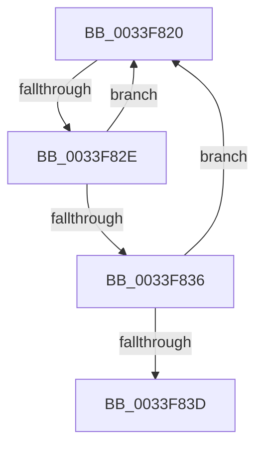

# sub_0033F820

- RVA: `0x0033F820`–`0x0033F84B` (길이 `43` bytes)
- VA: `0x000000014033F820`
- 실행 섹션: `.text`
- PDB 이름 있음: `아니요`; PDB Function 태그: `아니요`
- unwind 정보 RVA: `0x0007740C`
- 디코드: `12`개 명령, `43/43` bytes 표시
- 미해석 바이트: `0` (있으면 어셈블리에 `.byte`로 보존)

> 이 문서는 커널 이미지의 기계어와 PDB 기호를 분석해 생성했습니다. 4번과 5번은 함수 원형과 자료형을 바이너리 사용 방식에서 추정한 C 해석이며 원본 소스 복구 결과는 아닙니다.

## 1. Dependencies

- 직접 호출 지점: **0**; 고유 호출 대상: **0**
- 직접 호출자로 확인된 함수: **0**
- RIP 상대 이미지 참조: **1**

### Outgoing calls
- 직접 디코드된 call 명령이 없습니다.

### Direct callers
- 이 함수 시작 RVA로 연결되는 직접 call은 확인되지 않았습니다. 간접 호출은 완전히 역산할 수 없습니다.

### Static image references
- `0x0033F822` → RVA `0x00FC52AC` (`ALMOSTRO`; reference)

## 2. Other-region calls and transfers

- 다른 실행 섹션으로 향하는 call: **0**
- call이 아닌 외부 분기/꼬리 이동: **2**
  - `0x0033F828` → [sub_0033F97C](Unknown_function_0033F97C.md) (`tail-transfer`)
  - `0x0033F846` → [sub_0033F345 + 0x3F](Unknown_function_0033F345.md) (`tail-transfer`)

## 3. Assembly (complete function range)

```asm
0033F820  FF C3                           inc ebx
0033F822  85 1D 84 5A C8 00               test dword ptr [rip + 0xc85a84], ebx
0033F828  0F 84 4E 01 00 00               je 0x14033f97c
0033F82E  F3 90                           pause
0033F830  8B 06                           mov eax, dword ptr [rsi]
0033F832  84 C0                           test al, al
0033F834  78 EA                           js 0x14033f820
0033F836  F0 0F BA 2E 07                  lock bts dword ptr [rsi], 7
0033F83B  72 E3                           jb 0x14033f820
0033F83D  4C 8B 54 24 30                  mov r10, qword ptr [rsp + 0x30]
0033F842  4C 8D 7E 04                     lea r15, [rsi + 4]
0033F846  E9 39 FB FF FF                  jmp 0x14033f384
```

## 4. C-style interpretation (structured pseudocode)

```c
__int64 __fastcall sub_0033F820(__int64 a1, __int64 a2, __int64 a3, __int64 a4, __int64 a5, __int64 a6)
{
    __int64 v_rbx;

    v_rbx = (unsigned int)((v_rbx) + 1);
    if (sign_flag) goto loc_0033F820;
    if (condition_is_below) goto loc_0033F820;
}
```

## 5. (Beta) C Style

```c
int64_t sub_0033F820(int64_t Arg1, int64_t Arg2, int64_t Arg3, int64_t Arg4, uint64_t Arg5, int64_t Arg6)
{
    int64_t local_rbx;

    local_rbx = (uint32_t)((local_rbx) + 1);
    if (sign_flag) goto loc_0033F820;
    if (condition_is_below) goto loc_0033F820;
}
```

## 6. Execution-region graph

[열기: 2D/3D 그래프와 함수 탐색 컨트롤 패널](../../../control-panel.html?section=text&rva=0x0033F820&view=graph)

- 2D 그래프는 위에서 아래로 흐르고, 3D 그래프는 빈 공간을 드래그해 회전합니다. Shift+드래그는 이동, 휠은 확대·축소, 함수 노드 선택은 대상 보고서 이동입니다.

### Static fallback


