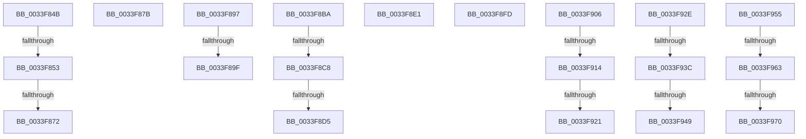

# sub_0033F84B

- RVA: `0x0033F84B`–`0x0033F97C` (길이 `305` bytes)
- VA: `0x000000014033F84B`
- 실행 섹션: `.text`
- PDB 이름 있음: `아니요`; PDB Function 태그: `아니요`
- unwind 정보 RVA: `0x00077420`
- 디코드: `67`개 명령, `305/305` bytes 표시
- 미해석 바이트: `0` (있으면 어셈블리에 `.byte`로 보존)

> 이 문서는 커널 이미지의 기계어와 PDB 기호를 분석해 생성했습니다. 4번과 5번은 함수 원형과 자료형을 바이너리 사용 방식에서 추정한 C 해석이며 원본 소스 복구 결과는 아닙니다.

## 1. Dependencies

- 직접 호출 지점: **10**; 고유 호출 대상: **3**
- 직접 호출자로 확인된 함수: **0**
- RIP 상대 이미지 참조: **1**

### Outgoing calls
- `0x0033F85E` → [KiInsertQueueInternal](../21/KiInsertQueueInternal_function_00219B30.md) (function, `0x00219B30`)
- `0x0033F8AB` → [KiInsertQueueInternal](../21/KiInsertQueueInternal_function_00219B30.md) (function, `0x00219B30`)
- `0x0033F8C8` → [KiCheckVpBackingLongSpinWaitHypercall](../30/KiCheckVpBackingLongSpinWaitHypercall_function_0030F490.md) (function, `0x0030F490`)
- `0x0033F8D7` → [HvlNotifyLongSpinWait](../30/HvlNotifyLongSpinWait_function_0030F460.md) (function, `0x0030F460`)
- `0x0033F914` → [KiCheckVpBackingLongSpinWaitHypercall](../30/KiCheckVpBackingLongSpinWaitHypercall_function_0030F490.md) (function, `0x0030F490`)
- `0x0033F924` → [HvlNotifyLongSpinWait](../30/HvlNotifyLongSpinWait_function_0030F460.md) (function, `0x0030F460`)
- `0x0033F93C` → [KiCheckVpBackingLongSpinWaitHypercall](../30/KiCheckVpBackingLongSpinWaitHypercall_function_0030F490.md) (function, `0x0030F490`)
- `0x0033F94B` → [HvlNotifyLongSpinWait](../30/HvlNotifyLongSpinWait_function_0030F460.md) (function, `0x0030F460`)
- `0x0033F963` → [KiCheckVpBackingLongSpinWaitHypercall](../30/KiCheckVpBackingLongSpinWaitHypercall_function_0030F490.md) (function, `0x0030F490`)
- `0x0033F972` → [HvlNotifyLongSpinWait](../30/HvlNotifyLongSpinWait_function_0030F460.md) (function, `0x0030F460`)

### Direct callers
- 이 함수 시작 RVA로 연결되는 직접 call은 확인되지 않았습니다. 간접 호출은 완전히 역산할 수 없습니다.

### Static image references
- `0x0033F8BA` → RVA `0x00FC6AB8` (`ALMOSTRO`; read)

## 2. Other-region calls and transfers

- 다른 실행 섹션으로 향하는 call: **0**
- call이 아닌 외부 분기/꼬리 이동: **20**
  - `0x0033F84D` → [sub_0033F9A3](Unknown_function_0033F9A3.md) (`tail-transfer`)
  - `0x0033F86C` → [sub_0033F345 + 0xA6](Unknown_function_0033F345.md) (`tail-transfer`)
  - `0x0033F876` → [sub_0033F345 + 0x73](Unknown_function_0033F345.md) (`tail-transfer`)
  - `0x0033F892` → [sub_0033F623 + 0x83](Unknown_function_0033F623.md) (`tail-transfer`)
  - `0x0033F899` → [sub_0033F9A3 + 0x26](Unknown_function_0033F9A3.md) (`tail-transfer`)
  - `0x0033F8B5` → [sub_0033F467 + 0x48](Unknown_function_0033F467.md) (`tail-transfer`)
  - `0x0033F8C2` → [sub_0033F623 + 0x38](Unknown_function_0033F623.md) (`tail-transfer`)
  - `0x0033F8CF` → [sub_0033F623 + 0x38](Unknown_function_0033F623.md) (`tail-transfer`)
  - `0x0033F8DC` → [sub_0033F623 + 0x3A](Unknown_function_0033F623.md) (`tail-transfer`)
  - `0x0033F8F8` → [sub_0033F467 + 0xC0](Unknown_function_0033F467.md) (`tail-transfer`)
  - `0x0033F901` → [sub_0033F623 + 0x14A](Unknown_function_0033F623.md) (`tail-transfer`)
  - `0x0033F90E` → [sub_0033F623 + 0xB9](Unknown_function_0033F623.md) (`tail-transfer`)
  - `0x0033F91B` → [sub_0033F623 + 0xB9](Unknown_function_0033F623.md) (`tail-transfer`)
  - `0x0033F929` → [sub_0033F623 + 0xBB](Unknown_function_0033F623.md) (`tail-transfer`)
  - `0x0033F936` → [sub_0033F467 + 0x117](Unknown_function_0033F467.md) (`tail-transfer`)
  - `0x0033F943` → [sub_0033F467 + 0x117](Unknown_function_0033F467.md) (`tail-transfer`)
  - `0x0033F950` → [sub_0033F467 + 0x119](Unknown_function_0033F467.md) (`tail-transfer`)
  - `0x0033F95D` → [sub_0033F467 + 0xF3](Unknown_function_0033F467.md) (`tail-transfer`)
  - `0x0033F96A` → [sub_0033F467 + 0xF3](Unknown_function_0033F467.md) (`tail-transfer`)
  - `0x0033F977` → [sub_0033F467 + 0xF5](Unknown_function_0033F467.md) (`tail-transfer`)

## 3. Assembly (complete function range)

```asm
0033F84B  3C 02                           cmp al, 2
0033F84D  0F 85 50 01 00 00               jne 0x14033f9a3
0033F853  C6 47 11 05                     mov byte ptr [rdi + 0x11], 5
0033F857  48 8B D7                        mov rdx, rdi
0033F85A  48 8B 4F 18                     mov rcx, qword ptr [rdi + 0x18]
0033F85E  E8 CD A2 ED FF                  call 0x140219b30
0033F863  41 83 2F 01                     sub dword ptr [r15], 1
0033F867  4C 8B 54 24 30                  mov r10, qword ptr [rsp + 0x30]
0033F86C  0F 84 79 FB FF FF               je 0x14033f3eb
0033F872  48 8D 46 08                     lea rax, [rsi + 8]
0033F876  E9 3D FB FF FF                  jmp 0x14033f3b8
0033F87B  8B 83 1C 02 00 00               mov eax, dword ptr [rbx + 0x21c]
0033F881  0F B6 C0                        movzx eax, al
0033F884  89 83 1C 02 00 00               mov dword ptr [rbx + 0x21c], eax
0033F88A  F0 FF 84 82 18 02 00 00         lock inc dword ptr [rdx + rax*4 + 0x218]
0033F892  E9 0F FE FF FF                  jmp 0x14033f6a6
0033F897  3C 02                           cmp al, 2
0033F899  0F 85 2A 01 00 00               jne 0x14033f9c9
0033F89F  41 C6 46 11 05                  mov byte ptr [r14 + 0x11], 5
0033F8A4  49 8B D6                        mov rdx, r14
0033F8A7  49 8B 4E 18                     mov rcx, qword ptr [r14 + 0x18]
0033F8AB  E8 80 A2 ED FF                  call 0x140219b30
0033F8B0  4C 8B 54 24 30                  mov r10, qword ptr [rsp + 0x30]
0033F8B5  E9 F5 FB FF FF                  jmp 0x14033f4af
0033F8BA  8B 05 F8 71 C8 00               mov eax, dword ptr [rip + 0xc871f8]
0033F8C0  A8 40                           test al, 0x40
0033F8C2  0F 84 93 FD FF FF               je 0x14033f65b
0033F8C8  E8 C3 FB FC FF                  call 0x14030f490
0033F8CD  84 C0                           test al, al
0033F8CF  0F 84 86 FD FF FF               je 0x14033f65b
0033F8D5  8B CD                           mov ecx, ebp
0033F8D7  E8 84 FB FC FF                  call 0x14030f460
0033F8DC  E9 7C FD FF FF                  jmp 0x14033f65d
0033F8E1  8B 83 1C 02 00 00               mov eax, dword ptr [rbx + 0x21c]
0033F8E7  0F B6 C0                        movzx eax, al
0033F8EA  89 83 1C 02 00 00               mov dword ptr [rbx + 0x21c], eax
0033F8F0  F0 FF 84 82 18 02 00 00         lock inc dword ptr [rdx + rax*4 + 0x218]
0033F8F8  E9 2A FC FF FF                  jmp 0x14033f527
0033F8FD  83 4B 74 02                     or dword ptr [rbx + 0x74], 2
0033F901  E9 67 FE FF FF                  jmp 0x14033f76d
0033F906  8B 05 AC 71 C8 00               mov eax, dword ptr [rip + 0xc871ac]
0033F90C  A8 40                           test al, 0x40
0033F90E  0F 84 C8 FD FF FF               je 0x14033f6dc
0033F914  E8 77 FB FC FF                  call 0x14030f490
0033F919  84 C0                           test al, al
0033F91B  0F 84 BB FD FF FF               je 0x14033f6dc
0033F921  41 8B CE                        mov ecx, r14d
0033F924  E8 37 FB FC FF                  call 0x14030f460
0033F929  E9 B0 FD FF FF                  jmp 0x14033f6de
0033F92E  8B 05 84 71 C8 00               mov eax, dword ptr [rip + 0xc87184]
0033F934  A8 40                           test al, 0x40
0033F936  0F 84 42 FC FF FF               je 0x14033f57e
0033F93C  E8 4F FB FC FF                  call 0x14030f490
0033F941  84 C0                           test al, al
0033F943  0F 84 35 FC FF FF               je 0x14033f57e
0033F949  8B CF                           mov ecx, edi
0033F94B  E8 10 FB FC FF                  call 0x14030f460
0033F950  E9 2B FC FF FF                  jmp 0x14033f580
0033F955  8B 05 5D 71 C8 00               mov eax, dword ptr [rip + 0xc8715d]
0033F95B  A8 40                           test al, 0x40
0033F95D  0F 84 F7 FB FF FF               je 0x14033f55a
0033F963  E8 28 FB FC FF                  call 0x14030f490
0033F968  84 C0                           test al, al
0033F96A  0F 84 EA FB FF FF               je 0x14033f55a
0033F970  8B CD                           mov ecx, ebp
0033F972  E8 E9 FA FC FF                  call 0x14030f460
0033F977  E9 E0 FB FF FF                  jmp 0x14033f55c
```

## 4. C-style interpretation (structured pseudocode)

```c
__int64 __fastcall sub_0033F84B(__int64 a1, __int64 a2, __int64 a3, __int64 a4, __int64 a5, __int64 a6)
{
    __int64 result;
    unsigned __int64 v_stack_p30;

    *(unsigned __int8 *)(v_rdi + 17) = 5;
    result = KiInsertQueueInternal(*(unsigned __int64 *)(v_rdi + 24), v_rdi, a3, a4);
}
```

## 5. (Beta) C Style

```c
int64_t sub_0033F84B(int64_t Arg1, int64_t Arg2, int64_t Arg3, int64_t Arg4, uint64_t Arg5, int64_t Arg6)
{
    int64_t result;
    uint64_t v_stack_p30;

    *(uint8_t *)(local_rdi + 0x11) = 5;
    result = KiInsertQueueInternal(*(uint64_t *)(local_rdi + 0x18), local_rdi, Arg3, Arg4);
}
```

## 6. Execution-region graph

[열기: 2D/3D 그래프와 함수 탐색 컨트롤 패널](../../../control-panel.html?section=text&rva=0x0033F84B&view=graph)

- 2D 그래프는 위에서 아래로 흐르고, 3D 그래프는 빈 공간을 드래그해 회전합니다. Shift+드래그는 이동, 휠은 확대·축소, 함수 노드 선택은 대상 보고서 이동입니다.

### Static fallback


