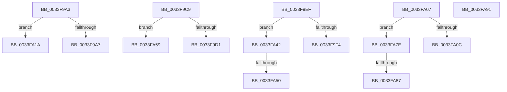

# sub_0033F9A3

- RVA: `0x0033F9A3`–`0x0033FA9A` (길이 `247` bytes)
- VA: `0x000000014033F9A3`
- 실행 섹션: `.text`
- PDB 이름 있음: `아니요`; PDB Function 태그: `아니요`
- unwind 정보 RVA: `0x00077454`
- 디코드: `60`개 명령, `247/247` bytes 표시
- 미해석 바이트: `0` (있으면 어셈블리에 `.byte`로 보존)

> 이 문서는 커널 이미지의 기계어와 PDB 기호를 분석해 생성했습니다. 4번과 5번은 함수 원형과 자료형을 바이너리 사용 방식에서 추정한 C 해석이며 원본 소스 복구 결과는 아닙니다.

## 1. Dependencies

- 직접 호출 지점: **4**; 고유 호출 대상: **2**
- 직접 호출자로 확인된 함수: **0**
- RIP 상대 이미지 참조: **0**

### Outgoing calls
- `0x0033F9B6` → [KiTryUnwaitThread](../35/KiTryUnwaitThread_function_003506D0.md) (function, `0x003506D0`)
- `0x0033F9E0` → [KiTryUnwaitThread](../35/KiTryUnwaitThread_function_003506D0.md) (function, `0x003506D0`)
- `0x0033FA2F` → [KeInsertQueueDpc](../20/KeInsertQueueDpc_function_00207C50.md) (function, `0x00207C50`)
- `0x0033FA6F` → [KeInsertQueueDpc](../20/KeInsertQueueDpc_function_00207C50.md) (function, `0x00207C50`)

### Direct callers
- 이 함수 시작 RVA로 연결되는 직접 call은 확인되지 않았습니다. 간접 호출은 완전히 역산할 수 없습니다.

### Static image references
- 디코드된 RIP-relative 메모리 참조가 없습니다.

## 2. Other-region calls and transfers

- 다른 실행 섹션으로 향하는 call: **0**
- call이 아닌 외부 분기/꼬리 이동: **11**
  - `0x0033F9C4` → [sub_0033F345 + 0x73](Unknown_function_0033F345.md) (`tail-transfer`)
  - `0x0033F9EA` → [sub_0033F467 + 0x48](Unknown_function_0033F467.md) (`tail-transfer`)
  - `0x0033FA02` → [sub_0033F623 + 0x183](Unknown_function_0033F623.md) (`tail-transfer`)
  - `0x0033FA15` → [sub_0033F467 + 0x30](Unknown_function_0033F467.md) (`tail-transfer`)
  - `0x0033FA3D` → [sub_0033F345 + 0x73](Unknown_function_0033F345.md) (`tail-transfer`)
  - `0x0033FA4A` → [sub_0033F623 + 0x183](Unknown_function_0033F623.md) (`tail-transfer`)
  - `0x0033FA54` → [sub_0033F623 + 0x183](Unknown_function_0033F623.md) (`tail-transfer`)
  - `0x0033FA79` → [sub_0033F467 + 0x48](Unknown_function_0033F467.md) (`tail-transfer`)
  - `0x0033FA81` → [sub_0033F467 + 0x30](Unknown_function_0033F467.md) (`tail-transfer`)
  - `0x0033FA8C` → [sub_0033F467 + 0x30](Unknown_function_0033F467.md) (`tail-transfer`)
  - `0x0033FA95` → [sub_0033F345 + 0x73](Unknown_function_0033F345.md) (`tail-transfer`)

## 3. Assembly (complete function range)

```asm
0033F9A3  3C 04                           cmp al, 4
0033F9A5  74 73                           je 0x14033fa1a
0033F9A7  45 33 C9                        xor r9d, r9d
0033F9AA  41 B8 00 01 00 00               mov r8d, 0x100
0033F9B0  48 8B D7                        mov rdx, rdi
0033F9B3  49 8B CA                        mov rcx, r10
0033F9B6  E8 15 0D 01 00                  call 0x1403506d0
0033F9BB  4C 8B 54 24 30                  mov r10, qword ptr [rsp + 0x30]
0033F9C0  48 8D 46 08                     lea rax, [rsi + 8]
0033F9C4  E9 EF F9 FF FF                  jmp 0x14033f3b8
0033F9C9  3C 04                           cmp al, 4
0033F9CB  0F 84 88 00 00 00               je 0x14033fa59
0033F9D1  45 33 C9                        xor r9d, r9d
0033F9D4  41 B8 00 01 00 00               mov r8d, 0x100
0033F9DA  49 8B D6                        mov rdx, r14
0033F9DD  49 8B CA                        mov rcx, r10
0033F9E0  E8 EB 0C 01 00                  call 0x1403506d0
0033F9E5  4C 8B 54 24 30                  mov r10, qword ptr [rsp + 0x30]
0033F9EA  E9 C0 FA FF FF                  jmp 0x14033f4af
0033F9EF  83 F8 05                        cmp eax, 5
0033F9F2  75 4E                           jne 0x14033fa42
0033F9F4  4C 8B 54 24 30                  mov r10, qword ptr [rsp + 0x30]
0033F9F9  80 E1 FE                        and cl, 0xfe
0033F9FC  80 C9 06                        or cl, 6
0033F9FF  88 4B 70                        mov byte ptr [rbx + 0x70], cl
0033FA02  E9 9F FD FF FF                  jmp 0x14033f7a6
0033FA07  83 F8 05                        cmp eax, 5
0033FA0A  75 72                           jne 0x14033fa7e
0033FA0C  80 E1 FE                        and cl, 0xfe
0033FA0F  80 C9 06                        or cl, 6
0033FA12  88 4B 70                        mov byte ptr [rbx + 0x70], cl
0033FA15  E9 7D FA FF FF                  jmp 0x14033f497
0033FA1A  C6 47 11 05                     mov byte ptr [rdi + 0x11], 5
0033FA1E  4C 8B C7                        mov r8, rdi
0033FA21  41 C7 07 00 00 00 00            mov dword ptr [r15], 0
0033FA28  48 8B D6                        mov rdx, rsi
0033FA2B  48 8B 4F 18                     mov rcx, qword ptr [rdi + 0x18]
0033FA2F  E8 1C 82 EC FF                  call 0x140207c50
0033FA34  4C 8B 54 24 30                  mov r10, qword ptr [rsp + 0x30]
0033FA39  48 8D 46 08                     lea rax, [rsi + 8]
0033FA3D  E9 76 F9 FF FF                  jmp 0x14033f3b8
0033FA42  4C 8B 54 24 30                  mov r10, qword ptr [rsp + 0x30]
0033FA47  83 F8 03                        cmp eax, 3
0033FA4A  0F 85 56 FD FF FF               jne 0x14033f7a6
0033FA50  C6 47 11 02                     mov byte ptr [rdi + 0x11], 2
0033FA54  E9 4D FD FF FF                  jmp 0x14033f7a6
0033FA59  41 C6 46 11 05                  mov byte ptr [r14 + 0x11], 5
0033FA5E  4D 8B C6                        mov r8, r14
0033FA61  41 C7 07 00 00 00 00            mov dword ptr [r15], 0
0033FA68  48 8B D6                        mov rdx, rsi
0033FA6B  49 8B 4E 18                     mov rcx, qword ptr [r14 + 0x18]
0033FA6F  E8 DC 81 EC FF                  call 0x140207c50
0033FA74  4C 8B 54 24 30                  mov r10, qword ptr [rsp + 0x30]
0033FA79  E9 31 FA FF FF                  jmp 0x14033f4af
0033FA7E  83 F8 03                        cmp eax, 3
0033FA81  0F 85 10 FA FF FF               jne 0x14033f497
0033FA87  41 C6 46 11 02                  mov byte ptr [r14 + 0x11], 2
0033FA8C  E9 06 FA FF FF                  jmp 0x14033f497
0033FA91  48 8D 46 08                     lea rax, [rsi + 8]
0033FA95  E9 1E F9 FF FF                  jmp 0x14033f3b8
```

## 4. C-style interpretation (structured pseudocode)

```c
__int64 __fastcall sub_0033F9A3(__int64 a1, __int64 a2, __int64 a3, int a4, __int64 a5, __int64 a6)
{
    __int64 result;
    unsigned __int64 v_stack_p30;

    if (((unsigned __int8)(result)) == 4) goto loc_0033FA1A;
    a4 = 0;
    result = KiTryUnwaitThread(v_r10, v_rdi, 256, a4);
loc_0033FA1A:
    *(unsigned __int8 *)(v_rdi + 17) = 5;
    *(unsigned int *)(v_r15) = 0;
    result = KeInsertQueueDpc(*(unsigned __int64 *)(v_rdi + 24), v_rsi, v_rdi, a4);
}
```

## 5. (Beta) C Style

```c
int64_t sub_0033F9A3(int64_t Arg1, int64_t Arg2, int64_t Arg3, int32_t Arg4, uint64_t Arg5, int64_t Arg6)
{
    int64_t result;
    uint64_t v_stack_p30;

    if (((uint8_t)(result)) == 4) goto loc_0033FA1A;
    Arg4 = 0;
    result = KiTryUnwaitThread(local_r10, local_rdi, 256, Arg4);
loc_0033FA1A:
    *(uint8_t *)(local_rdi + 0x11) = 5;
    *(uint32_t *)(local_r15) = 0;
    result = KeInsertQueueDpc(*(uint64_t *)(local_rdi + 0x18), local_rsi, local_rdi, Arg4);
}
```

## 6. Execution-region graph

[열기: 2D/3D 그래프와 함수 탐색 컨트롤 패널](../../../control-panel.html?section=text&rva=0x0033F9A3&view=graph)

- 2D 그래프는 위에서 아래로 흐르고, 3D 그래프는 빈 공간을 드래그해 회전합니다. Shift+드래그는 이동, 휠은 확대·축소, 함수 노드 선택은 대상 보고서 이동입니다.

### Static fallback


