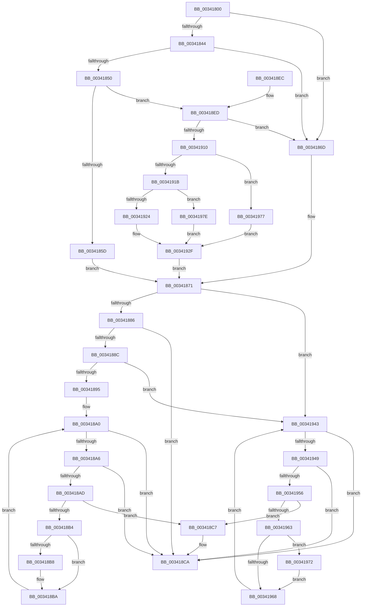

# CcFindBcb

- RVA: `0x00341800`–`0x00341985` (길이 `389` bytes)
- VA: `0x0000000140341800`
- 실행 섹션: `.text`
- PDB 이름 있음: `예`; PDB Function 태그: `아니요`
- unwind 정보 RVA: `0x0007758C`
- 디코드: `109`개 명령, `389/389` bytes 표시
- 미해석 바이트: `0` (있으면 어셈블리에 `.byte`로 보존)

> 이 문서는 커널 이미지의 기계어와 PDB 기호를 분석해 생성했습니다. 4번과 5번은 함수 원형과 자료형을 바이너리 사용 방식에서 추정한 C 해석이며 원본 소스 복구 결과는 아닙니다.

## 1. Dependencies

- 직접 호출 지점: **1**; 고유 호출 대상: **1**
- 직접 호출자로 확인된 함수: **1**
- RIP 상대 이미지 참조: **0**

### Outgoing calls
- `0x00341863` → [CcGetBcbListHeadLargeOffset](CcGetBcbListHeadLargeOffset_function_00341990.md) (function, `0x00341990`)

### Direct callers
- [CcAcquireByteRangeForWrite](../40/CcAcquireByteRangeForWrite_function_00401E74.md) at `0x004022D5`

### Static image references
- 디코드된 RIP-relative 메모리 참조가 없습니다.

## 2. Other-region calls and transfers

- 다른 실행 섹션으로 향하는 call: **0**
- 별도 외부 분기/꼬리 이동을 확인하지 못했습니다.

## 3. Assembly (complete function range)

```asm
00341800  48 89 5C 24 08                  mov qword ptr [rsp + 8], rbx
00341805  48 89 6C 24 10                  mov qword ptr [rsp + 0x10], rbp
0034180A  48 89 74 24 18                  mov qword ptr [rsp + 0x18], rsi
0034180F  48 89 7C 24 20                  mov qword ptr [rsp + 0x20], rdi
00341814  41 56                           push r14
00341816  48 83 EC 20                     sub rsp, 0x20
0034181A  4C 8B 1A                        mov r11, qword ptr [rdx]
0034181D  49 8B D8                        mov rbx, r8
00341820  4C 8B 41 20                     mov r8, qword ptr [rcx + 0x20]
00341824  49 8B F3                        mov rsi, r11
00341827  48 C1 EE 20                     shr rsi, 0x20
0034182B  40 32 ED                        xor bpl, bpl
0034182E  4D 8B F1                        mov r14, r9
00341831  48 8B FA                        mov rdi, rdx
00341834  4D 8D 93 00 00 08 00            lea r10, [r11 + 0x80000]
0034183B  49 81 F8 00 00 20 00            cmp r8, 0x200000
00341842  7E 29                           jle 0x14034186d
00341844  F7 81 98 00 00 00 00 02 00 00   test dword ptr [rcx + 0x98], 0x200
0034184E  74 1D                           je 0x14034186d
00341850  49 81 F8 00 00 00 02            cmp r8, 0x2000000
00341857  0F 8E 90 00 00 00               jle 0x1403418ed
0034185D  41 B0 01                        mov r8b, 1
00341860  49 8B D2                        mov rdx, r10
00341863  E8 28 01 00 00                  call 0x140341990
00341868  4C 8B D0                        mov r10, rax
0034186B  EB 04                           jmp 0x140341871
0034186D  4C 8D 51 10                     lea r10, [rcx + 0x10]
00341871  49 8B 0A                        mov rcx, qword ptr [r10]
00341874  41 B8 FD 02 00 00               mov r8d, 0x2fd
0034187A  48 8D 41 F0                     lea rax, [rcx - 0x10]
0034187E  85 F6                           test esi, esi
00341880  0F 85 BD 00 00 00               jne 0x140341943
00341886  66 44 39 00                     cmp word ptr [rax], r8w
0034188A  75 3E                           jne 0x1403418ca
0034188C  39 71 14                        cmp dword ptr [rcx + 0x14], esi
0034188F  0F 85 AE 00 00 00               jne 0x140341943
00341895  41 0F B7 C8                     movzx ecx, r8w
00341899  0F 1F 80 00 00 00 00            nop dword ptr [rax]
003418A0  66 41 3B C8                     cmp cx, r8w
003418A4  75 24                           jne 0x1403418ca
003418A6  8B 17                           mov edx, dword ptr [rdi]
003418A8  3B 50 20                        cmp edx, dword ptr [rax + 0x20]
003418AB  73 1D                           jae 0x1403418ca
003418AD  8B 48 08                        mov ecx, dword ptr [rax + 8]
003418B0  3B D1                           cmp edx, ecx
003418B2  73 13                           jae 0x1403418c7
003418B4  39 0B                           cmp dword ptr [rbx], ecx
003418B6  72 02                           jb 0x1403418ba
003418B8  89 0B                           mov dword ptr [rbx], ecx
003418BA  48 8B 40 10                     mov rax, qword ptr [rax + 0x10]
003418BE  48 83 C0 F0                     add rax, -0x10
003418C2  0F B7 08                        movzx ecx, word ptr [rax]
003418C5  EB D9                           jmp 0x1403418a0
003418C7  40 B5 01                        mov bpl, 1
003418CA  48 8B 5C 24 30                  mov rbx, qword ptr [rsp + 0x30]
003418CF  48 8B 74 24 40                  mov rsi, qword ptr [rsp + 0x40]
003418D4  48 8B 7C 24 48                  mov rdi, qword ptr [rsp + 0x48]
003418D9  49 89 06                        mov qword ptr [r14], rax
003418DC  40 0F B6 C5                     movzx eax, bpl
003418E0  48 8B 6C 24 38                  mov rbp, qword ptr [rsp + 0x38]
003418E5  48 83 C4 20                     add rsp, 0x20
003418E9  41 5E                           pop r14
003418EB  C3                              ret
003418EC  CC                              int3
003418ED  41 8B C0                        mov eax, r8d
003418F0  C1 F8 12                        sar eax, 0x12
003418F3  FF C0                           inc eax
003418F5  83 E0 FE                        and eax, 0xfffffffe
003418F8  99                              cdq
003418F9  2B C2                           sub eax, edx
003418FB  D1 F8                           sar eax, 1
003418FD  C1 E0 13                        shl eax, 0x13
00341900  2D 00 00 08 00                  sub eax, 0x80000
00341905  48 98                           cdqe
00341907  4C 3B D8                        cmp r11, rax
0034190A  0F 8D 5D FF FF FF               jge 0x14034186d
00341910  49 8B C0                        mov rax, r8
00341913  48 C1 E8 20                     shr rax, 0x20
00341917  85 C0                           test eax, eax
00341919  75 5C                           jne 0x140341977
0034191B  41 81 F8 00 00 10 00            cmp r8d, 0x100000
00341922  76 5A                           jbe 0x14034197e
00341924  41 8B C0                        mov eax, r8d
00341927  48 C1 E8 12                     shr rax, 0x12
0034192B  48 C1 E0 03                     shl rax, 3
0034192F  49 C1 FA 13                     sar r10, 0x13
00341933  49 C1 E2 04                     shl r10, 4
00341937  4C 03 51 58                     add r10, qword ptr [rcx + 0x58]
0034193B  4C 03 D0                        add r10, rax
0034193E  E9 2E FF FF FF                  jmp 0x140341871
00341943  66 44 39 00                     cmp word ptr [rax], r8w
00341947  75 81                           jne 0x1403418ca
00341949  48 8B 0F                        mov rcx, qword ptr [rdi]
0034194C  48 3B 48 20                     cmp rcx, qword ptr [rax + 0x20]
00341950  0F 8D 74 FF FF FF               jge 0x1403418ca
00341956  48 8B 50 08                     mov rdx, qword ptr [rax + 8]
0034195A  48 3B CA                        cmp rcx, rdx
0034195D  0F 8D 64 FF FF FF               jge 0x1403418c7
00341963  48 39 13                        cmp qword ptr [rbx], rdx
00341966  7D 0A                           jge 0x140341972
00341968  48 8B 40 10                     mov rax, qword ptr [rax + 0x10]
0034196C  48 83 E8 10                     sub rax, 0x10
00341970  EB D1                           jmp 0x140341943
00341972  48 89 13                        mov qword ptr [rbx], rdx
00341975  EB F1                           jmp 0x140341968
00341977  B8 FF FF FF FF                  mov eax, 0xffffffff
0034197C  EB B1                           jmp 0x14034192f
0034197E  B8 20 00 00 00                  mov eax, 0x20
00341983  EB AA                           jmp 0x14034192f
```

## 4. C-style interpretation (structured pseudocode)

```c
__int64 __fastcall CcFindBcb(__int64 a1, __int64 a2, __int64 a3, __int64 a4)
{
    __int64 result;
    __int64 v_r10;
    __int64 v_rbp;
    __int64 v_rsi;
    __int64 v_rsp;
    unsigned __int64 v_stack_p10;
    unsigned __int64 v_stack_p18;
    unsigned __int64 v_stack_p20;
    unsigned __int64 v_stack_p8;

    v_stack_p8 = v_rbx;
    v_stack_p10 = v_rbp;
    v_stack_p18 = v_rsi;
    v_stack_p20 = v_rdi;
    v_rsp = (v_rsp) - (32);
    v_rsi = (*(unsigned __int64 *)(a2)) >> (32);
    v_rbp = 0;
    if ((*(unsigned __int64 *)(a1 + 32)) <= 0x200000ULL) goto loc_0034186D;
    if (((*(unsigned int *)(a1 + 152)) & (512)) == 0) goto loc_0034186D;
    if ((*(unsigned __int64 *)(a1 + 32)) <= 0x2000000ULL) goto loc_003418ED;
    result = CcGetBcbListHeadLargeOffset(a1, *(unsigned __int64 *)(a2) + 524288, 1, a4);
    goto loc_00341871;
loc_0034186D:
loc_00341871:
    if ((unsigned int)(v_rsi) != 0) goto loc_00341943;
    if ((*(unsigned __int16 *)(*(unsigned __int64 *)(a1 + 16) - 16)) != 765) goto loc_003418CA;
    if ((*(unsigned int *)(*(unsigned __int64 *)(a1 + 16) + 20)) != ((unsigned int)(v_rsi))) goto loc_00341943;
loc_003418A0:
    if (765 != 765) goto loc_003418CA;
    if (((unsigned int)((unsigned int)(*(unsigned int *)(a2)))) >= (*(unsigned int *)(*(unsigned __int64 *)(a1 + 16) - 16 + 32))) goto loc_003418CA;
    if (((unsigned int)((unsigned int)(*(unsigned int *)(a2)))) >= ((unsigned int)((unsigned int)(*(unsigned int *)(*(unsigned __int64 *)(a1 + 16) - 16 + 8))))) goto loc_003418C7;
    if ((*(unsigned int *)(a3)) >= ((unsigned int)((unsigned int)(*(unsigned int *)(*(unsigned __int64 *)(a1 + 16) - 16 + 8))))) {
        *(unsigned int *)(a3) = (unsigned int)((unsigned int)(*(unsigned int *)(*(unsigned __int64 *)(a1 + 16) - 16 + 8)));
    }
    result = (*(unsigned __int64 *)(*(unsigned __int64 *)(a1 + 16) - 16 + 16)) + (-16);
    goto loc_003418A0;
loc_003418C7:
loc_003418CA:
    *(unsigned __int64 *)(a4) = result;
    v_rsp = (v_rsp) + (32);
    return 1;
loc_003418ED:
    result = (unsigned int)((765) >> (18));
    result = (unsigned int)((result) + 1);
    result = (unsigned int)((result) & (0xFFFFFFFEULL));
    result = (unsigned int)((result) - ((unsigned int)((unsigned int)(*(unsigned int *)(a2)))));
    result = (unsigned int)((result) >> (1));
    result = (unsigned int)((result) << (19));
    result = (unsigned int)((result) - (0x80000ULL));
    if ((*(unsigned __int64 *)(a2)) >= result) goto loc_0034186D;
    result = (765) >> (32);
    if ((unsigned int)(result) != 0) goto loc_00341977;
    if (765 <= 0x100000ULL) goto loc_0034197E;
    result = (765) >> (18);
    result = (result) << (3);
loc_0034192F:
    v_r10 = (a1 + 16) >> (19);
    v_r10 = (v_r10) << (4);
    v_r10 = (v_r10) + (*(unsigned __int64 *)(*(unsigned __int16 *)(result) + 88));
    v_r10 = (v_r10) + (result);
    goto loc_00341871;
loc_00341943:
    if ((*(unsigned __int16 *)(result)) != 765) goto loc_003418CA;
    if ((*(unsigned __int64 *)(v_stack_p20)) >= (*(unsigned __int64 *)(result + 32))) goto loc_003418CA;
    if ((*(unsigned __int64 *)(v_stack_p20)) >= (*(unsigned __int64 *)(result + 8))) goto loc_003418C7;
    if ((*(unsigned __int64 *)(v_stack_p8)) >= (*(unsigned __int64 *)(result + 8))) goto loc_00341972;
loc_00341968:
    result = (*(unsigned __int64 *)(result + 16)) - (16);
    goto loc_00341943;
loc_00341972:
    *(unsigned __int64 *)(v_stack_p8) = *(unsigned __int64 *)(result + 8);
    goto loc_00341968;
loc_00341977:
    goto loc_0034192F;
loc_0034197E:
    goto loc_0034192F;
}
```

## 5. (Beta) C Style

```c
int64_t CcFindBcb(void *Arg1, void *Arg2, void *Arg3, void *Arg4)
{
    uint8_t *arg1 = (uint8_t *)Arg1;
    uint8_t *arg2 = (uint8_t *)Arg2;
    uint8_t *arg3 = (uint8_t *)Arg3;
    uint8_t *arg4 = (uint8_t *)Arg4;

    int64_t result;
    int64_t local_r10;
    int64_t local_rbp;
    int64_t local_rsi;
    int64_t local_rsp;
    uint64_t v_stack_p10;
    uint64_t v_stack_p18;
    uint64_t v_stack_p20;
    uint64_t v_stack_p8;

    v_stack_p8 = local_rbx;
    v_stack_p10 = local_rbp;
    v_stack_p18 = local_rsi;
    v_stack_p20 = local_rdi;
    local_rsp = (local_rsp) - (32);
    local_rsi = (*(uint64_t *)(arg2)) >> (32);
    local_rbp = 0;
    if ((*(uint64_t *)(arg1 + 0x20)) <= 0x200000ULL) goto loc_0034186D;
    if (((*(uint32_t *)(arg1 + 0x98)) & (512)) == 0) goto loc_0034186D;
    if ((*(uint64_t *)(arg1 + 0x20)) <= 0x2000000ULL) goto loc_003418ED;
    result = CcGetBcbListHeadLargeOffset(Arg1, *(uint64_t *)(arg2) + 524288, 1, Arg4);
    goto loc_00341871;
loc_0034186D:
loc_00341871:
    if ((uint32_t)(local_rsi) != 0) goto loc_00341943;
    if ((*(uint16_t *)(*(uint64_t *)(arg1 + 0x10) - 0x10)) != 765) goto loc_003418CA;
    if ((*(uint32_t *)(*(uint64_t *)(arg1 + 0x10) + 0x14)) != ((uint32_t)(local_rsi))) goto loc_00341943;
loc_003418A0:
    if (765 != 765) goto loc_003418CA;
    if (((uint32_t)((uint32_t)(*(uint32_t *)(arg2)))) >= (*(uint32_t *)(*(uint64_t *)(arg1 + 0x10) - 0x10 + 0x20))) goto loc_003418CA;
    if (((uint32_t)((uint32_t)(*(uint32_t *)(arg2)))) >= ((uint32_t)((uint32_t)(*(uint32_t *)(*(uint64_t *)(arg1 + 0x10) - 0x10 + 0x8))))) goto loc_003418C7;
    if ((*(uint32_t *)(arg3)) >= ((uint32_t)((uint32_t)(*(uint32_t *)(*(uint64_t *)(arg1 + 0x10) - 0x10 + 0x8))))) {
        *(uint32_t *)(arg3) = (uint32_t)((uint32_t)(*(uint32_t *)(*(uint64_t *)(arg1 + 0x10) - 0x10 + 0x8)));
    }
    result = (*(uint64_t *)(*(uint64_t *)(arg1 + 0x10) - 0x10 + 0x10)) + (-16);
    goto loc_003418A0;
loc_003418C7:
loc_003418CA:
    *(uint64_t *)(arg4) = result;
    local_rsp = (local_rsp) + (32);
    return 1;
loc_003418ED:
    result = (uint32_t)((765) >> (18));
    result = (uint32_t)((result) + 1);
    result = (uint32_t)((result) & (0xFFFFFFFEULL));
    result = (uint32_t)((result) - ((uint32_t)((uint32_t)(*(uint32_t *)(arg2)))));
    result = (uint32_t)((result) >> (1));
    result = (uint32_t)((result) << (19));
    result = (uint32_t)((result) - (0x80000ULL));
    if ((*(uint64_t *)(arg2)) >= result) goto loc_0034186D;
    result = (765) >> (32);
    if ((uint32_t)(result) != 0) goto loc_00341977;
    if (765 <= 0x100000ULL) goto loc_0034197E;
    result = (765) >> (18);
    result = (result) << (3);
loc_0034192F:
    local_r10 = (Arg1 + 16) >> (19);
    local_r10 = (local_r10) << (4);
    local_r10 = (local_r10) + (*(uint64_t *)(*(uint16_t *)(result) + 0x58));
    local_r10 = (local_r10) + (result);
    goto loc_00341871;
loc_00341943:
    if ((*(uint16_t *)(result)) != 765) goto loc_003418CA;
    if ((*(uint64_t *)(v_stack_p20)) >= (*(uint64_t *)(result + 0x20))) goto loc_003418CA;
    if ((*(uint64_t *)(v_stack_p20)) >= (*(uint64_t *)(result + 0x8))) goto loc_003418C7;
    if ((*(uint64_t *)(v_stack_p8)) >= (*(uint64_t *)(result + 0x8))) goto loc_00341972;
loc_00341968:
    result = (*(uint64_t *)(result + 0x10)) - (16);
    goto loc_00341943;
loc_00341972:
    *(uint64_t *)(v_stack_p8) = *(uint64_t *)(result + 0x8);
    goto loc_00341968;
loc_00341977:
    goto loc_0034192F;
loc_0034197E:
    goto loc_0034192F;
}
```

### 관측된 메모리 오프셋

구조체 형식이 확인되지 않은 접근은 인자 기준의 오프셋으로만 기록했습니다.

| 기준 인자 | 오프셋 표현 | 폭 (bit) | 접근 |
|---|---:|---:|---|
| `Arg1` | `+ 0x10` | `64` | `R` |
| `Arg1` | `+ 0x20` | `64` | `R` |
| `Arg1` | `+ 0x58` | `64` | `R` |
| `Arg1` | `+ 0x98` | `32` | `R` |
| `Arg2` | `+ 0x0` | `32` | `R` |
| `Arg2` | `+ 0x0` | `64` | `R` |
| `Arg3` | `+ 0x0` | `32` | `R` |
| `Arg3` | `+ 0x0` | `32` | `W` |
| `Arg3` | `+ 0x0` | `64` | `R` |
| `Arg3` | `+ 0x0` | `64` | `W` |
| `Arg4` | `+ 0x0` | `64` | `W` |

## 6. Execution-region graph

[열기: 2D/3D 그래프와 함수 탐색 컨트롤 패널](../../../control-panel.html?section=text&rva=0x00341800&view=graph)

- 2D 그래프는 위에서 아래로 흐르고, 3D 그래프는 빈 공간을 드래그해 회전합니다. Shift+드래그는 이동, 휠은 확대·축소, 함수 노드 선택은 대상 보고서 이동입니다.

### Static fallback


