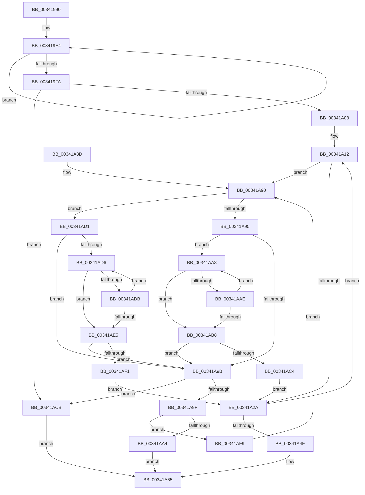

# CcGetBcbListHeadLargeOffset

- RVA: `0x00341990`–`0x00341B09` (길이 `377` bytes)
- VA: `0x0000000140341990`
- 실행 섹션: `.text`
- PDB 이름 있음: `예`; PDB Function 태그: `아니요`
- unwind 정보 RVA: `0x000775A8`
- 디코드: `111`개 명령, `377/377` bytes 표시
- 미해석 바이트: `0` (있으면 어셈블리에 `.byte`로 보존)

> 이 문서는 커널 이미지의 기계어와 PDB 기호를 분석해 생성했습니다. 4번과 5번은 함수 원형과 자료형을 바이너리 사용 방식에서 추정한 C 해석이며 원본 소스 복구 결과는 아닙니다.

## 1. Dependencies

- 직접 호출 지점: **1**; 고유 호출 대상: **1**
- 직접 호출자로 확인된 함수: **3**
- RIP 상대 이미지 참조: **1**

### Outgoing calls
- `0x00341A72` → [_security_check_cookie](../6A/_security_check_cookie_function_006AC640.md) (function, `0x006AC640`)

### Direct callers
- [CcSetVacbLargeOffset](../27/CcSetVacbLargeOffset_function_002733D0.md) at `0x0027369E`
- [CcPinFileData](../33/CcPinFileData_function_0033FB40.md) at `0x00340903`
- [CcFindBcb](CcFindBcb_function_00341800.md) at `0x00341863`

### Static image references
- `0x003419A4` → RVA `0x00E0A740` (`.data`; read)

## 2. Other-region calls and transfers

- 다른 실행 섹션으로 향하는 call: **0**
- 별도 외부 분기/꼬리 이동을 확인하지 못했습니다.

## 3. Assembly (complete function range)

```asm
00341990  48 89 5C 24 10                  mov qword ptr [rsp + 0x10], rbx
00341995  48 89 6C 24 18                  mov qword ptr [rsp + 0x18], rbp
0034199A  48 89 74 24 20                  mov qword ptr [rsp + 0x20], rsi
0034199F  57                              push rdi
003419A0  48 83 EC 60                     sub rsp, 0x60
003419A4  48 8B 05 95 8D AC 00            mov rax, qword ptr [rip + 0xac8d95]
003419AB  48 33 C4                        xor rax, rsp
003419AE  48 89 44 24 58                  mov qword ptr [rsp + 0x58], rax
003419B3  48 8B D9                        mov rbx, rcx
003419B6  0F 57 C0                        xorps xmm0, xmm0
003419B9  33 C0                           xor eax, eax
003419BB  33 F6                           xor esi, esi
003419BD  41 0F B6 E8                     movzx ebp, r8b
003419C1  48 89 44 24 30                  mov qword ptr [rsp + 0x30], rax
003419C6  0F 11 04 24                     movups xmmword ptr [rsp], xmm0
003419CA  48 8B 7B 58                     mov rdi, qword ptr [rbx + 0x58]
003419CE  45 33 C9                        xor r9d, r9d
003419D1  4C 8B 43 20                     mov r8, qword ptr [rbx + 0x20]
003419D5  B9 19 00 00 00                  mov ecx, 0x19
003419DA  0F 11 44 24 10                  movups xmmword ptr [rsp + 0x10], xmm0
003419DF  0F 11 44 24 20                  movups xmmword ptr [rsp + 0x20], xmm0
003419E4  44 8B D9                        mov r11d, ecx
003419E7  B8 01 00 00 00                  mov eax, 1
003419EC  83 C1 07                        add ecx, 7
003419EF  41 FF C1                        inc r9d
003419F2  48 D3 E0                        shl rax, cl
003419F5  4C 3B C0                        cmp r8, rax
003419F8  7F EA                           jg 0x1403419e4
003419FA  4C 89 74 24 70                  mov qword ptr [rsp + 0x70], r14
003419FF  48 3B D0                        cmp rdx, rax
00341A02  0F 8D C3 00 00 00               jge 0x140341acb
00341A08  49 BE FF FF FF FF FF FF FF 7F   movabs r14, 0x7fffffffffffffff
00341A12  4C 8B C2                        mov r8, rdx
00341A15  41 8B CB                        mov ecx, r11d
00341A18  49 D3 F8                        sar r8, cl
00341A1B  41 FF C9                        dec r9d
00341A1E  41 8B C0                        mov eax, r8d
00341A21  4C 8B 14 C7                     mov r10, qword ptr [rdi + rax*8]
00341A25  4D 85 D2                        test r10, r10
00341A28  74 66                           je 0x140341a90
00341A2A  48 89 3C F4                     mov qword ptr [rsp + rsi*8], rdi
00341A2E  B8 01 00 00 00                  mov eax, 1
00341A33  48 D3 E0                        shl rax, cl
00341A36  41 83 C3 F9                     add r11d, -7
00341A3A  48 FF C8                        dec rax
00341A3D  44 89 44 B4 38                  mov dword ptr [rsp + rsi*4 + 0x38], r8d
00341A42  48 23 D0                        and rdx, rax
00341A45  FF C6                           inc esi
00341A47  49 8B FA                        mov rdi, r10
00341A4A  45 85 C9                        test r9d, r9d
00341A4D  75 C3                           jne 0x140341a12
00341A4F  41 8B CB                        mov ecx, r11d
00341A52  B8 FE FF FF FF                  mov eax, 0xfffffffe
00341A57  48 D3 FA                        sar rdx, cl
00341A5A  48 23 C2                        and rax, rdx
00341A5D  48 83 E8 80                     sub rax, -0x80
00341A61  49 8D 04 C2                     lea rax, [r10 + rax*8]
00341A65  4C 8B 74 24 70                  mov r14, qword ptr [rsp + 0x70]
00341A6A  48 8B 4C 24 58                  mov rcx, qword ptr [rsp + 0x58]
00341A6F  48 33 CC                        xor rcx, rsp
00341A72  E8 C9 AB 36 00                  call 0x1406ac640
00341A77  4C 8D 5C 24 60                  lea r11, [rsp + 0x60]
00341A7C  49 8B 5B 18                     mov rbx, qword ptr [r11 + 0x18]
00341A80  49 8B 6B 20                     mov rbp, qword ptr [r11 + 0x20]
00341A84  49 8B 73 28                     mov rsi, qword ptr [r11 + 0x28]
00341A88  49 8B E3                        mov rsp, r11
00341A8B  5F                              pop rdi
00341A8C  C3                              ret
00341A8D  CC                              int3
00341A8E  66 90                           nop
00341A90  40 84 ED                        test bpl, bpl
00341A93  74 3C                           je 0x140341ad1
00341A95  41 83 F8 7F                     cmp r8d, 0x7f
00341A99  75 0D                           jne 0x140341aa8
00341A9B  85 F6                           test esi, esi
00341A9D  74 2C                           je 0x140341acb
00341A9F  83 FE 07                        cmp esi, 7
00341AA2  72 55                           jb 0x140341af9
00341AA4  33 C0                           xor eax, eax
00341AA6  EB BD                           jmp 0x140341a65
00341AA8  41 83 F8 7F                     cmp r8d, 0x7f
00341AAC  74 0A                           je 0x140341ab8
00341AAE  41 FF C0                        inc r8d
00341AB1  4A 83 3C C7 00                  cmp qword ptr [rdi + r8*8], 0
00341AB6  74 F0                           je 0x140341aa8
00341AB8  41 8B C0                        mov eax, r8d
00341ABB  4C 8B 14 C7                     mov r10, qword ptr [rdi + rax*8]
00341ABF  4D 85 D2                        test r10, r10
00341AC2  74 D7                           je 0x140341a9b
00341AC4  33 D2                           xor edx, edx
00341AC6  E9 5F FF FF FF                  jmp 0x140341a2a
00341ACB  48 8D 43 10                     lea rax, [rbx + 0x10]
00341ACF  EB 94                           jmp 0x140341a65
00341AD1  45 85 C0                        test r8d, r8d
00341AD4  74 C5                           je 0x140341a9b
00341AD6  45 85 C0                        test r8d, r8d
00341AD9  74 0A                           je 0x140341ae5
00341ADB  41 FF C8                        dec r8d
00341ADE  4A 83 3C C7 00                  cmp qword ptr [rdi + r8*8], 0
00341AE3  74 F1                           je 0x140341ad6
00341AE5  41 8B C0                        mov eax, r8d
00341AE8  4C 8B 14 C7                     mov r10, qword ptr [rdi + rax*8]
00341AEC  4D 85 D2                        test r10, r10
00341AEF  74 AA                           je 0x140341a9b
00341AF1  49 8B D6                        mov rdx, r14
00341AF4  E9 31 FF FF FF                  jmp 0x140341a2a
00341AF9  41 FF C1                        inc r9d
00341AFC  FF CE                           dec esi
00341AFE  44 8B 44 B4 38                  mov r8d, dword ptr [rsp + rsi*4 + 0x38]
00341B03  48 8B 3C F4                     mov rdi, qword ptr [rsp + rsi*8]
00341B07  EB 87                           jmp 0x140341a90
```

## 4. C-style interpretation (structured pseudocode)

```c
__int64 __fastcall CcGetBcbListHeadLargeOffset(__int64 a1, __int64 a2, unsigned __int8 a3, int a4)
{
    __int64 result;
    __int64 v_r11;
    __int64 v_rsi;
    __int64 v_rsp;
    unsigned __int64 v_stack_m10;
    unsigned __int64 v_stack_m38;
    unsigned __int64 v_stack_m48;
    unsigned __int64 v_stack_m58;
    unsigned __int64 v_stack_m68;
    unsigned __int64 v_stack_m8;
    unsigned __int64 v_stack_p10;
    unsigned __int64 v_stack_p18;
    unsigned __int64 v_stack_p20;
    unsigned __int64 v_stack_p8;

    v_stack_p10 = v_rbx;
    v_stack_p18 = v_rbp;
    v_stack_p20 = v_rsi;
    v_rsp = (v_rsp) - (96);
    result = (*(unsigned __int64 *)(v_rip + 11308437)) ^ (v_rsp);
    v_stack_m10 = result;
    result = 0;
    v_rsi = 0;
    v_stack_m38 = 0;
    v_stack_m68 = v_xmm0;
    a4 = 0;
    v_stack_m58 = v_xmm0;
    v_stack_m48 = v_xmm0;
loc_003419E4:
    a1 = (unsigned int)((25) + (7));
    a4 = (unsigned int)((a4) + 1);
    result = (1) << ((unsigned __int8)(a1));
    if ((*(unsigned __int64 *)(a1 + 32)) > result) goto loc_003419E4;
    v_stack_p8 = v_r14;
    if (a2 >= result) goto loc_00341ACB;
loc_00341A12:
    a3 = (a2) >> (25);
    a4 = (unsigned int)((a4) - 1);
    if (*(unsigned __int64 *)(*(unsigned __int64 *)(a1 + 88) + (unsigned int)(a3) * 8) == 0) goto loc_00341A90;
loc_00341A2A:
    *(unsigned __int64 *)(v_rsp + v_rsi * 8) = *(unsigned __int64 *)(a1 + 88);
    result = (1) << (25);
    v_r11 = (unsigned int)((25) + (-7));
    result = (result) - 1;
    *(unsigned int *)(v_rsp + v_rsi * 4 + 56) = a3;
    a2 = (a2) & (result);
    v_rsi = (unsigned int)((v_rsi) + 1);
    if (a4 != 0) goto loc_00341A12;
    a2 = (a2) >> ((unsigned __int8)((unsigned int)((unsigned int)(v_r11))));
    result = ((unsigned int)(0xFFFFFFFEULL)) & (a2);
    result = (result) - (-128);
loc_00341A65:
    a1 = (v_stack_m10) ^ (v_rsp);
    result = _security_check_cookie(a1, a2, a3, a4);
    return result;
loc_00341A90:
    if ((unsigned __int8)(*(unsigned __int64 *)(v_stack_m8 + 32)) == 0) goto loc_00341AD1;
    if (a3 != 127) goto loc_00341AA8;
loc_00341A9B:
    if ((unsigned int)(*(unsigned __int64 *)(v_stack_m8 + 40)) == 0) goto loc_00341ACB;
    if (((unsigned int)(*(unsigned __int64 *)(v_stack_m8 + 40))) < 7) goto loc_00341AF9;
    result = 0;
    goto loc_00341A65;
loc_00341AA8:
    if (a3 == 127) goto loc_00341AB8;
    a3 = (unsigned int)((a3) + 1);
    if ((*(unsigned __int64 *)(*(unsigned __int64 *)(*(unsigned __int64 *)(a1 + 88) + (unsigned int)(a3) * 8) + a3 * 8)) == 0) goto loc_00341AA8;
loc_00341AB8:
    if (*(unsigned __int64 *)(*(unsigned __int64 *)(*(unsigned __int64 *)(a1 + 88) + (unsigned int)(a3) * 8) + (unsigned int)(a3) * 8) == 0) goto loc_00341A9B;
    a2 = 0;
    goto loc_00341A2A;
loc_00341ACB:
    goto loc_00341A65;
loc_00341AD1:
    if (a3 == 0) goto loc_00341A9B;
loc_00341AD6:
    if (a3 == 0) goto loc_00341AE5;
    a3 = (unsigned int)((a3) - 1);
    if ((*(unsigned __int64 *)(*(unsigned __int64 *)(*(unsigned __int64 *)(a1 + 88) + (unsigned int)(a3) * 8) + a3 * 8)) == 0) goto loc_00341AD6;
loc_00341AE5:
    if (*(unsigned __int64 *)(*(unsigned __int64 *)(*(unsigned __int64 *)(a1 + 88) + (unsigned int)(a3) * 8) + (unsigned int)(a3) * 8) == 0) goto loc_00341A9B;
    goto loc_00341A2A;
loc_00341AF9:
    a4 = (unsigned int)((a4) + 1);
    v_rsi = (unsigned int)((*(unsigned __int64 *)(v_stack_m8 + 40)) - 1);
    goto loc_00341A90;
}
```

## 5. (Beta) C Style

```c
int64_t CcGetBcbListHeadLargeOffset(void *Arg1, int64_t Arg2, uint8_t Arg3, int32_t Arg4)
{
    uint8_t *arg1 = (uint8_t *)Arg1;

    int64_t result;
    int64_t local_r11;
    int64_t local_rsi;
    int64_t local_rsp;
    uint64_t v_stack_m10;
    uint64_t v_stack_m38;
    uint64_t v_stack_m48;
    uint64_t v_stack_m58;
    uint64_t v_stack_m68;
    uint64_t v_stack_m8;
    uint64_t v_stack_p10;
    uint64_t v_stack_p18;
    uint64_t v_stack_p20;
    uint64_t v_stack_p8;

    v_stack_p10 = local_rbx;
    v_stack_p18 = local_rbp;
    v_stack_p20 = local_rsi;
    local_rsp = (local_rsp) - (96);
    result = (*(uint64_t *)(v_rip + 0xAC8D95)) ^ (local_rsp);
    v_stack_m10 = result;
    result = 0;
    local_rsi = 0;
    v_stack_m38 = 0;
    v_stack_m68 = v_xmm0;
    Arg4 = 0;
    v_stack_m58 = v_xmm0;
    v_stack_m48 = v_xmm0;
loc_003419E4:
    Arg1 = (uint32_t)((25) + (7));
    Arg4 = (uint32_t)((Arg4) + 1);
    result = (1) << ((uint8_t)(Arg1));
    if ((*(uint64_t *)(arg1 + 0x20)) > result) goto loc_003419E4;
    v_stack_p8 = local_r14;
    if (Arg2 >= result) goto loc_00341ACB;
loc_00341A12:
    Arg3 = (Arg2) >> (25);
    Arg4 = (uint32_t)((Arg4) - 1);
    if (*(uint64_t *)(*(uint64_t *)(arg1 + 0x58) + (uint32_t)(Arg3) * 8) == 0) goto loc_00341A90;
loc_00341A2A:
    *(uint64_t *)(local_rsp + local_rsi * 8) = *(uint64_t *)(arg1 + 0x58);
    result = (1) << (25);
    local_r11 = (uint32_t)((25) + (-7));
    result = (result) - 1;
    *(uint32_t *)(local_rsp + local_rsi * 4 + 0x38) = Arg3;
    Arg2 = (Arg2) & (result);
    local_rsi = (uint32_t)((local_rsi) + 1);
    if (Arg4 != 0) goto loc_00341A12;
    Arg2 = (Arg2) >> ((uint8_t)((uint32_t)((uint32_t)(local_r11))));
    result = ((uint32_t)(0xFFFFFFFEULL)) & (Arg2);
    result = (result) - (-128);
loc_00341A65:
    Arg1 = (v_stack_m10) ^ (local_rsp);
    result = _security_check_cookie(Arg1, Arg2, Arg3, Arg4);
    return result;
loc_00341A90:
    if ((uint8_t)(*(uint64_t *)(v_stack_m8 + 0x20)) == 0) goto loc_00341AD1;
    if (Arg3 != 127) goto loc_00341AA8;
loc_00341A9B:
    if ((uint32_t)(*(uint64_t *)(v_stack_m8 + 0x28)) == 0) goto loc_00341ACB;
    if (((uint32_t)(*(uint64_t *)(v_stack_m8 + 0x28))) < 7) goto loc_00341AF9;
    result = 0;
    goto loc_00341A65;
loc_00341AA8:
    if (Arg3 == 127) goto loc_00341AB8;
    Arg3 = (uint32_t)((Arg3) + 1);
    if ((*(uint64_t *)(*(uint64_t *)(*(uint64_t *)(arg1 + 0x58) + (uint32_t)(Arg3) * 8) + Arg3 * 8)) == 0) goto loc_00341AA8;
loc_00341AB8:
    if (*(uint64_t *)(*(uint64_t *)(*(uint64_t *)(arg1 + 0x58) + (uint32_t)(Arg3) * 8) + (uint32_t)(Arg3) * 8) == 0) goto loc_00341A9B;
    Arg2 = 0;
    goto loc_00341A2A;
loc_00341ACB:
    goto loc_00341A65;
loc_00341AD1:
    if (Arg3 == 0) goto loc_00341A9B;
loc_00341AD6:
    if (Arg3 == 0) goto loc_00341AE5;
    Arg3 = (uint32_t)((Arg3) - 1);
    if ((*(uint64_t *)(*(uint64_t *)(*(uint64_t *)(arg1 + 0x58) + (uint32_t)(Arg3) * 8) + Arg3 * 8)) == 0) goto loc_00341AD6;
loc_00341AE5:
    if (*(uint64_t *)(*(uint64_t *)(*(uint64_t *)(arg1 + 0x58) + (uint32_t)(Arg3) * 8) + (uint32_t)(Arg3) * 8) == 0) goto loc_00341A9B;
    goto loc_00341A2A;
loc_00341AF9:
    Arg4 = (uint32_t)((Arg4) + 1);
    local_rsi = (uint32_t)((*(uint64_t *)(v_stack_m8 + 0x28)) - 1);
    goto loc_00341A90;
}
```

### 관측된 메모리 오프셋

구조체 형식이 확인되지 않은 접근은 인자 기준의 오프셋으로만 기록했습니다.

| 기준 인자 | 오프셋 표현 | 폭 (bit) | 접근 |
|---|---:|---:|---|
| `Arg1` | `+ 0x10` | `64` | `R` |
| `Arg1` | `+ 0x20` | `64` | `R` |
| `Arg1` | `+ 0x58` | `64` | `R` |

## 6. Execution-region graph

[열기: 2D/3D 그래프와 함수 탐색 컨트롤 패널](../../../control-panel.html?section=text&rva=0x00341990&view=graph)

- 2D 그래프는 위에서 아래로 흐르고, 3D 그래프는 빈 공간을 드래그해 회전합니다. Shift+드래그는 이동, 휠은 확대·축소, 함수 노드 선택은 대상 보고서 이동입니다.

### Static fallback


