# CcGetVirtualAddress

- RVA: `0x00340C9C`–`0x00341000` (길이 `868` bytes)
- VA: `0x0000000140340C9C`
- 실행 섹션: `.text`
- PDB 이름 있음: `예`; PDB Function 태그: `예`
- unwind 정보 RVA: `0x000774C8`
- 디코드: `223`개 명령, `868/868` bytes 표시
- 미해석 바이트: `0` (있으면 어셈블리에 `.byte`로 보존)

> 이 문서는 커널 이미지의 기계어와 PDB 기호를 분석해 생성했습니다. 4번과 5번은 함수 원형과 자료형을 바이너리 사용 방식에서 추정한 C 해석이며 원본 소스 복구 결과는 아닙니다.

## 1. Dependencies

- 직접 호출 지점: **14**; 고유 호출 대상: **11**
- 직접 호출자로 확인된 함수: **8**
- RIP 상대 이미지 참조: **2**

### Outgoing calls
- `0x00340D1B` → [CcAllocateInitializeVacbArray](../4A/CcAllocateInitializeVacbArray_function_004AE2BC.md) (function, `0x004AE2BC`)
- `0x00340D38` → [CcBuildUpHighPriorityMappings](../4E/CcBuildUpHighPriorityMappings_function_004E161C.md) (function, `0x004E161C`)
- `0x00340D6C` → [KeAbPreAcquire](../21/KeAbPreAcquire_function_00210230.md) (function, `0x00210230`)
- `0x00340D8D` → [ExfAcquirePushLockSharedEx](../21/ExfAcquirePushLockSharedEx_function_0021044C.md) (function, `0x0021044C`)
- `0x00340DC0` → [CcGetVacbLargeOffset](../38/CcGetVacbLargeOffset_function_0038A590.md) (function, `0x0038A590`)
- `0x00340DD8` → [CcIncrementVacbActiveCount](../40/CcIncrementVacbActiveCount_function_0040FC70.md) (function, `0x0040FC70`)
- `0x00340E0C` → [KeAbPostRelease](../2E/KeAbPostRelease_function_002E1600.md) (function, `0x002E1600`)
- `0x00340EB2` → [ExfReleasePushLock](../26/ExfReleasePushLock_function_002638D0.md) (function, `0x002638D0`)
- `0x00340EFA` → [KeAbPostRelease](../2E/KeAbPostRelease_function_002E1600.md) (function, `0x002E1600`)
- `0x00340F0C` → [CcGetVacbMiss](../27/CcGetVacbMiss_function_00272900.md) (function, `0x00272900`)
- `0x00340F67` → [CcUnmapVacbArray](../38/CcUnmapVacbArray_function_0038AEAC.md) (function, `0x0038AEAC`)
- `0x00340FAA` → [CcUnmapVacbArray](../38/CcUnmapVacbArray_function_0038AEAC.md) (function, `0x0038AEAC`)
- `0x00340FC4` → [ExfReleasePushLock](../26/ExfReleasePushLock_function_002638D0.md) (function, `0x002638D0`)
- `0x00340FFA` → [KeBugCheckEx](../4F/KeBugCheckEx_function_004FD660.md) (function, `0x004FD660`)

### Direct callers
- [CcPinFileData](../33/CcPinFileData_function_0033FB40.md) at `0x0033FBF2`
- [CcPurgeAndClearCacheSection](../38/CcPurgeAndClearCacheSection_function_0038A614.md) at `0x0038A6FE`
- [CcMapAndCopyInToCache](../3C/CcMapAndCopyInToCache_function_003CA7F0.md) at `0x003CAA17`
- [CcPrepareMdlWrite](../49/CcPrepareMdlWrite_function_004996D0.md) at `0x00499793`
- [CcMapData](../../page/96/CcMapData_function_0096C430.md) at `0x0096C4AA`
- [CcMapDataCommon](../../page/99/CcMapDataCommon_function_0099E560.md) at `0x0099E5C4`
- [CcMapAndCopyFromCache](../../page/A4/CcMapAndCopyFromCache_function_00A47060.md) at `0x00A470D2`
- [CcMdlRead](../../page/AB/CcMdlRead_function_00ABA520.md) at `0x00ABA5EA`

### Static image references
- `0x00340D05` → RVA `0x00F8F4A8` (`.data`; read)
- `0x00340F90` → RVA `0x00E0A868` (`.data`; read)

## 2. Other-region calls and transfers

- 다른 실행 섹션으로 향하는 call: **0**
- call이 아닌 외부 분기/꼬리 이동: **2**
  - `0x00340D2C` → [sub_006E206A](../6E/Unknown_function_006E206A.md) (`tail-transfer`)
  - `0x00340D3E` → [sub_006E206A](../6E/Unknown_function_006E206A.md) (`tail-transfer`)

## 3. Assembly (complete function range)

```asm
00340C9C  4C 89 4C 24 20                  mov qword ptr [rsp + 0x20], r9
00340CA1  4C 89 44 24 18                  mov qword ptr [rsp + 0x18], r8
00340CA6  55                              push rbp
00340CA7  53                              push rbx
00340CA8  56                              push rsi
00340CA9  57                              push rdi
00340CAA  41 54                           push r12
00340CAC  41 55                           push r13
00340CAE  41 56                           push r14
00340CB0  41 57                           push r15
00340CB2  48 8B EC                        mov rbp, rsp
00340CB5  48 83 EC 58                     sub rsp, 0x58
00340CB9  48 8B F1                        mov rsi, rcx
00340CBC  45 33 ED                        xor r13d, r13d
00340CBF  8B C2                           mov eax, edx
00340CC1  48 8B DA                        mov rbx, rdx
00340CC4  25 FF FF 03 00                  and eax, 0x3ffff
00340CC9  8B C8                           mov ecx, eax
00340CCB  4C 8B A6 18 02 00 00            mov r12, qword ptr [rsi + 0x218]
00340CD2  89 45 50                        mov dword ptr [rbp + 0x50], eax
00340CD5  48 8B C2                        mov rax, rdx
00340CD8  48 2B C1                        sub rax, rcx
00340CDB  48 89 4D E8                     mov qword ptr [rbp - 0x18], rcx
00340CDF  41 8B CD                        mov ecx, r13d
00340CE2  48 89 45 E0                     mov qword ptr [rbp - 0x20], rax
00340CE6  8B 86 98 00 00 00               mov eax, dword ptr [rsi + 0x98]
00340CEC  0F BA E0 09                     bt eax, 9
00340CF0  0F 92 C1                        setb cl
00340CF3  89 4D 48                        mov dword ptr [rbp + 0x48], ecx
00340CF6  0F BA E0 09                     bt eax, 9
00340CFA  0F 83 BC 01 00 00               jae 0x140340ebc
00340D00  B8 80 00 00 00                  mov eax, 0x80
00340D05  39 05 9D E7 C4 00               cmp dword ptr [rip + 0xc4e79d], eax
00340D0B  44 8D 78 81                     lea r15d, [rax - 0x7f]
00340D0F  73 42                           jae 0x140340d53
00340D11  41 39 84 24 E0 04 00 00         cmp dword ptr [r12 + 0x4e0], eax
00340D19  73 38                           jae 0x140340d53
00340D1B  E8 9C D5 16 00                  call 0x1404ae2bc
00340D20  4C 8B F0                        mov r14, rax
00340D23  48 85 C0                        test rax, rax
00340D26  74 2B                           je 0x140340d53
00340D28  41 83 FF 01                     cmp r15d, 1
00340D2C  0F 85 38 13 3A 00               jne 0x1406e206a
00340D32  48 8B D0                        mov rdx, rax
00340D35  49 8B CC                        mov rcx, r12
00340D38  E8 DF 08 1A 00                  call 0x1404e161c
00340D3D  90                              nop
00340D3E  E9 27 13 3A 00                  jmp 0x1406e206a
00340D43  45 33 FF                        xor r15d, r15d
00340D46  B8 80 00 00 00                  mov eax, 0x80
00340D4B  39 05 57 E7 C4 00               cmp dword ptr [rip + 0xc4e757], eax
00340D51  72 C8                           jb 0x140340d1b
00340D53  45 33 E4                        xor r12d, r12d
00340D56  48 3B 5E 20                     cmp rbx, qword ptr [rsi + 0x20]
00340D5A  0F 8F 82 02 00 00               jg 0x140340fe2
00340D60  48 8D 7E 68                     lea rdi, [rsi + 0x68]
00340D64  45 33 C0                        xor r8d, r8d
00340D67  48 8B CF                        mov rcx, rdi
00340D6A  33 D2                           xor edx, edx
00340D6C  E8 BF F4 EC FF                  call 0x140210230
00340D71  4C 8B F0                        mov r14, rax
00340D74  41 8D 4C 24 11                  lea ecx, [r12 + 0x11]
00340D79  33 C0                           xor eax, eax
00340D7B  F0 48 0F B1 0F                  lock cmpxchg qword ptr [rdi], rcx
00340D80  74 10                           je 0x140340d92
00340D82  4C 8B CF                        mov r9, rdi
00340D85  4D 8B C6                        mov r8, r14
00340D88  33 D2                           xor edx, edx
00340D8A  48 8B CF                        mov rcx, rdi
00340D8D  E8 BA F6 EC FF                  call 0x14021044c
00340D92  4D 85 F6                        test r14, r14
00340D95  74 05                           je 0x140340d9c
00340D97  41 C6 46 0A 01                  mov byte ptr [r14 + 0xa], 1
00340D9C  44 39 65 70                     cmp dword ptr [rbp + 0x70], r12d
00340DA0  0F 84 B9 00 00 00               je 0x140340e5f
00340DA6  41 BD 01 00 00 00               mov r13d, 1
00340DAC  48 81 7E 20 00 00 00 02         cmp qword ptr [rsi + 0x20], 0x2000000
00340DB4  0F 8E 92 00 00 00               jle 0x140340e4c
00340DBA  48 8B D3                        mov rdx, rbx
00340DBD  48 8B CE                        mov rcx, rsi
00340DC0  E8 CB 97 04 00                  call 0x14038a590
00340DC5  4C 8B F0                        mov r14, rax
00340DC8  48 8D 7E 68                     lea rdi, [rsi + 0x68]
00340DCC  4D 85 F6                        test r14, r14
00340DCF  0F 84 F6 00 00 00               je 0x140340ecb
00340DD5  49 8B CE                        mov rcx, r14
00340DD8  E8 93 EE 0C 00                  call 0x14040fc70
00340DDD  0F 0D 0F                        prefetchw byte ptr [rdi]
00340DE0  48 8B 07                        mov rax, qword ptr [rdi]
00340DE3  48 8B C8                        mov rcx, rax
00340DE6  48 83 E1 F0                     and rcx, 0xfffffffffffffff0
00340DEA  48 83 F9 10                     cmp rcx, 0x10
00340DEE  48 8D 50 F0                     lea rdx, [rax - 0x10]
00340DF2  49 0F 46 D4                     cmovbe rdx, r12
00340DF6  A8 02                           test al, 2
00340DF8  0F 85 B1 00 00 00               jne 0x140340eaf
00340DFE  F0 48 0F B1 17                  lock cmpxchg qword ptr [rdi], rdx
00340E03  0F 85 A6 00 00 00               jne 0x140340eaf
00340E09  48 8B CF                        mov rcx, rdi
00340E0C  E8 EF 07 FA FF                  call 0x1402e1600
00340E11  48 8B 5D E0                     mov rbx, qword ptr [rbp - 0x20]
00340E15  BF 00 00 04 00                  mov edi, 0x40000
00340E1A  45 85 ED                        test r13d, r13d
00340E1D  0F 84 4E 01 00 00               je 0x140340f71
00340E23  48 8B 45 58                     mov rax, qword ptr [rbp + 0x58]
00340E27  2B 7D 50                        sub edi, dword ptr [rbp + 0x50]
00340E2A  4C 89 30                        mov qword ptr [rax], r14
00340E2D  48 8B 45 60                     mov rax, qword ptr [rbp + 0x60]
00340E31  89 38                           mov dword ptr [rax], edi
00340E33  49 8B 06                        mov rax, qword ptr [r14]
00340E36  48 03 45 E8                     add rax, qword ptr [rbp - 0x18]
00340E3A  48 83 C4 58                     add rsp, 0x58
00340E3E  41 5F                           pop r15
00340E40  41 5E                           pop r14
00340E42  41 5D                           pop r13
00340E44  41 5C                           pop r12
00340E46  5F                              pop rdi
00340E47  5E                              pop rsi
00340E48  5B                              pop rbx
00340E49  5D                              pop rbp
00340E4A  C3                              ret
00340E4B  CC                              int3
00340E4C  48 8B 46 58                     mov rax, qword ptr [rsi + 0x58]
00340E50  8B CB                           mov ecx, ebx
00340E52  48 C1 E9 12                     shr rcx, 0x12
00340E56  4C 8B 34 C8                     mov r14, qword ptr [rax + rcx*8]
00340E5A  E9 69 FF FF FF                  jmp 0x140340dc8
00340E5F  8B 8E 98 00 00 00               mov ecx, dword ptr [rsi + 0x98]
00340E65  8B C1                           mov eax, ecx
00340E67  25 00 02 80 00                  and eax, 0x800200
00340E6C  3D 00 02 00 00                  cmp eax, 0x200
00340E71  0F 84 2F FF FF FF               je 0x140340da6
00340E77  0F BA E1 1E                     bt ecx, 0x1e
00340E7B  0F 82 25 FF FF FF               jb 0x140340da6
00340E81  48 8B 45 E0                     mov rax, qword ptr [rbp - 0x20]
00340E85  48 A9 FF FF 0F 00               test rax, 0xfffff
00340E8B  0F 85 15 FF FF FF               jne 0x140340da6
00340E91  48 3D 00 00 10 00               cmp rax, 0x100000
00340E97  0F 8C 09 FF FF FF               jl 0x140340da6
00340E9D  48 3B 86 58 01 00 00            cmp rax, qword ptr [rsi + 0x158]
00340EA4  0F 85 02 FF FF FF               jne 0x140340dac
00340EAA  E9 F7 FE FF FF                  jmp 0x140340da6
00340EAF  48 8B CF                        mov rcx, rdi
00340EB2  E8 19 2A F2 FF                  call 0x1402638d0
00340EB7  E9 4D FF FF FF                  jmp 0x140340e09
00340EBC  44 39 6D 68                     cmp dword ptr [rbp + 0x68], r13d
00340EC0  0F 85 3A FE FF FF               jne 0x140340d00
00340EC6  E9 78 FE FF FF                  jmp 0x140340d43
00340ECB  0F 0D 0F                        prefetchw byte ptr [rdi]
00340ECE  48 8B 07                        mov rax, qword ptr [rdi]
00340ED1  48 8B C8                        mov rcx, rax
00340ED4  48 83 E1 F0                     and rcx, 0xfffffffffffffff0
00340ED8  48 83 F9 10                     cmp rcx, 0x10
00340EDC  48 8D 50 F0                     lea rdx, [rax - 0x10]
00340EE0  49 0F 46 D4                     cmovbe rdx, r12
00340EE4  A8 02                           test al, 2
00340EE6  0F 85 D5 00 00 00               jne 0x140340fc1
00340EEC  F0 48 0F B1 17                  lock cmpxchg qword ptr [rdi], rdx
00340EF1  0F 85 CA 00 00 00               jne 0x140340fc1
00340EF7  48 8B CF                        mov rcx, rdi
00340EFA  E8 01 07 FA FF                  call 0x1402e1600
00340EFF  44 8B 45 48                     mov r8d, dword ptr [rbp + 0x48]
00340F03  45 8B CF                        mov r9d, r15d
00340F06  48 8B D3                        mov rdx, rbx
00340F09  48 8B CE                        mov rcx, rsi
00340F0C  E8 EF 19 F3 FF                  call 0x140272900
00340F11  48 8B 5D E0                     mov rbx, qword ptr [rbp - 0x20]
00340F15  4C 8B F0                        mov r14, rax
00340F18  8B 86 98 00 00 00               mov eax, dword ptr [rsi + 0x98]
00340F1E  25 00 02 00 08                  and eax, 0x8000200
00340F23  3D 00 02 00 00                  cmp eax, 0x200
00340F28  0F 85 E7 FE FF FF               jne 0x140340e15
00340F2E  48 F7 C3 FF FF 0F 00            test rbx, 0xfffff
00340F35  0F 85 DA FE FF FF               jne 0x140340e15
00340F3B  B8 00 00 10 00                  mov eax, 0x100000
00340F40  48 3B D8                        cmp rbx, rax
00340F43  0F 8C CC FE FF FF               jl 0x140340e15
00340F49  48 2B D8                        sub rbx, rax
00340F4C  44 88 64 24 28                  mov byte ptr [rsp + 0x28], r12b
00340F51  41 B1 01                        mov r9b, 1
00340F54  48 89 5D E0                     mov qword ptr [rbp - 0x20], rbx
00340F58  44 8B C0                        mov r8d, eax
00340F5B  44 88 64 24 20                  mov byte ptr [rsp + 0x20], r12b
00340F60  48 8D 55 E0                     lea rdx, [rbp - 0x20]
00340F64  48 8B CE                        mov rcx, rsi
00340F67  E8 40 9F 04 00                  call 0x14038aeac
00340F6C  E9 A4 FE FF FF                  jmp 0x140340e15
00340F71  41 B8 00 00 80 00               mov r8d, 0x800000
00340F77  44 88 64 24 28                  mov byte ptr [rsp + 0x28], r12b
00340F7C  41 B1 01                        mov r9b, 1
00340F7F  48 8B CE                        mov rcx, rsi
00340F82  44 88 64 24 20                  mov byte ptr [rsp + 0x20], r12b
00340F87  44 85 86 98 00 00 00            test dword ptr [rsi + 0x98], r8d
00340F8E  75 3E                           jne 0x140340fce
00340F90  44 8B 05 D1 98 AC 00            mov r8d, dword ptr [rip + 0xac98d1]
00340F97  41 8B C0                        mov eax, r8d
00340F9A  49 3B D8                        cmp rbx, r8
00340F9D  7D 15                           jge 0x140340fb4
00340F9F  4C 89 65 48                     mov qword ptr [rbp + 0x48], r12
00340FA3  48 8D 55 48                     lea rdx, [rbp + 0x48]
00340FA7  44 8B C3                        mov r8d, ebx
00340FAA  E8 FD 9E 04 00                  call 0x14038aeac
00340FAF  E9 6F FE FF FF                  jmp 0x140340e23
00340FB4  48 2B D8                        sub rbx, rax
00340FB7  48 89 5D E0                     mov qword ptr [rbp - 0x20], rbx
00340FBB  48 8D 55 E0                     lea rdx, [rbp - 0x20]
00340FBF  EB E9                           jmp 0x140340faa
00340FC1  48 8B CF                        mov rcx, rdi
00340FC4  E8 07 29 F2 FF                  call 0x1402638d0
00340FC9  E9 29 FF FF FF                  jmp 0x140340ef7
00340FCE  48 81 FB 00 00 84 00            cmp rbx, 0x840000
00340FD5  7C 05                           jl 0x140340fdc
00340FD7  49 2B D8                        sub rbx, r8
00340FDA  EB DB                           jmp 0x140340fb7
00340FDC  48 89 7D 48                     mov qword ptr [rbp + 0x48], rdi
00340FE0  EB C1                           jmp 0x140340fa3
00340FE2  45 33 C9                        xor r9d, r9d
00340FE5  4C 89 64 24 20                  mov qword ptr [rsp + 0x20], r12
00340FEA  BA 9E 05 00 00                  mov edx, 0x59e
00340FEF  49 C7 C0 20 04 00 C0            mov r8, 0xffffffffc0000420
00340FF6  41 8D 49 34                     lea ecx, [r9 + 0x34]
00340FFA  E8 61 C6 1B 00                  call 0x1404fd660
00340FFF  CC                              int3
```

## 4. C-style interpretation (structured pseudocode)

```c
__int64 __fastcall CcGetVirtualAddress(__int64 a1, __int64 a2, __int64 a3, __int64 a4, unsigned int a5, unsigned int a6)
{
    __int64 result;
    __int64 v_r12;
    __int64 v_r13;
    __int64 v_r15;
    __int64 v_rbx;
    __int64 v_rdi;
    __int64 v_rsp;
    unsigned __int64 v_stack_m58;
    unsigned __int64 v_stack_m60;
    unsigned int v_stack_p10;
    unsigned __int64 v_stack_p18;
    unsigned __int64 v_stack_p20;
    unsigned __int8 v_stack_p28;
    unsigned int v_stack_p8;

    v_stack_p20 = a4;
    v_stack_p18 = a3;
    v_rsp = (v_rsp) - (88);
    v_r13 = 0;
    result = (unsigned int)(((unsigned int)((unsigned int)(a2))) & (0x3FFFFULL));
    v_stack_p10 = (unsigned int)(result);
    result = (a2) - ((unsigned int)((unsigned int)(result)));
    v_stack_m58 = (unsigned int)((unsigned int)(result));
    v_stack_m60 = result;
    a1 = (condition_is_below) ? 1 : 0;
    v_stack_p8 = (unsigned int)(a1);
    if (condition_is_above_or_equal) goto loc_00340EBC;
loc_00340D00:
    if ((*(unsigned int *)(v_rip + 12904349)) >= 128) goto loc_00340D53;
    if ((*(unsigned int *)(*(unsigned __int64 *)(a1 + 536) + 1248)) >= 128) goto loc_00340D53;
loc_00340D1B:
    result = CcAllocateInitializeVacbArray(a1, a2, a3, a4);
    if (result == 0) goto loc_00340D53;
    result = CcBuildUpHighPriorityMappings(*(unsigned __int64 *)(a1 + 536), result, a3, a4);
loc_00340D43:
    v_r15 = 0;
    if ((*(unsigned int *)(v_rip + 12904279)) < 128) goto loc_00340D1B;
loc_00340D53:
    v_r12 = 0;
    if (a2 > (*(unsigned __int64 *)(a1 + 32))) goto loc_00340FE2;
    a3 = 0;
    a2 = 0;
    result = KeAbPreAcquire(a1 + 104, a2, a3, a4);
    result = 0;
    if (!(condition_is_equal)) {
        a4 = a1 + 104;
        a3 = 0;
        a2 = 0;
        a1 = a1 + 104;
        result = ExfAcquirePushLockSharedEx(a1, a2, a3, a4);
    }
    if (result != 0) {
        *(unsigned __int8 *)(result + 10) = 1;
    }
    if (a6 == 0) goto loc_00340E5F;
loc_00340DA6:
loc_00340DAC:
    if ((*(unsigned __int64 *)(a1 + 32)) <= 0x2000000ULL) goto loc_00340E4C;
    result = CcGetVacbLargeOffset(a1, 0, a3, a4);
loc_00340DC8:
    if (result == 0) goto loc_00340ECB;
    result = CcIncrementVacbActiveCount(result, 0, a3, a4);
    a1 = (*(unsigned __int64 *)(a1 + 104)) & (-16);
    a2 = *(unsigned __int64 *)(a1 + 104) - 16;
    if (a1 <= 16) { a2 = 0; }
    if ((((unsigned __int8)(*(unsigned __int64 *)(a1 + 104))) & (2)) != 0) goto loc_00340EAF;
    if ((((unsigned __int8)(*(unsigned __int64 *)(a1 + 104))) & (2)) != 0) goto loc_00340EAF;
loc_00340E09:
    result = KeAbPostRelease(a1 + 104, a2, a3, a4);
loc_00340E15:
    if (1 == 0) goto loc_00340F71;
loc_00340E23:
    v_rdi = (unsigned int)(((unsigned int)(0x40000ULL)) - (v_stack_p10));
    *(unsigned __int64 *)(v_stack_p18) = result;
    *(unsigned int *)(v_stack_p20) = (unsigned int)(v_rdi);
    result = (*(unsigned __int64 *)(result)) + (v_stack_m58);
    v_rsp = (v_rsp) + (88);
    return result;
loc_00340E4C:
    a1 = ((unsigned int)((unsigned int)(v_stack_m60))) >> (18);
    goto loc_00340DC8;
loc_00340E5F:
    result = (unsigned int)(((unsigned int)((unsigned int)((unsigned int)(*(unsigned int *)(a1 + 152))))) & (0x800200ULL));
    if (((unsigned int)(result)) == 512) goto loc_00340DA6;
    if (((unsigned int)(result)) < 512) goto loc_00340DA6;
    if (((v_stack_m60) & (0xFFFFFULL)) != 0) goto loc_00340DA6;
    if (v_stack_m60 < 0x100000ULL) goto loc_00340DA6;
    if (v_stack_m60 != (*(unsigned __int64 *)(a1 + 344))) goto loc_00340DAC;
    goto loc_00340DA6;
loc_00340EAF:
    result = ExfReleasePushLock(v_rdi, a2, a3, a4);
    goto loc_00340E09;
loc_00340EBC:
    if (a5 != 1) goto loc_00340D00;
    goto loc_00340D43;
loc_00340ECB:
    a1 = (*(unsigned __int64 *)(v_rdi)) & (-16);
    a2 = *(unsigned __int64 *)(v_rdi) - 16;
    if (a1 <= 16) { a2 = 0; }
    if ((((unsigned __int8)(*(unsigned __int64 *)(v_rdi))) & (2)) != 0) goto loc_00340FC1;
    if ((((unsigned __int8)(*(unsigned __int64 *)(v_rdi))) & (2)) != 0) goto loc_00340FC1;
loc_00340EF7:
    result = KeAbPostRelease(v_rdi, a2, a3, a4);
    result = CcGetVacbMiss(a1, v_stack_m60, (unsigned int)(v_stack_p8), 0);
    result = (unsigned int)(((unsigned int)(*(unsigned int *)(a1 + 152))) & (0x8000200ULL));
    if (((unsigned int)(result)) != 512) goto loc_00340E15;
    if (((v_stack_m60) & (0xFFFFFULL)) != 0) goto loc_00340E15;
    if (v_stack_m60 < ((unsigned int)(0x100000ULL))) goto loc_00340E15;
    v_rbx = (v_stack_m60) - ((unsigned int)(0x100000ULL));
    v_stack_p28 = 0;
    v_stack_m60 = v_rbx;
    v_stack_p20 = 0;
    result = CcUnmapVacbArray(a1, v_stack_m60, (unsigned int)((unsigned int)((unsigned int)(0x100000ULL))), 1);
    goto loc_00340E15;
loc_00340F71:
    v_stack_p28 = 0;
    v_stack_p20 = 0;
    if (((*(unsigned int *)(a1 + 152)) & ((unsigned int)((unsigned int)(0x800000ULL)))) != 0) goto loc_00340FCE;
    if (v_rbx >= ((unsigned int)(*(unsigned int *)(v_rip + 11311313)))) goto loc_00340FB4;
    v_stack_p8 = 0;
loc_00340FA3:
loc_00340FAA:
    result = CcUnmapVacbArray(a1, v_stack_p8, (unsigned int)((unsigned int)(v_rbx)), 1);
    goto loc_00340E23;
loc_00340FB4:
    v_rbx = (v_rbx) - (result);
loc_00340FB7:
    v_stack_m60 = v_rbx;
    goto loc_00340FAA;
loc_00340FC1:
    result = ExfReleasePushLock(v_rdi, v_stack_m60, (unsigned int)((unsigned int)(v_rbx)), 1);
    goto loc_00340EF7;
loc_00340FCE:
    if (v_rbx < 0x840000ULL) goto loc_00340FDC;
    v_rbx = (v_rbx) - ((unsigned int)((unsigned int)(v_rbx)));
    goto loc_00340FB7;
loc_00340FDC:
    v_stack_p8 = v_rdi;
    goto loc_00340FA3;
loc_00340FE2:
    a4 = 0;
    v_stack_p20 = 0;
    result = KeBugCheckEx(a4 + 52, (unsigned int)(0x59EULL), 0xFFFFFFFFC0000420ULL, a4);
    return result;
}
```

## 5. (Beta) C Style

```c
int64_t CcGetVirtualAddress(void *Arg1, int64_t Arg2, int64_t Arg3, int64_t Arg4, uint32_t Arg5, uint32_t Arg6)
{
    uint8_t *arg1 = (uint8_t *)Arg1;

    int64_t result;
    int64_t local_r12;
    int64_t local_r13;
    int64_t local_r15;
    int64_t local_rbx;
    int64_t local_rdi;
    int64_t local_rsp;
    uint64_t v_stack_m58;
    uint64_t v_stack_m60;
    uint32_t v_stack_p10;
    uint64_t v_stack_p18;
    uint64_t v_stack_p20;
    uint8_t v_stack_p28;
    uint32_t v_stack_p8;

    v_stack_p20 = Arg4;
    v_stack_p18 = Arg3;
    local_rsp = (local_rsp) - (88);
    local_r13 = 0;
    result = (uint32_t)(((uint32_t)((uint32_t)(Arg2))) & (0x3FFFFULL));
    v_stack_p10 = (uint32_t)(result);
    result = (Arg2) - ((uint32_t)((uint32_t)(result)));
    v_stack_m58 = (uint32_t)((uint32_t)(result));
    v_stack_m60 = result;
    Arg1 = (condition_is_below) ? 1 : 0;
    v_stack_p8 = (uint32_t)(Arg1);
    if (condition_is_above_or_equal) goto loc_00340EBC;
loc_00340D00:
    if ((*(uint32_t *)(v_rip + 0xC4E79D)) >= 128) goto loc_00340D53;
    if ((*(uint32_t *)(*(uint64_t *)(arg1 + 0x218) + 0x4E0)) >= 128) goto loc_00340D53;
loc_00340D1B:
    result = CcAllocateInitializeVacbArray(Arg1, Arg2, Arg3, Arg4);
    if (result == 0) goto loc_00340D53;
    result = CcBuildUpHighPriorityMappings(*(uint64_t *)(arg1 + 0x218), result, Arg3, Arg4);
loc_00340D43:
    local_r15 = 0;
    if ((*(uint32_t *)(v_rip + 0xC4E757)) < 128) goto loc_00340D1B;
loc_00340D53:
    local_r12 = 0;
    if (Arg2 > (*(uint64_t *)(arg1 + 0x20))) goto loc_00340FE2;
    Arg3 = 0;
    Arg2 = 0;
    result = KeAbPreAcquire(Arg1 + 104, Arg2, Arg3, Arg4);
    result = 0;
    if (!(condition_is_equal)) {
        Arg4 = Arg1 + 104;
        Arg3 = 0;
        Arg2 = 0;
        Arg1 = Arg1 + 104;
        result = ExfAcquirePushLockSharedEx(Arg1, Arg2, Arg3, Arg4);
    }
    if (result != 0) {
        *(uint8_t *)(result + 0xA) = 1;
    }
    if (Arg6 == 0) goto loc_00340E5F;
loc_00340DA6:
loc_00340DAC:
    if ((*(uint64_t *)(arg1 + 0x20)) <= 0x2000000ULL) goto loc_00340E4C;
    result = CcGetVacbLargeOffset(Arg1, 0, Arg3, Arg4);
loc_00340DC8:
    if (result == 0) goto loc_00340ECB;
    result = CcIncrementVacbActiveCount(result, 0, Arg3, Arg4);
    Arg1 = (*(uint64_t *)(arg1 + 0x68)) & (-16);
    Arg2 = *(uint64_t *)(arg1 + 0x68) - 16;
    if (Arg1 <= 16) { Arg2 = 0; }
    if ((((uint8_t)(*(uint64_t *)(arg1 + 0x68))) & (2)) != 0) goto loc_00340EAF;
    if ((((uint8_t)(*(uint64_t *)(arg1 + 0x68))) & (2)) != 0) goto loc_00340EAF;
loc_00340E09:
    result = KeAbPostRelease(Arg1 + 104, Arg2, Arg3, Arg4);
loc_00340E15:
    if (1 == 0) goto loc_00340F71;
loc_00340E23:
    local_rdi = (uint32_t)(((uint32_t)(0x40000ULL)) - (v_stack_p10));
    *(uint64_t *)(v_stack_p18) = result;
    *(uint32_t *)(v_stack_p20) = (uint32_t)(local_rdi);
    result = (*(uint64_t *)(result)) + (v_stack_m58);
    local_rsp = (local_rsp) + (88);
    return result;
loc_00340E4C:
    Arg1 = ((uint32_t)((uint32_t)(v_stack_m60))) >> (18);
    goto loc_00340DC8;
loc_00340E5F:
    result = (uint32_t)(((uint32_t)((uint32_t)((uint32_t)(*(uint32_t *)(arg1 + 0x98))))) & (0x800200ULL));
    if (((uint32_t)(result)) == 512) goto loc_00340DA6;
    if (((uint32_t)(result)) < 512) goto loc_00340DA6;
    if (((v_stack_m60) & (0xFFFFFULL)) != 0) goto loc_00340DA6;
    if (v_stack_m60 < 0x100000ULL) goto loc_00340DA6;
    if (v_stack_m60 != (*(uint64_t *)(arg1 + 0x158))) goto loc_00340DAC;
    goto loc_00340DA6;
loc_00340EAF:
    result = ExfReleasePushLock(local_rdi, Arg2, Arg3, Arg4);
    goto loc_00340E09;
loc_00340EBC:
    if (Arg5 != 1) goto loc_00340D00;
    goto loc_00340D43;
loc_00340ECB:
    Arg1 = (*(uint64_t *)(local_rdi)) & (-16);
    Arg2 = *(uint64_t *)(local_rdi) - 16;
    if (Arg1 <= 16) { Arg2 = 0; }
    if ((((uint8_t)(*(uint64_t *)(local_rdi))) & (2)) != 0) goto loc_00340FC1;
    if ((((uint8_t)(*(uint64_t *)(local_rdi))) & (2)) != 0) goto loc_00340FC1;
loc_00340EF7:
    result = KeAbPostRelease(local_rdi, Arg2, Arg3, Arg4);
    result = CcGetVacbMiss(Arg1, v_stack_m60, (uint32_t)(v_stack_p8), 0);
    result = (uint32_t)(((uint32_t)(*(uint32_t *)(arg1 + 0x98))) & (0x8000200ULL));
    if (((uint32_t)(result)) != 512) goto loc_00340E15;
    if (((v_stack_m60) & (0xFFFFFULL)) != 0) goto loc_00340E15;
    if (v_stack_m60 < ((uint32_t)(0x100000ULL))) goto loc_00340E15;
    local_rbx = (v_stack_m60) - ((uint32_t)(0x100000ULL));
    v_stack_p28 = 0;
    v_stack_m60 = local_rbx;
    v_stack_p20 = 0;
    result = CcUnmapVacbArray(Arg1, v_stack_m60, (uint32_t)((uint32_t)((uint32_t)(0x100000ULL))), 1);
    goto loc_00340E15;
loc_00340F71:
    v_stack_p28 = 0;
    v_stack_p20 = 0;
    if (((*(uint32_t *)(arg1 + 0x98)) & ((uint32_t)((uint32_t)(0x800000ULL)))) != 0) goto loc_00340FCE;
    if (local_rbx >= ((uint32_t)(*(uint32_t *)(v_rip + 0xAC98D1)))) goto loc_00340FB4;
    v_stack_p8 = 0;
loc_00340FA3:
loc_00340FAA:
    result = CcUnmapVacbArray(Arg1, v_stack_p8, (uint32_t)((uint32_t)(local_rbx)), 1);
    goto loc_00340E23;
loc_00340FB4:
    local_rbx = (local_rbx) - (result);
loc_00340FB7:
    v_stack_m60 = local_rbx;
    goto loc_00340FAA;
loc_00340FC1:
    result = ExfReleasePushLock(local_rdi, v_stack_m60, (uint32_t)((uint32_t)(local_rbx)), 1);
    goto loc_00340EF7;
loc_00340FCE:
    if (local_rbx < 0x840000ULL) goto loc_00340FDC;
    local_rbx = (local_rbx) - ((uint32_t)((uint32_t)(local_rbx)));
    goto loc_00340FB7;
loc_00340FDC:
    v_stack_p8 = local_rdi;
    goto loc_00340FA3;
loc_00340FE2:
    Arg4 = 0;
    v_stack_p20 = 0;
    result = KeBugCheckEx(Arg4 + 52, (uint32_t)(0x59EULL), 0xFFFFFFFFC0000420ULL, Arg4);
    return result;
}
```

### 관측된 메모리 오프셋

구조체 형식이 확인되지 않은 접근은 인자 기준의 오프셋으로만 기록했습니다.

| 기준 인자 | 오프셋 표현 | 폭 (bit) | 접근 |
|---|---:|---:|---|
| `Arg1` | `+ 0x0` | `8` | `R` |
| `Arg1` | `+ 0x0` | `64` | `R` |
| `Arg1` | `+ 0x20` | `64` | `R` |
| `Arg1` | `+ 0x58` | `64` | `R` |
| `Arg1` | `+ 0x68` | `64` | `R` |
| `Arg1` | `+ 0x98` | `32` | `R` |
| `Arg1` | `+ 0x158` | `64` | `R` |
| `Arg1` | `+ 0x218` | `64` | `R` |

## 6. Execution-region graph

[열기: 2D/3D 그래프와 함수 탐색 컨트롤 패널](../../../control-panel.html?section=text&rva=0x00340C9C&view=graph)

- 2D 그래프는 위에서 아래로 흐르고, 3D 그래프는 빈 공간을 드래그해 회전합니다. Shift+드래그는 이동, 휠은 확대·축소, 함수 노드 선택은 대상 보고서 이동입니다.

### Static fallback

```mermaid
flowchart TD
  bb_00340C9C[BB_00340C9C]
  bb_00340D00[BB_00340D00]
  bb_00340D11[BB_00340D11]
  bb_00340D1B[BB_00340D1B]
  bb_00340D28[BB_00340D28]
  bb_00340D32[BB_00340D32]
  bb_00340D43[BB_00340D43]
  bb_00340D53[BB_00340D53]
  bb_00340D60[BB_00340D60]
  bb_00340D82[BB_00340D82]
  bb_00340D92[BB_00340D92]
  bb_00340D97[BB_00340D97]
  bb_00340D9C[BB_00340D9C]
  bb_00340DA6[BB_00340DA6]
  bb_00340DAC[BB_00340DAC]
  bb_00340DBA[BB_00340DBA]
  bb_00340DC8[BB_00340DC8]
  bb_00340DD5[BB_00340DD5]
  bb_00340DFE[BB_00340DFE]
  bb_00340E09[BB_00340E09]
  bb_00340E15[BB_00340E15]
  bb_00340E23[BB_00340E23]
  bb_00340E4B[BB_00340E4B]
  bb_00340E4C[BB_00340E4C]
  bb_00340E5F[BB_00340E5F]
  bb_00340E77[BB_00340E77]
  bb_00340E81[BB_00340E81]
  bb_00340E91[BB_00340E91]
  bb_00340E9D[BB_00340E9D]
  bb_00340EAA[BB_00340EAA]
  bb_00340EAF[BB_00340EAF]
  bb_00340EBC[BB_00340EBC]
  bb_00340EC6[BB_00340EC6]
  bb_00340ECB[BB_00340ECB]
  bb_00340EEC[BB_00340EEC]
  bb_00340EF7[BB_00340EF7]
  bb_00340F2E[BB_00340F2E]
  bb_00340F3B[BB_00340F3B]
  bb_00340F49[BB_00340F49]
  bb_00340F71[BB_00340F71]
  bb_00340F90[BB_00340F90]
  bb_00340F9F[BB_00340F9F]
  bb_00340FA3[BB_00340FA3]
  bb_00340FAA[BB_00340FAA]
  bb_00340FB4[BB_00340FB4]
  bb_00340FB7[BB_00340FB7]
  bb_00340FC1[BB_00340FC1]
  bb_00340FCE[BB_00340FCE]
  bb_00340FD7[BB_00340FD7]
  bb_00340FDC[BB_00340FDC]
  bb_00340FE2[BB_00340FE2]
  bb_00340C9C -->|branch| bb_00340EBC
  bb_00340C9C -->|fallthrough| bb_00340D00
  bb_00340D00 -->|branch| bb_00340D53
  bb_00340D00 -->|fallthrough| bb_00340D11
  bb_00340D11 -->|branch| bb_00340D53
  bb_00340D11 -->|fallthrough| bb_00340D1B
  bb_00340D1B -->|branch| bb_00340D53
  bb_00340D1B -->|fallthrough| bb_00340D28
  bb_00340D28 -->|fallthrough| bb_00340D32
  bb_00340D43 -->|branch| bb_00340D1B
  bb_00340D43 -->|fallthrough| bb_00340D53
  bb_00340D53 -->|branch| bb_00340FE2
  bb_00340D53 -->|fallthrough| bb_00340D60
  bb_00340D60 -->|branch| bb_00340D92
  bb_00340D60 -->|fallthrough| bb_00340D82
  bb_00340D82 -->|flow| bb_00340D92
  bb_00340D92 -->|branch| bb_00340D9C
  bb_00340D92 -->|fallthrough| bb_00340D97
  bb_00340D97 -->|flow| bb_00340D9C
  bb_00340D9C -->|branch| bb_00340E5F
  bb_00340D9C -->|fallthrough| bb_00340DA6
  bb_00340DA6 -->|flow| bb_00340DAC
  bb_00340DAC -->|branch| bb_00340E4C
  bb_00340DAC -->|fallthrough| bb_00340DBA
  bb_00340DBA -->|flow| bb_00340DC8
  bb_00340DC8 -->|branch| bb_00340ECB
  bb_00340DC8 -->|fallthrough| bb_00340DD5
  bb_00340DD5 -->|branch| bb_00340EAF
  bb_00340DD5 -->|fallthrough| bb_00340DFE
  bb_00340DFE -->|branch| bb_00340EAF
  bb_00340DFE -->|fallthrough| bb_00340E09
  bb_00340E09 -->|flow| bb_00340E15
  bb_00340E15 -->|branch| bb_00340F71
  bb_00340E15 -->|fallthrough| bb_00340E23
  bb_00340E4B -->|flow| bb_00340E4C
  bb_00340E4C -->|branch| bb_00340DC8
  bb_00340E5F -->|branch| bb_00340DA6
  bb_00340E5F -->|fallthrough| bb_00340E77
  bb_00340E77 -->|branch| bb_00340DA6
  bb_00340E77 -->|fallthrough| bb_00340E81
  bb_00340E81 -->|branch| bb_00340DA6
  bb_00340E81 -->|fallthrough| bb_00340E91
  bb_00340E91 -->|branch| bb_00340DA6
  bb_00340E91 -->|fallthrough| bb_00340E9D
  bb_00340E9D -->|branch| bb_00340DAC
  bb_00340E9D -->|fallthrough| bb_00340EAA
  bb_00340EAA -->|branch| bb_00340DA6
  bb_00340EAF -->|branch| bb_00340E09
  bb_00340EBC -->|branch| bb_00340D00
  bb_00340EBC -->|fallthrough| bb_00340EC6
  bb_00340EC6 -->|branch| bb_00340D43
  bb_00340ECB -->|branch| bb_00340FC1
  bb_00340ECB -->|fallthrough| bb_00340EEC
  bb_00340EEC -->|branch| bb_00340FC1
  bb_00340EEC -->|fallthrough| bb_00340EF7
  bb_00340EF7 -->|branch| bb_00340E15
  bb_00340EF7 -->|fallthrough| bb_00340F2E
  bb_00340F2E -->|branch| bb_00340E15
  bb_00340F2E -->|fallthrough| bb_00340F3B
  bb_00340F3B -->|branch| bb_00340E15
  bb_00340F3B -->|fallthrough| bb_00340F49
  bb_00340F49 -->|branch| bb_00340E15
  bb_00340F71 -->|branch| bb_00340FCE
  bb_00340F71 -->|fallthrough| bb_00340F90
  bb_00340F90 -->|branch| bb_00340FB4
  bb_00340F90 -->|fallthrough| bb_00340F9F
  bb_00340F9F -->|flow| bb_00340FA3
  bb_00340FA3 -->|flow| bb_00340FAA
  bb_00340FAA -->|branch| bb_00340E23
  bb_00340FB4 -->|flow| bb_00340FB7
  bb_00340FB7 -->|branch| bb_00340FAA
  bb_00340FC1 -->|branch| bb_00340EF7
  bb_00340FCE -->|branch| bb_00340FDC
  bb_00340FCE -->|fallthrough| bb_00340FD7
  bb_00340FD7 -->|branch| bb_00340FB7
  bb_00340FDC -->|branch| bb_00340FA3
```


