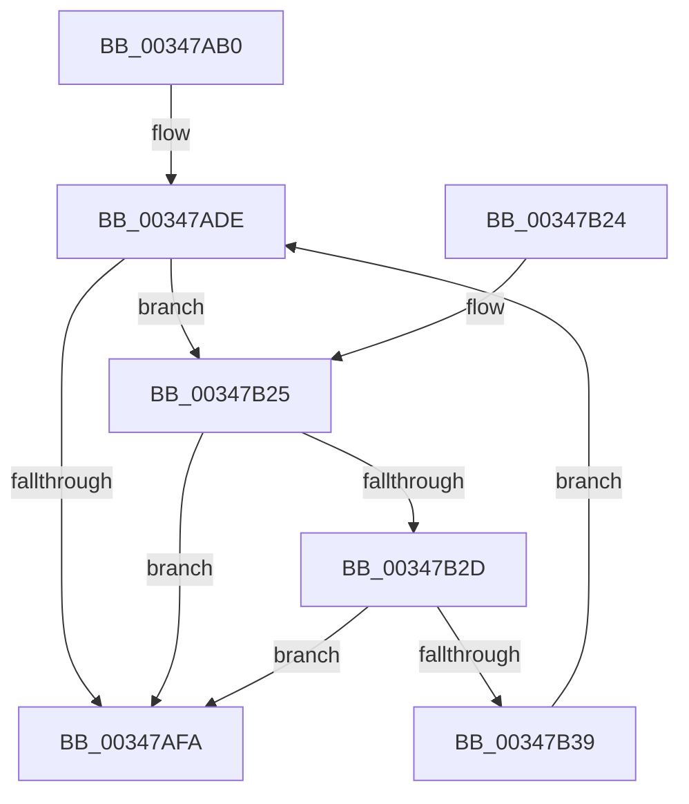

# CcWrapperMmCopyToCachedPage

- RVA: `0x00347AB0`–`0x00347B3B` (길이 `139` bytes)
- VA: `0x0000000140347AB0`
- 실행 섹션: `.text`
- PDB 이름 있음: `예`; PDB Function 태그: `아니요`
- unwind 정보 RVA: `0x00078128`
- 디코드: `44`개 명령, `139/139` bytes 표시
- 미해석 바이트: `0` (있으면 어셈블리에 `.byte`로 보존)

> 이 문서는 커널 이미지의 기계어와 PDB 기호를 분석해 생성했습니다. 4번과 5번은 함수 원형과 자료형을 바이너리 사용 방식에서 추정한 C 해석이며 원본 소스 복구 결과는 아닙니다.

## 1. Dependencies

- 직접 호출 지점: **1**; 고유 호출 대상: **1**
- 직접 호출자로 확인된 함수: **1**
- RIP 상대 이미지 참조: **0**

### Outgoing calls
- `0x00347AEE` → [MmCopyToCachedPage](MmCopyToCachedPage_function_00347B44.md) (function, `0x00347B44`)

### Direct callers
- [CcMapAndCopyInToCache](../3C/CcMapAndCopyInToCache_function_003CA7F0.md) at `0x003CAB42`

### Static image references
- 디코드된 RIP-relative 메모리 참조가 없습니다.

## 2. Other-region calls and transfers

- 다른 실행 섹션으로 향하는 call: **0**
- 별도 외부 분기/꼬리 이동을 확인하지 못했습니다.

## 3. Assembly (complete function range)

```asm
00347AB0  48 89 5C 24 08                  mov qword ptr [rsp + 8], rbx
00347AB5  48 89 6C 24 10                  mov qword ptr [rsp + 0x10], rbp
00347ABA  48 89 74 24 18                  mov qword ptr [rsp + 0x18], rsi
00347ABF  57                              push rdi
00347AC0  41 56                           push r14
00347AC2  41 57                           push r15
00347AC4  48 83 EC 30                     sub rsp, 0x30
00347AC8  8B 5C 24 70                     mov ebx, dword ptr [rsp + 0x70]
00347ACC  49 8B F9                        mov rdi, r9
00347ACF  41 8B F0                        mov esi, r8d
00347AD2  48 8B EA                        mov rbp, rdx
00347AD5  4C 8B F1                        mov r14, rcx
00347AD8  41 BF 01 00 00 00               mov r15d, 1
00347ADE  4C 8B CF                        mov r9, rdi
00347AE1  89 5C 24 20                     mov dword ptr [rsp + 0x20], ebx
00347AE5  44 8B C6                        mov r8d, esi
00347AE8  48 8B D5                        mov rdx, rbp
00347AEB  49 8B CE                        mov rcx, r14
00347AEE  E8 51 00 00 00                  call 0x140347b44
00347AF3  8B C8                           mov ecx, eax
00347AF5  F6 C3 08                        test bl, 8
00347AF8  75 2B                           jne 0x140347b25
00347AFA  48 8B 44 24 78                  mov rax, qword ptr [rsp + 0x78]
00347AFF  48 8B 6C 24 58                  mov rbp, qword ptr [rsp + 0x58]
00347B04  48 8B 74 24 60                  mov rsi, qword ptr [rsp + 0x60]
00347B09  C1 EB 02                        shr ebx, 2
00347B0C  F6 D3                           not bl
00347B0E  80 E3 01                        and bl, 1
00347B11  88 18                           mov byte ptr [rax], bl
00347B13  8B C1                           mov eax, ecx
00347B15  48 8B 5C 24 50                  mov rbx, qword ptr [rsp + 0x50]
00347B1A  48 83 C4 30                     add rsp, 0x30
00347B1E  41 5F                           pop r15
00347B20  41 5E                           pop r14
00347B22  5F                              pop rdi
00347B23  C3                              ret
00347B24  CC                              int3
00347B25  81 F9 9A 00 00 C0               cmp ecx, 0xc000009a
00347B2B  75 CD                           jne 0x140347afa
00347B2D  83 E3 F3                        and ebx, 0xfffffff3
00347B30  41 FF C7                        inc r15d
00347B33  41 83 FF 02                     cmp r15d, 2
00347B37  77 C1                           ja 0x140347afa
00347B39  EB A3                           jmp 0x140347ade
```

## 4. C-style interpretation (structured pseudocode)

```c
__int64 __fastcall CcWrapperMmCopyToCachedPage(__int64 a1, __int64 a2, int a3, __int64 a4, unsigned int a5, __int64 a6)
{
    __int64 result;
    __int64 v_r15;
    __int64 v_rbx;
    __int64 v_rsp;
    unsigned int v_stack_m28;
    unsigned __int64 v_stack_p10;
    unsigned __int64 v_stack_p18;
    unsigned __int64 v_stack_p8;

    v_stack_p8 = v_rbx;
    v_stack_p10 = v_rbp;
    v_stack_p18 = v_rsi;
    v_rsp = (v_rsp) - (48);
loc_00347ADE:
    v_stack_m28 = (unsigned int)((unsigned int)(a5));
    result = MmCopyToCachedPage(a1, a2, (unsigned int)((unsigned int)((unsigned int)(a3))), a4);
    if ((((unsigned __int8)((unsigned int)(a5))) & (8)) != 0) goto loc_00347B25;
loc_00347AFA:
    v_rbx = (unsigned int)(((unsigned int)(a5)) >> (2));
    v_rbx = (unsigned __int8)(~(v_rbx));
    v_rbx = (unsigned __int8)((v_rbx) & (1));
    *(unsigned __int8 *)(a6) = (unsigned __int8)(v_rbx);
    v_rsp = (v_rsp) + (48);
    return (unsigned int)((unsigned int)((unsigned int)((unsigned int)(result))));
loc_00347B25:
    if (((unsigned int)((unsigned int)((unsigned int)(result)))) != 0xC000009AULL) goto loc_00347AFA;
    v_rbx = (unsigned int)((v_stack_p8) & (0xFFFFFFF3ULL));
    v_r15 = (unsigned int)((1) + 1);
    if (((unsigned int)(v_r15)) > 2) goto loc_00347AFA;
    goto loc_00347ADE;
}
```

## 5. (Beta) C Style

```c
int64_t CcWrapperMmCopyToCachedPage(int64_t Arg1, int64_t Arg2, int32_t Arg3, int64_t Arg4, uint32_t Arg5, void *Arg6)
{
    uint8_t *arg6 = (uint8_t *)Arg6;

    int64_t result;
    int64_t local_r15;
    int64_t local_rbx;
    int64_t local_rsp;
    uint32_t v_stack_m28;
    uint64_t v_stack_p10;
    uint64_t v_stack_p18;
    uint64_t v_stack_p8;

    v_stack_p8 = local_rbx;
    v_stack_p10 = local_rbp;
    v_stack_p18 = local_rsi;
    local_rsp = (local_rsp) - (48);
loc_00347ADE:
    v_stack_m28 = (uint32_t)((uint32_t)(Arg5));
    result = MmCopyToCachedPage(Arg1, Arg2, (uint32_t)((uint32_t)((uint32_t)(Arg3))), Arg4);
    if ((((uint8_t)((uint32_t)(Arg5))) & (8)) != 0) goto loc_00347B25;
loc_00347AFA:
    local_rbx = (uint32_t)(((uint32_t)(Arg5)) >> (2));
    local_rbx = (uint8_t)(~(local_rbx));
    local_rbx = (uint8_t)((local_rbx) & (1));
    *(uint8_t *)(arg6) = (uint8_t)(local_rbx);
    local_rsp = (local_rsp) + (48);
    return (uint32_t)((uint32_t)((uint32_t)((uint32_t)(result))));
loc_00347B25:
    if (((uint32_t)((uint32_t)((uint32_t)(result)))) != 0xC000009AULL) goto loc_00347AFA;
    local_rbx = (uint32_t)((v_stack_p8) & (0xFFFFFFF3ULL));
    local_r15 = (uint32_t)((1) + 1);
    if (((uint32_t)(local_r15)) > 2) goto loc_00347AFA;
    goto loc_00347ADE;
}
```

### 관측된 메모리 오프셋

구조체 형식이 확인되지 않은 접근은 인자 기준의 오프셋으로만 기록했습니다.

| 기준 인자 | 오프셋 표현 | 폭 (bit) | 접근 |
|---|---:|---:|---|
| `Arg6` | `+ 0x0` | `8` | `W` |

## 6. Execution-region graph

[열기: 2D/3D 그래프와 함수 탐색 컨트롤 패널](../../../control-panel.html?section=text&rva=0x00347AB0&view=graph)

- 2D 그래프는 위에서 아래로 흐르고, 3D 그래프는 빈 공간을 드래그해 회전합니다. Shift+드래그는 이동, 휠은 확대·축소, 함수 노드 선택은 대상 보고서 이동입니다.

### Static fallback


