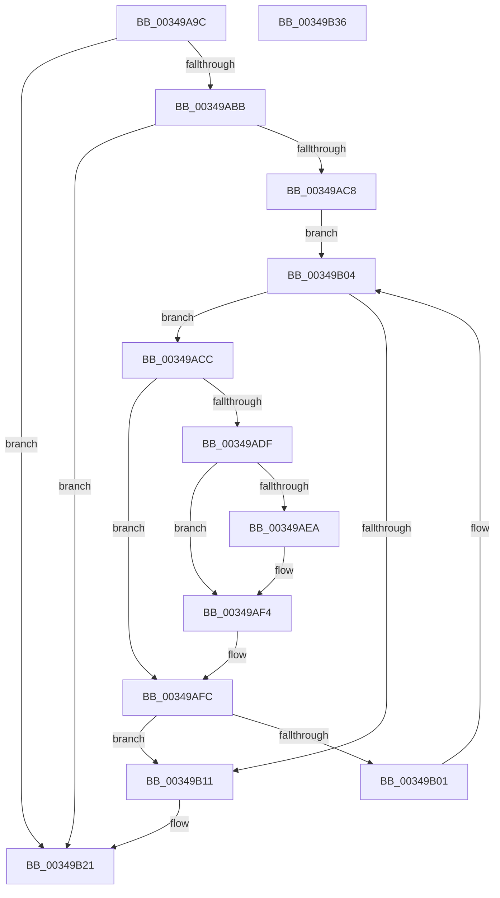

# CmpDoFlushAll

- RVA: `0x00349A9C`–`0x00349B37` (길이 `155` bytes)
- VA: `0x0000000140349A9C`
- 실행 섹션: `.text`
- PDB 이름 있음: `예`; PDB Function 태그: `아니요`
- unwind 정보 RVA: `0x0005C954`
- 디코드: `45`개 명령, `155/155` bytes 표시
- 미해석 바이트: `0` (있으면 어셈블리에 `.byte`로 보존)

> 이 문서는 커널 이미지의 기계어와 PDB 기호를 분석해 생성했습니다. 4번과 5번은 함수 원형과 자료형을 바이너리 사용 방식에서 추정한 C 해석이며 원본 소스 복구 결과는 아닙니다.

## 1. Dependencies

- 직접 호출 지점: **7**; 고유 호출 대상: **7**
- 직접 호출자로 확인된 함수: **3**
- RIP 상대 이미지 참조: **1**

### Outgoing calls
- `0x00349ABB` → [CmpGetLastHive](../../page/87/CmpGetLastHive_function_008786B4.md) (function, `0x008786B4`)
- `0x00349AD6` → [ExAcquireRundownProtection](../21/ExAcquireRundownProtection_function_00216620.md) (function, `0x00216620`)
- `0x00349AEF` → [CmpFlushHive](../../page/9B/CmpFlushHive_function_009B3DC0.md) (function, `0x009B3DC0`)
- `0x00349AF7` → [ExReleaseRundownProtection](ExReleaseRundownProtection_function_00349E80.md) (function, `0x00349E80`)
- `0x00349B04` → [CmpGetNextHive](../../page/84/CmpGetNextHive_function_0084E330.md) (function, `0x0084E330`)
- `0x00349B14` → [CmpQuitNextHive](../../page/A7/CmpQuitNextHive_function_00A76990.md) (function, `0x00A76990`)
- `0x00349B1C` → [CmpDereferenceHive](../../page/86/CmpDereferenceHive_function_008632B0.md) (function, `0x008632B0`)

### Direct callers
- [CmReconcileAndValidateAllHives](../../page/7E/CmReconcileAndValidateAllHives_function_007E7D90.md) at `0x007E7DE6`
- [CmpForceFlushWorker](../../page/A6/CmpForceFlushWorker_function_00A6B030.md) at `0x00A6B0AB`
- [NtFlushKey](../../page/A8/NtFlushKey_function_00A8A030.md) at `0x00A8A27D`

### Static image references
- `0x00349AB0` → RVA `0x00FD8001` (`PAGEDATA`; read)

## 2. Other-region calls and transfers

- 다른 실행 섹션으로 향하는 call: **5**
  - `0x00349ABB` → [CmpGetLastHive](../../page/87/CmpGetLastHive_function_008786B4.md) (`.text` → `PAGE`)
  - `0x00349AEF` → [CmpFlushHive](../../page/9B/CmpFlushHive_function_009B3DC0.md) (`.text` → `PAGE`)
  - `0x00349B04` → [CmpGetNextHive](../../page/84/CmpGetNextHive_function_0084E330.md) (`.text` → `PAGE`)
  - `0x00349B14` → [CmpQuitNextHive](../../page/A7/CmpQuitNextHive_function_00A76990.md) (`.text` → `PAGE`)
  - `0x00349B1C` → [CmpDereferenceHive](../../page/86/CmpDereferenceHive_function_008632B0.md) (`.text` → `PAGE`)
- 별도 외부 분기/꼬리 이동을 확인하지 못했습니다.

## 3. Assembly (complete function range)

```asm
00349A9C  48 89 5C 24 08                  mov qword ptr [rsp + 8], rbx
00349AA1  48 89 6C 24 10                  mov qword ptr [rsp + 0x10], rbp
00349AA6  48 89 74 24 18                  mov qword ptr [rsp + 0x18], rsi
00349AAB  57                              push rdi
00349AAC  48 83 EC 20                     sub rsp, 0x20
00349AB0  80 3D 4A E5 C8 00 00            cmp byte ptr [rip + 0xc8e54a], 0
00349AB7  8B E9                           mov ebp, ecx
00349AB9  75 66                           jne 0x140349b21
00349ABB  E8 F4 EB 52 00                  call 0x1408786b4
00349AC0  48 8B F8                        mov rdi, rax
00349AC3  48 85 C0                        test rax, rax
00349AC6  74 59                           je 0x140349b21
00349AC8  33 C9                           xor ecx, ecx
00349ACA  EB 38                           jmp 0x140349b04
00349ACC  48 8D B3 68 06 00 00            lea rsi, [rbx + 0x668]
00349AD3  48 8B CE                        mov rcx, rsi
00349AD6  E8 45 CB EC FF                  call 0x140216620
00349ADB  84 C0                           test al, al
00349ADD  74 1D                           je 0x140349afc
00349ADF  8B 93 A0 00 00 00               mov edx, dword ptr [rbx + 0xa0]
00349AE5  F6 C2 02                        test dl, 2
00349AE8  75 0A                           jne 0x140349af4
00349AEA  8B D5                           mov edx, ebp
00349AEC  48 8B CB                        mov rcx, rbx
00349AEF  E8 CC A2 66 00                  call 0x1409b3dc0
00349AF4  48 8B CE                        mov rcx, rsi
00349AF7  E8 84 03 00 00                  call 0x140349e80
00349AFC  48 3B DF                        cmp rbx, rdi
00349AFF  74 10                           je 0x140349b11
00349B01  48 8B CB                        mov rcx, rbx
00349B04  E8 27 48 50 00                  call 0x14084e330
00349B09  48 8B D8                        mov rbx, rax
00349B0C  48 85 C0                        test rax, rax
00349B0F  75 BB                           jne 0x140349acc
00349B11  48 8B CB                        mov rcx, rbx
00349B14  E8 77 CE 72 00                  call 0x140a76990
00349B19  48 8B CF                        mov rcx, rdi
00349B1C  E8 8F 97 51 00                  call 0x1408632b0
00349B21  48 8B 5C 24 30                  mov rbx, qword ptr [rsp + 0x30]
00349B26  48 8B 6C 24 38                  mov rbp, qword ptr [rsp + 0x38]
00349B2B  48 8B 74 24 40                  mov rsi, qword ptr [rsp + 0x40]
00349B30  48 83 C4 20                     add rsp, 0x20
00349B34  5F                              pop rdi
00349B35  C3                              ret
00349B36  CC                              int3
```

## 4. C-style interpretation (structured pseudocode)

```c
__int64 __fastcall CmpDoFlushAll(int a1)
{
    __int64 result;
    __int64 v_rsp;
    unsigned __int64 v_stack_p10;
    unsigned __int64 v_stack_p18;
    unsigned __int64 v_stack_p8;

    v_stack_p8 = v_rbx;
    v_stack_p10 = v_rbp;
    v_stack_p18 = v_rsi;
    v_rsp = (v_rsp) - (32);
    if ((*(unsigned __int8 *)(v_rip + 13165898)) != 0) goto loc_00349B21;
    result = CmpGetLastHive(a1, a2, a3, a4);
    if (result == 0) goto loc_00349B21;
    a1 = 0;
    goto loc_00349B04;
loc_00349ACC:
    result = ExAcquireRundownProtection(v_rbx + 1640, a2, a3, a4);
    if ((unsigned __int8)(result) == 0) goto loc_00349AFC;
    if ((((unsigned __int8)((unsigned int)(*(unsigned int *)(v_rbx + 160)))) & (2)) == 0) {
        a2 = (unsigned int)((unsigned int)(a1));
        a1 = v_rbx;
        result = CmpFlushHive(a1, a2, a3, a4);
    }
    result = ExReleaseRundownProtection(v_rbx + 1640, a2, a3, a4);
loc_00349AFC:
    if (v_rbx == result) goto loc_00349B11;
loc_00349B04:
    result = CmpGetNextHive(v_rbx, a2, a3, a4);
    if (result != 0) goto loc_00349ACC;
loc_00349B11:
    result = CmpQuitNextHive(result, a2, a3, a4);
    result = CmpDereferenceHive(result, a2, a3, a4);
loc_00349B21:
    v_rsp = (v_rsp) + (32);
    return result;
}
```

## 5. (Beta) C Style

```c
int64_t CmpDoFlushAll(int32_t Arg1)
{
    int64_t result;
    int64_t local_rsp;
    uint64_t v_stack_p10;
    uint64_t v_stack_p18;
    uint64_t v_stack_p8;

    v_stack_p8 = local_rbx;
    v_stack_p10 = local_rbp;
    v_stack_p18 = local_rsi;
    local_rsp = (local_rsp) - (32);
    if ((*(uint8_t *)(v_rip + 0xC8E54A)) != 0) goto loc_00349B21;
    result = CmpGetLastHive(Arg1, a2, a3, a4);
    if (result == 0) goto loc_00349B21;
    Arg1 = 0;
    goto loc_00349B04;
loc_00349ACC:
    result = ExAcquireRundownProtection(local_rbx + 1640, a2, a3, a4);
    if ((uint8_t)(result) == 0) goto loc_00349AFC;
    if ((((uint8_t)((uint32_t)(*(uint32_t *)(local_rbx + 0xA0)))) & (2)) == 0) {
        a2 = (uint32_t)((uint32_t)(Arg1));
        Arg1 = local_rbx;
        result = CmpFlushHive(Arg1, a2, a3, a4);
    }
    result = ExReleaseRundownProtection(local_rbx + 1640, a2, a3, a4);
loc_00349AFC:
    if (local_rbx == result) goto loc_00349B11;
loc_00349B04:
    result = CmpGetNextHive(local_rbx, a2, a3, a4);
    if (result != 0) goto loc_00349ACC;
loc_00349B11:
    result = CmpQuitNextHive(result, a2, a3, a4);
    result = CmpDereferenceHive(result, a2, a3, a4);
loc_00349B21:
    local_rsp = (local_rsp) + (32);
    return result;
}
```

## 6. Execution-region graph

[열기: 2D/3D 그래프와 함수 탐색 컨트롤 패널](../../../control-panel.html?section=text&rva=0x00349A9C&view=graph)

- 2D 그래프는 위에서 아래로 흐르고, 3D 그래프는 빈 공간을 드래그해 회전합니다. Shift+드래그는 이동, 휠은 확대·축소, 함수 노드 선택은 대상 보고서 이동입니다.

### Static fallback


