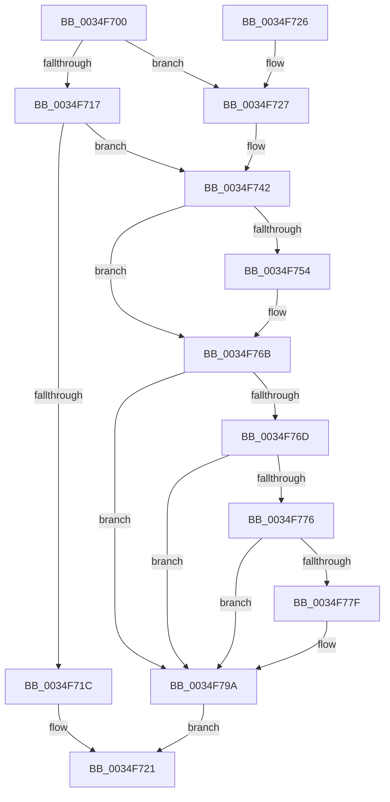

# ExConvertExclusiveToSharedLite

- RVA: `0x0034F700`–`0x0034F7A1` (길이 `161` bytes)
- VA: `0x000000014034F700`
- 실행 섹션: `.text`
- PDB 이름 있음: `예`; PDB Function 태그: `아니요`
- unwind 정보 RVA: `0x00078C98`
- 디코드: `44`개 명령, `161/161` bytes 표시
- 미해석 바이트: `0` (있으면 어셈블리에 `.byte`로 보존)

> 이 문서는 커널 이미지의 기계어와 PDB 기호를 분석해 생성했습니다. 4번과 5번은 함수 원형과 자료형을 바이너리 사용 방식에서 추정한 C 해석이며 원본 소스 복구 결과는 아닙니다.

## 1. Dependencies

- 직접 호출 지점: **5**; 고유 호출 대상: **3**
- 직접 호출자로 확인된 함수: **7**
- RIP 상대 이미지 참조: **0**

### Outgoing calls
- `0x0034F71C` → [ExpConvertExclusiveToSharedLite](ExpConvertExclusiveToSharedLite_function_0034F7A8.md) (function, `0x0034F7A8`)
- `0x0034F73C` → [KeBugCheckEx](../4F/KeBugCheckEx_function_004FD660.md) (function, `0x004FD660`)
- `0x0034F765` → [KeBugCheckEx](../4F/KeBugCheckEx_function_004FD660.md) (function, `0x004FD660`)
- `0x0034F794` → [KeBugCheckEx](../4F/KeBugCheckEx_function_004FD660.md) (function, `0x004FD660`)
- `0x0034F79A` → [ExpFastResourceLegacyConvertExclusiveToShared](../41/ExpFastResourceLegacyConvertExclusiveToShared_function_00416000.md) (function, `0x00416000`)

### Direct callers
- [FsRtlAcquireFileForModWriteEx](../29/FsRtlAcquireFileForModWriteEx_function_00299E5C.md) at `0x0029A174`
- [DifExConvertExclusiveToSharedLiteWrapper](../61/DifExConvertExclusiveToSharedLiteWrapper_function_0061EFC0.md) at `0x0061F086`
- [NtMapCMFModule](../../page/7D/NtMapCMFModule_function_007D4310.md) at `0x007D4AA8`
- [CmpReplicateKeyToVirtual](../../page/7E/CmpReplicateKeyToVirtual_function_007EBAEC.md) at `0x007EBCDB`
- [PspAllocateAndQueryNotificationChannel](../../page/91/PspAllocateAndQueryNotificationChannel_function_00917EE4.md) at `0x00917F80`
- [PnpUnlinkDeviceRemovalRelations](../../page/A0/PnpUnlinkDeviceRemovalRelations_function_00A063D8.md) at `0x00A065F3`
- [PpDevNodeUnlockTree](../../page/A2/PpDevNodeUnlockTree_function_00A21290.md) at `0x00A212DF`

### Static image references
- 디코드된 RIP-relative 메모리 참조가 없습니다.

## 2. Other-region calls and transfers

- 다른 실행 섹션으로 향하는 call: **0**
- 별도 외부 분기/꼬리 이동을 확인하지 못했습니다.

## 3. Assembly (complete function range)

```asm
0034F700  48 83 EC 38                     sub rsp, 0x38
0034F704  0F B7 51 1A                     movzx edx, word ptr [rcx + 0x1a]
0034F708  41 B9 01 00 00 00               mov r9d, 1
0034F70E  8A C2                           mov al, dl
0034F710  24 41                           and al, 0x41
0034F712  41 3A C1                        cmp al, r9b
0034F715  74 10                           je 0x14034f727
0034F717  41 84 D1                        test r9b, dl
0034F71A  75 26                           jne 0x14034f742
0034F71C  E8 87 00 00 00                  call 0x14034f7a8
0034F721  48 83 C4 38                     add rsp, 0x38
0034F725  C3                              ret
0034F726  CC                              int3
0034F727  48 83 64 24 20 00               and qword ptr [rsp + 0x20], 0
0034F72D  45 33 C9                        xor r9d, r9d
0034F730  4C 8B C1                        mov r8, rcx
0034F733  B9 C6 01 00 00                  mov ecx, 0x1c6
0034F738  41 8D 51 0F                     lea edx, [r9 + 0xf]
0034F73C  E8 1F DF 1A 00                  call 0x1404fd660
0034F741  CC                              int3
0034F742  44 0F 20 C0                     mov rax, cr8
0034F746  65 48 8B 14 25 88 01 00 00      mov rdx, qword ptr gs:[0x188]
0034F74F  41 3A C1                        cmp al, r9b
0034F752  76 17                           jbe 0x14034f76b
0034F754  48 83 64 24 20 00               and qword ptr [rsp + 0x20], 0
0034F75A  33 D2                           xor edx, edx
0034F75C  44 0F B6 C0                     movzx r8d, al
0034F760  B9 C6 01 00 00                  mov ecx, 0x1c6
0034F765  E8 F6 DE 1A 00                  call 0x1404fd660
0034F76A  CC                              int3
0034F76B  73 2D                           jae 0x14034f79a
0034F76D  F7 42 74 00 04 00 00            test dword ptr [rdx + 0x74], 0x400
0034F774  75 24                           jne 0x14034f79a
0034F776  83 BA E4 01 00 00 00            cmp dword ptr [rdx + 0x1e4], 0
0034F77D  75 1B                           jne 0x14034f79a
0034F77F  48 83 64 24 20 00               and qword ptr [rsp + 0x20], 0
0034F785  45 33 C9                        xor r9d, r9d
0034F788  45 33 C0                        xor r8d, r8d
0034F78B  B9 C6 01 00 00                  mov ecx, 0x1c6
0034F790  41 8D 51 07                     lea edx, [r9 + 7]
0034F794  E8 C7 DE 1A 00                  call 0x1404fd660
0034F799  CC                              int3
0034F79A  E8 61 68 0C 00                  call 0x140416000
0034F79F  EB 80                           jmp 0x14034f721
```

## 4. C-style interpretation (structured pseudocode)

```c
__int64 __fastcall ExConvertExclusiveToSharedLite(__int64 a1)
{
    __int64 result;
    __int64 v_rsp;
    unsigned __int64 v_stack_p20;

    v_rsp = (v_rsp) - (56);
    result = (unsigned __int8)(((unsigned __int8)(*(unsigned __int16 *)(a1 + 26))) & (65));
    if (((unsigned __int8)(result)) == 1) goto loc_0034F727;
    if (((1) & ((unsigned __int8)(*(unsigned __int16 *)(a1 + 26)))) != 0) goto loc_0034F742;
    result = ExpConvertExclusiveToSharedLite(a1, *(unsigned __int16 *)(a1 + 26), a3, 1);
loc_0034F721:
    v_rsp = (v_rsp) + (56);
    return result;
loc_0034F727:
    a4 = 0;
    result = KeBugCheckEx(454, a4 + 15, a1, a4);
loc_0034F742:
    result = v_cr8;
    if (((unsigned __int8)(v_cr8)) >= = 0) {
        a2 = 0;
        a3 = (unsigned __int8)(v_cr8);
        a1 = 454;
        result = KeBugCheckEx(a1, a2, a3, a4);
    }
    if (condition_is_above_or_equal) goto loc_0034F79A;
    if (((*(unsigned int *)(a2 + 116)) & (0x400ULL)) != 0) goto loc_0034F79A;
    if ((*(unsigned int *)(a2 + 484)) == 0) {
        a4 = 0;
        a3 = 0;
        a1 = 454;
        a2 = a4 + 7;
        result = KeBugCheckEx(a1, a2, a3, a4);
    }
    result = ExpFastResourceLegacyConvertExclusiveToShared(a1, a2, a3, a4);
    goto loc_0034F721;
}
```

## 5. (Beta) C Style

```c
int64_t ExConvertExclusiveToSharedLite(void *Arg1)
{
    uint8_t *arg1 = (uint8_t *)Arg1;

    int64_t result;
    int64_t local_rsp;
    uint64_t v_stack_p20;

    local_rsp = (local_rsp) - (56);
    result = (uint8_t)(((uint8_t)(*(uint16_t *)(arg1 + 0x1A))) & (65));
    if (((uint8_t)(result)) == 1) goto loc_0034F727;
    if (((1) & ((uint8_t)(*(uint16_t *)(arg1 + 0x1A)))) != 0) goto loc_0034F742;
    result = ExpConvertExclusiveToSharedLite(Arg1, *(uint16_t *)(arg1 + 0x1A), a3, 1);
loc_0034F721:
    local_rsp = (local_rsp) + (56);
    return result;
loc_0034F727:
    a4 = 0;
    result = KeBugCheckEx(454, a4 + 15, Arg1, a4);
loc_0034F742:
    result = v_cr8;
    if (((uint8_t)(v_cr8)) >= = 0) {
        a2 = 0;
        a3 = (uint8_t)(v_cr8);
        Arg1 = 454;
        result = KeBugCheckEx(Arg1, a2, a3, a4);
    }
    if (condition_is_above_or_equal) goto loc_0034F79A;
    if (((*(uint32_t *)(a2 + 0x74)) & (0x400ULL)) != 0) goto loc_0034F79A;
    if ((*(uint32_t *)(a2 + 0x1E4)) == 0) {
        a4 = 0;
        a3 = 0;
        Arg1 = 454;
        a2 = a4 + 7;
        result = KeBugCheckEx(Arg1, a2, a3, a4);
    }
    result = ExpFastResourceLegacyConvertExclusiveToShared(Arg1, a2, a3, a4);
    goto loc_0034F721;
}
```

### 관측된 메모리 오프셋

구조체 형식이 확인되지 않은 접근은 인자 기준의 오프셋으로만 기록했습니다.

| 기준 인자 | 오프셋 표현 | 폭 (bit) | 접근 |
|---|---:|---:|---|
| `Arg1` | `+ 0x1A` | `16` | `R` |

## 6. Execution-region graph

[열기: 2D/3D 그래프와 함수 탐색 컨트롤 패널](../../../control-panel.html?section=text&rva=0x0034F700&view=graph)

- 2D 그래프는 위에서 아래로 흐르고, 3D 그래프는 빈 공간을 드래그해 회전합니다. Shift+드래그는 이동, 휠은 확대·축소, 함수 노드 선택은 대상 보고서 이동입니다.

### Static fallback


