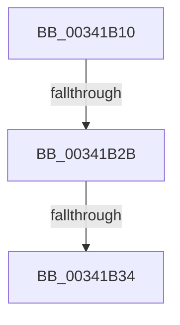

# ExIsResourceAcquiredSharedLite

- RVA: `0x00341B10`–`0x00341B4C` (길이 `60` bytes)
- VA: `0x0000000140341B10`
- 실행 섹션: `.text`
- PDB 이름 있음: `예`; PDB Function 태그: `아니요`
- unwind 정보 RVA: `0x000775CC`
- 디코드: `17`개 명령, `60/60` bytes 표시
- 미해석 바이트: `0` (있으면 어셈블리에 `.byte`로 보존)

> 이 문서는 커널 이미지의 기계어와 PDB 기호를 분석해 생성했습니다. 4번과 5번은 함수 원형과 자료형을 바이너리 사용 방식에서 추정한 C 해석이며 원본 소스 복구 결과는 아닙니다.

## 1. Dependencies

- 직접 호출 지점: **0**; 고유 호출 대상: **0**
- 직접 호출자로 확인된 함수: **7**
- RIP 상대 이미지 참조: **0**

### Outgoing calls
- 직접 디코드된 call 명령이 없습니다.

### Direct callers
- [CmpIsRegistryLockAcquired](../45/CmpIsRegistryLockAcquired_function_00456A7C.md) at `0x00456AA8`
- [DifExIsResourceAcquiredSharedLiteWrapper](../62/DifExIsResourceAcquiredSharedLiteWrapper_function_00621950.md) at `0x00621A1D`
- [CmpTestRegistryLock](../66/CmpTestRegistryLock_function_0066AC84.md) at `0x0066ACA1`
- [CmpDoReOpenTransKey](../../page/7F/CmpDoReOpenTransKey_function_007F78E8.md) at `0x007F797A`
- [FsRtlAcquireFileForCcFlushEx](../../page/9D/FsRtlAcquireFileForCcFlushEx_function_009D72F0.md) at `0x009D7502`
- [PnpUnlinkDeviceRemovalRelations](../../page/A0/PnpUnlinkDeviceRemovalRelations_function_00A063D8.md) at `0x00A06415`
- [PpDevNodeLockTree](../../page/A1/PpDevNodeLockTree_function_00A19310.md) at `0x00A19382`

### Static image references
- 디코드된 RIP-relative 메모리 참조가 없습니다.

## 2. Other-region calls and transfers

- 다른 실행 섹션으로 향하는 call: **0**
- call이 아닌 외부 분기/꼬리 이동: **3**
  - `0x00341B25` → [sub_00341C85](Unknown_function_00341C85.md) (`tail-transfer`)
  - `0x00341B2E` → [sub_00341C85 + 0x1B](Unknown_function_00341C85.md) (`tail-transfer`)
  - `0x00341B46` → [sub_00341C22](Unknown_function_00341C22.md) (`tail-transfer`)

## 3. Assembly (complete function range)

```asm
00341B10  40 53                           push rbx
00341B12  57                              push rdi
00341B13  48 83 EC 58                     sub rsp, 0x58
00341B17  48 8B D9                        mov rbx, rcx
00341B1A  0F B7 49 1A                     movzx ecx, word ptr [rcx + 0x1a]
00341B1E  0F B6 C1                        movzx eax, cl
00341B21  24 41                           and al, 0x41
00341B23  3C 01                           cmp al, 1
00341B25  0F 84 5A 01 00 00               je 0x140341c85
00341B2B  F6 C1 01                        test cl, 1
00341B2E  0F 85 6C 01 00 00               jne 0x140341ca0
00341B34  33 C0                           xor eax, eax
00341B36  0F 57 C0                        xorps xmm0, xmm0
00341B39  0F 11 44 24 30                  movups xmmword ptr [rsp + 0x30], xmm0
00341B3E  48 89 44 24 40                  mov qword ptr [rsp + 0x40], rax
00341B43  39 43 40                        cmp dword ptr [rbx + 0x40], eax
00341B46  0F 84 D6 00 00 00               je 0x140341c22
```

## 4. C-style interpretation (structured pseudocode)

```c
__int64 __fastcall ExIsResourceAcquiredSharedLite(__int64 a1)
{
    __int64 result;
    __int64 v_rsp;
    unsigned __int64 v_stack_m28;
    unsigned __int64 v_stack_m38;

    v_rsp = (v_rsp) - (88);
    result = (unsigned __int8)(((unsigned __int8)(*(unsigned __int16 *)(a1 + 26))) & (65));
    result = 0;
    v_stack_m38 = v_xmm0;
    v_stack_m28 = 0;
}
```

## 5. (Beta) C Style

```c
int64_t ExIsResourceAcquiredSharedLite(void *Arg1)
{
    uint8_t *arg1 = (uint8_t *)Arg1;

    int64_t result;
    int64_t local_rsp;
    uint64_t v_stack_m28;
    uint64_t v_stack_m38;

    local_rsp = (local_rsp) - (88);
    result = (uint8_t)(((uint8_t)(*(uint16_t *)(arg1 + 0x1A))) & (65));
    result = 0;
    v_stack_m38 = v_xmm0;
    v_stack_m28 = 0;
}
```

### 관측된 메모리 오프셋

구조체 형식이 확인되지 않은 접근은 인자 기준의 오프셋으로만 기록했습니다.

| 기준 인자 | 오프셋 표현 | 폭 (bit) | 접근 |
|---|---:|---:|---|
| `Arg1` | `+ 0x1A` | `16` | `R` |
| `Arg1` | `+ 0x40` | `32` | `R` |

## 6. Execution-region graph

[열기: 2D/3D 그래프와 함수 탐색 컨트롤 패널](../../../control-panel.html?section=text&rva=0x00341B10&view=graph)

- 2D 그래프는 위에서 아래로 흐르고, 3D 그래프는 빈 공간을 드래그해 회전합니다. Shift+드래그는 이동, 휠은 확대·축소, 함수 노드 선택은 대상 보고서 이동입니다.

### Static fallback


