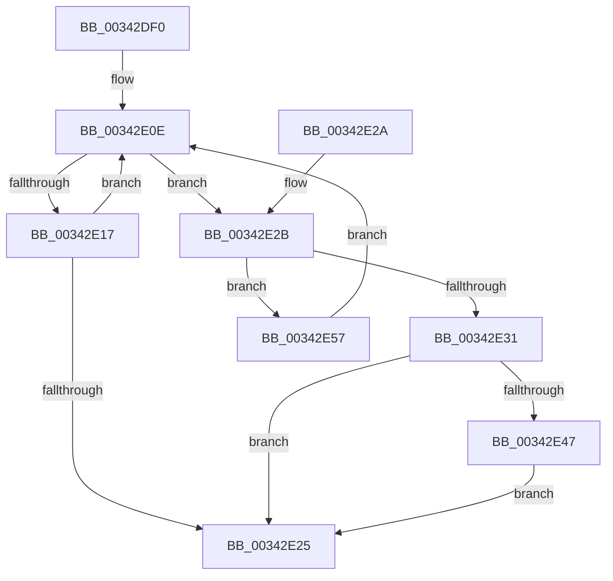

# ExReleaseRundownProtectionCacheAware

- RVA: `0x00342DF0`–`0x00342E5C` (길이 `108` bytes)
- VA: `0x0000000140342DF0`
- 실행 섹션: `.text`
- PDB 이름 있음: `예`; PDB Function 태그: `아니요`
- unwind 정보 RVA: `0x0005CEF4`
- 디코드: `32`개 명령, `108/108` bytes 표시
- 미해석 바이트: `0` (있으면 어셈블리에 `.byte`로 보존)

> 이 문서는 커널 이미지의 기계어와 PDB 기호를 분석해 생성했습니다. 4번과 5번은 함수 원형과 자료형을 바이너리 사용 방식에서 추정한 C 해석이며 원본 소스 복구 결과는 아닙니다.

## 1. Dependencies

- 직접 호출 지점: **1**; 고유 호출 대상: **1**
- 직접 호출자로 확인된 함수: **4**
- RIP 상대 이미지 참조: **0**

### Outgoing calls
- `0x00342E50` → [KeSetEvent](../33/KeSetEvent_function_0033F310.md) (function, `0x0033F310`)

### Direct callers
- [MiProbeUnlockPage](../24/MiProbeUnlockPage_function_00243860.md) at `0x00243BD7`
- [sub_00341D47](Unknown_function_00341D47.md) at `0x00341D7E`
- [sub_003422B4](Unknown_function_003422B4.md) at `0x0034235C`
- [sub_003422B4](Unknown_function_003422B4.md) at `0x00342377`
- [PfpPartitionRundownProtectionRelease](../47/PfpPartitionRundownProtectionRelease_function_0047BB54.md) at `0x0047BB5C`

### Static image references
- 디코드된 RIP-relative 메모리 참조가 없습니다.

## 2. Other-region calls and transfers

- 다른 실행 섹션으로 향하는 call: **0**
- 별도 외부 분기/꼬리 이동을 확인하지 못했습니다.

## 3. Assembly (complete function range)

```asm
00342DF0  48 83 EC 28                     sub rsp, 0x28
00342DF4  65 8B 04 25 A4 01 00 00         mov eax, dword ptr gs:[0x1a4]
00342DFC  33 D2                           xor edx, edx
00342DFE  F7 71 14                        div dword ptr [rcx + 0x14]
00342E01  4C 8B C9                        mov r9, rcx
00342E04  0F AF 51 10                     imul edx, dword ptr [rcx + 0x10]
00342E08  48 03 11                        add rdx, qword ptr [rcx]
00342E0B  0F 0D 0A                        prefetchw byte ptr [rdx]
00342E0E  4C 8B 02                        mov r8, qword ptr [rdx]
00342E11  41 F6 C0 01                     test r8b, 1
00342E15  75 14                           jne 0x140342e2b
00342E17  49 8D 48 FE                     lea rcx, [r8 - 2]
00342E1B  49 8B C0                        mov rax, r8
00342E1E  F0 48 0F B1 0A                  lock cmpxchg qword ptr [rdx], rcx
00342E23  75 E9                           jne 0x140342e0e
00342E25  48 83 C4 28                     add rsp, 0x28
00342E29  C3                              ret
00342E2A  CC                              int3
00342E2B  49 83 F8 01                     cmp r8, 1
00342E2F  74 26                           je 0x140342e57
00342E31  49 83 E0 FE                     and r8, 0xfffffffffffffffe
00342E35  48 C7 C0 FF FF FF FF            mov rax, 0xffffffffffffffff
00342E3C  F0 49 0F C1 00                  lock xadd qword ptr [r8], rax
00342E41  48 83 F8 01                     cmp rax, 1
00342E45  75 DE                           jne 0x140342e25
00342E47  49 8D 48 08                     lea rcx, [r8 + 8]
00342E4B  33 D2                           xor edx, edx
00342E4D  45 33 C0                        xor r8d, r8d
00342E50  E8 BB C4 FF FF                  call 0x14033f310
00342E55  EB CE                           jmp 0x140342e25
00342E57  49 8B 11                        mov rdx, qword ptr [r9]
00342E5A  EB B2                           jmp 0x140342e0e
```

## 4. C-style interpretation (structured pseudocode)

```c
__int64 __fastcall ExReleaseRundownProtectionCacheAware(__int64 a1, int a2)
{
    __int64 result;
    __int64 v_rsp;

    v_rsp = (v_rsp) - (40);
    a2 = 0;
    a2 = (unsigned int)((a2) * (*(unsigned int *)(a1 + 16)));
    a2 = (a2) + (*(unsigned __int64 *)(a1));
loc_00342E0E:
    if ((((unsigned __int8)(*(unsigned __int64 *)(a2))) & (1)) != 0) goto loc_00342E2B;
    if ((((unsigned __int8)(*(unsigned __int64 *)(a2))) & (1)) != 0) goto loc_00342E0E;
loc_00342E25:
    v_rsp = (v_rsp) + (40);
    return *(unsigned __int64 *)(a2);
loc_00342E2B:
    if ((*(unsigned __int64 *)(a2)) == 1) goto loc_00342E57;
    a3 = (*(unsigned __int64 *)(a2)) & (-2);
    if (-1 != 1) goto loc_00342E25;
    a2 = 0;
    a3 = 0;
    result = KeSetEvent(a3 + 8, a2, a3, a1);
    goto loc_00342E25;
loc_00342E57:
    goto loc_00342E0E;
}
```

## 5. (Beta) C Style

```c
int64_t ExReleaseRundownProtectionCacheAware(void *Arg1, int32_t Arg2)
{
    uint8_t *arg1 = (uint8_t *)Arg1;

    int64_t result;
    int64_t local_rsp;

    local_rsp = (local_rsp) - (40);
    Arg2 = 0;
    Arg2 = (uint32_t)((Arg2) * (*(uint32_t *)(arg1 + 0x10)));
    Arg2 = (Arg2) + (*(uint64_t *)(arg1));
loc_00342E0E:
    if ((((uint8_t)(*(uint64_t *)(Arg2))) & (1)) != 0) goto loc_00342E2B;
    if ((((uint8_t)(*(uint64_t *)(Arg2))) & (1)) != 0) goto loc_00342E0E;
loc_00342E25:
    local_rsp = (local_rsp) + (40);
    return *(uint64_t *)(Arg2);
loc_00342E2B:
    if ((*(uint64_t *)(Arg2)) == 1) goto loc_00342E57;
    a3 = (*(uint64_t *)(Arg2)) & (-2);
    if (-1 != 1) goto loc_00342E25;
    Arg2 = 0;
    a3 = 0;
    result = KeSetEvent(a3 + 8, Arg2, a3, Arg1);
    goto loc_00342E25;
loc_00342E57:
    goto loc_00342E0E;
}
```

### 관측된 메모리 오프셋

구조체 형식이 확인되지 않은 접근은 인자 기준의 오프셋으로만 기록했습니다.

| 기준 인자 | 오프셋 표현 | 폭 (bit) | 접근 |
|---|---:|---:|---|
| `Arg1` | `+ 0x0` | `64` | `R` |
| `Arg1` | `+ 0x10` | `32` | `R` |
| `Arg1` | `+ 0x14` | `32` | `R` |

## 6. Execution-region graph

[열기: 2D/3D 그래프와 함수 탐색 컨트롤 패널](../../../control-panel.html?section=text&rva=0x00342DF0&view=graph)

- 2D 그래프는 위에서 아래로 흐르고, 3D 그래프는 빈 공간을 드래그해 회전합니다. Shift+드래그는 이동, 휠은 확대·축소, 함수 노드 선택은 대상 보고서 이동입니다.

### Static fallback


