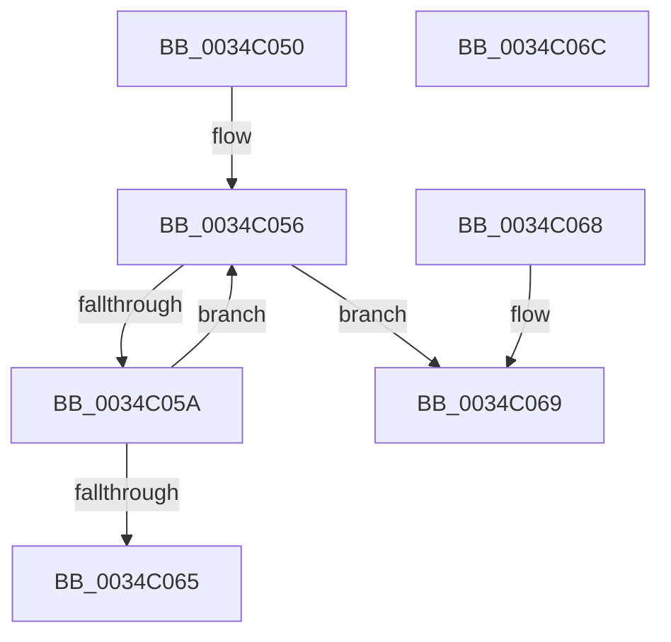

# ExfAcquireRundownProtection

- RVA: `0x0034C050`–`0x0034C06D` (길이 `29` bytes)
- VA: `0x000000014034C050`
- 실행 섹션: `.text`
- PDB 이름 있음: `예`; PDB Function 태그: `아니요`
- unwind 정보 RVA: `0x000DB714`
- 디코드: `13`개 명령, `29/29` bytes 표시
- 미해석 바이트: `0` (있으면 어셈블리에 `.byte`로 보존)

> 이 문서는 커널 이미지의 기계어와 PDB 기호를 분석해 생성했습니다. 4번과 5번은 함수 원형과 자료형을 바이너리 사용 방식에서 추정한 C 해석이며 원본 소스 복구 결과는 아닙니다.

## 1. Dependencies

- 직접 호출 지점: **0**; 고유 호출 대상: **0**
- 직접 호출자로 확인된 함수: **24**
- RIP 상대 이미지 참조: **0**

### Outgoing calls
- 직접 디코드된 call 명령이 없습니다.

### Direct callers
- [ExAcquireRundownProtection](../21/ExAcquireRundownProtection_function_00216620.md) at `0x00216641`
- [ExAcquireRundownProtectionCacheAware](../23/ExAcquireRundownProtectionCacheAware_function_0023D110.md) at `0x0023D14A`
- [sub_0034BEB2](Unknown_function_0034BEB2.md) at `0x0034BEB6`
- [SmKmStoreReference](SmKmStoreReference_function_0034BFB0.md) at `0x0034C026`
- [sub_0034DBCE](Unknown_function_0034DBCE.md) at `0x0034DBCE`
- [sub_0085EF76](../../page/85/Unknown_function_0085EF76.md) at `0x0085EF79`
- [ObpReferenceObjectByHandleWithTag](../../page/86/ObpReferenceObjectByHandleWithTag_function_00869650.md) at `0x00869B4C`
- [ObpCreateHandle](../../page/86/ObpCreateHandle_function_0086B950.md) at `0x0086C5BA`
- [ObpCreateHandle](../../page/86/ObpCreateHandle_function_0086B950.md) at `0x0086D002`
- [ObReferenceProcessHandleTable](../../page/89/ObReferenceProcessHandleTable_function_00893B70.md) at `0x00893BB7`
- [ObDuplicateObject](../../page/8C/ObDuplicateObject_function_008C4FA0.md) at `0x008C5757`
- [ObDuplicateObject](../../page/8C/ObDuplicateObject_function_008C4FA0.md) at `0x008C5771`
- [ObpCallPreOperationCallbacks](../../page/8C/ObpCallPreOperationCallbacks_function_008C6570.md) at `0x008C68A9`
- [EtwpCovSampCaptureBufferProcess](../../page/8D/EtwpCovSampCaptureBufferProcess_function_008D71C0.md) at `0x008D7366`
- [EtwpCovSampCaptureBufferMapAddressesAndQueue](../../page/8D/EtwpCovSampCaptureBufferMapAddressesAndQueue_function_008D7430.md) at `0x008D7770`
- [EtwpCovSampAcquireSamplerRundown](../../page/8D/EtwpCovSampAcquireSamplerRundown_function_008D7F7C.md) at `0x008D7FD1`
- [ExpWnfLookupNameInstance](../../page/90/ExpWnfLookupNameInstance_function_00908C70.md) at `0x00908D18`
- [NtQueryWnfStateData](../../page/90/NtQueryWnfStateData_function_00909DF0.md) at `0x0090A348`
- [ExpNtUpdateWnfStateData](../../page/90/ExpNtUpdateWnfStateData_function_0090A7A0.md) at `0x0090AC5C`
- [sub_0090B2DA](../../page/90/Unknown_function_0090B2DA.md) at `0x0090B376`
- [ExpWnfDispatchKernelSubscription](../../page/90/ExpWnfDispatchKernelSubscription_function_0090C520.md) at `0x0090C6CD`
- [ExpWnfDispatchKernelSubscription](../../page/90/ExpWnfDispatchKernelSubscription_function_0090C520.md) at `0x0090C8FD`
- [ObGetProcessHandleCount](../../page/91/ObGetProcessHandleCount_function_009195D0.md) at `0x009196D6`
- [PfSnPrefetchSections](../../page/93/PfSnPrefetchSections_function_0093BCF4.md) at `0x0093BF21`
- [PfSnPrefetchSectionsCleanup](../../page/93/PfSnPrefetchSectionsCleanup_function_0093C0B0.md) at `0x0093C1A0`
- [PfSnPrefetchScenario](../../page/96/PfSnPrefetchScenario_function_00961080.md) at `0x0096114B`
- [sub_00BC9445](../../pagecmrc/BC/Unknown_function_00BC9445.md) at `0x00BC944A`

### Static image references
- 디코드된 RIP-relative 메모리 참조가 없습니다.

## 2. Other-region calls and transfers

- 다른 실행 섹션으로 향하는 call: **0**
- 별도 외부 분기/꼬리 이동을 확인하지 못했습니다.

## 3. Assembly (complete function range)

```asm
0034C050  0F 0D 09                        prefetchw byte ptr [rcx]
0034C053  48 8B 01                        mov rax, qword ptr [rcx]
0034C056  A8 01                           test al, 1
0034C058  75 0F                           jne 0x14034c069
0034C05A  48 8D 50 02                     lea rdx, [rax + 2]
0034C05E  F0 48 0F B1 11                  lock cmpxchg qword ptr [rcx], rdx
0034C063  75 F1                           jne 0x14034c056
0034C065  B0 01                           mov al, 1
0034C067  C3                              ret
0034C068  CC                              int3
0034C069  32 C0                           xor al, al
0034C06B  C3                              ret
0034C06C  CC                              int3
```

## 4. C-style interpretation (structured pseudocode)

```c
__int64 __fastcall ExfAcquireRundownProtection(__int64 a1)
{
    __int64 result;

loc_0034C056:
    if ((((unsigned __int8)(*(unsigned __int64 *)(a1))) & (1)) != 0) goto loc_0034C069;
    if ((((unsigned __int8)(*(unsigned __int64 *)(a1))) & (1)) != 0) goto loc_0034C056;
    return 1;
loc_0034C069:
    result = 0;
    return result;
}
```

## 5. (Beta) C Style

```c
int64_t ExfAcquireRundownProtection(void *Arg1)
{
    uint8_t *arg1 = (uint8_t *)Arg1;

    int64_t result;

loc_0034C056:
    if ((((uint8_t)(*(uint64_t *)(arg1))) & (1)) != 0) goto loc_0034C069;
    if ((((uint8_t)(*(uint64_t *)(arg1))) & (1)) != 0) goto loc_0034C056;
    return 1;
loc_0034C069:
    result = 0;
    return result;
}
```

### 관측된 메모리 오프셋

구조체 형식이 확인되지 않은 접근은 인자 기준의 오프셋으로만 기록했습니다.

| 기준 인자 | 오프셋 표현 | 폭 (bit) | 접근 |
|---|---:|---:|---|
| `Arg1` | `+ 0x0` | `8` | `R` |
| `Arg1` | `+ 0x0` | `64` | `R` |

## 6. Execution-region graph

[열기: 2D/3D 그래프와 함수 탐색 컨트롤 패널](../../../control-panel.html?section=text&rva=0x0034C050&view=graph)

- 2D 그래프는 위에서 아래로 흐르고, 3D 그래프는 빈 공간을 드래그해 회전합니다. Shift+드래그는 이동, 휠은 확대·축소, 함수 노드 선택은 대상 보고서 이동입니다.

### Static fallback


