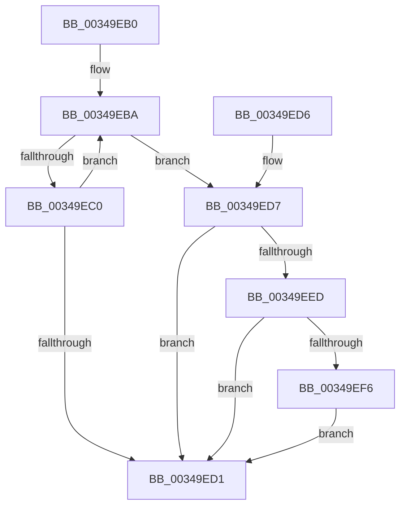

# ExfReleaseRundownProtection

- RVA: `0x00349EB0`–`0x00349F06` (길이 `86` bytes)
- VA: `0x0000000140349EB0`
- 실행 섹션: `.text`
- PDB 이름 있음: `예`; PDB Function 태그: `아니요`
- unwind 정보 RVA: `0x00078414`
- 디코드: `25`개 명령, `86/86` bytes 표시
- 미해석 바이트: `0` (있으면 어셈블리에 `.byte`로 보존)

> 이 문서는 커널 이미지의 기계어와 PDB 기호를 분석해 생성했습니다. 4번과 5번은 함수 원형과 자료형을 바이너리 사용 방식에서 추정한 C 해석이며 원본 소스 복구 결과는 아닙니다.

## 1. Dependencies

- 직접 호출 지점: **1**; 고유 호출 대상: **1**
- 직접 호출자로 확인된 함수: **29**
- RIP 상대 이미지 참조: **0**

### Outgoing calls
- `0x00349EFF` → [KeSetEvent](../33/KeSetEvent_function_0033F310.md) (function, `0x0033F310`)

### Direct callers
- [sub_002055DD](../20/Unknown_function_002055DD.md) at `0x0020580C`
- [SmKmStoreDereference](../20/SmKmStoreDereference_function_00206574.md) at `0x002065B9`
- [sub_002142F9](../21/Unknown_function_002142F9.md) at `0x00214DAF`
- [PsBoostThreadOutstandingIoQoS](../21/PsBoostThreadOutstandingIoQoS_function_00215C54.md) at `0x00215CC4`
- [sub_002160C7](../21/Unknown_function_002160C7.md) at `0x002160F7`
- [sub_003422B4](Unknown_function_003422B4.md) at `0x003424CD`
- [sub_003449AA](Unknown_function_003449AA.md) at `0x00344A28`
- [MiCompleteProtoPteFault](MiCompleteProtoPteFault_function_00345710.md) at `0x003467DD`
- [ExReleaseRundownProtection](ExReleaseRundownProtection_function_00349E80.md) at `0x00349E9F`
- [sub_0034DBC7](Unknown_function_0034DBC7.md) at `0x0034DBC7`
- [ExReleaseExtensionTable](../45/ExReleaseExtensionTable_function_00456DC0.md) at `0x00456DE3`
- [sub_0085EE44](../../page/85/Unknown_function_0085EE44.md) at `0x0085EE47`
- [ObpCloseHandle](../../page/86/ObpCloseHandle_function_008685B0.md) at `0x0086873A`
- [NtClose](../../page/86/NtClose_function_00868870.md) at `0x00868A17`
- [ObWaitForMultipleObjects](../../page/86/ObWaitForMultipleObjects_function_00868DF0.md) at `0x0086942D`
- [ObWaitForMultipleObjects](../../page/86/ObWaitForMultipleObjects_function_00868DF0.md) at `0x008695EE`
- [ObpReferenceObjectByHandleWithTag](../../page/86/ObpReferenceObjectByHandleWithTag_function_00869650.md) at `0x00869B42`
- [ObpReferenceObjectByHandleWithTag](../../page/86/ObpReferenceObjectByHandleWithTag_function_00869650.md) at `0x00869C5A`
- [ObpReferenceObjectByHandleWithTag](../../page/86/ObpReferenceObjectByHandleWithTag_function_00869650.md) at `0x00869C64`
- [ObpCreateHandle](../../page/86/ObpCreateHandle_function_0086B950.md) at `0x0086C5A8`
- [ObpCreateHandle](../../page/86/ObpCreateHandle_function_0086B950.md) at `0x0086CCB9`
- [ObpCreateHandle](../../page/86/ObpCreateHandle_function_0086B950.md) at `0x0086CE33`
- [ObpCreateHandle](../../page/86/ObpCreateHandle_function_0086B950.md) at `0x0086D0A0`
- [ObpCreateHandle](../../page/86/ObpCreateHandle_function_0086B950.md) at `0x0086D172`
- [ObReferenceProcessHandleTable](../../page/89/ObReferenceProcessHandleTable_function_00893B70.md) at `0x00893BE6`
- [ObDuplicateObject](../../page/8C/ObDuplicateObject_function_008C4FA0.md) at `0x008C5CF6`
- [ObDuplicateObject](../../page/8C/ObDuplicateObject_function_008C4FA0.md) at `0x008C5D00`
- [ObDuplicateObject](../../page/8C/ObDuplicateObject_function_008C4FA0.md) at `0x008C5D17`
- [ObpCallPreOperationCallbacks](../../page/8C/ObpCallPreOperationCallbacks_function_008C6570.md) at `0x008C68C1`
- [ObpCallPreOperationCallbacks](../../page/8C/ObpCallPreOperationCallbacks_function_008C6570.md) at `0x008C68CE`
- [PspWriteTebImpersonationInfo](../../page/8C/PspWriteTebImpersonationInfo_function_008CC7F0.md) at `0x008CC9AC`
- [EtwpCovSampReleaseSamplerRundown](../../page/8D/EtwpCovSampReleaseSamplerRundown_function_008D7850.md) at `0x008D7895`
- [NtQueryWnfStateData](../../page/90/NtQueryWnfStateData_function_00909DF0.md) at `0x0090A674`
- [NtQueryWnfStateData](../../page/90/NtQueryWnfStateData_function_00909DF0.md) at `0x0090A67E`
- [ExpNtUpdateWnfStateData](../../page/90/ExpNtUpdateWnfStateData_function_0090A7A0.md) at `0x0090B01E`
- [ExpNtUpdateWnfStateData](../../page/90/ExpNtUpdateWnfStateData_function_0090A7A0.md) at `0x0090B028`
- [ExpWnfDispatchKernelSubscription](../../page/90/ExpWnfDispatchKernelSubscription_function_0090C520.md) at `0x0090C833`
- [ExpWnfDispatchKernelSubscription](../../page/90/ExpWnfDispatchKernelSubscription_function_0090C520.md) at `0x0090C8EF`
- [ObGetProcessHandleCount](../../page/91/ObGetProcessHandleCount_function_009195D0.md) at `0x009196FE`
- [ObpCallPostOperationCallbacks](../../page/9A/ObpCallPostOperationCallbacks_function_009A7BC0.md) at `0x009A7C79`
- [ObDereferenceProcessHandleTable](../../page/9E/ObDereferenceProcessHandleTable_function_009EB950.md) at `0x009EB976`
- [CmpReleaseShutdownRundown](../../pagecmrc/BC/CmpReleaseShutdownRundown_function_00BC9880.md) at `0x00BC98C0`

### Static image references
- 디코드된 RIP-relative 메모리 참조가 없습니다.

## 2. Other-region calls and transfers

- 다른 실행 섹션으로 향하는 call: **0**
- 별도 외부 분기/꼬리 이동을 확인하지 못했습니다.

## 3. Assembly (complete function range)

```asm
00349EB0  48 83 EC 28                     sub rsp, 0x28
00349EB4  0F 0D 09                        prefetchw byte ptr [rcx]
00349EB7  4C 8B 01                        mov r8, qword ptr [rcx]
00349EBA  41 F6 C0 01                     test r8b, 1
00349EBE  75 17                           jne 0x140349ed7
00349EC0  49 8D 50 FE                     lea rdx, [r8 - 2]
00349EC4  49 8B C0                        mov rax, r8
00349EC7  F0 48 0F B1 11                  lock cmpxchg qword ptr [rcx], rdx
00349ECC  4C 8B C0                        mov r8, rax
00349ECF  75 E9                           jne 0x140349eba
00349ED1  48 83 C4 28                     add rsp, 0x28
00349ED5  C3                              ret
00349ED6  CC                              int3
00349ED7  49 83 E0 FE                     and r8, 0xfffffffffffffffe
00349EDB  48 C7 C0 FF FF FF FF            mov rax, 0xffffffffffffffff
00349EE2  F0 49 0F C1 00                  lock xadd qword ptr [r8], rax
00349EE7  48 83 F8 01                     cmp rax, 1
00349EEB  75 E4                           jne 0x140349ed1
00349EED  F0 41 0F BA 70 20 00            lock btr dword ptr [r8 + 0x20], 0
00349EF4  72 DB                           jb 0x140349ed1
00349EF6  49 8D 48 08                     lea rcx, [r8 + 8]
00349EFA  33 D2                           xor edx, edx
00349EFC  45 33 C0                        xor r8d, r8d
00349EFF  E8 0C 54 FF FF                  call 0x14033f310
00349F04  EB CB                           jmp 0x140349ed1
```

## 4. C-style interpretation (structured pseudocode)

```c
__int64 __fastcall ExfReleaseRundownProtection(__int64 a1)
{
    __int64 result;
    __int64 v_rsp;

    v_rsp = (v_rsp) - (40);
loc_00349EBA:
    if ((((unsigned __int8)(*(unsigned __int64 *)(a1))) & (1)) != 0) goto loc_00349ED7;
    if ((((unsigned __int8)(*(unsigned __int64 *)(a1))) & (1)) != 0) goto loc_00349EBA;
loc_00349ED1:
    v_rsp = (v_rsp) + (40);
    return *(unsigned __int64 *)(a1);
loc_00349ED7:
    a3 = (*(unsigned __int64 *)(a1)) & (-2);
    if (-1 != 1) goto loc_00349ED1;
    if (-1 < 1) goto loc_00349ED1;
    a2 = 0;
    a3 = 0;
    result = KeSetEvent(a3 + 8, a2, a3, a4);
    goto loc_00349ED1;
}
```

## 5. (Beta) C Style

```c
int64_t ExfReleaseRundownProtection(void *Arg1)
{
    uint8_t *arg1 = (uint8_t *)Arg1;

    int64_t result;
    int64_t local_rsp;

    local_rsp = (local_rsp) - (40);
loc_00349EBA:
    if ((((uint8_t)(*(uint64_t *)(arg1))) & (1)) != 0) goto loc_00349ED7;
    if ((((uint8_t)(*(uint64_t *)(arg1))) & (1)) != 0) goto loc_00349EBA;
loc_00349ED1:
    local_rsp = (local_rsp) + (40);
    return *(uint64_t *)(arg1);
loc_00349ED7:
    a3 = (*(uint64_t *)(arg1)) & (-2);
    if (-1 != 1) goto loc_00349ED1;
    if (-1 < 1) goto loc_00349ED1;
    a2 = 0;
    a3 = 0;
    result = KeSetEvent(a3 + 8, a2, a3, a4);
    goto loc_00349ED1;
}
```

### 관측된 메모리 오프셋

구조체 형식이 확인되지 않은 접근은 인자 기준의 오프셋으로만 기록했습니다.

| 기준 인자 | 오프셋 표현 | 폭 (bit) | 접근 |
|---|---:|---:|---|
| `Arg1` | `+ 0x0` | `8` | `R` |
| `Arg1` | `+ 0x0` | `64` | `R` |

## 6. Execution-region graph

[열기: 2D/3D 그래프와 함수 탐색 컨트롤 패널](../../../control-panel.html?section=text&rva=0x00349EB0&view=graph)

- 2D 그래프는 위에서 아래로 흐르고, 3D 그래프는 빈 공간을 드래그해 회전합니다. Shift+드래그는 이동, 휠은 확대·축소, 함수 노드 선택은 대상 보고서 이동입니다.

### Static fallback


