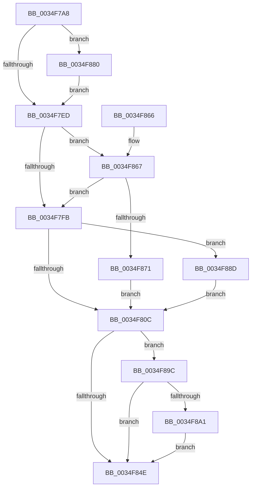

# ExpConvertExclusiveToSharedLite

- RVA: `0x0034F7A8`–`0x0034F8B9` (길이 `273` bytes)
- VA: `0x000000014034F7A8`
- 실행 섹션: `.text`
- PDB 이름 있음: `예`; PDB Function 태그: `아니요`
- unwind 정보 RVA: `0x00078CA4`
- 디코드: `70`개 명령, `273/273` bytes 표시
- 미해석 바이트: `0` (있으면 어셈블리에 `.byte`로 보존)

> 이 문서는 커널 이미지의 기계어와 PDB 기호를 분석해 생성했습니다. 4번과 5번은 함수 원형과 자료형을 바이너리 사용 방식에서 추정한 C 해석이며 원본 소스 복구 결과는 아닙니다.

## 1. Dependencies

- 직접 호출 지점: **6**; 고유 호출 대상: **6**
- 직접 호출자로 확인된 함수: **1**
- RIP 상대 이미지 참조: **3**

### Outgoing calls
- `0x0034F836` → [KeReleaseInStackQueuedSpinLock](KeReleaseInStackQueuedSpinLock_function_00342CE0.md) (function, `0x00342CE0`)
- `0x0034F845` → [KeWakeWaitChain](KeWakeWaitChain_function_0034F8C0.md) (function, `0x0034F8C0`)
- `0x0034F879` → [KiAcquireQueuedSpinLockInstrumented](../27/KiAcquireQueuedSpinLockInstrumented_function_00275850.md) (function, `0x00275850`)
- `0x0034F883` → [KiRaiseIrqlProcessIrqlFlags](../4F/KiRaiseIrqlProcessIrqlFlags_function_004F56FC.md) (function, `0x004F56FC`)
- `0x0034F892` → [KxWaitForLockOwnerShip](../25/KxWaitForLockOwnerShip_function_00257EB0.md) (function, `0x00257EB0`)
- `0x0034F8B2` → [ExpApplyPriorityBoost](../21/ExpApplyPriorityBoost_function_00213F10.md) (function, `0x00213F10`)

### Direct callers
- [ExConvertExclusiveToSharedLite](ExConvertExclusiveToSharedLite_function_0034F700.md) at `0x0034F71C`

### Static image references
- `0x0034F7E1` → RVA `0x00FC6D20` (`ALMOSTRO`; read)
- `0x0034F7ED` → RVA `0x00FC6B06` (`ALMOSTRO`; read)
- `0x0034F867` → RVA `0x00F0DE58` (`.data`; read)

## 2. Other-region calls and transfers

- 다른 실행 섹션으로 향하는 call: **0**
- 별도 외부 분기/꼬리 이동을 확인하지 못했습니다.

## 3. Assembly (complete function range)

```asm
0034F7A8  4C 8B DC                        mov r11, rsp
0034F7AB  49 89 5B 10                     mov qword ptr [r11 + 0x10], rbx
0034F7AF  49 89 73 18                     mov qword ptr [r11 + 0x18], rsi
0034F7B3  57                              push rdi
0034F7B4  48 83 EC 40                     sub rsp, 0x40
0034F7B8  33 C0                           xor eax, eax
0034F7BA  48 8D 59 60                     lea rbx, [rcx + 0x60]
0034F7BE  0F 57 C0                        xorps xmm0, xmm0
0034F7C1  48 8B F9                        mov rdi, rcx
0034F7C4  0F 11 44 24 20                  movups xmmword ptr [rsp + 0x20], xmm0
0034F7C9  49 21 43 D8                     and qword ptr [r11 - 0x28], rax
0034F7CD  49 89 43 E8                     mov qword ptr [r11 - 0x18], rax
0034F7D1  49 89 5B E0                     mov qword ptr [r11 - 0x20], rbx
0034F7D5  90                              nop
0034F7D6  44 0F 20 C6                     mov rsi, cr8
0034F7DA  8D 50 02                        lea edx, [rax + 2]
0034F7DD  44 0F 22 C2                     mov cr8, rdx
0034F7E1  39 05 39 75 C7 00               cmp dword ptr [rip + 0xc77539], eax
0034F7E7  0F 85 93 00 00 00               jne 0x14034f880
0034F7ED  F6 05 12 73 C7 00 21            test byte ptr [rip + 0xc77312], 0x21
0034F7F4  40 88 74 24 30                  mov byte ptr [rsp + 0x30], sil
0034F7F9  75 6C                           jne 0x14034f867
0034F7FB  48 8D 54 24 20                  lea rdx, [rsp + 0x20]
0034F800  48 87 13                        xchg qword ptr [rbx], rdx
0034F803  48 85 D2                        test rdx, rdx
0034F806  0F 85 81 00 00 00               jne 0x14034f88d
0034F80C  B8 7F FF 00 00                  mov eax, 0xff7f
0034F811  48 8D 4C 24 20                  lea rcx, [rsp + 0x20]
0034F816  66 21 47 1A                     and word ptr [rdi + 0x1a], ax
0034F81A  48 8B 47 20                     mov rax, qword ptr [rdi + 0x20]
0034F81E  48 83 67 20 00                  and qword ptr [rdi + 0x20], 0
0034F823  8B 5F 48                        mov ebx, dword ptr [rdi + 0x48]
0034F826  83 67 48 00                     and dword ptr [rdi + 0x48], 0
0034F82A  01 5F 40                        add dword ptr [rdi + 0x40], ebx
0034F82D  40 8A 77 1B                     mov sil, byte ptr [rdi + 0x1b]
0034F831  48 89 44 24 50                  mov qword ptr [rsp + 0x50], rax
0034F836  E8 A5 34 FF FF                  call 0x140342ce0
0034F83B  45 33 C0                        xor r8d, r8d
0034F83E  48 8D 4C 24 50                  lea rcx, [rsp + 0x50]
0034F843  33 D2                           xor edx, edx
0034F845  E8 76 00 00 00                  call 0x14034f8c0
0034F84A  85 DB                           test ebx, ebx
0034F84C  75 4E                           jne 0x14034f89c
0034F84E  65 FF 04 25 74 90 00 00         inc dword ptr gs:[0x9074]
0034F856  48 8B 5C 24 58                  mov rbx, qword ptr [rsp + 0x58]
0034F85B  48 8B 74 24 60                  mov rsi, qword ptr [rsp + 0x60]
0034F860  48 83 C4 40                     add rsp, 0x40
0034F864  5F                              pop rdi
0034F865  C3                              ret
0034F866  CC                              int3
0034F867  8B 05 EB E5 BB 00               mov eax, dword ptr [rip + 0xbbe5eb]
0034F86D  85 C0                           test eax, eax
0034F86F  75 8A                           jne 0x14034f7fb
0034F871  48 8B D3                        mov rdx, rbx
0034F874  48 8D 4C 24 20                  lea rcx, [rsp + 0x20]
0034F879  E8 D2 5F F2 FF                  call 0x140275850
0034F87E  EB 8C                           jmp 0x14034f80c
0034F880  40 8A CE                        mov cl, sil
0034F883  E8 74 5E 1A 00                  call 0x1404f56fc
0034F888  E9 60 FF FF FF                  jmp 0x14034f7ed
0034F88D  48 8D 4C 24 20                  lea rcx, [rsp + 0x20]
0034F892  E8 19 86 F0 FF                  call 0x140257eb0
0034F897  E9 70 FF FF FF                  jmp 0x14034f80c
0034F89C  40 84 F6                        test sil, sil
0034F89F  74 AD                           je 0x14034f84e
0034F8A1  65 4C 8B 04 25 88 01 00 00      mov r8, qword ptr gs:[0x188]
0034F8AA  BA 00 FF 00 00                  mov edx, 0xff00
0034F8AF  48 8B CF                        mov rcx, rdi
0034F8B2  E8 59 46 EC FF                  call 0x140213f10
0034F8B7  EB 95                           jmp 0x14034f84e
```

## 4. C-style interpretation (structured pseudocode)

```c
__int64 __fastcall ExpConvertExclusiveToSharedLite(__int64 a1, __int64 a2, int a3)
{
    __int64 result;
    __int64 v_rsp;
    unsigned __int8 v_stack_m18;
    unsigned __int64 v_stack_m28;
    unsigned __int64 v_stack_p10;
    unsigned __int64 v_stack_p18;
    unsigned __int64 v_stack_p20;
    unsigned __int64 v_stack_p8;

    *(unsigned __int64 *)(v_rsp + 16) = v_rbx;
    *(unsigned __int64 *)(v_rsp + 24) = v_rsi;
    v_rsp = (v_rsp) - (64);
    result = 0;
    v_stack_m28 = v_xmm0;
    *(unsigned __int64 *)(v_rsp - 24) = 0;
    *(unsigned __int64 *)(v_rsp - 32) = a1 + 96;
    if ((*(unsigned int *)(v_rip + 13071673)) != 0) goto loc_0034F880;
loc_0034F7ED:
    v_stack_m18 = (unsigned __int8)(v_cr8);
    if (((*(unsigned __int8 *)(v_rip + 13071122)) & (33)) != 0) goto loc_0034F867;
loc_0034F7FB:
    if (v_stack_m28 != 0) goto loc_0034F88D;
loc_0034F80C:
    v_stack_p8 = *(unsigned __int64 *)(a1 + 32);
    result = KeReleaseInStackQueuedSpinLock(v_stack_m28, v_stack_m28, a3, a4);
    a3 = 0;
    a2 = 0;
    result = KeWakeWaitChain(v_stack_p8, a2, a3, a4);
    if ((unsigned int)((unsigned int)(*(unsigned int *)(a1 + 72))) != 0) goto loc_0034F89C;
loc_0034F84E:
    v_rsp = (v_rsp) + (64);
    return result;
loc_0034F867:
    if ((unsigned int)((unsigned int)(*(unsigned int *)(v_rip + 12314091))) != 0) goto loc_0034F7FB;
    result = KiAcquireQueuedSpinLockInstrumented(v_stack_p20, v_stack_p10, a3, a4);
    goto loc_0034F80C;
loc_0034F880:
    result = KiRaiseIrqlProcessIrqlFlags((unsigned __int8)(v_stack_p18), v_stack_p10, a3, a4);
    goto loc_0034F7ED;
loc_0034F88D:
    result = KxWaitForLockOwnerShip(v_stack_p20, v_stack_p10, a3, a4);
    goto loc_0034F80C;
loc_0034F89C:
    if ((unsigned __int8)(v_stack_p18) == 0) goto loc_0034F84E;
    result = ExpApplyPriorityBoost(a1, (unsigned int)(0xFF00ULL), *(unsigned __int64 *)(gs_base + (0 + 392)), a4);
    goto loc_0034F84E;
}
```

## 5. (Beta) C Style

```c
int64_t ExpConvertExclusiveToSharedLite(void *Arg1, int64_t Arg2, int32_t Arg3)
{
    uint8_t *arg1 = (uint8_t *)Arg1;

    int64_t result;
    int64_t local_rsp;
    uint8_t v_stack_m18;
    uint64_t v_stack_m28;
    uint64_t v_stack_p10;
    uint64_t v_stack_p18;
    uint64_t v_stack_p20;
    uint64_t v_stack_p8;

    *(uint64_t *)(local_rsp + 0x10) = local_rbx;
    *(uint64_t *)(local_rsp + 0x18) = local_rsi;
    local_rsp = (local_rsp) - (64);
    result = 0;
    v_stack_m28 = v_xmm0;
    *(uint64_t *)(local_rsp - 0x18) = 0;
    *(void **)(local_rsp - 0x20) = Arg1 + 96;
    if ((*(uint32_t *)(v_rip + 0xC77539)) != 0) goto loc_0034F880;
loc_0034F7ED:
    v_stack_m18 = (uint8_t)(v_cr8);
    if (((*(uint8_t *)(v_rip + 0xC77312)) & (33)) != 0) goto loc_0034F867;
loc_0034F7FB:
    if (v_stack_m28 != 0) goto loc_0034F88D;
loc_0034F80C:
    v_stack_p8 = *(uint64_t *)(arg1 + 0x20);
    result = KeReleaseInStackQueuedSpinLock(v_stack_m28, v_stack_m28, Arg3, a4);
    Arg3 = 0;
    Arg2 = 0;
    result = KeWakeWaitChain(v_stack_p8, Arg2, Arg3, a4);
    if ((uint32_t)((uint32_t)(*(uint32_t *)(arg1 + 0x48))) != 0) goto loc_0034F89C;
loc_0034F84E:
    local_rsp = (local_rsp) + (64);
    return result;
loc_0034F867:
    if ((uint32_t)((uint32_t)(*(uint32_t *)(v_rip + 0xBBE5EB))) != 0) goto loc_0034F7FB;
    result = KiAcquireQueuedSpinLockInstrumented(v_stack_p20, v_stack_p10, Arg3, a4);
    goto loc_0034F80C;
loc_0034F880:
    result = KiRaiseIrqlProcessIrqlFlags((uint8_t)(v_stack_p18), v_stack_p10, Arg3, a4);
    goto loc_0034F7ED;
loc_0034F88D:
    result = KxWaitForLockOwnerShip(v_stack_p20, v_stack_p10, Arg3, a4);
    goto loc_0034F80C;
loc_0034F89C:
    if ((uint8_t)(v_stack_p18) == 0) goto loc_0034F84E;
    result = ExpApplyPriorityBoost(Arg1, (uint32_t)(0xFF00ULL), *(uint64_t *)(gs_base + (0 + 0x188)), a4);
    goto loc_0034F84E;
}
```

### 관측된 메모리 오프셋

구조체 형식이 확인되지 않은 접근은 인자 기준의 오프셋으로만 기록했습니다.

| 기준 인자 | 오프셋 표현 | 폭 (bit) | 접근 |
|---|---:|---:|---|
| `Arg1` | `+ 0x0` | `64` | `R/W` |
| `Arg1` | `+ 0x1A` | `16` | `R/W` |
| `Arg1` | `+ 0x1B` | `8` | `R` |
| `Arg1` | `+ 0x20` | `64` | `R` |
| `Arg1` | `+ 0x20` | `64` | `R/W` |
| `Arg1` | `+ 0x40` | `32` | `R/W` |
| `Arg1` | `+ 0x48` | `32` | `R` |
| `Arg1` | `+ 0x48` | `32` | `R/W` |
| `Arg1` | `+ 0x60` | `64` | `R` |

## 6. Execution-region graph

[열기: 2D/3D 그래프와 함수 탐색 컨트롤 패널](../../../control-panel.html?section=text&rva=0x0034F7A8&view=graph)

- 2D 그래프는 위에서 아래로 흐르고, 3D 그래프는 빈 공간을 드래그해 회전합니다. Shift+드래그는 이동, 휠은 확대·축소, 함수 노드 선택은 대상 보고서 이동입니다.

### Static fallback


