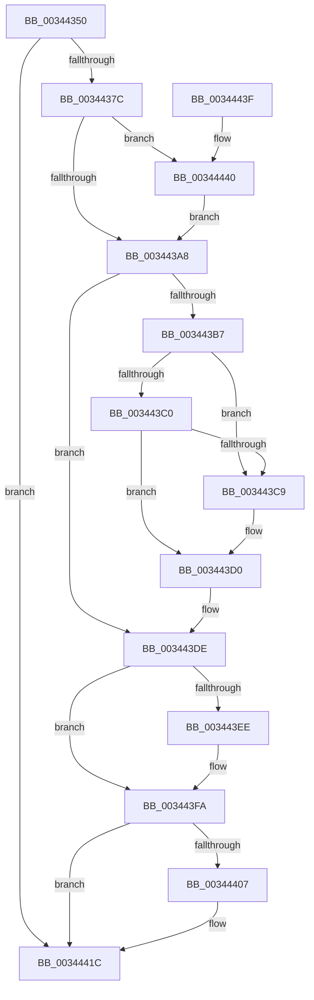

# ExpLeaveWorkerFactoryAwayMode

- RVA: `0x00344350`–`0x0034444D` (길이 `253` bytes)
- VA: `0x0000000140344350`
- 실행 섹션: `.text`
- PDB 이름 있음: `예`; PDB Function 태그: `아니요`
- unwind 정보 RVA: `0x00077CB8`
- 디코드: `62`개 명령, `253/253` bytes 표시
- 미해석 바이트: `0` (있으면 어셈블리에 `.byte`로 보존)

> 이 문서는 커널 이미지의 기계어와 PDB 기호를 분석해 생성했습니다. 4번과 5번은 함수 원형과 자료형을 바이너리 사용 방식에서 추정한 C 해석이며 원본 소스 복구 결과는 아닙니다.

## 1. Dependencies

- 직접 호출 지점: **4**; 고유 호출 대상: **4**
- 직접 호출자로 확인된 함수: **4**
- RIP 상대 이미지 참조: **1**

### Outgoing calls
- `0x003443AB` → [KiAcquireKobjectLockSafe](../25/KiAcquireKobjectLockSafe_function_00251C90.md) (function, `0x00251C90`)
- `0x003443F5` → [KiLowerIrqlProcessIrqlFlags](../4F/KiLowerIrqlProcessIrqlFlags_function_004F5698.md) (function, `0x004F5698`)
- `0x0034440F` → [ObfDereferenceObjectWithTag](../2F/ObfDereferenceObjectWithTag_function_002F78E0.md) (function, `0x002F78E0`)
- `0x00344443` → [KiRaiseIrqlProcessIrqlFlags](../4F/KiRaiseIrqlProcessIrqlFlags_function_004F56FC.md) (function, `0x004F56FC`)

### Direct callers
- [ExpShutdownWorkerFactory](../2A/ExpShutdownWorkerFactory_function_002A4F70.md) at `0x002A4FE7`
- [sub_003439EB](Unknown_function_003439EB.md) at `0x00343AAF`
- [sub_00344568](Unknown_function_00344568.md) at `0x003445DB`
- [NtSetInformationWorkerFactory](../35/NtSetInformationWorkerFactory_function_00350A30.md) at `0x00350E7F`
- [NtSetInformationWorkerFactory](../35/NtSetInformationWorkerFactory_function_00350A30.md) at `0x00350F29`
- [NtSetInformationWorkerFactory](../35/NtSetInformationWorkerFactory_function_00350A30.md) at `0x003512AB`

### Static image references
- `0x0034439B` → RVA `0x00FC6D20` (`ALMOSTRO`; read)

## 2. Other-region calls and transfers

- 다른 실행 섹션으로 향하는 call: **0**
- 별도 외부 분기/꼬리 이동을 확인하지 못했습니다.

## 3. Assembly (complete function range)

```asm
00344350  48 8B C4                        mov rax, rsp
00344353  48 89 58 08                     mov qword ptr [rax + 8], rbx
00344357  48 89 68 10                     mov qword ptr [rax + 0x10], rbp
0034435B  48 89 70 18                     mov qword ptr [rax + 0x18], rsi
0034435F  48 89 78 20                     mov qword ptr [rax + 0x20], rdi
00344363  41 56                           push r14
00344365  48 83 EC 20                     sub rsp, 0x20
00344369  F7 81 98 01 00 00 00 04 00 00   test dword ptr [rcx + 0x198], 0x400
00344373  48 8B D9                        mov rbx, rcx
00344376  0F 84 A0 00 00 00               je 0x14034441c
0034437C  48 8B 41 10                     mov rax, qword ptr [rcx + 0x10]
00344380  48 8D B9 68 02 00 00            lea rdi, [rcx + 0x268]
00344387  45 32 F6                        xor r14b, r14b
0034438A  48 8B 70 08                     mov rsi, qword ptr [rax + 8]
0034438E  44 0F 20 C5                     mov rbp, cr8
00344392  BA 02 00 00 00                  mov edx, 2
00344397  44 0F 22 C2                     mov cr8, rdx
0034439B  83 3D 7E 29 C8 00 00            cmp dword ptr [rip + 0xc8297e], 0
003443A2  0F 85 98 00 00 00               jne 0x140344440
003443A8  48 8B CE                        mov rcx, rsi
003443AB  E8 E0 D8 F0 FF                  call 0x140251c90
003443B0  8A 47 11                        mov al, byte ptr [rdi + 0x11]
003443B3  3C 04                           cmp al, 4
003443B5  75 27                           jne 0x1403443de
003443B7  48 8B 0F                        mov rcx, qword ptr [rdi]
003443BA  48 39 79 08                     cmp qword ptr [rcx + 8], rdi
003443BE  75 09                           jne 0x1403443c9
003443C0  48 8B 47 08                     mov rax, qword ptr [rdi + 8]
003443C4  48 39 38                        cmp qword ptr [rax], rdi
003443C7  74 07                           je 0x1403443d0
003443C9  B9 03 00 00 00                  mov ecx, 3
003443CE  CD 29                           int 0x29
003443D0  48 89 08                        mov qword ptr [rax], rcx
003443D3  41 B6 01                        mov r14b, 1
003443D6  48 89 41 08                     mov qword ptr [rcx + 8], rax
003443DA  C6 47 11 05                     mov byte ptr [rdi + 0x11], 5
003443DE  F0 81 26 7F FF FF FF            lock and dword ptr [rsi], 0xffffff7f
003443E5  83 3D 34 29 C8 00 00            cmp dword ptr [rip + 0xc82934], 0
003443EC  74 0C                           je 0x1403443fa
003443EE  44 0F 20 C1                     mov rcx, cr8
003443F2  40 8A D5                        mov dl, bpl
003443F5  E8 9E 12 1B 00                  call 0x1404f5698
003443FA  40 0F B6 C5                     movzx eax, bpl
003443FE  44 0F 22 C0                     mov cr8, rax
00344402  45 84 F6                        test r14b, r14b
00344405  74 15                           je 0x14034441c
00344407  BA 44 66 6C 74                  mov edx, 0x746c6644
0034440C  48 8B CB                        mov rcx, rbx
0034440F  E8 CC 34 FB FF                  call 0x1402f78e0
00344414  0F BA B3 98 01 00 00 0A         btr dword ptr [rbx + 0x198], 0xa
0034441C  0F BA B3 98 01 00 00 09         btr dword ptr [rbx + 0x198], 9
00344424  48 8B 5C 24 30                  mov rbx, qword ptr [rsp + 0x30]
00344429  48 8B 6C 24 38                  mov rbp, qword ptr [rsp + 0x38]
0034442E  48 8B 74 24 40                  mov rsi, qword ptr [rsp + 0x40]
00344433  48 8B 7C 24 48                  mov rdi, qword ptr [rsp + 0x48]
00344438  48 83 C4 20                     add rsp, 0x20
0034443C  41 5E                           pop r14
0034443E  C3                              ret
0034443F  CC                              int3
00344440  40 8A CD                        mov cl, bpl
00344443  E8 B4 12 1B 00                  call 0x1404f56fc
00344448  E9 5B FF FF FF                  jmp 0x1403443a8
```

## 4. C-style interpretation (structured pseudocode)

```c
__int64 __fastcall ExpLeaveWorkerFactoryAwayMode(__int64 a1)
{
    __int64 result;
    __int64 v_r14;
    __int64 v_rsp;
    unsigned __int64 v_stack_p10;
    unsigned __int64 v_stack_p18;
    unsigned __int64 v_stack_p20;
    unsigned __int64 v_stack_p8;

    *(unsigned __int64 *)(v_rsp + 8) = v_rbx;
    *(unsigned __int64 *)(v_rsp + 16) = v_rbp;
    *(unsigned __int64 *)(v_rsp + 24) = v_rsi;
    *(unsigned __int64 *)(v_rsp + 32) = v_rdi;
    v_rsp = (v_rsp) - (32);
    if (((*(unsigned int *)(a1 + 408)) & (0x400ULL)) == 0) goto loc_0034441C;
    v_r14 = 0;
    if ((*(unsigned int *)(v_rip + 13117822)) != 0) goto loc_00344440;
loc_003443A8:
    result = KiAcquireKobjectLockSafe(*(unsigned __int64 *)(*(unsigned __int64 *)(a1 + 16) + 8), 2, a3, a4);
    if (((unsigned __int8)(*(unsigned __int8 *)(a1 + 616 + 17))) != 4) goto loc_003443DE;
    if ((*(unsigned __int64 *)(*(unsigned __int64 *)(a1 + 616) + 8)) != (a1 + 616)) goto loc_003443C9;
    if ((*(unsigned __int64 *)(*(unsigned __int64 *)(a1 + 616 + 8))) != (a1 + 616)) {
        a1 = 3;
    }
    *(unsigned __int64 *)(*(unsigned __int64 *)(a1 + 616 + 8)) = a1;
    *(unsigned __int64 *)(a1 + 8) = *(unsigned __int64 *)(a1 + 616 + 8);
    *(unsigned __int8 *)(a1 + 616 + 17) = 5;
loc_003443DE:
    result = *(unsigned __int64 *)(a1 + 616 + 8);
    if ((*(unsigned int *)(v_rip + 13117748)) != 0) {
        a1 = 2;
        a2 = (unsigned __int8)(v_cr8);
        result = KiLowerIrqlProcessIrqlFlags(a1, a2, a3, a4);
    }
    result = (unsigned __int8)(v_cr8);
    if (1 != 0) {
        a2 = 0x746C6644ULL;
        a1 = a1;
        result = ObfDereferenceObjectWithTag(a1, a2, a3, a4);
    }
    v_rsp = (v_rsp) + (32);
    return result;
loc_00344440:
    result = KiRaiseIrqlProcessIrqlFlags((unsigned __int8)(v_stack_p10), a2, a3, a4);
    goto loc_003443A8;
}
```

## 5. (Beta) C Style

```c
int64_t ExpLeaveWorkerFactoryAwayMode(void *Arg1)
{
    uint8_t *arg1 = (uint8_t *)Arg1;

    int64_t result;
    int64_t local_r14;
    int64_t local_rsp;
    uint64_t v_stack_p10;
    uint64_t v_stack_p18;
    uint64_t v_stack_p20;
    uint64_t v_stack_p8;

    *(uint64_t *)(local_rsp + 0x8) = local_rbx;
    *(uint64_t *)(local_rsp + 0x10) = local_rbp;
    *(uint64_t *)(local_rsp + 0x18) = local_rsi;
    *(uint64_t *)(local_rsp + 0x20) = local_rdi;
    local_rsp = (local_rsp) - (32);
    if (((*(uint32_t *)(arg1 + 0x198)) & (0x400ULL)) == 0) goto loc_0034441C;
    local_r14 = 0;
    if ((*(uint32_t *)(v_rip + 0xC8297E)) != 0) goto loc_00344440;
loc_003443A8:
    result = KiAcquireKobjectLockSafe(*(uint64_t *)(*(uint64_t *)(arg1 + 0x10) + 0x8), 2, a3, a4);
    if (((uint8_t)(*(uint8_t *)(arg1 + 0x268 + 0x11))) != 4) goto loc_003443DE;
    if ((*(uint64_t *)(*(uint64_t *)(arg1 + 0x268) + 0x8)) != (Arg1 + 616)) goto loc_003443C9;
    if ((*(uint64_t *)(*(uint64_t *)(arg1 + 0x268 + 0x8))) != (Arg1 + 616)) {
        Arg1 = 3;
    }
    *(void **)(*(uint64_t *)(arg1 + 0x268 + 0x8)) = Arg1;
    *(uint64_t *)(arg1 + 0x8) = *(uint64_t *)(arg1 + 0x268 + 0x8);
    *(uint8_t *)(arg1 + 0x268 + 0x11) = 5;
loc_003443DE:
    result = *(uint64_t *)(arg1 + 0x268 + 0x8);
    if ((*(uint32_t *)(v_rip + 0xC82934)) != 0) {
        Arg1 = 2;
        a2 = (uint8_t)(v_cr8);
        result = KiLowerIrqlProcessIrqlFlags(Arg1, a2, a3, a4);
    }
    result = (uint8_t)(v_cr8);
    if (1 != 0) {
        a2 = 0x746C6644ULL;
        Arg1 = Arg1;
        result = ObfDereferenceObjectWithTag(Arg1, a2, a3, a4);
    }
    local_rsp = (local_rsp) + (32);
    return result;
loc_00344440:
    result = KiRaiseIrqlProcessIrqlFlags((uint8_t)(v_stack_p10), a2, a3, a4);
    goto loc_003443A8;
}
```

### 관측된 메모리 오프셋

구조체 형식이 확인되지 않은 접근은 인자 기준의 오프셋으로만 기록했습니다.

| 기준 인자 | 오프셋 표현 | 폭 (bit) | 접근 |
|---|---:|---:|---|
| `Arg1` | `+ 0x0` | `64` | `R` |
| `Arg1` | `+ 0x8` | `64` | `R` |
| `Arg1` | `+ 0x10` | `64` | `R` |
| `Arg1` | `+ 0x11` | `8` | `R` |
| `Arg1` | `+ 0x11` | `8` | `W` |
| `Arg1` | `+ 0x198` | `32` | `R` |
| `Arg1` | `+ 0x198` | `32` | `R/W` |
| `Arg1` | `+ 0x268` | `64` | `R` |

## 6. Execution-region graph

[열기: 2D/3D 그래프와 함수 탐색 컨트롤 패널](../../../control-panel.html?section=text&rva=0x00344350&view=graph)

- 2D 그래프는 위에서 아래로 흐르고, 3D 그래프는 빈 공간을 드래그해 회전합니다. Shift+드래그는 이동, 휠은 확대·축소, 함수 노드 선택은 대상 보고서 이동입니다.

### Static fallback


