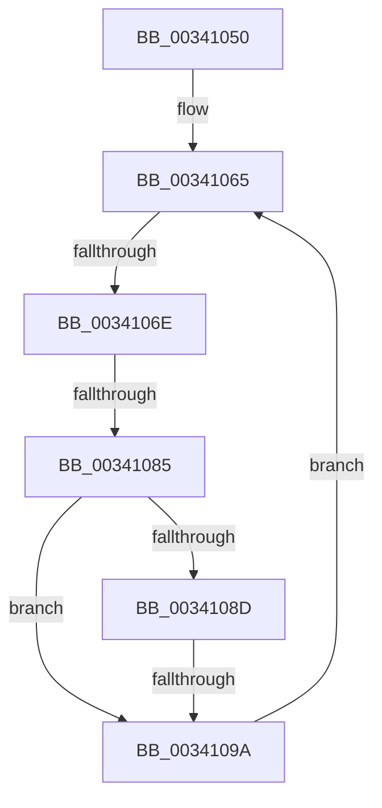

# ExpWakePushLock

- RVA: `0x00341050`–`0x003410A7` (길이 `87` bytes)
- VA: `0x0000000140341050`
- 실행 섹션: `.text`
- PDB 이름 있음: `예`; PDB Function 태그: `아니요`
- unwind 정보 RVA: `0x000774F4`
- 디코드: `24`개 명령, `87/87` bytes 표시
- 미해석 바이트: `0` (있으면 어셈블리에 `.byte`로 보존)

> 이 문서는 커널 이미지의 기계어와 PDB 기호를 분석해 생성했습니다. 4번과 5번은 함수 원형과 자료형을 바이너리 사용 방식에서 추정한 C 해석이며 원본 소스 복구 결과는 아닙니다.

## 1. Dependencies

- 직접 호출 지점: **0**; 고유 호출 대상: **0**
- 직접 호출자로 확인된 함수: **5**
- RIP 상대 이미지 참조: **0**

### Outgoing calls
- 직접 디코드된 call 명령이 없습니다.

### Direct callers
- [ExfAcquirePushLockExclusiveEx](../20/ExfAcquirePushLockExclusiveEx_function_0020FC90.md) at `0x0020FEAB`
- [ExfReleasePushLockShared](../26/ExfReleasePushLockShared_function_00263440.md) at `0x002634B0`
- [ExfReleasePushLockExclusive](../26/ExfReleasePushLockExclusive_function_00263900.md) at `0x0026392F`
- [ExpOptimizePushLockList](../45/ExpOptimizePushLockList_function_004574DC.md) at `0x00457512`
- [ExfReleasePushLockSharedEx](../47/ExfReleasePushLockSharedEx_function_00471AD0.md) at `0x00471BA5`

### Static image references
- 디코드된 RIP-relative 메모리 참조가 없습니다.

## 2. Other-region calls and transfers

- 다른 실행 섹션으로 향하는 call: **0**
- call이 아닌 외부 분기/꼬리 이동: **3**
  - `0x00341068` → [sub_00341179](Unknown_function_00341179.md) (`tail-transfer`)
  - `0x0034107F` → [sub_00341179 + 0x17](Unknown_function_00341179.md) (`tail-transfer`)
  - `0x00341094` → [sub_00341132](Unknown_function_00341132.md) (`tail-transfer`)

## 3. Assembly (complete function range)

```asm
00341050  48 89 5C 24 10                  mov qword ptr [rsp + 0x10], rbx
00341055  57                              push rdi
00341056  48 83 EC 20                     sub rsp, 0x20
0034105A  4C 8B C9                        mov r9, rcx
0034105D  BF 01 00 00 00                  mov edi, 1
00341062  45 33 D2                        xor r10d, r10d
00341065  40 84 D7                        test dil, dl
00341068  0F 85 0B 01 00 00               jne 0x140341179
0034106E  4C 8B C2                        mov r8, rdx
00341071  49 83 E0 F0                     and r8, 0xfffffffffffffff0
00341075  49 8B C8                        mov rcx, r8
00341078  49 8B 58 20                     mov rbx, qword ptr [r8 + 0x20]
0034107C  48 85 DB                        test rbx, rbx
0034107F  0F 84 0B 01 00 00               je 0x140341190
00341085  8B 43 34                        mov eax, dword ptr [rbx + 0x34]
00341088  40 84 C7                        test dil, al
0034108B  74 0D                           je 0x14034109a
0034108D  48 8B 43 28                     mov rax, qword ptr [rbx + 0x28]
00341091  48 85 C0                        test rax, rax
00341094  0F 85 98 00 00 00               jne 0x140341132
0034109A  48 8B C2                        mov rax, rdx
0034109D  F0 4D 0F B1 11                  lock cmpxchg qword ptr [r9], r10
003410A2  48 8B D0                        mov rdx, rax
003410A5  75 BE                           jne 0x140341065
```

## 4. C-style interpretation (structured pseudocode)

```c
__int64 __fastcall ExpWakePushLock(__int64 a1, __int64 a2)
{
    __int64 v_r10;
    __int64 v_rsp;
    unsigned __int64 v_stack_p10;

    v_stack_p10 = v_rbx;
    v_rsp = (v_rsp) - (32);
    v_r10 = 0;
loc_00341065:
    a3 = (a2) & (-16);
    if (((1) & ((unsigned __int8)((unsigned int)(*(unsigned int *)(*(unsigned __int64 *)(a3 + 32) + 52))))) == 0) goto loc_0034109A;
loc_0034109A:
    if (*(unsigned __int64 *)(*(unsigned __int64 *)(a3 + 32) + 40) != 0) goto loc_00341065;
}
```

## 5. (Beta) C Style

```c
int64_t ExpWakePushLock(void *Arg1, void *Arg2)
{
    uint8_t *arg1 = (uint8_t *)Arg1;
    uint8_t *arg2 = (uint8_t *)Arg2;

    int64_t local_r10;
    int64_t local_rsp;
    uint64_t v_stack_p10;

    v_stack_p10 = local_rbx;
    local_rsp = (local_rsp) - (32);
    local_r10 = 0;
loc_00341065:
    a3 = (Arg2) & (-16);
    if (((1) & ((uint8_t)((uint32_t)(*(uint32_t *)(*(uint64_t *)(a3 + 0x20) + 0x34))))) == 0) goto loc_0034109A;
loc_0034109A:
    if (*(uint64_t *)(*(uint64_t *)(a3 + 0x20) + 0x28) != 0) goto loc_00341065;
}
```

### 관측된 메모리 오프셋

구조체 형식이 확인되지 않은 접근은 인자 기준의 오프셋으로만 기록했습니다.

| 기준 인자 | 오프셋 표현 | 폭 (bit) | 접근 |
|---|---:|---:|---|
| `Arg1` | `+ 0x0` | `64` | `R` |
| `Arg2` | `+ 0x20` | `64` | `R` |

## 6. Execution-region graph

[열기: 2D/3D 그래프와 함수 탐색 컨트롤 패널](../../../control-panel.html?section=text&rva=0x00341050&view=graph)

- 2D 그래프는 위에서 아래로 흐르고, 3D 그래프는 빈 공간을 드래그해 회전합니다. Shift+드래그는 이동, 휠은 확대·축소, 함수 노드 선택은 대상 보고서 이동입니다.

### Static fallback


