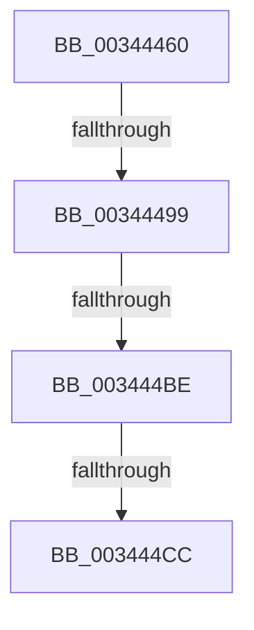

# ExpWorkerFactoryCheckCreate

- RVA: `0x00344460`–`0x003444DD` (길이 `125` bytes)
- VA: `0x0000000140344460`
- 실행 섹션: `.text`
- PDB 이름 있음: `예`; PDB Function 태그: `아니요`
- unwind 정보 RVA: `0x00077CD4`
- 디코드: `34`개 명령, `125/125` bytes 표시
- 미해석 바이트: `0` (있으면 어셈블리에 `.byte`로 보존)

> 이 문서는 커널 이미지의 기계어와 PDB 기호를 분석해 생성했습니다. 4번과 5번은 함수 원형과 자료형을 바이너리 사용 방식에서 추정한 C 해석이며 원본 소스 복구 결과는 아닙니다.

## 1. Dependencies

- 직접 호출 지점: **0**; 고유 호출 대상: **0**
- 직접 호출자로 확인된 함수: **5**
- RIP 상대 이미지 참조: **2**

### Outgoing calls
- 직접 디코드된 call 명령이 없습니다.

### Direct callers
- [sub_003439EB](Unknown_function_003439EB.md) at `0x00343B91`
- [NtSetInformationWorkerFactory](../35/NtSetInformationWorkerFactory_function_00350A30.md) at `0x00350FCA`
- [NtWaitForWorkViaWorkerFactory](../39/NtWaitForWorkViaWorkerFactory_function_00394270.md) at `0x00394CCD`
- [ExpWorkerFactoryDeferredThreadCreation](../49/ExpWorkerFactoryDeferredThreadCreation_function_0049F1A8.md) at `0x0049F201`
- [ExpWorkerFactoryManagerThread](../65/ExpWorkerFactoryManagerThread_function_0065CCC0.md) at `0x0065CD83`

### Static image references
- `0x003444B2` → RVA `0x00FC6D20` (`ALMOSTRO`; read)
- `0x003444BE` → RVA `0x00FC6B06` (`ALMOSTRO`; read)

## 2. Other-region calls and transfers

- 다른 실행 섹션으로 향하는 call: **0**
- call이 아닌 외부 분기/꼬리 이동: **4**
  - `0x00344497` → [sub_003444DD](Unknown_function_003444DD.md) (`tail-transfer`)
  - `0x003444B8` → [sub_0034453D + 0x19](Unknown_function_0034453D.md) (`tail-transfer`)
  - `0x003444CA` → [sub_0034453D](Unknown_function_0034453D.md) (`tail-transfer`)
  - `0x003444D7` → [sub_0034465D](Unknown_function_0034465D.md) (`tail-transfer`)

## 3. Assembly (complete function range)

```asm
00344460  4C 8B DC                        mov r11, rsp
00344463  49 89 5B 10                     mov qword ptr [r11 + 0x10], rbx
00344467  49 89 6B 18                     mov qword ptr [r11 + 0x18], rbp
0034446B  49 89 73 20                     mov qword ptr [r11 + 0x20], rsi
0034446F  57                              push rdi
00344470  41 54                           push r12
00344472  41 56                           push r14
00344474  48 83 EC 40                     sub rsp, 0x40
00344478  33 C0                           xor eax, eax
0034447A  0F 57 C0                        xorps xmm0, xmm0
0034447D  45 0F B6 F0                     movzx r14d, r8b
00344481  48 8B FA                        mov rdi, rdx
00344484  48 8B D9                        mov rbx, rcx
00344487  0F 11 44 24 20                  movups xmmword ptr [rsp + 0x20], xmm0
0034448C  49 89 43 D8                     mov qword ptr [r11 - 0x28], rax
00344490  44 8D 60 02                     lea r12d, [rax + 2]
00344494  48 85 D2                        test rdx, rdx
00344497  75 44                           jne 0x1403444dd
00344499  48 8B 71 10                     mov rsi, qword ptr [rcx + 0x10]
0034449D  49 8D 7B C8                     lea rdi, [r11 - 0x38]
003444A1  49 89 73 D0                     mov qword ptr [r11 - 0x30], rsi
003444A5  49 89 43 C8                     mov qword ptr [r11 - 0x38], rax
003444A9  90                              nop
003444AA  44 0F 20 C5                     mov rbp, cr8
003444AE  45 0F 22 C4                     mov cr8, r12
003444B2  39 05 68 28 C8 00               cmp dword ptr [rip + 0xc82868], eax
003444B8  0F 85 98 00 00 00               jne 0x140344556
003444BE  F6 05 41 26 C8 00 21            test byte ptr [rip + 0xc82641], 0x21
003444C5  40 88 6C 24 30                  mov byte ptr [rsp + 0x30], bpl
003444CA  75 71                           jne 0x14034453d
003444CC  48 8D 54 24 20                  lea rdx, [rsp + 0x20]
003444D1  48 87 16                        xchg qword ptr [rsi], rdx
003444D4  48 85 D2                        test rdx, rdx
003444D7  0F 85 80 01 00 00               jne 0x14034465d
```

## 4. C-style interpretation (structured pseudocode)

```c
__int64 __fastcall ExpWorkerFactoryCheckCreate(__int64 a1, __int64 a2, unsigned __int8 a3)
{
    __int64 result;
    __int64 v_rsp;
    unsigned __int8 v_stack_m28;
    unsigned __int64 v_stack_m38;

    *(unsigned __int64 *)(v_rsp + 16) = v_rbx;
    *(unsigned __int64 *)(v_rsp + 24) = v_rbp;
    *(unsigned __int64 *)(v_rsp + 32) = v_rsi;
    v_rsp = (v_rsp) - (64);
    result = 0;
    v_stack_m38 = v_xmm0;
    *(unsigned __int64 *)(v_rsp - 40) = 0;
    *(unsigned __int64 *)(v_rsp - 48) = *(unsigned __int64 *)(a1 + 16);
    *(unsigned __int64 *)(v_rsp - 56) = 0;
    v_stack_m28 = (unsigned __int8)(v_cr8);
}
```

## 5. (Beta) C Style

```c
int64_t ExpWorkerFactoryCheckCreate(void *Arg1, int64_t Arg2, uint8_t Arg3)
{
    uint8_t *arg1 = (uint8_t *)Arg1;

    int64_t result;
    int64_t local_rsp;
    uint8_t v_stack_m28;
    uint64_t v_stack_m38;

    *(uint64_t *)(local_rsp + 0x10) = local_rbx;
    *(uint64_t *)(local_rsp + 0x18) = local_rbp;
    *(uint64_t *)(local_rsp + 0x20) = local_rsi;
    local_rsp = (local_rsp) - (64);
    result = 0;
    v_stack_m38 = v_xmm0;
    *(uint64_t *)(local_rsp - 0x28) = 0;
    *(uint64_t *)(local_rsp - 0x30) = *(uint64_t *)(arg1 + 0x10);
    *(uint64_t *)(local_rsp - 0x38) = 0;
    v_stack_m28 = (uint8_t)(v_cr8);
}
```

### 관측된 메모리 오프셋

구조체 형식이 확인되지 않은 접근은 인자 기준의 오프셋으로만 기록했습니다.

| 기준 인자 | 오프셋 표현 | 폭 (bit) | 접근 |
|---|---:|---:|---|
| `Arg1` | `+ 0x10` | `64` | `R` |

## 6. Execution-region graph

[열기: 2D/3D 그래프와 함수 탐색 컨트롤 패널](../../../control-panel.html?section=text&rva=0x00344460&view=graph)

- 2D 그래프는 위에서 아래로 흐르고, 3D 그래프는 빈 공간을 드래그해 회전합니다. Shift+드래그는 이동, 휠은 확대·축소, 함수 노드 선택은 대상 보고서 이동입니다.

### Static fallback


