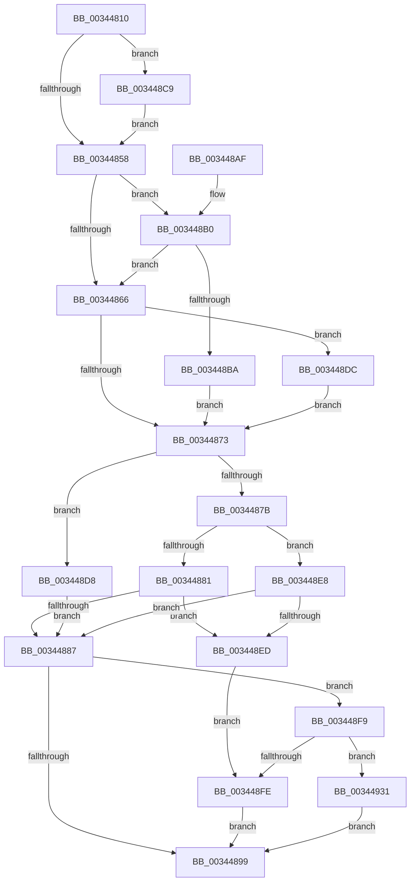

# ExpWorkerFactoryCompletionPacketRoutine

- RVA: `0x00344810`–`0x00344949` (길이 `313` bytes)
- VA: `0x0000000140344810`
- 실행 섹션: `.text`
- PDB 이름 있음: `예`; PDB Function 태그: `아니요`
- unwind 정보 RVA: `0x00077D4C`
- 디코드: `87`개 명령, `313/313` bytes 표시
- 미해석 바이트: `0` (있으면 어셈블리에 `.byte`로 보존)

> 이 문서는 커널 이미지의 기계어와 PDB 기호를 분석해 생성했습니다. 4번과 5번은 함수 원형과 자료형을 바이너리 사용 방식에서 추정한 C 해석이며 원본 소스 복구 결과는 아닙니다.

## 1. Dependencies

- 직접 호출 지점: **8**; 고유 호출 대상: **7**
- 직접 호출자로 확인된 함수: **1**
- RIP 상대 이미지 참조: **3**

### Outgoing calls
- `0x00344890` → [KeReleaseInStackQueuedSpinLock](KeReleaseInStackQueuedSpinLock_function_00342CE0.md) (function, `0x00342CE0`)
- `0x003448C2` → [KiAcquireQueuedSpinLockInstrumented](../27/KiAcquireQueuedSpinLockInstrumented_function_00275850.md) (function, `0x00275850`)
- `0x003448D1` → [KiRaiseIrqlProcessIrqlFlags](../4F/KiRaiseIrqlProcessIrqlFlags_function_004F56FC.md) (function, `0x004F56FC`)
- `0x003448E1` → [KxWaitForLockOwnerShip](../25/KxWaitForLockOwnerShip_function_00257EB0.md) (function, `0x00257EB0`)
- `0x003448F2` → [KeReleaseInStackQueuedSpinLock](KeReleaseInStackQueuedSpinLock_function_00342CE0.md) (function, `0x00342CE0`)
- `0x00344927` → [IoSetIoCompletionEx3](../24/IoSetIoCompletionEx3_function_0024EEE0.md) (function, `0x0024EEE0`)
- `0x00344935` → [IoFreeMiniCompletionPacket](../../page/9A/IoFreeMiniCompletionPacket_function_009A82B0.md) (function, `0x009A82B0`)
- `0x0034493F` → [ExFreePoolWithTag](../../poolcode/B8/ExFreePoolWithTag_function_00B82870.md) (function, `0x00B82870`)

### Direct callers
- [sub_009A8352](../../page/9A/Unknown_function_009A8352.md) at `0x009A837C`

### Static image references
- `0x00344850` → RVA `0x00FC6D20` (`ALMOSTRO`; read)
- `0x00344858` → RVA `0x00FC6B06` (`ALMOSTRO`; read)
- `0x003448B0` → RVA `0x00F0DE58` (`.data`; read)

## 2. Other-region calls and transfers

- 다른 실행 섹션으로 향하는 call: **2**
  - `0x00344935` → [IoFreeMiniCompletionPacket](../../page/9A/IoFreeMiniCompletionPacket_function_009A82B0.md) (`.text` → `PAGE`)
  - `0x0034493F` → [ExFreePoolWithTag](../../poolcode/B8/ExFreePoolWithTag_function_00B82870.md) (`.text` → `POOLCODE`)
- 별도 외부 분기/꼬리 이동을 확인하지 못했습니다.

## 3. Assembly (complete function range)

```asm
00344810  48 89 5C 24 08                  mov qword ptr [rsp + 8], rbx
00344815  48 89 6C 24 10                  mov qword ptr [rsp + 0x10], rbp
0034481A  48 89 74 24 18                  mov qword ptr [rsp + 0x18], rsi
0034481F  57                              push rdi
00344820  48 83 EC 70                     sub rsp, 0x70
00344824  33 C0                           xor eax, eax
00344826  0F 57 C0                        xorps xmm0, xmm0
00344829  0F 11 44 24 50                  movups xmmword ptr [rsp + 0x50], xmm0
0034482E  33 F6                           xor esi, esi
00344830  48 89 44 24 60                  mov qword ptr [rsp + 0x60], rax
00344835  48 89 74 24 50                  mov qword ptr [rsp + 0x50], rsi
0034483A  48 8B DA                        mov rbx, rdx
0034483D  48 89 54 24 58                  mov qword ptr [rsp + 0x58], rdx
00344842  90                              nop
00344843  44 0F 20 C7                     mov rdi, cr8
00344847  BD 02 00 00 00                  mov ebp, 2
0034484C  44 0F 22 C5                     mov cr8, rbp
00344850  39 05 CA 24 C8 00               cmp dword ptr [rip + 0xc824ca], eax
00344856  75 71                           jne 0x1403448c9
00344858  F6 05 A7 22 C8 00 21            test byte ptr [rip + 0xc822a7], 0x21
0034485F  40 88 7C 24 60                  mov byte ptr [rsp + 0x60], dil
00344864  75 4A                           jne 0x1403448b0
00344866  48 8D 54 24 50                  lea rdx, [rsp + 0x50]
0034486B  48 87 13                        xchg qword ptr [rbx], rdx
0034486E  48 85 D2                        test rdx, rdx
00344871  75 69                           jne 0x1403448dc
00344873  8B FE                           mov edi, esi
00344875  40 38 73 22                     cmp byte ptr [rbx + 0x22], sil
00344879  75 5D                           jne 0x1403448d8
0034487B  40 38 73 21                     cmp byte ptr [rbx + 0x21], sil
0034487F  75 67                           jne 0x1403448e8
00344881  83 43 18 FF                     add dword ptr [rbx + 0x18], -1
00344885  75 66                           jne 0x1403448ed
00344887  48 8D 4C 24 50                  lea rcx, [rsp + 0x50]
0034488C  40 88 73 20                     mov byte ptr [rbx + 0x20], sil
00344890  E8 4B E4 FF FF                  call 0x140342ce0
00344895  85 FF                           test edi, edi
00344897  75 60                           jne 0x1403448f9
00344899  4C 8D 5C 24 70                  lea r11, [rsp + 0x70]
0034489E  49 8B 5B 10                     mov rbx, qword ptr [r11 + 0x10]
003448A2  49 8B 6B 18                     mov rbp, qword ptr [r11 + 0x18]
003448A6  49 8B 73 20                     mov rsi, qword ptr [r11 + 0x20]
003448AA  49 8B E3                        mov rsp, r11
003448AD  5F                              pop rdi
003448AE  C3                              ret
003448AF  CC                              int3
003448B0  8B 05 A2 95 BC 00               mov eax, dword ptr [rip + 0xbc95a2]
003448B6  85 C0                           test eax, eax
003448B8  75 AC                           jne 0x140344866
003448BA  48 8B D3                        mov rdx, rbx
003448BD  48 8D 4C 24 50                  lea rcx, [rsp + 0x50]
003448C2  E8 89 0F F3 FF                  call 0x140275850
003448C7  EB AA                           jmp 0x140344873
003448C9  40 0F B6 D5                     movzx edx, bpl
003448CD  40 0F B6 CF                     movzx ecx, dil
003448D1  E8 26 0E 1B 00                  call 0x1404f56fc
003448D6  EB 80                           jmp 0x140344858
003448D8  8B FD                           mov edi, ebp
003448DA  EB AB                           jmp 0x140344887
003448DC  48 8D 4C 24 50                  lea rcx, [rsp + 0x50]
003448E1  E8 CA 35 F1 FF                  call 0x140257eb0
003448E6  EB 8B                           jmp 0x140344873
003448E8  39 73 1C                        cmp dword ptr [rbx + 0x1c], esi
003448EB  74 9A                           je 0x140344887
003448ED  48 8D 4C 24 50                  lea rcx, [rsp + 0x50]
003448F2  E8 E9 E3 FF FF                  call 0x140342ce0
003448F7  EB 05                           jmp 0x1403448fe
003448F9  83 FF 01                        cmp edi, 1
003448FC  75 33                           jne 0x140344931
003448FE  48 8B 43 10                     mov rax, qword ptr [rbx + 0x10]
00344902  45 33 C9                        xor r9d, r9d
00344905  48 8B 4B 08                     mov rcx, qword ptr [rbx + 8]
00344909  45 33 C0                        xor r8d, r8d
0034490C  40 88 74 24 40                  mov byte ptr [rsp + 0x40], sil
00344911  33 D2                           xor edx, edx
00344913  40 88 74 24 38                  mov byte ptr [rsp + 0x38], sil
00344918  48 89 44 24 30                  mov qword ptr [rsp + 0x30], rax
0034491D  40 88 74 24 28                  mov byte ptr [rsp + 0x28], sil
00344922  48 89 74 24 20                  mov qword ptr [rsp + 0x20], rsi
00344927  E8 B4 A5 F0 FF                  call 0x14024eee0
0034492C  E9 68 FF FF FF                  jmp 0x140344899
00344931  48 8B 4B 10                     mov rcx, qword ptr [rbx + 0x10]
00344935  E8 76 39 66 00                  call 0x1409a82b0
0034493A  33 D2                           xor edx, edx
0034493C  48 8B CB                        mov rcx, rbx
0034493F  E8 2C DF 83 00                  call 0x140b82870
00344944  E9 50 FF FF FF                  jmp 0x140344899
```

## 4. C-style interpretation (structured pseudocode)

```c
__int64 __fastcall ExpWorkerFactoryCompletionPacketRoutine(__int64 a1, __int64 a2, int a3, int a4)
{
    __int64 result;
    __int64 v_rsi;
    __int64 v_rsp;
    unsigned __int64 v_stack_m18;
    unsigned __int64 v_stack_m20;
    unsigned __int64 v_stack_m28;
    unsigned __int8 v_stack_m30;
    unsigned __int8 v_stack_m38;
    unsigned __int64 v_stack_m40;
    unsigned __int8 v_stack_m48;
    unsigned __int64 v_stack_m50;
    unsigned __int64 v_stack_m8;
    unsigned __int64 v_stack_p10;
    unsigned __int64 v_stack_p18;
    unsigned __int64 v_stack_p8;

    v_stack_p8 = v_rbx;
    v_stack_p10 = v_rbp;
    v_stack_p18 = v_rsi;
    v_rsp = (v_rsp) - (112);
    result = 0;
    v_stack_m28 = v_xmm0;
    v_rsi = 0;
    v_stack_m18 = 0;
    v_stack_m28 = 0;
    v_stack_m20 = a2;
    if ((*(unsigned int *)(v_rip + 13116618)) != 0) goto loc_003448C9;
loc_00344858:
    v_stack_m18 = (unsigned __int8)(v_cr8);
    if (((*(unsigned __int8 *)(v_rip + 13116071)) & (33)) != 0) goto loc_003448B0;
loc_00344866:
    if (v_stack_m28 != 0) goto loc_003448DC;
loc_00344873:
    if ((*(unsigned __int8 *)(a2 + 34)) != 0) goto loc_003448D8;
    if ((*(unsigned __int8 *)(a2 + 33)) != 0) goto loc_003448E8;
    if ((*(unsigned __int8 *)(a2 + 33)) != 0) goto loc_003448ED;
loc_00344887:
    *(unsigned __int8 *)(a2 + 32) = 0;
    result = KeReleaseInStackQueuedSpinLock(v_stack_m28, v_stack_m28, a3, a4);
    if (0 != 0) goto loc_003448F9;
loc_00344899:
    return result;
loc_003448B0:
    if ((unsigned int)((unsigned int)(*(unsigned int *)(v_rip + 12359074))) != 0) goto loc_00344866;
    result = KiAcquireQueuedSpinLockInstrumented(v_stack_m20, *(unsigned __int64 *)(v_stack_m8 + 16), a3, a4);
    goto loc_00344873;
loc_003448C9:
    result = KiRaiseIrqlProcessIrqlFlags(0, (unsigned __int8)(*(unsigned __int64 *)(v_stack_m8 + 24)), a3, a4);
    goto loc_00344858;
loc_003448D8:
    goto loc_00344887;
loc_003448DC:
    result = KxWaitForLockOwnerShip(v_stack_m20, (unsigned __int8)(*(unsigned __int64 *)(v_stack_m8 + 24)), a3, a4);
    goto loc_00344873;
loc_003448E8:
    if ((*(unsigned int *)(*(unsigned __int64 *)(v_stack_m8 + 16) + 28)) == ((unsigned int)(*(unsigned __int64 *)(v_stack_m8 + 32)))) goto loc_00344887;
loc_003448ED:
    result = KeReleaseInStackQueuedSpinLock(v_stack_m20, (unsigned __int8)(*(unsigned __int64 *)(v_stack_m8 + 24)), a3, a4);
    goto loc_003448FE;
loc_003448F9:
    if (((unsigned int)((unsigned int)((unsigned int)(*(unsigned __int64 *)(v_stack_m8 + 24))))) != 1) goto loc_00344931;
loc_003448FE:
    a4 = 0;
    a3 = 0;
    v_stack_m30 = (unsigned __int8)(*(unsigned __int64 *)(v_stack_m8 + 32));
    a2 = 0;
    v_stack_m38 = (unsigned __int8)(*(unsigned __int64 *)(v_stack_m8 + 32));
    v_stack_m40 = *(unsigned __int64 *)(*(unsigned __int64 *)(v_stack_m8 + 16) + 16);
    v_stack_m48 = (unsigned __int8)(*(unsigned __int64 *)(v_stack_m8 + 32));
    v_stack_m50 = *(unsigned __int64 *)(v_stack_m8 + 32);
    result = IoSetIoCompletionEx3(*(unsigned __int64 *)(*(unsigned __int64 *)(v_stack_m8 + 16) + 8), a2, a3, a4);
    goto loc_00344899;
loc_00344931:
    result = IoFreeMiniCompletionPacket(*(unsigned __int64 *)(*(unsigned __int64 *)(v_stack_m8 + 16) + 16), a2, a3, a4);
    a2 = 0;
    result = ExFreePoolWithTag(*(unsigned __int64 *)(v_stack_m8 + 16), a2, a3, a4);
    goto loc_00344899;
}
```

## 5. (Beta) C Style

```c
int64_t ExpWorkerFactoryCompletionPacketRoutine(int64_t Arg1, void *Arg2, int32_t Arg3, int32_t Arg4)
{
    uint8_t *arg2 = (uint8_t *)Arg2;

    int64_t result;
    int64_t local_rsi;
    int64_t local_rsp;
    uint64_t v_stack_m18;
    uint64_t v_stack_m20;
    uint64_t v_stack_m28;
    uint8_t v_stack_m30;
    uint8_t v_stack_m38;
    uint64_t v_stack_m40;
    uint8_t v_stack_m48;
    uint64_t v_stack_m50;
    uint64_t v_stack_m8;
    uint64_t v_stack_p10;
    uint64_t v_stack_p18;
    uint64_t v_stack_p8;

    v_stack_p8 = local_rbx;
    v_stack_p10 = local_rbp;
    v_stack_p18 = local_rsi;
    local_rsp = (local_rsp) - (112);
    result = 0;
    v_stack_m28 = v_xmm0;
    local_rsi = 0;
    v_stack_m18 = 0;
    v_stack_m28 = 0;
    v_stack_m20 = Arg2;
    if ((*(uint32_t *)(v_rip + 0xC824CA)) != 0) goto loc_003448C9;
loc_00344858:
    v_stack_m18 = (uint8_t)(v_cr8);
    if (((*(uint8_t *)(v_rip + 0xC822A7)) & (33)) != 0) goto loc_003448B0;
loc_00344866:
    if (v_stack_m28 != 0) goto loc_003448DC;
loc_00344873:
    if ((*(uint8_t *)(arg2 + 0x22)) != 0) goto loc_003448D8;
    if ((*(uint8_t *)(arg2 + 0x21)) != 0) goto loc_003448E8;
    if ((*(uint8_t *)(arg2 + 0x21)) != 0) goto loc_003448ED;
loc_00344887:
    *(uint8_t *)(arg2 + 0x20) = 0;
    result = KeReleaseInStackQueuedSpinLock(v_stack_m28, v_stack_m28, Arg3, Arg4);
    if (0 != 0) goto loc_003448F9;
loc_00344899:
    return result;
loc_003448B0:
    if ((uint32_t)((uint32_t)(*(uint32_t *)(v_rip + 0xBC95A2))) != 0) goto loc_00344866;
    result = KiAcquireQueuedSpinLockInstrumented(v_stack_m20, *(uint64_t *)(v_stack_m8 + 0x10), Arg3, Arg4);
    goto loc_00344873;
loc_003448C9:
    result = KiRaiseIrqlProcessIrqlFlags(0, (uint8_t)(*(uint64_t *)(v_stack_m8 + 0x18)), Arg3, Arg4);
    goto loc_00344858;
loc_003448D8:
    goto loc_00344887;
loc_003448DC:
    result = KxWaitForLockOwnerShip(v_stack_m20, (uint8_t)(*(uint64_t *)(v_stack_m8 + 0x18)), Arg3, Arg4);
    goto loc_00344873;
loc_003448E8:
    if ((*(uint32_t *)(*(uint64_t *)(v_stack_m8 + 0x10) + 0x1C)) == ((uint32_t)(*(uint64_t *)(v_stack_m8 + 0x20)))) goto loc_00344887;
loc_003448ED:
    result = KeReleaseInStackQueuedSpinLock(v_stack_m20, (uint8_t)(*(uint64_t *)(v_stack_m8 + 0x18)), Arg3, Arg4);
    goto loc_003448FE;
loc_003448F9:
    if (((uint32_t)((uint32_t)((uint32_t)(*(uint64_t *)(v_stack_m8 + 0x18))))) != 1) goto loc_00344931;
loc_003448FE:
    Arg4 = 0;
    Arg3 = 0;
    v_stack_m30 = (uint8_t)(*(uint64_t *)(v_stack_m8 + 0x20));
    Arg2 = 0;
    v_stack_m38 = (uint8_t)(*(uint64_t *)(v_stack_m8 + 0x20));
    v_stack_m40 = *(uint64_t *)(*(uint64_t *)(v_stack_m8 + 0x10) + 0x10);
    v_stack_m48 = (uint8_t)(*(uint64_t *)(v_stack_m8 + 0x20));
    v_stack_m50 = *(uint64_t *)(v_stack_m8 + 0x20);
    result = IoSetIoCompletionEx3(*(uint64_t *)(*(uint64_t *)(v_stack_m8 + 0x10) + 0x8), Arg2, Arg3, Arg4);
    goto loc_00344899;
loc_00344931:
    result = IoFreeMiniCompletionPacket(*(uint64_t *)(*(uint64_t *)(v_stack_m8 + 0x10) + 0x10), Arg2, Arg3, Arg4);
    Arg2 = 0;
    result = ExFreePoolWithTag(*(uint64_t *)(v_stack_m8 + 0x10), Arg2, Arg3, Arg4);
    goto loc_00344899;
}
```

### 관측된 메모리 오프셋

구조체 형식이 확인되지 않은 접근은 인자 기준의 오프셋으로만 기록했습니다.

| 기준 인자 | 오프셋 표현 | 폭 (bit) | 접근 |
|---|---:|---:|---|
| `Arg2` | `+ 0x0` | `64` | `R/W` |
| `Arg2` | `+ 0x8` | `64` | `R` |
| `Arg2` | `+ 0x10` | `64` | `R` |
| `Arg2` | `+ 0x18` | `32` | `R/W` |
| `Arg2` | `+ 0x1C` | `32` | `R` |
| `Arg2` | `+ 0x20` | `8` | `W` |
| `Arg2` | `+ 0x21` | `8` | `R` |
| `Arg2` | `+ 0x22` | `8` | `R` |

## 6. Execution-region graph

[열기: 2D/3D 그래프와 함수 탐색 컨트롤 패널](../../../control-panel.html?section=text&rva=0x00344810&view=graph)

- 2D 그래프는 위에서 아래로 흐르고, 3D 그래프는 빈 공간을 드래그해 회전합니다. Shift+드래그는 이동, 휠은 확대·축소, 함수 노드 선택은 대상 보고서 이동입니다.

### Static fallback


