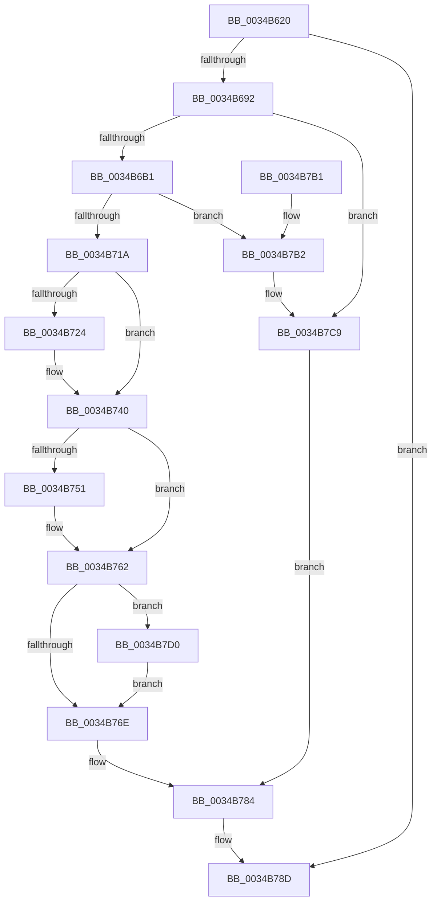

# ExpWorkerFactoryCreateThread

- RVA: `0x0034B620`–`0x0034B7F2` (길이 `466` bytes)
- VA: `0x000000014034B620`
- 실행 섹션: `.text`
- PDB 이름 있음: `예`; PDB Function 태그: `아니요`
- unwind 정보 RVA: `0x000785D4`
- 디코드: `114`개 명령, `466/466` bytes 표시
- 미해석 바이트: `0` (있으면 어셈블리에 `.byte`로 보존)

> 이 문서는 커널 이미지의 기계어와 PDB 기호를 분석해 생성했습니다. 4번과 5번은 함수 원형과 자료형을 바이너리 사용 방식에서 추정한 C 해석이며 원본 소스 복구 결과는 아닙니다.

## 1. Dependencies

- 직접 호출 지점: **14**; 고유 호출 대상: **9**
- 직접 호출자로 확인된 함수: **2**
- RIP 상대 이미지 참조: **1**

### Outgoing calls
- `0x0034B685` → [ExAcquireRundownProtection](../21/ExAcquireRundownProtection_function_00216620.md) (function, `0x00216620`)
- `0x0034B69A` → [KeAcquireInStackQueuedSpinLock](../27/KeAcquireInStackQueuedSpinLock_function_002757A0.md) (function, `0x002757A0`)
- `0x0034B6BE` → [KeReleaseInStackQueuedSpinLock](KeReleaseInStackQueuedSpinLock_function_00342CE0.md) (function, `0x00342CE0`)
- `0x0034B705` → [RtlpCreateUserThreadEx](../../page/A1/RtlpCreateUserThreadEx_function_00A1E5D4.md) (function, `0x00A1E5D4`)
- `0x0034B72C` → [KeAcquireInStackQueuedSpinLock](../27/KeAcquireInStackQueuedSpinLock_function_002757A0.md) (function, `0x002757A0`)
- `0x0034B73B` → [KeReleaseInStackQueuedSpinLock](KeReleaseInStackQueuedSpinLock_function_00342CE0.md) (function, `0x00342CE0`)
- `0x0034B75D` → [ZwSetInformationThread](../6A/ZwSetInformationThread_function_006AD270.md) (function, `0x006AD270`)
- `0x0034B773` → [ZwResumeThread](../6A/ZwResumeThread_function_006ADB10.md) (function, `0x006ADB10`)
- `0x0034B77F` → [ObCloseHandle](../../page/8A/ObCloseHandle_function_008A1870.md) (function, `0x008A1870`)
- `0x0034B788` → [ExReleaseRundownProtection](ExReleaseRundownProtection_function_00349E80.md) (function, `0x00349E80`)
- `0x0034B78D` → [KeLeaveCriticalRegion](../25/KeLeaveCriticalRegion_function_0025D8B0.md) (function, `0x0025D8B0`)
- `0x0034B7BA` → [KeAcquireInStackQueuedSpinLock](../27/KeAcquireInStackQueuedSpinLock_function_002757A0.md) (function, `0x002757A0`)
- `0x0034B7C9` → [KeReleaseInStackQueuedSpinLock](KeReleaseInStackQueuedSpinLock_function_00342CE0.md) (function, `0x00342CE0`)
- `0x0034B7E8` → [ZwSetInformationThread](../6A/ZwSetInformationThread_function_006AD270.md) (function, `0x006AD270`)

### Direct callers
- [sub_00344568](Unknown_function_00344568.md) at `0x003445FB`
- [NtSetInformationWorkerFactory](../35/NtSetInformationWorkerFactory_function_00350A30.md) at `0x00350F43`
- [NtSetInformationWorkerFactory](../35/NtSetInformationWorkerFactory_function_00350A30.md) at `0x0035117F`

### Static image references
- `0x0034B7D0` → RVA `0x00FC5018` (`ALMOSTRO`; read)

## 2. Other-region calls and transfers

- 다른 실행 섹션으로 향하는 call: **2**
  - `0x0034B705` → [RtlpCreateUserThreadEx](../../page/A1/RtlpCreateUserThreadEx_function_00A1E5D4.md) (`.text` → `PAGE`)
  - `0x0034B77F` → [ObCloseHandle](../../page/8A/ObCloseHandle_function_008A1870.md) (`.text` → `PAGE`)
- 별도 외부 분기/꼬리 이동을 확인하지 못했습니다.

## 3. Assembly (complete function range)

```asm
0034B620  48 8B C4                        mov rax, rsp
0034B623  48 89 58 10                     mov qword ptr [rax + 0x10], rbx
0034B627  48 89 70 18                     mov qword ptr [rax + 0x18], rsi
0034B62B  48 89 78 20                     mov qword ptr [rax + 0x20], rdi
0034B62F  55                              push rbp
0034B630  41 56                           push r14
0034B632  41 57                           push r15
0034B634  48 8D 68 A1                     lea rbp, [rax - 0x5f]
0034B638  48 81 EC 90 00 00 00            sub rsp, 0x90
0034B63F  8B B1 98 01 00 00               mov esi, dword ptr [rcx + 0x198]
0034B645  33 C0                           xor eax, eax
0034B647  48 21 45 67                     and qword ptr [rbp + 0x67], rax
0034B64B  0F 57 C9                        xorps xmm1, xmm1
0034B64E  0F 11 4D 27                     movups xmmword ptr [rbp + 0x27], xmm1
0034B652  48 89 45 37                     mov qword ptr [rbp + 0x37], rax
0034B656  81 E6 00 08 00 00               and esi, 0x800
0034B65C  65 48 8B 04 25 88 01 00 00      mov rax, qword ptr gs:[0x188]
0034B665  48 8B D9                        mov rbx, rcx
0034B668  0F 57 C0                        xorps xmm0, xmm0
0034B66B  BF 80 00 00 00                  mov edi, 0x80
0034B670  0B F7                           or esi, edi
0034B672  48 83 C1 68                     add rcx, 0x68
0034B676  0F 11 45 17                     movups xmmword ptr [rbp + 0x17], xmm0
0034B67A  66 FF 88 E4 01 00 00            dec word ptr [rax + 0x1e4]
0034B681  90                              nop
0034B682  C1 EE 07                        shr esi, 7
0034B685  E8 96 AF EC FF                  call 0x140216620
0034B68A  84 C0                           test al, al
0034B68C  0F 84 FB 00 00 00               je 0x14034b78d
0034B692  48 8B 4B 10                     mov rcx, qword ptr [rbx + 0x10]
0034B696  48 8D 55 27                     lea rdx, [rbp + 0x27]
0034B69A  E8 01 A1 F2 FF                  call 0x1402757a0
0034B69F  48 8B 43 10                     mov rax, qword ptr [rbx + 0x10]
0034B6A3  48 8D 4D 27                     lea rcx, [rbp + 0x27]
0034B6A7  80 78 21 00                     cmp byte ptr [rax + 0x21], 0
0034B6AB  0F 85 18 01 00 00               jne 0x14034b7c9
0034B6B1  FF 83 88 01 00 00               inc dword ptr [rbx + 0x188]
0034B6B7  44 8B BB 98 01 00 00            mov r15d, dword ptr [rbx + 0x198]
0034B6BE  E8 1D 76 FF FF                  call 0x140342ce0
0034B6C3  48 8B 4B 28                     mov rcx, qword ptr [rbx + 0x28]
0034B6C7  48 8D 45 17                     lea rax, [rbp + 0x17]
0034B6CB  48 89 44 24 50                  mov qword ptr [rsp + 0x50], rax
0034B6D0  45 33 C9                        xor r9d, r9d
0034B6D3  48 8D 45 67                     lea rax, [rbp + 0x67]
0034B6D7  44 8B C6                        mov r8d, esi
0034B6DA  48 89 44 24 48                  mov qword ptr [rsp + 0x48], rax
0034B6DF  33 D2                           xor edx, edx
0034B6E1  48 8B 43 20                     mov rax, qword ptr [rbx + 0x20]
0034B6E5  48 89 44 24 40                  mov qword ptr [rsp + 0x40], rax
0034B6EA  48 8B 43 18                     mov rax, qword ptr [rbx + 0x18]
0034B6EE  48 89 44 24 38                  mov qword ptr [rsp + 0x38], rax
0034B6F3  48 8B 43 40                     mov rax, qword ptr [rbx + 0x40]
0034B6F7  48 89 44 24 28                  mov qword ptr [rsp + 0x28], rax
0034B6FC  48 8B 43 38                     mov rax, qword ptr [rbx + 0x38]
0034B700  48 89 44 24 20                  mov qword ptr [rsp + 0x20], rax
0034B705  E8 CA 2E 6D 00                  call 0x140a1e5d4
0034B70A  89 83 A0 01 00 00               mov dword ptr [rbx + 0x1a0], eax
0034B710  8B F8                           mov edi, eax
0034B712  85 C0                           test eax, eax
0034B714  0F 88 98 00 00 00               js 0x14034b7b2
0034B71A  BF 00 80 00 00                  mov edi, 0x8000
0034B71F  44 85 FF                        test edi, r15d
0034B722  75 1C                           jne 0x14034b740
0034B724  48 8B 4B 10                     mov rcx, qword ptr [rbx + 0x10]
0034B728  48 8D 55 27                     lea rdx, [rbp + 0x27]
0034B72C  E8 6F A0 F2 FF                  call 0x1402757a0
0034B731  09 BB 98 01 00 00               or dword ptr [rbx + 0x198], edi
0034B737  48 8D 4D 27                     lea rcx, [rbp + 0x27]
0034B73B  E8 A0 75 FF FF                  call 0x140342ce0
0034B740  48 8B 75 67                     mov rsi, qword ptr [rbp + 0x67]
0034B744  4C 8D 83 9C 01 00 00            lea r8, [rbx + 0x19c]
0034B74B  41 83 38 00                     cmp dword ptr [r8], 0
0034B74F  74 11                           je 0x14034b762
0034B751  BA 03 00 00 00                  mov edx, 3
0034B756  48 8B CE                        mov rcx, rsi
0034B759  44 8D 4A 01                     lea r9d, [rdx + 1]
0034B75D  E8 0E 1B 36 00                  call 0x1406ad270
0034B762  F7 83 98 01 00 00 00 40 00 00   test dword ptr [rbx + 0x198], 0x4000
0034B76C  75 62                           jne 0x14034b7d0
0034B76E  33 D2                           xor edx, edx
0034B770  48 8B CE                        mov rcx, rsi
0034B773  E8 98 23 36 00                  call 0x1406adb10
0034B778  33 D2                           xor edx, edx
0034B77A  48 8B CE                        mov rcx, rsi
0034B77D  8B F8                           mov edi, eax
0034B77F  E8 EC 60 55 00                  call 0x1408a1870
0034B784  48 8D 4B 68                     lea rcx, [rbx + 0x68]
0034B788  E8 F3 E6 FF FF                  call 0x140349e80
0034B78D  E8 1E 21 F1 FF                  call 0x14025d8b0
0034B792  4C 8D 9C 24 90 00 00 00         lea r11, [rsp + 0x90]
0034B79A  8B C7                           mov eax, edi
0034B79C  49 8B 5B 28                     mov rbx, qword ptr [r11 + 0x28]
0034B7A0  49 8B 73 30                     mov rsi, qword ptr [r11 + 0x30]
0034B7A4  49 8B 7B 38                     mov rdi, qword ptr [r11 + 0x38]
0034B7A8  49 8B E3                        mov rsp, r11
0034B7AB  41 5F                           pop r15
0034B7AD  41 5E                           pop r14
0034B7AF  5D                              pop rbp
0034B7B0  C3                              ret
0034B7B1  CC                              int3
0034B7B2  48 8B 4B 10                     mov rcx, qword ptr [rbx + 0x10]
0034B7B6  48 8D 55 27                     lea rdx, [rbp + 0x27]
0034B7BA  E8 E1 9F F2 FF                  call 0x1402757a0
0034B7BF  FF 8B 88 01 00 00               dec dword ptr [rbx + 0x188]
0034B7C5  48 8D 4D 27                     lea rcx, [rbp + 0x27]
0034B7C9  E8 12 75 FF FF                  call 0x140342ce0
0034B7CE  EB B4                           jmp 0x14034b784
0034B7D0  44 0F B7 0D 40 98 C7 00         movzx r9d, word ptr [rip + 0xc79840]
0034B7D8  4C 8D 43 78                     lea r8, [rbx + 0x78]
0034B7DC  41 C1 E1 03                     shl r9d, 3
0034B7E0  BA 27 00 00 00                  mov edx, 0x27
0034B7E5  48 8B CE                        mov rcx, rsi
0034B7E8  E8 83 1A 36 00                  call 0x1406ad270
0034B7ED  E9 7C FF FF FF                  jmp 0x14034b76e
```

## 4. C-style interpretation (structured pseudocode)

```c
__int64 __fastcall ExpWorkerFactoryCreateThread(__int64 a1, __int64 a2, __int64 a3, int a4)
{
    __int64 result;
    __int64 v_rsi;
    __int64 v_rsp;
    unsigned __int64 v_stack_m18;
    unsigned __int64 v_stack_m58;
    unsigned __int64 v_stack_m60;
    unsigned __int64 v_stack_m68;
    unsigned __int64 v_stack_m70;
    unsigned __int64 v_stack_m80;
    unsigned __int64 v_stack_m88;

    *(unsigned __int64 *)(v_rsp + 16) = v_rbx;
    *(unsigned __int64 *)(v_rsp + 24) = v_rsi;
    *(unsigned __int64 *)(v_rsp + 32) = v_rdi;
    v_rsp = (v_rsp) - (144);
    result = 0;
    *(unsigned __int64 *)(v_rsp - 95 + 39) = v_xmm1;
    *(unsigned __int64 *)(v_rsp - 95 + 55) = 0;
    v_rsi = (unsigned int)(((unsigned int)(*(unsigned int *)(a1 + 408))) & (0x800ULL));
    v_rsi = (unsigned int)((v_rsi) | (128));
    a1 = (a1) + (104);
    *(unsigned __int64 *)(v_rsp - 95 + 23) = v_xmm0;
    v_rsi = (unsigned int)((v_rsi) >> (7));
    result = ExAcquireRundownProtection(a1, a2, a3, a4);
    if ((unsigned __int8)(result) == 0) goto loc_0034B78D;
    result = KeAcquireInStackQueuedSpinLock(*(unsigned __int64 *)(a1 + 16), v_rsp - 95 + 39, a3, a4);
    if ((*(unsigned __int8 *)(*(unsigned __int64 *)(a1 + 16) + 33)) != 0) goto loc_0034B7C9;
    result = KeReleaseInStackQueuedSpinLock(v_rsp - 95 + 39, v_rsp - 95 + 39, a3, a4);
    v_stack_m58 = v_rsp - 95 + 23;
    a4 = 0;
    v_stack_m60 = v_rsp - 95 + 103;
    a2 = 0;
    v_stack_m68 = *(unsigned __int64 *)(a1 + 32);
    v_stack_m70 = *(unsigned __int64 *)(a1 + 24);
    v_stack_m80 = *(unsigned __int64 *)(a1 + 64);
    v_stack_m88 = *(unsigned __int64 *)(a1 + 56);
    result = RtlpCreateUserThreadEx(*(unsigned __int64 *)(a1 + 40), a2, (unsigned int)((unsigned int)(v_rsi)), a4);
    *(unsigned int *)(a1 + 416) = (unsigned int)(result);
    if (sign_flag) goto loc_0034B7B2;
    if ((((unsigned int)((unsigned int)(0x8000ULL))) & ((unsigned int)((unsigned int)(*(unsigned int *)(a1 + 408))))) == 0) {
        a1 = *(unsigned __int64 *)(a1 + 16);
        a2 = v_rsp - 95 + 39;
        result = KeAcquireInStackQueuedSpinLock(a1, a2, (unsigned int)((unsigned int)(v_rsi)), a4);
        a1 = v_rsp - 95 + 39;
        result = KeReleaseInStackQueuedSpinLock(a1, a2, (unsigned int)((unsigned int)(v_rsi)), a4);
    }
    if ((*(unsigned int *)(a1 + 412)) != 0) {
        a2 = 3;
        a1 = *(unsigned __int64 *)(v_rsp - 95 + 103);
        a4 = a2 + 1;
        result = ZwSetInformationThread(a1, a2, a1 + 412, a4);
    }
    if (((*(unsigned int *)(a1 + 408)) & (0x4000ULL)) != 0) goto loc_0034B7D0;
loc_0034B76E:
    a2 = 0;
    result = ZwResumeThread(*(unsigned __int64 *)(v_rsp - 95 + 103), a2, a1 + 412, a4);
    a2 = 0;
    result = ObCloseHandle(*(unsigned __int64 *)(v_rsp - 95 + 103), a2, a1 + 412, a4);
loc_0034B784:
    result = ExReleaseRundownProtection(a1 + 104, a2, a1 + 412, a4);
loc_0034B78D:
    result = KeLeaveCriticalRegion(a1 + 104, a2, a1 + 412, a4);
    return (unsigned int)((unsigned int)((unsigned int)((unsigned int)(result))));
loc_0034B7B2:
    result = KeAcquireInStackQueuedSpinLock(*(unsigned __int64 *)(*(unsigned __int64 *)(v_stack_m18 + 40) + 16), v_rsp - 95 + 39, a1 + 412, a4);
loc_0034B7C9:
    result = KeReleaseInStackQueuedSpinLock(v_rsp - 95 + 39, v_rsp - 95 + 39, a1 + 412, a4);
    goto loc_0034B784;
loc_0034B7D0:
    a4 = (unsigned int)((*(unsigned __int16 *)(v_rip + 13080640)) << (3));
    result = ZwSetInformationThread(*(unsigned __int64 *)(v_stack_m18 + 48), 39, *(unsigned __int64 *)(v_stack_m18 + 40) + 120, a4);
    goto loc_0034B76E;
}
```

## 5. (Beta) C Style

```c
int64_t ExpWorkerFactoryCreateThread(void *Arg1, int64_t Arg2, int64_t Arg3, int32_t Arg4)
{
    uint8_t *arg1 = (uint8_t *)Arg1;

    int64_t result;
    int64_t local_rsi;
    int64_t local_rsp;
    uint64_t v_stack_m18;
    uint64_t v_stack_m58;
    uint64_t v_stack_m60;
    uint64_t v_stack_m68;
    uint64_t v_stack_m70;
    uint64_t v_stack_m80;
    uint64_t v_stack_m88;

    *(uint64_t *)(local_rsp + 0x10) = local_rbx;
    *(uint64_t *)(local_rsp + 0x18) = local_rsi;
    *(uint64_t *)(local_rsp + 0x20) = local_rdi;
    local_rsp = (local_rsp) - (144);
    result = 0;
    *(uint64_t *)(local_rsp - 0x5F + 0x27) = v_xmm1;
    *(uint64_t *)(local_rsp - 0x5F + 0x37) = 0;
    local_rsi = (uint32_t)(((uint32_t)(*(uint32_t *)(arg1 + 0x198))) & (0x800ULL));
    local_rsi = (uint32_t)((local_rsi) | (128));
    Arg1 = (Arg1) + (104);
    *(uint64_t *)(local_rsp - 0x5F + 0x17) = v_xmm0;
    local_rsi = (uint32_t)((local_rsi) >> (7));
    result = ExAcquireRundownProtection(Arg1, Arg2, Arg3, Arg4);
    if ((uint8_t)(result) == 0) goto loc_0034B78D;
    result = KeAcquireInStackQueuedSpinLock(*(uint64_t *)(arg1 + 0x10), local_rsp - 95 + 39, Arg3, Arg4);
    if ((*(uint8_t *)(*(uint64_t *)(arg1 + 0x10) + 0x21)) != 0) goto loc_0034B7C9;
    result = KeReleaseInStackQueuedSpinLock(local_rsp - 95 + 39, local_rsp - 95 + 39, Arg3, Arg4);
    v_stack_m58 = local_rsp - 95 + 23;
    Arg4 = 0;
    v_stack_m60 = local_rsp - 95 + 103;
    Arg2 = 0;
    v_stack_m68 = *(uint64_t *)(arg1 + 0x20);
    v_stack_m70 = *(uint64_t *)(arg1 + 0x18);
    v_stack_m80 = *(uint64_t *)(arg1 + 0x40);
    v_stack_m88 = *(uint64_t *)(arg1 + 0x38);
    result = RtlpCreateUserThreadEx(*(uint64_t *)(arg1 + 0x28), Arg2, (uint32_t)((uint32_t)(local_rsi)), Arg4);
    *(uint32_t *)(arg1 + 0x1A0) = (uint32_t)(result);
    if (sign_flag) goto loc_0034B7B2;
    if ((((uint32_t)((uint32_t)(0x8000ULL))) & ((uint32_t)((uint32_t)(*(uint32_t *)(arg1 + 0x198))))) == 0) {
        Arg1 = *(uint64_t *)(arg1 + 0x10);
        Arg2 = local_rsp - 95 + 39;
        result = KeAcquireInStackQueuedSpinLock(Arg1, Arg2, (uint32_t)((uint32_t)(local_rsi)), Arg4);
        Arg1 = local_rsp - 95 + 39;
        result = KeReleaseInStackQueuedSpinLock(Arg1, Arg2, (uint32_t)((uint32_t)(local_rsi)), Arg4);
    }
    if ((*(uint32_t *)(arg1 + 0x19C)) != 0) {
        Arg2 = 3;
        Arg1 = *(uint64_t *)(local_rsp - 0x5F + 0x67);
        Arg4 = Arg2 + 1;
        result = ZwSetInformationThread(Arg1, Arg2, Arg1 + 412, Arg4);
    }
    if (((*(uint32_t *)(arg1 + 0x198)) & (0x4000ULL)) != 0) goto loc_0034B7D0;
loc_0034B76E:
    Arg2 = 0;
    result = ZwResumeThread(*(uint64_t *)(local_rsp - 0x5F + 0x67), Arg2, Arg1 + 412, Arg4);
    Arg2 = 0;
    result = ObCloseHandle(*(uint64_t *)(local_rsp - 0x5F + 0x67), Arg2, Arg1 + 412, Arg4);
loc_0034B784:
    result = ExReleaseRundownProtection(Arg1 + 104, Arg2, Arg1 + 412, Arg4);
loc_0034B78D:
    result = KeLeaveCriticalRegion(Arg1 + 104, Arg2, Arg1 + 412, Arg4);
    return (uint32_t)((uint32_t)((uint32_t)((uint32_t)(result))));
loc_0034B7B2:
    result = KeAcquireInStackQueuedSpinLock(*(uint64_t *)(*(uint64_t *)(v_stack_m18 + 0x28) + 0x10), local_rsp - 95 + 39, Arg1 + 412, Arg4);
loc_0034B7C9:
    result = KeReleaseInStackQueuedSpinLock(local_rsp - 95 + 39, local_rsp - 95 + 39, Arg1 + 412, Arg4);
    goto loc_0034B784;
loc_0034B7D0:
    Arg4 = (uint32_t)((*(uint16_t *)(v_rip + 0xC79840)) << (3));
    result = ZwSetInformationThread(*(uint64_t *)(v_stack_m18 + 0x30), 39, *(uint64_t *)(v_stack_m18 + 0x28) + 120, Arg4);
    goto loc_0034B76E;
}
```

### 관측된 메모리 오프셋

구조체 형식이 확인되지 않은 접근은 인자 기준의 오프셋으로만 기록했습니다.

| 기준 인자 | 오프셋 표현 | 폭 (bit) | 접근 |
|---|---:|---:|---|
| `Arg1` | `+ 0x0` | `32` | `R` |
| `Arg1` | `+ 0x10` | `64` | `R` |
| `Arg1` | `+ 0x18` | `64` | `R` |
| `Arg1` | `+ 0x20` | `64` | `R` |
| `Arg1` | `+ 0x28` | `64` | `R` |
| `Arg1` | `+ 0x38` | `64` | `R` |
| `Arg1` | `+ 0x40` | `64` | `R` |
| `Arg1` | `+ 0x68` | `64` | `R` |
| `Arg1` | `+ 0x78` | `64` | `R` |
| `Arg1` | `+ 0x188` | `32` | `R/W` |
| `Arg1` | `+ 0x198` | `32` | `R` |
| `Arg1` | `+ 0x198` | `32` | `R/W` |
| `Arg1` | `+ 0x19C` | `64` | `R` |
| `Arg1` | `+ 0x1A0` | `32` | `W` |

## 6. Execution-region graph

[열기: 2D/3D 그래프와 함수 탐색 컨트롤 패널](../../../control-panel.html?section=text&rva=0x0034B620&view=graph)

- 2D 그래프는 위에서 아래로 흐르고, 3D 그래프는 빈 공간을 드래그해 회전합니다. Shift+드래그는 이동, 휠은 확대·축소, 함수 노드 선택은 대상 보고서 이동입니다.

### Static fallback


