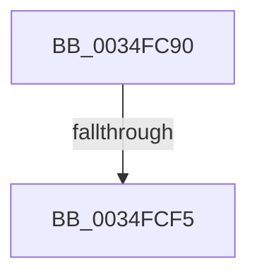

# FsRtlReleaseEofLock

- RVA: `0x0034FC90`–`0x0034FCFA` (길이 `106` bytes)
- VA: `0x000000014034FC90`
- 실행 섹션: `.text`
- PDB 이름 있음: `예`; PDB Function 태그: `아니요`
- unwind 정보 RVA: `0x00078CF4`
- 디코드: `29`개 명령, `106/106` bytes 표시
- 미해석 바이트: `0` (있으면 어셈블리에 `.byte`로 보존)

> 이 문서는 커널 이미지의 기계어와 PDB 기호를 분석해 생성했습니다. 4번과 5번은 함수 원형과 자료형을 바이너리 사용 방식에서 추정한 C 해석이며 원본 소스 복구 결과는 아닙니다.

## 1. Dependencies

- 직접 호출 지점: **1**; 고유 호출 대상: **1**
- 직접 호출자로 확인된 함수: **0**
- RIP 상대 이미지 참조: **1**

### Outgoing calls
- `0x0034FCD3` → [KeAbPreAcquire](../21/KeAbPreAcquire_function_00210230.md) (function, `0x00210230`)

### Direct callers
- 이 함수 시작 RVA로 연결되는 직접 call은 확인되지 않았습니다. 간접 호출은 완전히 역산할 수 없습니다.

### Static image references
- `0x0034FCE8` → RVA `0x00FC6D20` (`ALMOSTRO`; read)

## 2. Other-region calls and transfers

- 다른 실행 섹션으로 향하는 call: **0**
- call이 아닌 외부 분기/꼬리 이동: **1**
  - `0x0034FCEF` → [sub_0034FE9B](Unknown_function_0034FE9B.md) (`tail-transfer`)

## 3. Assembly (complete function range)

```asm
0034FC90  4C 8B DC                        mov r11, rsp
0034FC93  49 89 53 10                     mov qword ptr [r11 + 0x10], rdx
0034FC97  53                              push rbx
0034FC98  55                              push rbp
0034FC99  57                              push rdi
0034FC9A  41 54                           push r12
0034FC9C  41 55                           push r13
0034FC9E  48 83 EC 50                     sub rsp, 0x50
0034FCA2  49 8D 43 B8                     lea rax, [r11 - 0x48]
0034FCA6  48 89 94 24 90 00 00 00         mov qword ptr [rsp + 0x90], rdx
0034FCAE  49 89 43 C0                     mov qword ptr [r11 - 0x40], rax
0034FCB2  48 8B D9                        mov rbx, rcx
0034FCB5  49 8D 43 B8                     lea rax, [r11 - 0x48]
0034FCB9  45 33 ED                        xor r13d, r13d
0034FCBC  49 89 43 B8                     mov qword ptr [r11 - 0x48], rax
0034FCC0  45 33 C0                        xor r8d, r8d
0034FCC3  48 8B C2                        mov rax, rdx
0034FCC6  33 D2                           xor edx, edx
0034FCC8  48 8B 41 18                     mov rax, qword ptr [rcx + 0x18]
0034FCCC  48 8B 78 30                     mov rdi, qword ptr [rax + 0x30]
0034FCD0  48 8B CF                        mov rcx, rdi
0034FCD3  E8 58 05 EC FF                  call 0x140210230
0034FCD8  48 8B E8                        mov rbp, rax
0034FCDB  45 0F 20 C4                     mov r12, cr8
0034FCDF  B8 01 00 00 00                  mov eax, 1
0034FCE4  44 0F 22 C0                     mov cr8, rax
0034FCE8  44 39 2D 31 70 C7 00            cmp dword ptr [rip + 0xc77031], r13d
0034FCEF  0F 85 A6 01 00 00               jne 0x14034fe9b
0034FCF5  F0 0F BA 37 00                  lock btr dword ptr [rdi], 0
```

## 4. C-style interpretation (structured pseudocode)

```c
__int64 __fastcall FsRtlReleaseEofLock(__int64 a1, __int64 a2, int a3)
{
    __int64 result;
    __int64 v_r13;
    __int64 v_rsp;
    unsigned __int64 v_stack_p18;

    *(unsigned __int64 *)(v_rsp + 16) = a2;
    v_rsp = (v_rsp) - (80);
    v_stack_p18 = a2;
    *(unsigned __int64 *)(v_rsp - 64) = v_rsp - 72;
    v_r13 = 0;
    *(unsigned __int64 *)(v_rsp - 72) = v_rsp - 72;
    a3 = 0;
    a2 = 0;
    result = KeAbPreAcquire(*(unsigned __int64 *)(*(unsigned __int64 *)(a1 + 24) + 48), a2, a3, a4);
    return 1;
}
```

## 5. (Beta) C Style

```c
int64_t FsRtlReleaseEofLock(void *Arg1, int64_t Arg2, int32_t Arg3)
{
    uint8_t *arg1 = (uint8_t *)Arg1;

    int64_t result;
    int64_t local_r13;
    int64_t local_rsp;
    uint64_t v_stack_p18;

    *(uint64_t *)(local_rsp + 0x10) = Arg2;
    local_rsp = (local_rsp) - (80);
    v_stack_p18 = Arg2;
    *(uint64_t *)(local_rsp - 0x40) = local_rsp - 72;
    local_r13 = 0;
    *(uint64_t *)(local_rsp - 0x48) = local_rsp - 72;
    Arg3 = 0;
    Arg2 = 0;
    result = KeAbPreAcquire(*(uint64_t *)(*(uint64_t *)(arg1 + 0x18) + 0x30), Arg2, Arg3, a4);
    return 1;
}
```

### 관측된 메모리 오프셋

구조체 형식이 확인되지 않은 접근은 인자 기준의 오프셋으로만 기록했습니다.

| 기준 인자 | 오프셋 표현 | 폭 (bit) | 접근 |
|---|---:|---:|---|
| `Arg1` | `+ 0x18` | `64` | `R` |

## 6. Execution-region graph

[열기: 2D/3D 그래프와 함수 탐색 컨트롤 패널](../../../control-panel.html?section=text&rva=0x0034FC90&view=graph)

- 2D 그래프는 위에서 아래로 흐르고, 3D 그래프는 빈 공간을 드래그해 회전합니다. Shift+드래그는 이동, 휠은 확대·축소, 함수 노드 선택은 대상 보고서 이동입니다.

### Static fallback


