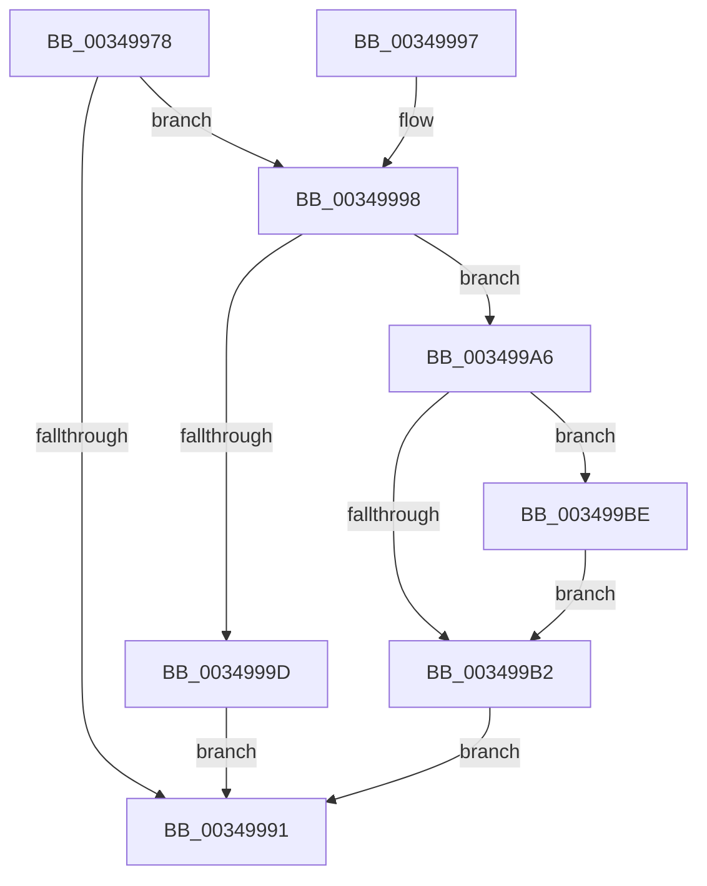

# IoDiskIoAttributionDereference

- RVA: `0x00349978`–`0x003499C5` (길이 `77` bytes)
- VA: `0x0000000140349978`
- 실행 섹션: `.text`
- PDB 이름 있음: `예`; PDB Function 태그: `아니요`
- unwind 정보 RVA: `0x000783B4`
- 디코드: `25`개 명령, `77/77` bytes 표시
- 미해석 바이트: `0` (있으면 어셈블리에 `.byte`로 보존)

> 이 문서는 커널 이미지의 기계어와 PDB 기호를 분석해 생성했습니다. 4번과 5번은 함수 원형과 자료형을 바이너리 사용 방식에서 추정한 C 해석이며 원본 소스 복구 결과는 아닙니다.

## 1. Dependencies

- 직접 호출 지점: **2**; 고유 호출 대상: **2**
- 직접 호출자로 확인된 함수: **21**
- RIP 상대 이미지 참조: **0**

### Outgoing calls
- `0x003499B7` → [ExFreePoolWithTag](../../poolcode/B8/ExFreePoolWithTag_function_00B82870.md) (function, `0x00B82870`)
- `0x003499BE` → [IoDiskIoAttributionDereference](IoDiskIoAttributionDereference_function_00349978.md) (function, `0x00349978`)

### Direct callers
- [IoGetIoRateControl](IoGetIoRateControl_function_003493F0.md) at `0x00349523`
- [IoRecordIoAttribution](IoRecordIoAttribution_function_003495D0.md) at `0x0034962C`
- [IoDiskIoAttributionDereference](IoDiskIoAttributionDereference_function_00349978.md) at `0x003499BE`
- [MmUpdateSectionIoAttribution](../3C/MmUpdateSectionIoAttribution_function_003C9FA4.md) at `0x003CA01A`
- [CcMapAndCopyInToCache](../3C/CcMapAndCopyInToCache_function_003CA7F0.md) at `0x003CB261`
- [MiCheckAndUpdateIoAttribution](../3C/MiCheckAndUpdateIoAttribution_function_003CB3C4.md) at `0x003CB44A`
- [CcUninitializeCacheMap](../3C/CcUninitializeCacheMap_function_003CD520.md) at `0x003CD9C4`
- [MiFlushSection](../40/MiFlushSection_function_004036B0.md) at `0x00403E83`
- [MiGatherMappedPages](../40/MiGatherMappedPages_function_00404E80.md) at `0x00405208`
- [CcCopyReadEx](../45/CcCopyReadEx_function_0045E160.md) at `0x0045E512`
- [CcCompleteAsyncRead](../45/CcCompleteAsyncRead_function_0045E7DC.md) at `0x0045EAD4`
- [CcPerformReadAhead](../48/CcPerformReadAhead_function_0048F738.md) at `0x0048FD28`
- [IoSetDiskIoAttributionOnProcess](../49/IoSetDiskIoAttributionOnProcess_function_0049521C.md) at `0x00495294`
- [IoNotifyQuotaState](../4A/IoNotifyQuotaState_function_004A13C0.md) at `0x004A144D`
- [CcCopyReadEx$fin$0](../6D/CcCopyReadEx_fin_0_function_006D3230.md) at `0x006D3247`
- [CcCompleteAsyncRead$fin$1](../6D/CcCompleteAsyncRead_fin_1_function_006D3387.md) at `0x006D339B`
- [CcPerformReadAhead$fin$1](../6D/CcPerformReadAhead_fin_1_function_006D3929.md) at `0x006D3A15`
- [PspIoRateEntryDeactivate](../../page/9F/PspIoRateEntryDeactivate_function_009F7BD4.md) at `0x009F7C0D`
- [PspRemoveIoAttribution](../../page/9F/PspRemoveIoAttribution_function_009F8014.md) at `0x009F803E`
- [PspIoRateEntryActivate](../../page/9F/PspIoRateEntryActivate_function_009F8398.md) at `0x009F84A5`
- [MiSegmentDelete](../../page/A1/MiSegmentDelete_function_00A1FBB4.md) at `0x00A1FCF0`

### Static image references
- 디코드된 RIP-relative 메모리 참조가 없습니다.

## 2. Other-region calls and transfers

- 다른 실행 섹션으로 향하는 call: **1**
  - `0x003499B7` → [ExFreePoolWithTag](../../poolcode/B8/ExFreePoolWithTag_function_00B82870.md) (`.text` → `POOLCODE`)
- 별도 외부 분기/꼬리 이동을 확인하지 못했습니다.

## 3. Assembly (complete function range)

```asm
00349978  40 53                           push rbx
0034997A  48 83 EC 20                     sub rsp, 0x20
0034997E  48 8B D9                        mov rbx, rcx
00349981  48 83 C8 FF                     or rax, 0xffffffffffffffff
00349985  F0 48 0F C1 41 20               lock xadd qword ptr [rcx + 0x20], rax
0034998B  48 83 E8 01                     sub rax, 1
0034998F  7E 07                           jle 0x140349998
00349991  48 83 C4 20                     add rsp, 0x20
00349995  5B                              pop rbx
00349996  C3                              ret
00349997  CC                              int3
00349998  48 85 C0                        test rax, rax
0034999B  74 09                           je 0x1403499a6
0034999D  B9 0E 00 00 00                  mov ecx, 0xe
003499A2  CD 29                           int 0x29
003499A4  EB EB                           jmp 0x140349991
003499A6  48 8B 89 B0 00 00 00            mov rcx, qword ptr [rcx + 0xb0]
003499AD  48 85 C9                        test rcx, rcx
003499B0  75 0C                           jne 0x1403499be
003499B2  33 D2                           xor edx, edx
003499B4  48 8B CB                        mov rcx, rbx
003499B7  E8 B4 8E 83 00                  call 0x140b82870
003499BC  EB D3                           jmp 0x140349991
003499BE  E8 B5 FF FF FF                  call 0x140349978
003499C3  EB ED                           jmp 0x1403499b2
```

## 4. C-style interpretation (structured pseudocode)

```c
__int64 __fastcall IoDiskIoAttributionDereference(__int64 a1, int a2)
{
    __int64 result;
    __int64 v_rsp;

    v_rsp = (v_rsp) - (32);
    result = (result) | (-1);
    result = (result) - (1);
    if (condition_is_less_or_equal) goto loc_00349998;
loc_00349991:
    v_rsp = (v_rsp) + (32);
    return result;
loc_00349998:
    if (result == 0) goto loc_003499A6;
    goto loc_00349991;
loc_003499A6:
    if (*(unsigned __int64 *)(14 + 176) != 0) goto loc_003499BE;
loc_003499B2:
    a2 = 0;
    result = ExFreePoolWithTag(a1, a2, a3, a4);
    goto loc_00349991;
loc_003499BE:
    result = IoDiskIoAttributionDereference(a1, a2, a3, a4);
    goto loc_003499B2;
}
```

## 5. (Beta) C Style

```c
int64_t IoDiskIoAttributionDereference(void *Arg1, int32_t Arg2)
{
    uint8_t *arg1 = (uint8_t *)Arg1;

    int64_t result;
    int64_t local_rsp;

    local_rsp = (local_rsp) - (32);
    result = (result) | (-1);
    result = (result) - (1);
    if (condition_is_less_or_equal) goto loc_00349998;
loc_00349991:
    local_rsp = (local_rsp) + (32);
    return result;
loc_00349998:
    if (result == 0) goto loc_003499A6;
    goto loc_00349991;
loc_003499A6:
    if (*(uint64_t *)(14 + 0xB0) != 0) goto loc_003499BE;
loc_003499B2:
    Arg2 = 0;
    result = ExFreePoolWithTag(Arg1, Arg2, a3, a4);
    goto loc_00349991;
loc_003499BE:
    result = IoDiskIoAttributionDereference(Arg1, Arg2, a3, a4);
    goto loc_003499B2;
}
```

### 관측된 메모리 오프셋

구조체 형식이 확인되지 않은 접근은 인자 기준의 오프셋으로만 기록했습니다.

| 기준 인자 | 오프셋 표현 | 폭 (bit) | 접근 |
|---|---:|---:|---|
| `Arg1` | `+ 0x20` | `64` | `R/W` |
| `Arg1` | `+ 0xB0` | `64` | `R` |

## 6. Execution-region graph

[열기: 2D/3D 그래프와 함수 탐색 컨트롤 패널](../../../control-panel.html?section=text&rva=0x00349978&view=graph)

- 2D 그래프는 위에서 아래로 흐르고, 3D 그래프는 빈 공간을 드래그해 회전합니다. Shift+드래그는 이동, 휠은 확대·축소, 함수 노드 선택은 대상 보고서 이동입니다.

### Static fallback


