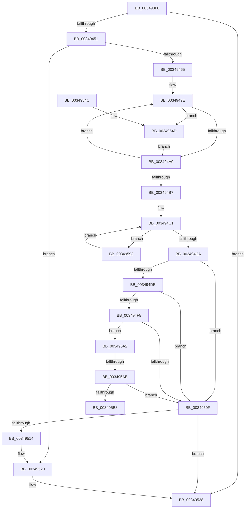

# IoGetIoRateControl

- RVA: `0x003493F0`–`0x003495BD` (길이 `461` bytes)
- VA: `0x00000001403493F0`
- 실행 섹션: `.text`
- PDB 이름 있음: `예`; PDB Function 태그: `예`
- unwind 정보 RVA: `0x0007833C`
- 디코드: `117`개 명령, `461/461` bytes 표시
- 미해석 바이트: `0` (있으면 어셈블리에 `.byte`로 보존)

> 이 문서는 커널 이미지의 기계어와 PDB 기호를 분석해 생성했습니다. 4번과 5번은 함수 원형과 자료형을 바이너리 사용 방식에서 추정한 C 해석이며 원본 소스 복구 결과는 아닙니다.

## 1. Dependencies

- 직접 호출 지점: **6**; 고유 호출 대상: **6**
- 직접 호출자로 확인된 함수: **0**
- RIP 상대 이미지 참조: **0**

### Outgoing calls
- `0x00349440` → [IopFindDiskIoAttribution](IopFindDiskIoAttribution_function_00349670.md) (function, `0x00349670`)
- `0x00349458` → [ExAcquireRundownProtection](../21/ExAcquireRundownProtection_function_00216620.md) (function, `0x00216620`)
- `0x00349482` → [PsIoRateControlReference](../46/PsIoRateControlReference_function_0046E77C.md) (function, `0x0046E77C`)
- `0x0034951B` → [ExReleaseRundownProtection](ExReleaseRundownProtection_function_00349E80.md) (function, `0x00349E80`)
- `0x00349523` → [IoDiskIoAttributionDereference](IoDiskIoAttributionDereference_function_00349978.md) (function, `0x00349978`)
- `0x00349558` → [IoDiskIoAttributionQuery](../37/IoDiskIoAttributionQuery_function_00379D38.md) (function, `0x00379D38`)

### Direct callers
- 이 함수 시작 RVA로 연결되는 직접 call은 확인되지 않았습니다. 간접 호출은 완전히 역산할 수 없습니다.

### Static image references
- 디코드된 RIP-relative 메모리 참조가 없습니다.

## 2. Other-region calls and transfers

- 다른 실행 섹션으로 향하는 call: **0**
- call이 아닌 외부 분기/꼬리 이동: **2**
  - `0x003495A5` → [sub_006E2128](../6E/Unknown_function_006E2128.md) (`tail-transfer`)
  - `0x003495B8` → [sub_006E2128](../6E/Unknown_function_006E2128.md) (`tail-transfer`)

## 3. Assembly (complete function range)

```asm
003493F0  48 8B C4                        mov rax, rsp
003493F3  48 89 58 08                     mov qword ptr [rax + 8], rbx
003493F7  48 89 70 10                     mov qword ptr [rax + 0x10], rsi
003493FB  48 89 78 20                     mov qword ptr [rax + 0x20], rdi
003493FF  4C 89 40 18                     mov qword ptr [rax + 0x18], r8
00349403  55                              push rbp
00349404  41 54                           push r12
00349406  41 55                           push r13
00349408  41 56                           push r14
0034940A  41 57                           push r15
0034940C  48 8B EC                        mov rbp, rsp
0034940F  48 81 EC 80 00 00 00            sub rsp, 0x80
00349416  48 8B 45 60                     mov rax, qword ptr [rbp + 0x60]
0034941A  0F 57 C0                        xorps xmm0, xmm0
0034941D  0F 57 C9                        xorps xmm1, xmm1
00349420  45 33 ED                        xor r13d, r13d
00349423  4D 8B F1                        mov r14, r9
00349426  48 8B FA                        mov rdi, rdx
00349429  0F 11 45 B0                     movups xmmword ptr [rbp - 0x50], xmm0
0034942D  4C 21 28                        and qword ptr [rax], r13
00349430  0F 11 4D E0                     movups xmmword ptr [rbp - 0x20], xmm1
00349434  0F 11 4D F0                     movups xmmword ptr [rbp - 0x10], xmm1
00349438  0F 11 45 C0                     movups xmmword ptr [rbp - 0x40], xmm0
0034943C  0F 11 45 D0                     movups xmmword ptr [rbp - 0x30], xmm0
00349440  E8 2B 02 00 00                  call 0x140349670
00349445  48 8B D8                        mov rbx, rax
00349448  48 85 C0                        test rax, rax
0034944B  0F 84 D7 00 00 00               je 0x140349528
00349451  48 8D 88 A8 00 00 00            lea rcx, [rax + 0xa8]
00349458  E8 C3 D1 EC FF                  call 0x140216620
0034945D  84 C0                           test al, al
0034945F  0F 84 BB 00 00 00               je 0x140349520
00349465  4C 8B BB A0 00 00 00            mov r15, qword ptr [rbx + 0xa0]
0034946C  4C 8D 4D B0                     lea r9, [rbp - 0x50]
00349470  48 8B 45 50                     mov rax, qword ptr [rbp + 0x50]
00349474  49 8B CF                        mov rcx, r15
00349477  4D 8B C6                        mov r8, r14
0034947A  48 89 44 24 20                  mov qword ptr [rsp + 0x20], rax
0034947F  48 8B D7                        mov rdx, rdi
00349482  E8 F5 52 12 00                  call 0x14046e77c
00349487  48 8B 7D 58                     mov rdi, qword ptr [rbp + 0x58]
0034948B  48 8D 45 B0                     lea rax, [rbp - 0x50]
0034948F  48 83 C7 10                     add rdi, 0x10
00349493  48 8D 75 B0                     lea rsi, [rbp - 0x50]
00349497  4C 2B F0                        sub r14, rax
0034949A  45 8D 65 02                     lea r12d, [r13 + 2]
0034949E  49 83 3C 36 00                  cmp qword ptr [r14 + rsi], 0
003494A3  0F 85 A4 00 00 00               jne 0x14034954d
003494A9  48 83 C6 08                     add rsi, 8
003494AD  48 83 C7 20                     add rdi, 0x20
003494B1  49 83 EC 01                     sub r12, 1
003494B5  75 E7                           jne 0x14034949e
003494B7  48 8B 83 B0 00 00 00            mov rax, qword ptr [rbx + 0xb0]
003494BE  48 8B CB                        mov rcx, rbx
003494C1  48 85 C0                        test rax, rax
003494C4  0F 85 C9 00 00 00               jne 0x140349593
003494CA  48 8B 41 18                     mov rax, qword ptr [rcx + 0x18]
003494CE  48 8B 4D 60                     mov rcx, qword ptr [rbp + 0x60]
003494D2  48 89 01                        mov qword ptr [rcx], rax
003494D5  48 8B 4D 68                     mov rcx, qword ptr [rbp + 0x68]
003494D9  48 85 C9                        test rcx, rcx
003494DC  74 31                           je 0x14034950f
003494DE  83 21 00                        and dword ptr [rcx], 0
003494E1  48 8B 55 40                     mov rdx, qword ptr [rbp + 0x40]
003494E5  48 8B 92 20 02 00 00            mov rdx, qword ptr [rdx + 0x220]
003494EC  48 8B 82 A0 02 00 00            mov rax, qword ptr [rdx + 0x2a0]
003494F3  48 85 C0                        test rax, rax
003494F6  74 17                           je 0x14034950f
003494F8  48 8B 82 A0 02 00 00            mov rax, qword ptr [rdx + 0x2a0]
003494FF  48 8B 90 08 07 00 00            mov rdx, qword ptr [rax + 0x708]
00349506  48 85 D2                        test rdx, rdx
00349509  0F 85 93 00 00 00               jne 0x1403495a2
0034950F  48 85 DB                        test rbx, rbx
00349512  74 14                           je 0x140349528
00349514  48 8D 8B A8 00 00 00            lea rcx, [rbx + 0xa8]
0034951B  E8 60 09 00 00                  call 0x140349e80
00349520  48 8B CB                        mov rcx, rbx
00349523  E8 50 04 00 00                  call 0x140349978
00349528  4C 8D 9C 24 80 00 00 00         lea r11, [rsp + 0x80]
00349530  41 8B C5                        mov eax, r13d
00349533  49 8B 5B 30                     mov rbx, qword ptr [r11 + 0x30]
00349537  49 8B 73 38                     mov rsi, qword ptr [r11 + 0x38]
0034953B  49 8B 7B 48                     mov rdi, qword ptr [r11 + 0x48]
0034953F  49 8B E3                        mov rsp, r11
00349542  41 5F                           pop r15
00349544  41 5E                           pop r14
00349546  41 5D                           pop r13
00349548  41 5C                           pop r12
0034954A  5D                              pop rbp
0034954B  C3                              ret
0034954C  CC                              int3
0034954D  48 8B 0E                        mov rcx, qword ptr [rsi]
00349550  4C 8D 45 C0                     lea r8, [rbp - 0x40]
00349554  48 8D 55 E0                     lea rdx, [rbp - 0x20]
00349558  E8 DB 07 03 00                  call 0x140379d38
0034955D  48 8B 45 D8                     mov rax, qword ptr [rbp - 0x28]
00349561  0F 10 45 E0                     movups xmm0, xmmword ptr [rbp - 0x20]
00349565  0F 10 4D F0                     movups xmm1, xmmword ptr [rbp - 0x10]
00349569  0F 11 47 F0                     movups xmmword ptr [rdi - 0x10], xmm0
0034956D  0F 11 0F                        movups xmmword ptr [rdi], xmm1
00349570  48 01 47 08                     add qword ptr [rdi + 8], rax
00349574  48 8B 45 D0                     mov rax, qword ptr [rbp - 0x30]
00349578  48 01 07                        add qword ptr [rdi], rax
0034957B  48 8B 45 C0                     mov rax, qword ptr [rbp - 0x40]
0034957F  48 01 47 F0                     add qword ptr [rdi - 0x10], rax
00349583  48 8B 45 C8                     mov rax, qword ptr [rbp - 0x38]
00349587  48 01 47 F8                     add qword ptr [rdi - 8], rax
0034958B  41 FF C5                        inc r13d
0034958E  E9 16 FF FF FF                  jmp 0x1403494a9
00349593  48 8B C8                        mov rcx, rax
00349596  48 8B 80 B0 00 00 00            mov rax, qword ptr [rax + 0xb0]
0034959D  E9 1F FF FF FF                  jmp 0x1403494c1
003495A2  49 3B D7                        cmp rdx, r15
003495A5  0F 84 7D 8B 39 00               je 0x1406e2128
003495AB  4C 39 BA 30 06 00 00            cmp qword ptr [rdx + 0x630], r15
003495B2  0F 85 57 FF FF FF               jne 0x14034950f
003495B8  E9 6B 8B 39 00                  jmp 0x1406e2128
```

## 4. C-style interpretation (structured pseudocode)

```c
__int64 __fastcall IoGetIoRateControl(__int64 a1, __int64 a2, __int64 a3, __int64 a4, __int64 a5, __int64 a6, __int64 a7, __int64 a8)
{
    __int64 result;
    __int64 v_r12;
    __int64 v_r13;
    __int64 v_r14;
    __int64 v_rdi;
    __int64 v_rsi;
    __int64 v_rsp;
    unsigned __int64 v_stack_m28;
    unsigned __int64 v_stack_m38;
    unsigned __int64 v_stack_m48;
    unsigned __int64 v_stack_m50;
    unsigned __int64 v_stack_m58;
    unsigned __int64 v_stack_m60;
    unsigned __int64 v_stack_m68;
    unsigned __int64 v_stack_m78;
    unsigned __int64 v_stack_m88;
    unsigned __int64 v_stack_p18;

    *(unsigned __int64 *)(v_rsp + 8) = v_rbx;
    *(unsigned __int64 *)(v_rsp + 16) = v_rsi;
    *(unsigned __int64 *)(v_rsp + 32) = v_rdi;
    *(unsigned __int64 *)(v_rsp + 24) = a3;
    v_rsp = (v_rsp) - (128);
    v_r13 = 0;
    v_stack_m78 = v_xmm0;
    v_stack_m48 = v_xmm1;
    v_stack_m38 = v_xmm1;
    v_stack_m68 = v_xmm0;
    v_stack_m58 = v_xmm0;
    result = IopFindDiskIoAttribution(a1, a2, a3, a4);
    if (result == 0) goto loc_00349528;
    result = ExAcquireRundownProtection(result + 168, a2, a3, a4);
    if ((unsigned __int8)(result) == 0) goto loc_00349520;
    v_stack_m88 = a5;
    result = PsIoRateControlReference(*(unsigned __int64 *)(result + 160), a2, a4, v_stack_m78);
    v_rdi = (a6) + (16);
    v_r14 = (a4) - (v_stack_m78);
loc_0034949E:
    if ((*(unsigned __int64 *)(v_r14 + v_stack_m78 * 1)) != 0) goto loc_0034954D;
loc_003494A9:
    v_rsi = (v_stack_m78) + (8);
    v_rdi = (v_rdi) + (32);
    v_r12 = (v_r13 + 2) - (1);
    if (condition_is_not_equal) goto loc_0034949E;
loc_003494C1:
    if (*(unsigned __int64 *)(result + 176) != 0) goto loc_00349593;
    *(unsigned __int64 *)(a7) = *(unsigned __int64 *)(result + 24);
    if (a8 == 0) goto loc_0034950F;
    if (*(unsigned __int64 *)(*(unsigned __int64 *)(v_stack_p18 + 544) + 672) == 0) goto loc_0034950F;
    if (*(unsigned __int64 *)(*(unsigned __int64 *)(*(unsigned __int64 *)(v_stack_p18 + 544) + 672) + 1800) != 0) goto loc_003495A2;
loc_0034950F:
    if (result == 0) goto loc_00349528;
    result = ExReleaseRundownProtection(result + 168, *(unsigned __int64 *)(*(unsigned __int64 *)(*(unsigned __int64 *)(v_stack_p18 + 544) + 672) + 1800), a4, v_stack_m78);
loc_00349520:
    result = IoDiskIoAttributionDereference(result, *(unsigned __int64 *)(*(unsigned __int64 *)(*(unsigned __int64 *)(v_stack_p18 + 544) + 672) + 1800), a4, v_stack_m78);
loc_00349528:
    return 0;
loc_0034954D:
    result = IoDiskIoAttributionQuery(*(unsigned __int64 *)(*(unsigned __int64 *)(v_stack_m28 + 56)), v_stack_m48, v_stack_m68, v_stack_m78);
    *(unsigned __int64 *)(*(unsigned __int64 *)(v_stack_m28 + 72) - 16) = v_xmm0;
    *(unsigned __int64 *)(*(unsigned __int64 *)(v_stack_m28 + 72)) = v_xmm1;
    v_r13 = (unsigned int)((v_r13) + 1);
    goto loc_003494A9;
loc_00349593:
    goto loc_003494C1;
loc_003495A2:
    if ((*(unsigned __int64 *)(v_stack_m48 + 1584)) != (*(unsigned __int64 *)(result + 160))) goto loc_0034950F;
}
```

## 5. (Beta) C Style

```c
int64_t IoGetIoRateControl(int64_t Arg1, int64_t Arg2, int64_t Arg3, void *Arg4, int64_t Arg5, void *Arg6, void *Arg7, int64_t Arg8)
{
    uint8_t *arg4 = (uint8_t *)Arg4;
    uint8_t *arg6 = (uint8_t *)Arg6;
    uint8_t *arg7 = (uint8_t *)Arg7;

    int64_t result;
    int64_t local_r12;
    int64_t local_r13;
    int64_t local_r14;
    int64_t local_rdi;
    int64_t local_rsi;
    int64_t local_rsp;
    uint64_t v_stack_m28;
    uint64_t v_stack_m38;
    uint64_t v_stack_m48;
    uint64_t v_stack_m50;
    uint64_t v_stack_m58;
    uint64_t v_stack_m60;
    uint64_t v_stack_m68;
    uint64_t v_stack_m78;
    uint64_t v_stack_m88;
    uint64_t v_stack_p18;

    *(uint64_t *)(local_rsp + 0x8) = local_rbx;
    *(uint64_t *)(local_rsp + 0x10) = local_rsi;
    *(uint64_t *)(local_rsp + 0x20) = local_rdi;
    *(uint64_t *)(local_rsp + 0x18) = Arg3;
    local_rsp = (local_rsp) - (128);
    local_r13 = 0;
    v_stack_m78 = v_xmm0;
    v_stack_m48 = v_xmm1;
    v_stack_m38 = v_xmm1;
    v_stack_m68 = v_xmm0;
    v_stack_m58 = v_xmm0;
    result = IopFindDiskIoAttribution(Arg1, Arg2, Arg3, Arg4);
    if (result == 0) goto loc_00349528;
    result = ExAcquireRundownProtection(result + 168, Arg2, Arg3, Arg4);
    if ((uint8_t)(result) == 0) goto loc_00349520;
    v_stack_m88 = Arg5;
    result = PsIoRateControlReference(*(uint64_t *)(result + 0xA0), Arg2, Arg4, v_stack_m78);
    local_rdi = (Arg6) + (16);
    local_r14 = (Arg4) - (v_stack_m78);
loc_0034949E:
    if ((*(uint64_t *)(local_r14 + v_stack_m78 * 1)) != 0) goto loc_0034954D;
loc_003494A9:
    local_rsi = (v_stack_m78) + (8);
    local_rdi = (local_rdi) + (32);
    local_r12 = (local_r13 + 2) - (1);
    if (condition_is_not_equal) goto loc_0034949E;
loc_003494C1:
    if (*(uint64_t *)(result + 0xB0) != 0) goto loc_00349593;
    *(uint64_t *)(arg7) = *(uint64_t *)(result + 0x18);
    if (Arg8 == 0) goto loc_0034950F;
    if (*(uint64_t *)(*(uint64_t *)(v_stack_p18 + 0x220) + 0x2A0) == 0) goto loc_0034950F;
    if (*(uint64_t *)(*(uint64_t *)(*(uint64_t *)(v_stack_p18 + 0x220) + 0x2A0) + 0x708) != 0) goto loc_003495A2;
loc_0034950F:
    if (result == 0) goto loc_00349528;
    result = ExReleaseRundownProtection(result + 168, *(uint64_t *)(*(uint64_t *)(*(uint64_t *)(v_stack_p18 + 0x220) + 0x2A0) + 0x708), Arg4, v_stack_m78);
loc_00349520:
    result = IoDiskIoAttributionDereference(result, *(uint64_t *)(*(uint64_t *)(*(uint64_t *)(v_stack_p18 + 0x220) + 0x2A0) + 0x708), Arg4, v_stack_m78);
loc_00349528:
    return 0;
loc_0034954D:
    result = IoDiskIoAttributionQuery(*(uint64_t *)(*(uint64_t *)(v_stack_m28 + 0x38)), v_stack_m48, v_stack_m68, v_stack_m78);
    *(uint64_t *)(*(uint64_t *)(v_stack_m28 + 0x48) - 0x10) = v_xmm0;
    *(uint64_t *)(*(uint64_t *)(v_stack_m28 + 0x48)) = v_xmm1;
    local_r13 = (uint32_t)((local_r13) + 1);
    goto loc_003494A9;
loc_00349593:
    goto loc_003494C1;
loc_003495A2:
    if ((*(uint64_t *)(v_stack_m48 + 0x630)) != (*(uint64_t *)(result + 0xA0))) goto loc_0034950F;
}
```

### 관측된 메모리 오프셋

구조체 형식이 확인되지 않은 접근은 인자 기준의 오프셋으로만 기록했습니다.

| 기준 인자 | 오프셋 표현 | 폭 (bit) | 접근 |
|---|---:|---:|---|
| `Arg4` | `+ 0x0 + rsi*1` | `64` | `R` |
| `Arg6` | `- 0x10` | `64` | `R/W` |
| `Arg6` | `- 0x10` | `128` | `R` |
| `Arg6` | `- 0x8` | `64` | `R/W` |
| `Arg6` | `+ 0x0` | `64` | `R/W` |
| `Arg6` | `+ 0x0` | `128` | `R` |
| `Arg6` | `+ 0x8` | `64` | `R/W` |
| `Arg7` | `+ 0x0` | `64` | `R/W` |
| `Arg7` | `+ 0x0` | `64` | `W` |

## 6. Execution-region graph

[열기: 2D/3D 그래프와 함수 탐색 컨트롤 패널](../../../control-panel.html?section=text&rva=0x003493F0&view=graph)

- 2D 그래프는 위에서 아래로 흐르고, 3D 그래프는 빈 공간을 드래그해 회전합니다. Shift+드래그는 이동, 휠은 확대·축소, 함수 노드 선택은 대상 보고서 이동입니다.

### Static fallback


