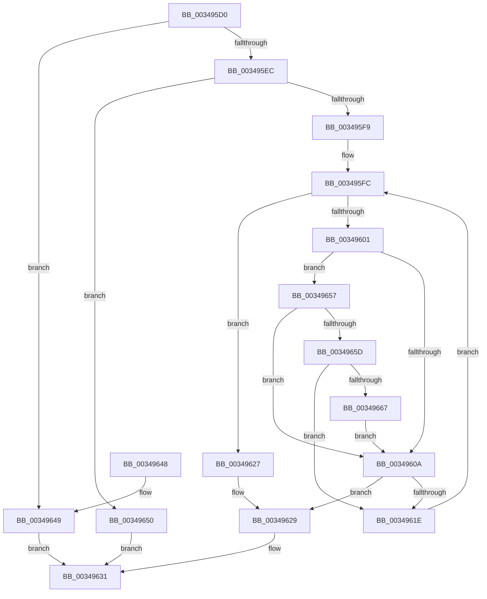

# IoRecordIoAttribution

- RVA: `0x003495D0`–`0x00349669` (길이 `153` bytes)
- VA: `0x00000001403495D0`
- 실행 섹션: `.text`
- PDB 이름 있음: `예`; PDB Function 태그: `아니요`
- unwind 정보 RVA: `0x0007836C`
- 디코드: `47`개 명령, `153/153` bytes 표시
- 미해석 바이트: `0` (있으면 어셈블리에 `.byte`로 보존)

> 이 문서는 커널 이미지의 기계어와 PDB 기호를 분석해 생성했습니다. 4번과 5번은 함수 원형과 자료형을 바이너리 사용 방식에서 추정한 C 해석이며 원본 소스 복구 결과는 아닙니다.

## 1. Dependencies

- 직접 호출 지점: **3**; 고유 호출 대상: **3**
- 직접 호출자로 확인된 함수: **0**
- RIP 상대 이미지 참조: **0**

### Outgoing calls
- `0x003495EC` → [IopFindDiskIoAttribution](IopFindDiskIoAttribution_function_00349670.md) (function, `0x00349670`)
- `0x00349613` → [IopRecordIoAttribution](IopRecordIoAttribution_function_00349758.md) (function, `0x00349758`)
- `0x0034962C` → [IoDiskIoAttributionDereference](IoDiskIoAttributionDereference_function_00349978.md) (function, `0x00349978`)

### Direct callers
- 이 함수 시작 RVA로 연결되는 직접 call은 확인되지 않았습니다. 간접 호출은 완전히 역산할 수 없습니다.

### Static image references
- 디코드된 RIP-relative 메모리 참조가 없습니다.

## 2. Other-region calls and transfers

- 다른 실행 섹션으로 향하는 call: **0**
- 별도 외부 분기/꼬리 이동을 확인하지 못했습니다.

## 3. Assembly (complete function range)

```asm
003495D0  48 89 5C 24 08                  mov qword ptr [rsp + 8], rbx
003495D5  48 89 6C 24 10                  mov qword ptr [rsp + 0x10], rbp
003495DA  48 89 74 24 18                  mov qword ptr [rsp + 0x18], rsi
003495DF  57                              push rdi
003495E0  48 83 EC 20                     sub rsp, 0x20
003495E4  83 3A 01                        cmp dword ptr [rdx], 1
003495E7  48 8B EA                        mov rbp, rdx
003495EA  75 5D                           jne 0x140349649
003495EC  E8 7F 00 00 00                  call 0x140349670
003495F1  48 8B F0                        mov rsi, rax
003495F4  48 85 C0                        test rax, rax
003495F7  74 57                           je 0x140349650
003495F9  48 8B F8                        mov rdi, rax
003495FC  48 85 FF                        test rdi, rdi
003495FF  74 26                           je 0x140349627
00349601  8B 45 04                        mov eax, dword ptr [rbp + 4]
00349604  0F BA E0 0B                     bt eax, 0xb
00349608  72 4D                           jb 0x140349657
0034960A  45 33 C0                        xor r8d, r8d
0034960D  48 8B D5                        mov rdx, rbp
00349610  48 8B CF                        mov rcx, rdi
00349613  E8 40 01 00 00                  call 0x140349758
00349618  8B D8                           mov ebx, eax
0034961A  85 C0                           test eax, eax
0034961C  78 0B                           js 0x140349629
0034961E  48 8B BF B0 00 00 00            mov rdi, qword ptr [rdi + 0xb0]
00349625  EB D5                           jmp 0x1403495fc
00349627  33 DB                           xor ebx, ebx
00349629  48 8B CE                        mov rcx, rsi
0034962C  E8 47 03 00 00                  call 0x140349978
00349631  48 8B 6C 24 38                  mov rbp, qword ptr [rsp + 0x38]
00349636  8B C3                           mov eax, ebx
00349638  48 8B 5C 24 30                  mov rbx, qword ptr [rsp + 0x30]
0034963D  48 8B 74 24 40                  mov rsi, qword ptr [rsp + 0x40]
00349642  48 83 C4 20                     add rsp, 0x20
00349646  5F                              pop rdi
00349647  C3                              ret
00349648  CC                              int3
00349649  BB 59 00 00 C0                  mov ebx, 0xc0000059
0034964E  EB E1                           jmp 0x140349631
00349650  BB 08 00 00 C0                  mov ebx, 0xc0000008
00349655  EB DA                           jmp 0x140349631
00349657  0F BA E0 09                     bt eax, 9
0034965B  72 AD                           jb 0x14034960a
0034965D  48 83 BF B0 00 00 00 00         cmp qword ptr [rdi + 0xb0], 0
00349665  74 B7                           je 0x14034961e
00349667  EB A1                           jmp 0x14034960a
```

## 4. C-style interpretation (structured pseudocode)

```c
__int64 __fastcall IoRecordIoAttribution(__int64 a1, __int64 a2, int a3)
{
    __int64 result;
    __int64 v_rbx;
    __int64 v_rsp;
    unsigned __int64 v_stack_p10;
    unsigned __int64 v_stack_p18;
    unsigned __int64 v_stack_p8;

    v_stack_p8 = v_rbx;
    v_stack_p10 = v_rbp;
    v_stack_p18 = v_rsi;
    v_rsp = (v_rsp) - (32);
    if ((*(unsigned int *)(a2)) != 1) goto loc_00349649;
    result = IopFindDiskIoAttribution(a1, a2, a3, a4);
    if (result == 0) goto loc_00349650;
loc_003495FC:
    if (result == 0) goto loc_00349627;
    if (condition_is_below) goto loc_00349657;
loc_0034960A:
    a3 = 0;
    result = IopRecordIoAttribution(result, a2, a3, a4);
    if (sign_flag) goto loc_00349629;
loc_0034961E:
    goto loc_003495FC;
loc_00349627:
    v_rbx = 0;
loc_00349629:
    result = IoDiskIoAttributionDereference(result, a2, a3, a4);
loc_00349631:
    v_rsp = (v_rsp) + (32);
    return 0;
loc_00349649:
    goto loc_00349631;
loc_00349650:
    goto loc_00349631;
loc_00349657:
    if (condition_is_below) goto loc_0034960A;
    if ((*(unsigned __int64 *)(*(unsigned __int64 *)(result + 176) + 176)) == 0) goto loc_0034961E;
    goto loc_0034960A;
}
```

## 5. (Beta) C Style

```c
int64_t IoRecordIoAttribution(int64_t Arg1, void *Arg2, int32_t Arg3)
{
    uint8_t *arg2 = (uint8_t *)Arg2;

    int64_t result;
    int64_t local_rbx;
    int64_t local_rsp;
    uint64_t v_stack_p10;
    uint64_t v_stack_p18;
    uint64_t v_stack_p8;

    v_stack_p8 = local_rbx;
    v_stack_p10 = local_rbp;
    v_stack_p18 = local_rsi;
    local_rsp = (local_rsp) - (32);
    if ((*(uint32_t *)(arg2)) != 1) goto loc_00349649;
    result = IopFindDiskIoAttribution(Arg1, Arg2, Arg3, a4);
    if (result == 0) goto loc_00349650;
loc_003495FC:
    if (result == 0) goto loc_00349627;
    if (condition_is_below) goto loc_00349657;
loc_0034960A:
    Arg3 = 0;
    result = IopRecordIoAttribution(result, Arg2, Arg3, a4);
    if (sign_flag) goto loc_00349629;
loc_0034961E:
    goto loc_003495FC;
loc_00349627:
    local_rbx = 0;
loc_00349629:
    result = IoDiskIoAttributionDereference(result, Arg2, Arg3, a4);
loc_00349631:
    local_rsp = (local_rsp) + (32);
    return 0;
loc_00349649:
    goto loc_00349631;
loc_00349650:
    goto loc_00349631;
loc_00349657:
    if (condition_is_below) goto loc_0034960A;
    if ((*(uint64_t *)(*(uint64_t *)(result + 0xB0) + 0xB0)) == 0) goto loc_0034961E;
    goto loc_0034960A;
}
```

### 관측된 메모리 오프셋

구조체 형식이 확인되지 않은 접근은 인자 기준의 오프셋으로만 기록했습니다.

| 기준 인자 | 오프셋 표현 | 폭 (bit) | 접근 |
|---|---:|---:|---|
| `Arg2` | `+ 0x0` | `32` | `R` |
| `Arg2` | `+ 0x4` | `32` | `R` |

## 6. Execution-region graph

[열기: 2D/3D 그래프와 함수 탐색 컨트롤 패널](../../../control-panel.html?section=text&rva=0x003495D0&view=graph)

- 2D 그래프는 위에서 아래로 흐르고, 3D 그래프는 빈 공간을 드래그해 회전합니다. Shift+드래그는 이동, 휠은 확대·축소, 함수 노드 선택은 대상 보고서 이동입니다.

### Static fallback


