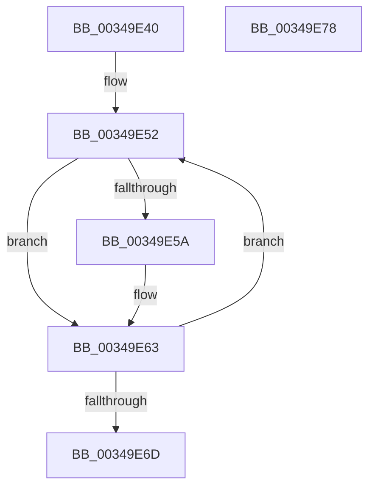

# IoReleaseIoRateControl

- RVA: `0x00349E40`–`0x00349E79` (길이 `57` bytes)
- VA: `0x0000000140349E40`
- 실행 섹션: `.text`
- PDB 이름 있음: `예`; PDB Function 태그: `아니요`
- unwind 정보 RVA: `0x0005CAAC`
- 디코드: `18`개 명령, `57/57` bytes 표시
- 미해석 바이트: `0` (있으면 어셈블리에 `.byte`로 보존)

> 이 문서는 커널 이미지의 기계어와 PDB 기호를 분석해 생성했습니다. 4번과 5번은 함수 원형과 자료형을 바이너리 사용 방식에서 추정한 C 해석이며 원본 소스 복구 결과는 아닙니다.

## 1. Dependencies

- 직접 호출 지점: **1**; 고유 호출 대상: **1**
- 직접 호출자로 확인된 함수: **0**
- RIP 상대 이미지 참조: **0**

### Outgoing calls
- `0x00349E5E` → [ExReleaseRundownProtection](ExReleaseRundownProtection_function_00349E80.md) (function, `0x00349E80`)

### Direct callers
- 이 함수 시작 RVA로 연결되는 직접 call은 확인되지 않았습니다. 간접 호출은 완전히 역산할 수 없습니다.

### Static image references
- 디코드된 RIP-relative 메모리 참조가 없습니다.

## 2. Other-region calls and transfers

- 다른 실행 섹션으로 향하는 call: **0**
- 별도 외부 분기/꼬리 이동을 확인하지 못했습니다.

## 3. Assembly (complete function range)

```asm
00349E40  48 89 5C 24 08                  mov qword ptr [rsp + 8], rbx
00349E45  57                              push rdi
00349E46  48 83 EC 20                     sub rsp, 0x20
00349E4A  48 8B D9                        mov rbx, rcx
00349E4D  BF 02 00 00 00                  mov edi, 2
00349E52  48 8B 0B                        mov rcx, qword ptr [rbx]
00349E55  48 85 C9                        test rcx, rcx
00349E58  74 09                           je 0x140349e63
00349E5A  48 83 C1 20                     add rcx, 0x20
00349E5E  E8 1D 00 00 00                  call 0x140349e80
00349E63  48 83 C3 08                     add rbx, 8
00349E67  48 83 EF 01                     sub rdi, 1
00349E6B  75 E5                           jne 0x140349e52
00349E6D  48 8B 5C 24 30                  mov rbx, qword ptr [rsp + 0x30]
00349E72  48 83 C4 20                     add rsp, 0x20
00349E76  5F                              pop rdi
00349E77  C3                              ret
00349E78  CC                              int3
```

## 4. C-style interpretation (structured pseudocode)

```c
__int64 __fastcall IoReleaseIoRateControl(__int64 a1)
{
    __int64 result;
    __int64 v_rbx;
    __int64 v_rdi;
    __int64 v_rsp;
    unsigned __int64 v_stack_p8;

    v_stack_p8 = v_rbx;
    v_rsp = (v_rsp) - (32);
loc_00349E52:
    if (*(unsigned __int64 *)(a1) != 0) {
        a1 = (*(unsigned __int64 *)(a1)) + (32);
        result = ExReleaseRundownProtection(a1, a2, a3, a4);
    }
    v_rbx = (a1) + (8);
    v_rdi = (2) - (1);
    if (condition_is_not_equal) goto loc_00349E52;
    v_rsp = (v_rsp) + (32);
    return result;
}
```

## 5. (Beta) C Style

```c
int64_t IoReleaseIoRateControl(void *Arg1)
{
    uint8_t *arg1 = (uint8_t *)Arg1;

    int64_t result;
    int64_t local_rbx;
    int64_t local_rdi;
    int64_t local_rsp;
    uint64_t v_stack_p8;

    v_stack_p8 = local_rbx;
    local_rsp = (local_rsp) - (32);
loc_00349E52:
    if (*(uint64_t *)(arg1) != 0) {
        Arg1 = (*(uint64_t *)(arg1)) + (32);
        result = ExReleaseRundownProtection(Arg1, a2, a3, a4);
    }
    local_rbx = (Arg1) + (8);
    local_rdi = (2) - (1);
    if (condition_is_not_equal) goto loc_00349E52;
    local_rsp = (local_rsp) + (32);
    return result;
}
```

### 관측된 메모리 오프셋

구조체 형식이 확인되지 않은 접근은 인자 기준의 오프셋으로만 기록했습니다.

| 기준 인자 | 오프셋 표현 | 폭 (bit) | 접근 |
|---|---:|---:|---|
| `Arg1` | `+ 0x0` | `64` | `R` |

## 6. Execution-region graph

[열기: 2D/3D 그래프와 함수 탐색 컨트롤 패널](../../../control-panel.html?section=text&rva=0x00349E40&view=graph)

- 2D 그래프는 위에서 아래로 흐르고, 3D 그래프는 빈 공간을 드래그해 회전합니다. Shift+드래그는 이동, 휠은 확대·축소, 함수 노드 선택은 대상 보고서 이동입니다.

### Static fallback


