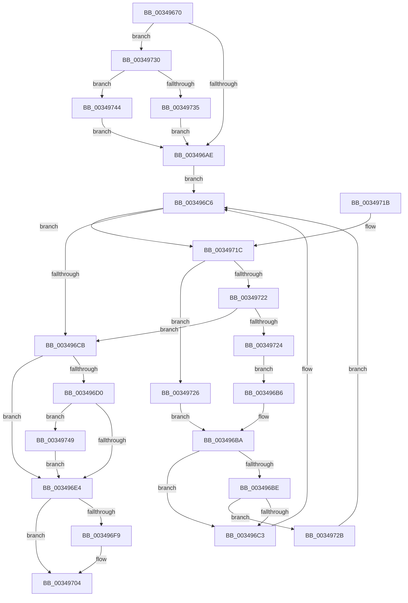

# IopFindDiskIoAttribution

- RVA: `0x00349670`–`0x00349752` (길이 `226` bytes)
- VA: `0x0000000140349670`
- 실행 섹션: `.text`
- PDB 이름 있음: `예`; PDB Function 태그: `아니요`
- unwind 정보 RVA: `0x00078384`
- 디코드: `65`개 명령, `226/226` bytes 표시
- 미해석 바이트: `0` (있으면 어셈블리에 `.byte`로 보존)

> 이 문서는 커널 이미지의 기계어와 PDB 기호를 분석해 생성했습니다. 4번과 5번은 함수 원형과 자료형을 바이너리 사용 방식에서 추정한 C 해석이며 원본 소스 복구 결과는 아닙니다.

## 1. Dependencies

- 직접 호출 지점: **3**; 고유 호출 대상: **3**
- 직접 호출자로 확인된 함수: **3**
- RIP 상대 이미지 참조: **4**

### Outgoing calls
- `0x0034968B` → [ExAcquireSpinLockShared](../24/ExAcquireSpinLockShared_function_0024DCE0.md) (function, `0x0024DCE0`)
- `0x003496EB` → [ExReleaseSpinLockSharedFromDpcLevel](../24/ExReleaseSpinLockSharedFromDpcLevel_function_0024A590.md) (function, `0x0024A590`)
- `0x003496FF` → [KiLowerIrqlProcessIrqlFlags](../4F/KiLowerIrqlProcessIrqlFlags_function_004F5698.md) (function, `0x004F5698`)

### Direct callers
- [IoGetIoRateControl](IoGetIoRateControl_function_003493F0.md) at `0x00349440`
- [IoRecordIoAttribution](IoRecordIoAttribution_function_003495D0.md) at `0x003495EC`
- [IoNotifyQuotaState](../4A/IoNotifyQuotaState_function_004A13C0.md) at `0x004A13E1`

### Static image references
- `0x00349684` → RVA `0x00F8D1E0` (`.data`; read)
- `0x00349690` → RVA `0x00F8D420` (`.data`; read)
- `0x0034969E` → RVA `0x00F8D428` (`.data`; read)
- `0x003496F0` → RVA `0x00FC6D20` (`ALMOSTRO`; read)

## 2. Other-region calls and transfers

- 다른 실행 섹션으로 향하는 call: **0**
- 별도 외부 분기/꼬리 이동을 확인하지 못했습니다.

## 3. Assembly (complete function range)

```asm
00349670  48 89 5C 24 08                  mov qword ptr [rsp + 8], rbx
00349675  48 89 74 24 10                  mov qword ptr [rsp + 0x10], rsi
0034967A  57                              push rdi
0034967B  48 83 EC 20                     sub rsp, 0x20
0034967F  48 8B F1                        mov rsi, rcx
00349682  33 FF                           xor edi, edi
00349684  48 8D 0D 55 3B C4 00            lea rcx, [rip + 0xc43b55]
0034968B  E8 50 46 F0 FF                  call 0x14024dce0
00349690  48 8B 15 89 3D C4 00            mov rdx, qword ptr [rip + 0xc43d89]
00349697  44 8D 47 01                     lea r8d, [rdi + 1]
0034969B  0F B6 D8                        movzx ebx, al
0034969E  48 8B 05 83 3D C4 00            mov rax, qword ptr [rip + 0xc43d83]
003496A5  41 84 C0                        test r8b, al
003496A8  0F 85 82 00 00 00               jne 0x140349730
003496AE  0F B6 C8                        movzx ecx, al
003496B1  41 23 C8                        and ecx, r8d
003496B4  EB 10                           jmp 0x1403496c6
003496B6  48 8B 42 08                     mov rax, qword ptr [rdx + 8]
003496BA  85 C9                           test ecx, ecx
003496BC  74 05                           je 0x1403496c3
003496BE  48 85 C0                        test rax, rax
003496C1  75 68                           jne 0x14034972b
003496C3  48 8B D0                        mov rdx, rax
003496C6  48 85 D2                        test rdx, rdx
003496C9  75 51                           jne 0x14034971c
003496CB  48 85 D2                        test rdx, rdx
003496CE  74 14                           je 0x1403496e4
003496D0  48 8B FA                        mov rdi, rdx
003496D3  49 8B C0                        mov rax, r8
003496D6  F0 48 0F C1 42 20               lock xadd qword ptr [rdx + 0x20], rax
003496DC  49 03 C0                        add rax, r8
003496DF  49 3B C0                        cmp rax, r8
003496E2  7E 65                           jle 0x140349749
003496E4  48 8D 0D F5 3A C4 00            lea rcx, [rip + 0xc43af5]
003496EB  E8 A0 0E F0 FF                  call 0x14024a590
003496F0  83 3D 29 D6 C7 00 00            cmp dword ptr [rip + 0xc7d629], 0
003496F7  74 0B                           je 0x140349704
003496F9  44 0F 20 C1                     mov rcx, cr8
003496FD  8A D3                           mov dl, bl
003496FF  E8 94 BF 1A 00                  call 0x1404f5698
00349704  44 0F 22 C3                     mov cr8, rbx
00349708  48 8B 5C 24 30                  mov rbx, qword ptr [rsp + 0x30]
0034970D  48 8B C7                        mov rax, rdi
00349710  48 8B 74 24 38                  mov rsi, qword ptr [rsp + 0x38]
00349715  48 83 C4 20                     add rsp, 0x20
00349719  5F                              pop rdi
0034971A  C3                              ret
0034971B  CC                              int3
0034971C  48 3B 72 18                     cmp rsi, qword ptr [rdx + 0x18]
00349720  72 04                           jb 0x140349726
00349722  76 A7                           jbe 0x1403496cb
00349724  EB 90                           jmp 0x1403496b6
00349726  48 8B 02                        mov rax, qword ptr [rdx]
00349729  EB 8F                           jmp 0x1403496ba
0034972B  48 33 D0                        xor rdx, rax
0034972E  EB 96                           jmp 0x1403496c6
00349730  48 85 D2                        test rdx, rdx
00349733  74 0F                           je 0x140349744
00349735  48 8D 0D E4 3C C4 00            lea rcx, [rip + 0xc43ce4]
0034973C  48 33 D1                        xor rdx, rcx
0034973F  E9 6A FF FF FF                  jmp 0x1403496ae
00349744  E9 65 FF FF FF                  jmp 0x1403496ae
00349749  B9 0E 00 00 00                  mov ecx, 0xe
0034974E  CD 29                           int 0x29
00349750  EB 92                           jmp 0x1403496e4
```

## 4. C-style interpretation (structured pseudocode)

```c
__int64 __fastcall IopFindDiskIoAttribution(__int64 a1)
{
    __int64 result;
    __int64 v_rdi;
    __int64 v_rsp;
    unsigned __int64 v_stack_p10;
    unsigned __int64 v_stack_p8;

    v_stack_p8 = v_rbx;
    v_stack_p10 = v_rsi;
    v_rsp = (v_rsp) - (32);
    v_rdi = 0;
    result = ExAcquireSpinLockShared(v_rip + 12860245, a2, a3, a4);
    if ((((unsigned __int8)(v_rdi + 1)) & ((unsigned __int8)(*(unsigned __int64 *)(v_rip + 12860803)))) != 0) goto loc_00349730;
loc_003496AE:
    a1 = (unsigned int)(((unsigned __int8)(*(unsigned __int64 *)(v_rip + 12860803))) & ((unsigned int)(v_rdi + 1)));
    goto loc_003496C6;
loc_003496B6:
loc_003496BA:
    if ((unsigned int)(a1) == 0) goto loc_003496C3;
    if (*(unsigned __int64 *)(*(unsigned __int64 *)(v_rip + 12860809) + 8) != 0) goto loc_0034972B;
loc_003496C3:
loc_003496C6:
    if (*(unsigned __int64 *)(*(unsigned __int64 *)(v_rip + 12860809) + 8) != 0) goto loc_0034971C;
loc_003496CB:
    if (*(unsigned __int64 *)(*(unsigned __int64 *)(v_rip + 12860809) + 8) == 0) goto loc_003496E4;
    result = (v_rdi + 1) + (v_rdi + 1);
    if (result <= (v_rdi + 1)) goto loc_00349749;
loc_003496E4:
    result = ExReleaseSpinLockSharedFromDpcLevel(v_rip + 12860149, *(unsigned __int64 *)(*(unsigned __int64 *)(v_rip + 12860809) + 8), v_rdi + 1, a4);
    if ((*(unsigned int *)(v_rip + 13096489)) != 0) {
        a1 = v_cr8;
        a2 = (unsigned __int8)((unsigned __int8)(result));
        result = KiLowerIrqlProcessIrqlFlags(a1, a2, v_rdi + 1, a4);
    }
    v_rsp = (v_rsp) + (32);
    return *(unsigned __int64 *)(*(unsigned __int64 *)(v_rip + 12860809) + 8);
loc_0034971C:
    if (v_stack_p10 < (*(unsigned __int64 *)(a2 + 24))) goto loc_00349726;
    if (v_stack_p10 <= (*(unsigned __int64 *)(a2 + 24))) goto loc_003496CB;
    goto loc_003496B6;
loc_00349726:
    goto loc_003496BA;
loc_0034972B:
    a2 = (a2) ^ (*(unsigned __int64 *)(a2));
    goto loc_003496C6;
loc_00349730:
    if (a2 == 0) goto loc_00349744;
    a2 = (a2) ^ (v_rip + 12860644);
    goto loc_003496AE;
loc_00349744:
    goto loc_003496AE;
loc_00349749:
    goto loc_003496E4;
}
```

## 5. (Beta) C Style

```c
int64_t IopFindDiskIoAttribution(int64_t Arg1)
{
    int64_t result;
    int64_t local_rdi;
    int64_t local_rsp;
    uint64_t v_stack_p10;
    uint64_t v_stack_p8;

    v_stack_p8 = local_rbx;
    v_stack_p10 = local_rsi;
    local_rsp = (local_rsp) - (32);
    local_rdi = 0;
    result = ExAcquireSpinLockShared(v_rip + 12860245, a2, a3, a4);
    if ((((uint8_t)(local_rdi + 1)) & ((uint8_t)(*(uint64_t *)(v_rip + 0xC43D83)))) != 0) goto loc_00349730;
loc_003496AE:
    Arg1 = (uint32_t)(((uint8_t)(*(uint64_t *)(v_rip + 0xC43D83))) & ((uint32_t)(local_rdi + 1)));
    goto loc_003496C6;
loc_003496B6:
loc_003496BA:
    if ((uint32_t)(Arg1) == 0) goto loc_003496C3;
    if (*(uint64_t *)(*(uint64_t *)(v_rip + 0xC43D89) + 0x8) != 0) goto loc_0034972B;
loc_003496C3:
loc_003496C6:
    if (*(uint64_t *)(*(uint64_t *)(v_rip + 0xC43D89) + 0x8) != 0) goto loc_0034971C;
loc_003496CB:
    if (*(uint64_t *)(*(uint64_t *)(v_rip + 0xC43D89) + 0x8) == 0) goto loc_003496E4;
    result = (local_rdi + 1) + (local_rdi + 1);
    if (result <= (local_rdi + 1)) goto loc_00349749;
loc_003496E4:
    result = ExReleaseSpinLockSharedFromDpcLevel(v_rip + 12860149, *(uint64_t *)(*(uint64_t *)(v_rip + 0xC43D89) + 0x8), local_rdi + 1, a4);
    if ((*(uint32_t *)(v_rip + 0xC7D629)) != 0) {
        Arg1 = v_cr8;
        a2 = (uint8_t)((uint8_t)(result));
        result = KiLowerIrqlProcessIrqlFlags(Arg1, a2, local_rdi + 1, a4);
    }
    local_rsp = (local_rsp) + (32);
    return *(uint64_t *)(*(uint64_t *)(v_rip + 0xC43D89) + 0x8);
loc_0034971C:
    if (v_stack_p10 < (*(uint64_t *)(a2 + 0x18))) goto loc_00349726;
    if (v_stack_p10 <= (*(uint64_t *)(a2 + 0x18))) goto loc_003496CB;
    goto loc_003496B6;
loc_00349726:
    goto loc_003496BA;
loc_0034972B:
    a2 = (a2) ^ (*(uint64_t *)(a2));
    goto loc_003496C6;
loc_00349730:
    if (a2 == 0) goto loc_00349744;
    a2 = (a2) ^ (v_rip + 12860644);
    goto loc_003496AE;
loc_00349744:
    goto loc_003496AE;
loc_00349749:
    goto loc_003496E4;
}
```

## 6. Execution-region graph

[열기: 2D/3D 그래프와 함수 탐색 컨트롤 패널](../../../control-panel.html?section=text&rva=0x00349670&view=graph)

- 2D 그래프는 위에서 아래로 흐르고, 3D 그래프는 빈 공간을 드래그해 회전합니다. Shift+드래그는 이동, 휠은 확대·축소, 함수 노드 선택은 대상 보고서 이동입니다.

### Static fallback


