# IopRecordIoAttribution

- RVA: `0x00349758`–`0x0034996F` (길이 `535` bytes)
- VA: `0x0000000140349758`
- 실행 섹션: `.text`
- PDB 이름 있음: `예`; PDB Function 태그: `아니요`
- unwind 정보 RVA: `0x00078398`
- 디코드: `145`개 명령, `535/535` bytes 표시
- 미해석 바이트: `0` (있으면 어셈블리에 `.byte`로 보존)

> 이 문서는 커널 이미지의 기계어와 PDB 기호를 분석해 생성했습니다. 4번과 5번은 함수 원형과 자료형을 바이너리 사용 방식에서 추정한 C 해석이며 원본 소스 복구 결과는 아닙니다.

## 1. Dependencies

- 직접 호출 지점: **4**; 고유 호출 대상: **4**
- 직접 호출자로 확인된 함수: **2**
- RIP 상대 이미지 참조: **4**

### Outgoing calls
- `0x00349832` → [KeReleaseInStackQueuedSpinLock](KeReleaseInStackQueuedSpinLock_function_00342CE0.md) (function, `0x00342CE0`)
- `0x0034987A` → [KiAcquireQueuedSpinLockInstrumented](../27/KiAcquireQueuedSpinLockInstrumented_function_00275850.md) (function, `0x00275850`)
- `0x0034992D` → [KiRaiseIrqlProcessIrqlFlags](../4F/KiRaiseIrqlProcessIrqlFlags_function_004F56FC.md) (function, `0x004F56FC`)
- `0x00349965` → [KxWaitForLockOwnerShip](../25/KxWaitForLockOwnerShip_function_00257EB0.md) (function, `0x00257EB0`)

### Direct callers
- [IoRecordIoAttribution](IoRecordIoAttribution_function_003495D0.md) at `0x00349613`
- [IoDiskIoAttributionQuery](../37/IoDiskIoAttributionQuery_function_00379D38.md) at `0x00379DAA`

### Static image references
- `0x003497CE` → RVA `0x00FC6D20` (`ALMOSTRO`; read)
- `0x003497DA` → RVA `0x00FC6B06` (`ALMOSTRO`; read)
- `0x00349864` → RVA `0x00F0DE58` (`.data`; read)
- `0x00349901` → RVA `0x00E0A9C4` (`.data`; read)

## 2. Other-region calls and transfers

- 다른 실행 섹션으로 향하는 call: **0**
- 별도 외부 분기/꼬리 이동을 확인하지 못했습니다.

## 3. Assembly (complete function range)

```asm
00349758  48 89 5C 24 08                  mov qword ptr [rsp + 8], rbx
0034975D  55                              push rbp
0034975E  56                              push rsi
0034975F  57                              push rdi
00349760  41 54                           push r12
00349762  41 55                           push r13
00349764  41 56                           push r14
00349766  41 57                           push r15
00349768  48 83 EC 40                     sub rsp, 0x40
0034976C  33 C0                           xor eax, eax
0034976E  48 8B D9                        mov rbx, rcx
00349771  48 89 44 24 30                  mov qword ptr [rsp + 0x30], rax
00349776  45 8B E8                        mov r13d, r8d
00349779  8B 42 04                        mov eax, dword ptr [rdx + 4]
0034977C  45 33 C0                        xor r8d, r8d
0034977F  0F B6 C8                        movzx ecx, al
00349782  0F 57 C0                        xorps xmm0, xmm0
00349785  48 8B EA                        mov rbp, rdx
00349788  0F 11 44 24 20                  movups xmmword ptr [rsp + 0x20], xmm0
0034978D  83 E9 03                        sub ecx, 3
00349790  0F 85 BC 00 00 00               jne 0x140349852
00349796  48 8D 7B 50                     lea rdi, [rbx + 0x50]
0034979A  48 8B 72 18                     mov rsi, qword ptr [rdx + 0x18]
0034979E  45 33 FF                        xor r15d, r15d
003497A1  33 D2                           xor edx, edx
003497A3  8D 42 02                        lea eax, [rdx + 2]
003497A6  44 84 E8                        test al, r13b
003497A9  75 51                           jne 0x1403497fc
003497AB  48 21 54 24 20                  and qword ptr [rsp + 0x20], rdx
003497B0  4C 8D 73 28                     lea r14, [rbx + 0x28]
003497B4  44 8D 42 01                     lea r8d, [rdx + 1]
003497B8  4C 89 74 24 28                  mov qword ptr [rsp + 0x28], r14
003497BD  90                              nop
003497BE  44 89 84 24 88 00 00 00         mov dword ptr [rsp + 0x88], r8d
003497C6  45 0F 20 C4                     mov r12, cr8
003497CA  44 0F 22 C0                     mov cr8, rax
003497CE  39 15 4C D5 C7 00               cmp dword ptr [rip + 0xc7d54c], edx
003497D4  0F 85 4E 01 00 00               jne 0x140349928
003497DA  F6 05 25 D3 C7 00 21            test byte ptr [rip + 0xc7d325], 0x21
003497E1  44 88 64 24 30                  mov byte ptr [rsp + 0x30], r12b
003497E6  75 7C                           jne 0x140349864
003497E8  48 8D 54 24 20                  lea rdx, [rsp + 0x20]
003497ED  49 87 16                        xchg qword ptr [r14], rdx
003497F0  48 85 D2                        test rdx, rdx
003497F3  0F 85 67 01 00 00               jne 0x140349960
003497F9  49 8B D7                        mov rdx, r15
003497FC  F7 45 04 00 01 00 00            test dword ptr [rbp + 4], 0x100
00349803  0F 84 83 00 00 00               je 0x14034988c
00349809  48 8B 43 48                     mov rax, qword ptr [rbx + 0x48]
0034980D  48 85 C0                        test rax, rax
00349810  74 06                           je 0x140349818
00349812  48 3B 73 40                     cmp rsi, qword ptr [rbx + 0x40]
00349816  73 04                           jae 0x14034981c
00349818  48 89 73 40                     mov qword ptr [rbx + 0x40], rsi
0034981C  48 FF C0                        inc rax
0034981F  48 89 43 48                     mov qword ptr [rbx + 0x48], rax
00349823  48 FF 07                        inc qword ptr [rdi]
00349826  33 DB                           xor ebx, ebx
00349828  45 85 C0                        test r8d, r8d
0034982B  74 0A                           je 0x140349837
0034982D  48 8D 4C 24 20                  lea rcx, [rsp + 0x20]
00349832  E8 A9 94 FF FF                  call 0x140342ce0
00349837  8B C3                           mov eax, ebx
00349839  48 8B 9C 24 80 00 00 00         mov rbx, qword ptr [rsp + 0x80]
00349841  48 83 C4 40                     add rsp, 0x40
00349845  41 5F                           pop r15
00349847  41 5E                           pop r14
00349849  41 5D                           pop r13
0034984B  41 5C                           pop r12
0034984D  5F                              pop rdi
0034984E  5E                              pop rsi
0034984F  5D                              pop rbp
00349850  C3                              ret
00349851  CC                              int3
00349852  83 F9 01                        cmp ecx, 1
00349855  0F 85 BD 00 00 00               jne 0x140349918
0034985B  48 8D 7B 78                     lea rdi, [rbx + 0x78]
0034985F  E9 36 FF FF FF                  jmp 0x14034979a
00349864  8B 05 EE 45 BC 00               mov eax, dword ptr [rip + 0xbc45ee]
0034986A  85 C0                           test eax, eax
0034986C  0F 85 76 FF FF FF               jne 0x1403497e8
00349872  49 8B D6                        mov rdx, r14
00349875  48 8D 4C 24 20                  lea rcx, [rsp + 0x20]
0034987A  E8 D1 BF F2 FF                  call 0x140275850
0034987F  44 8B 84 24 88 00 00 00         mov r8d, dword ptr [rsp + 0x88]
00349887  E9 6D FF FF FF                  jmp 0x1403497f9
0034988C  41 F6 C5 01                     test r13b, 1
00349890  75 07                           jne 0x140349899
00349892  48 FF 4B 48                     dec qword ptr [rbx + 0x48]
00349896  48 FF 0F                        dec qword ptr [rdi]
00349899  0F BA 65 04 09                  bt dword ptr [rbp + 4], 9
0034989E  72 22                           jb 0x1403498c2
003498A0  48 8B 4B 30                     mov rcx, qword ptr [rbx + 0x30]
003498A4  48 8B 45 10                     mov rax, qword ptr [rbp + 0x10]
003498A8  48 3B C8                        cmp rcx, rax
003498AB  48 0F 46 C8                     cmovbe rcx, rax
003498AF  48 3B F1                        cmp rsi, rcx
003498B2  72 0A                           jb 0x1403498be
003498B4  48 8B D6                        mov rdx, rsi
003498B7  48 89 73 30                     mov qword ptr [rbx + 0x30], rsi
003498BB  48 2B D1                        sub rdx, rcx
003498BE  48 8B 75 10                     mov rsi, qword ptr [rbp + 0x10]
003498C2  48 8B 4B 38                     mov rcx, qword ptr [rbx + 0x38]
003498C6  48 8B 43 40                     mov rax, qword ptr [rbx + 0x40]
003498CA  48 3B C8                        cmp rcx, rax
003498CD  48 0F 46 C8                     cmovbe rcx, rax
003498D1  48 3B F1                        cmp rsi, rcx
003498D4  72 0A                           jb 0x1403498e0
003498D6  4C 8B FE                        mov r15, rsi
003498D9  48 89 73 38                     mov qword ptr [rbx + 0x38], rsi
003498DD  4C 2B F9                        sub r15, rcx
003498E0  4C 01 7F 08                     add qword ptr [rdi + 8], r15
003498E4  0F BA 65 04 09                  bt dword ptr [rbp + 4], 9
003498E9  0F 82 37 FF FF FF               jb 0x140349826
003498EF  48 01 57 10                     add qword ptr [rdi + 0x10], rdx
003498F3  33 D2                           xor edx, edx
003498F5  8B 45 08                        mov eax, dword ptr [rbp + 8]
003498F8  48 01 47 18                     add qword ptr [rdi + 0x18], rax
003498FC  8B 45 08                        mov eax, dword ptr [rbp + 8]
003498FF  FF C8                           dec eax
00349901  03 05 BD 10 AC 00               add eax, dword ptr [rip + 0xac10bd]
00349907  F7 35 B7 10 AC 00               div dword ptr [rip + 0xac10b7]
0034990D  8B C8                           mov ecx, eax
0034990F  48 01 4F 20                     add qword ptr [rdi + 0x20], rcx
00349913  E9 0E FF FF FF                  jmp 0x140349826
00349918  41 F6 C5 01                     test r13b, 1
0034991C  75 21                           jne 0x14034993f
0034991E  BB BB 00 00 C0                  mov ebx, 0xc00000bb
00349923  E9 0F FF FF FF                  jmp 0x140349837
00349928  8A D0                           mov dl, al
0034992A  41 8A CC                        mov cl, r12b
0034992D  E8 CA BD 1A 00                  call 0x1404f56fc
00349932  44 8B 84 24 88 00 00 00         mov r8d, dword ptr [rsp + 0x88]
0034993A  E9 9B FE FF FF                  jmp 0x1403497da
0034993F  48 8D 7B 50                     lea rdi, [rbx + 0x50]
00349943  4C 39 07                        cmp qword ptr [rdi], r8
00349946  0F 85 4E FE FF FF               jne 0x14034979a
0034994C  48 8D 7B 78                     lea rdi, [rbx + 0x78]
00349950  4C 39 07                        cmp qword ptr [rdi], r8
00349953  0F 85 41 FE FF FF               jne 0x14034979a
00349959  33 DB                           xor ebx, ebx
0034995B  E9 D7 FE FF FF                  jmp 0x140349837
00349960  48 8D 4C 24 20                  lea rcx, [rsp + 0x20]
00349965  E8 46 E5 F0 FF                  call 0x140257eb0
0034996A  E9 10 FF FF FF                  jmp 0x14034987f
```

## 4. C-style interpretation (structured pseudocode)

```c
__int64 __fastcall IopRecordIoAttribution(__int64 a1, __int64 a2, int a3)
{
    __int64 result;
    __int64 v_r15;
    __int64 v_rbx;
    __int64 v_rsp;
    unsigned __int64 v_stack_m48;
    unsigned __int64 v_stack_m50;
    unsigned __int64 v_stack_m58;
    unsigned int v_stack_p10;
    unsigned __int64 v_stack_p20;
    unsigned __int64 v_stack_p8;
    unsigned int v_stack_p88;

    v_stack_p8 = v_rbx;
    v_rsp = (v_rsp) - (64);
    result = 0;
    v_stack_m48 = 0;
    a3 = 0;
    v_stack_m58 = v_xmm0;
    a1 = (unsigned int)(((unsigned __int8)((unsigned int)(*(unsigned int *)(a2 + 4)))) - (3));
    if (condition_is_not_equal) goto loc_00349852;
loc_0034979A:
    v_r15 = 0;
    a2 = 0;
    if ((((unsigned __int8)(a2 + 2)) & ((unsigned __int8)((unsigned int)(a3)))) != 0) goto loc_003497FC;
    v_stack_m50 = a1 + 40;
    v_stack_p10 = (unsigned int)(a2 + 1);
    if ((*(unsigned int *)(v_rip + 13096268)) != 0) goto loc_00349928;
loc_003497DA:
    v_stack_m48 = (unsigned __int8)(v_cr8);
    if (((*(unsigned __int8 *)(v_rip + 13095717)) & (33)) != 0) goto loc_00349864;
loc_003497E8:
    if (v_stack_m58 != 0) goto loc_00349960;
loc_003497F9:
loc_003497FC:
    if (((*(unsigned int *)(a2 + 4)) & (256)) == 0) goto loc_0034988C;
    if (*(unsigned __int64 *)(a1 + 72) == 0) goto loc_00349818;
    if ((*(unsigned __int64 *)(a2 + 24)) < (*(unsigned __int64 *)(a1 + 64))) {
        *(unsigned __int64 *)(a1 + 64) = *(unsigned __int64 *)(a2 + 24);
    }
    result = (*(unsigned __int64 *)(a1 + 72)) + 1;
    *(unsigned __int64 *)(a1 + 72) = result;
loc_00349826:
    v_rbx = 0;
    if ((unsigned int)(a2 + 1) != 0) {
        a1 = v_stack_m58;
        result = KeReleaseInStackQueuedSpinLock(a1, 0, a2 + 1, a4);
    }
    v_rsp = (v_rsp) + (64);
    return 0;
loc_00349852:
    if (((unsigned int)(a1)) != 1) goto loc_00349918;
    goto loc_0034979A;
loc_00349864:
    if ((unsigned int)((unsigned int)(*(unsigned int *)(v_rip + 12338670))) != 0) goto loc_003497E8;
    result = KiAcquireQueuedSpinLockInstrumented(v_stack_p20, a1 + 40, a2 + 1, a4);
loc_0034987F:
    goto loc_003497F9;
loc_0034988C:
    if ((((unsigned __int8)((unsigned int)(a3))) & (1)) == 0) {
    }
    if (condition_is_below) goto loc_003498C2;
    a1 = *(unsigned __int64 *)(v_stack_p8 + 48);
    if ((*(unsigned __int64 *)(v_stack_p8 + 48)) <= (*(unsigned __int64 *)(a2 + 16))) { a1 = *(unsigned __int64 *)(a2 + 16); }
    if ((*(unsigned __int64 *)(a2 + 24)) >= a1) {
        a2 = *(unsigned __int64 *)(a2 + 24);
        *(unsigned __int64 *)(v_stack_p8 + 48) = *(unsigned __int64 *)(a2 + 24);
        a2 = (a2) - (a1);
    }
loc_003498C2:
    a1 = *(unsigned __int64 *)(v_stack_p8 + 56);
    if ((*(unsigned __int64 *)(v_stack_p8 + 56)) <= (*(unsigned __int64 *)(v_stack_p8 + 64))) { a1 = *(unsigned __int64 *)(v_stack_p8 + 64); }
    if ((*(unsigned __int64 *)(a2 + 16)) >= a1) {
        v_r15 = *(unsigned __int64 *)(a2 + 16);
        *(unsigned __int64 *)(v_stack_p8 + 56) = *(unsigned __int64 *)(a2 + 16);
        v_r15 = (v_r15) - (a1);
    }
    if (condition_is_below) goto loc_00349826;
    a2 = 0;
    result = (unsigned int)(((unsigned int)(*(unsigned int *)(a2 + 8))) - 1);
    result = (unsigned int)((result) + (*(unsigned int *)(v_rip + 11276477)));
    goto loc_00349826;
loc_00349918:
    if ((((unsigned __int8)((unsigned int)(a3))) & (1)) != 0) goto loc_0034993F;
    goto loc_00349837;
loc_00349928:
    result = KiRaiseIrqlProcessIrqlFlags((unsigned __int8)(v_cr8), (unsigned __int8)(result), (unsigned int)(v_stack_p88), a4);
    goto loc_003497DA;
loc_0034993F:
    if ((*(unsigned __int64 *)((unsigned int)(0xC00000BBULL) + 80)) != ((unsigned int)(v_stack_p88))) goto loc_0034979A;
    if ((*(unsigned __int64 *)((unsigned int)(0xC00000BBULL) + 120)) != ((unsigned int)(v_stack_p88))) goto loc_0034979A;
    v_rbx = 0;
    goto loc_00349837;
loc_00349960:
    result = KxWaitForLockOwnerShip(v_stack_p20, (unsigned __int8)(result), (unsigned int)(v_stack_p88), a4);
    goto loc_0034987F;
}
```

## 5. (Beta) C Style

```c
int64_t IopRecordIoAttribution(void *Arg1, void *Arg2, int32_t Arg3)
{
    uint8_t *arg1 = (uint8_t *)Arg1;
    uint8_t *arg2 = (uint8_t *)Arg2;

    int64_t result;
    int64_t local_r15;
    int64_t local_rbx;
    int64_t local_rsp;
    uint64_t v_stack_m48;
    uint64_t v_stack_m50;
    uint64_t v_stack_m58;
    uint32_t v_stack_p10;
    uint64_t v_stack_p20;
    uint64_t v_stack_p8;
    uint32_t v_stack_p88;

    v_stack_p8 = local_rbx;
    local_rsp = (local_rsp) - (64);
    result = 0;
    v_stack_m48 = 0;
    Arg3 = 0;
    v_stack_m58 = v_xmm0;
    Arg1 = (uint32_t)(((uint8_t)((uint32_t)(*(uint32_t *)(arg2 + 0x4)))) - (3));
    if (condition_is_not_equal) goto loc_00349852;
loc_0034979A:
    local_r15 = 0;
    Arg2 = 0;
    if ((((uint8_t)(Arg2 + 2)) & ((uint8_t)((uint32_t)(Arg3)))) != 0) goto loc_003497FC;
    v_stack_m50 = Arg1 + 40;
    v_stack_p10 = (uint32_t)(Arg2 + 1);
    if ((*(uint32_t *)(v_rip + 0xC7D54C)) != 0) goto loc_00349928;
loc_003497DA:
    v_stack_m48 = (uint8_t)(v_cr8);
    if (((*(uint8_t *)(v_rip + 0xC7D325)) & (33)) != 0) goto loc_00349864;
loc_003497E8:
    if (v_stack_m58 != 0) goto loc_00349960;
loc_003497F9:
loc_003497FC:
    if (((*(uint32_t *)(arg2 + 0x4)) & (256)) == 0) goto loc_0034988C;
    if (*(uint64_t *)(arg1 + 0x48) == 0) goto loc_00349818;
    if ((*(uint64_t *)(arg2 + 0x18)) < (*(uint64_t *)(arg1 + 0x40))) {
        *(uint64_t *)(arg1 + 0x40) = *(uint64_t *)(arg2 + 0x18);
    }
    result = (*(uint64_t *)(arg1 + 0x48)) + 1;
    *(uint64_t *)(arg1 + 0x48) = result;
loc_00349826:
    local_rbx = 0;
    if ((uint32_t)(Arg2 + 1) != 0) {
        Arg1 = v_stack_m58;
        result = KeReleaseInStackQueuedSpinLock(Arg1, 0, Arg2 + 1, a4);
    }
    local_rsp = (local_rsp) + (64);
    return 0;
loc_00349852:
    if (((uint32_t)(Arg1)) != 1) goto loc_00349918;
    goto loc_0034979A;
loc_00349864:
    if ((uint32_t)((uint32_t)(*(uint32_t *)(v_rip + 0xBC45EE))) != 0) goto loc_003497E8;
    result = KiAcquireQueuedSpinLockInstrumented(v_stack_p20, Arg1 + 40, Arg2 + 1, a4);
loc_0034987F:
    goto loc_003497F9;
loc_0034988C:
    if ((((uint8_t)((uint32_t)(Arg3))) & (1)) == 0) {
    }
    if (condition_is_below) goto loc_003498C2;
    Arg1 = *(uint64_t *)(v_stack_p8 + 0x30);
    if ((*(uint64_t *)(v_stack_p8 + 0x30)) <= (*(uint64_t *)(arg2 + 0x10))) { Arg1 = *(uint64_t *)(arg2 + 0x10); }
    if ((*(uint64_t *)(arg2 + 0x18)) >= Arg1) {
        Arg2 = *(uint64_t *)(arg2 + 0x18);
        *(uint64_t *)(v_stack_p8 + 0x30) = *(uint64_t *)(arg2 + 0x18);
        Arg2 = (Arg2) - (Arg1);
    }
loc_003498C2:
    Arg1 = *(uint64_t *)(v_stack_p8 + 0x38);
    if ((*(uint64_t *)(v_stack_p8 + 0x38)) <= (*(uint64_t *)(v_stack_p8 + 0x40))) { Arg1 = *(uint64_t *)(v_stack_p8 + 0x40); }
    if ((*(uint64_t *)(arg2 + 0x10)) >= Arg1) {
        local_r15 = *(uint64_t *)(arg2 + 0x10);
        *(uint64_t *)(v_stack_p8 + 0x38) = *(uint64_t *)(arg2 + 0x10);
        local_r15 = (local_r15) - (Arg1);
    }
    if (condition_is_below) goto loc_00349826;
    Arg2 = 0;
    result = (uint32_t)(((uint32_t)(*(uint32_t *)(arg2 + 0x8))) - 1);
    result = (uint32_t)((result) + (*(uint32_t *)(v_rip + 0xAC10BD)));
    goto loc_00349826;
loc_00349918:
    if ((((uint8_t)((uint32_t)(Arg3))) & (1)) != 0) goto loc_0034993F;
    goto loc_00349837;
loc_00349928:
    result = KiRaiseIrqlProcessIrqlFlags((uint8_t)(v_cr8), (uint8_t)(result), (uint32_t)(v_stack_p88), a4);
    goto loc_003497DA;
loc_0034993F:
    if ((*(uint64_t *)((uint32_t)(0xC00000BBULL) + 0x50)) != ((uint32_t)(v_stack_p88))) goto loc_0034979A;
    if ((*(uint64_t *)((uint32_t)(0xC00000BBULL) + 0x78)) != ((uint32_t)(v_stack_p88))) goto loc_0034979A;
    local_rbx = 0;
    goto loc_00349837;
loc_00349960:
    result = KxWaitForLockOwnerShip(v_stack_p20, (uint8_t)(result), (uint32_t)(v_stack_p88), a4);
    goto loc_0034987F;
}
```

### 관측된 메모리 오프셋

구조체 형식이 확인되지 않은 접근은 인자 기준의 오프셋으로만 기록했습니다.

| 기준 인자 | 오프셋 표현 | 폭 (bit) | 접근 |
|---|---:|---:|---|
| `Arg1` | `+ 0x0` | `64` | `R` |
| `Arg1` | `+ 0x0` | `64` | `R/W` |
| `Arg1` | `+ 0x8` | `64` | `R/W` |
| `Arg1` | `+ 0x10` | `64` | `R/W` |
| `Arg1` | `+ 0x18` | `64` | `R/W` |
| `Arg1` | `+ 0x20` | `64` | `R/W` |
| `Arg1` | `+ 0x28` | `64` | `R` |
| `Arg1` | `+ 0x30` | `64` | `R` |
| `Arg1` | `+ 0x30` | `64` | `W` |
| `Arg1` | `+ 0x38` | `64` | `R` |
| `Arg1` | `+ 0x38` | `64` | `W` |
| `Arg1` | `+ 0x40` | `64` | `R` |
| `Arg1` | `+ 0x40` | `64` | `W` |
| `Arg1` | `+ 0x48` | `64` | `R` |
| `Arg1` | `+ 0x48` | `64` | `R/W` |
| `Arg1` | `+ 0x48` | `64` | `W` |
| `Arg1` | `+ 0x50` | `64` | `R` |
| `Arg1` | `+ 0x78` | `64` | `R` |
| `Arg2` | `+ 0x4` | `32` | `R` |
| `Arg2` | `+ 0x8` | `32` | `R` |
| `Arg2` | `+ 0x10` | `64` | `R` |
| `Arg2` | `+ 0x18` | `64` | `R` |

## 6. Execution-region graph

[열기: 2D/3D 그래프와 함수 탐색 컨트롤 패널](../../../control-panel.html?section=text&rva=0x00349758&view=graph)

- 2D 그래프는 위에서 아래로 흐르고, 3D 그래프는 빈 공간을 드래그해 회전합니다. Shift+드래그는 이동, 휠은 확대·축소, 함수 노드 선택은 대상 보고서 이동입니다.

### Static fallback

```mermaid
flowchart TD
  bb_00349758[BB_00349758]
  bb_00349796[BB_00349796]
  bb_0034979A[BB_0034979A]
  bb_003497AB[BB_003497AB]
  bb_003497DA[BB_003497DA]
  bb_003497E8[BB_003497E8]
  bb_003497F9[BB_003497F9]
  bb_003497FC[BB_003497FC]
  bb_00349809[BB_00349809]
  bb_00349812[BB_00349812]
  bb_00349818[BB_00349818]
  bb_0034981C[BB_0034981C]
  bb_00349826[BB_00349826]
  bb_0034982D[BB_0034982D]
  bb_00349837[BB_00349837]
  bb_00349851[BB_00349851]
  bb_00349852[BB_00349852]
  bb_0034985B[BB_0034985B]
  bb_00349864[BB_00349864]
  bb_00349872[BB_00349872]
  bb_0034987F[BB_0034987F]
  bb_0034988C[BB_0034988C]
  bb_00349892[BB_00349892]
  bb_00349899[BB_00349899]
  bb_003498A0[BB_003498A0]
  bb_003498B4[BB_003498B4]
  bb_003498BE[BB_003498BE]
  bb_003498C2[BB_003498C2]
  bb_003498D6[BB_003498D6]
  bb_003498E0[BB_003498E0]
  bb_003498EF[BB_003498EF]
  bb_00349918[BB_00349918]
  bb_0034991E[BB_0034991E]
  bb_00349928[BB_00349928]
  bb_0034993F[BB_0034993F]
  bb_0034994C[BB_0034994C]
  bb_00349959[BB_00349959]
  bb_00349960[BB_00349960]
  bb_00349758 -->|branch| bb_00349852
  bb_00349758 -->|fallthrough| bb_00349796
  bb_00349796 -->|flow| bb_0034979A
  bb_0034979A -->|branch| bb_003497FC
  bb_0034979A -->|fallthrough| bb_003497AB
  bb_003497AB -->|branch| bb_00349928
  bb_003497AB -->|fallthrough| bb_003497DA
  bb_003497DA -->|branch| bb_00349864
  bb_003497DA -->|fallthrough| bb_003497E8
  bb_003497E8 -->|branch| bb_00349960
  bb_003497E8 -->|fallthrough| bb_003497F9
  bb_003497F9 -->|flow| bb_003497FC
  bb_003497FC -->|branch| bb_0034988C
  bb_003497FC -->|fallthrough| bb_00349809
  bb_00349809 -->|branch| bb_00349818
  bb_00349809 -->|fallthrough| bb_00349812
  bb_00349812 -->|branch| bb_0034981C
  bb_00349812 -->|fallthrough| bb_00349818
  bb_00349818 -->|flow| bb_0034981C
  bb_0034981C -->|flow| bb_00349826
  bb_00349826 -->|branch| bb_00349837
  bb_00349826 -->|fallthrough| bb_0034982D
  bb_0034982D -->|flow| bb_00349837
  bb_00349851 -->|flow| bb_00349852
  bb_00349852 -->|branch| bb_00349918
  bb_00349852 -->|fallthrough| bb_0034985B
  bb_0034985B -->|branch| bb_0034979A
  bb_00349864 -->|branch| bb_003497E8
  bb_00349864 -->|fallthrough| bb_00349872
  bb_00349872 -->|flow| bb_0034987F
  bb_0034987F -->|branch| bb_003497F9
  bb_0034988C -->|branch| bb_00349899
  bb_0034988C -->|fallthrough| bb_00349892
  bb_00349892 -->|flow| bb_00349899
  bb_00349899 -->|branch| bb_003498C2
  bb_00349899 -->|fallthrough| bb_003498A0
  bb_003498A0 -->|branch| bb_003498BE
  bb_003498A0 -->|fallthrough| bb_003498B4
  bb_003498B4 -->|flow| bb_003498BE
  bb_003498BE -->|flow| bb_003498C2
  bb_003498C2 -->|branch| bb_003498E0
  bb_003498C2 -->|fallthrough| bb_003498D6
  bb_003498D6 -->|flow| bb_003498E0
  bb_003498E0 -->|branch| bb_00349826
  bb_003498E0 -->|fallthrough| bb_003498EF
  bb_003498EF -->|branch| bb_00349826
  bb_00349918 -->|branch| bb_0034993F
  bb_00349918 -->|fallthrough| bb_0034991E
  bb_0034991E -->|branch| bb_00349837
  bb_00349928 -->|branch| bb_003497DA
  bb_0034993F -->|branch| bb_0034979A
  bb_0034993F -->|fallthrough| bb_0034994C
  bb_0034994C -->|branch| bb_0034979A
  bb_0034994C -->|fallthrough| bb_00349959
  bb_00349959 -->|branch| bb_00349837
  bb_00349960 -->|branch| bb_0034987F
```


