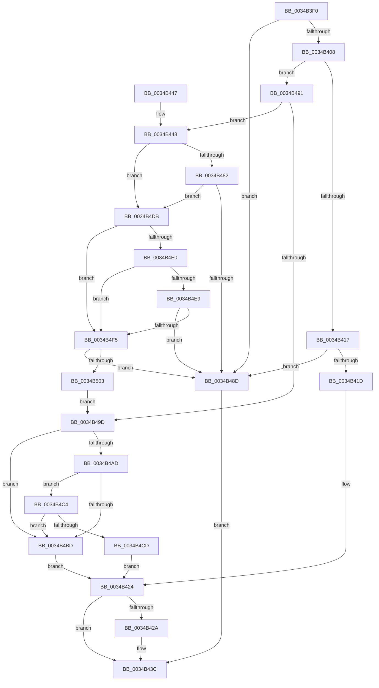

# KeInvalidAccessAllowed

- RVA: `0x0034B3F0`–`0x0034B505` (길이 `277` bytes)
- VA: `0x000000014034B3F0`
- 실행 섹션: `.text`
- PDB 이름 있음: `예`; PDB Function 태그: `아니요`
- unwind 정보 RVA: `0x0007859C`
- 디코드: `73`개 명령, `277/277` bytes 표시
- 미해석 바이트: `0` (있으면 어셈블리에 `.byte`로 보존)

> 이 문서는 커널 이미지의 기계어와 PDB 기호를 분석해 생성했습니다. 4번과 5번은 함수 원형과 자료형을 바이너리 사용 방식에서 추정한 C 해석이며 원본 소스 복구 결과는 아닙니다.

## 1. Dependencies

- 직접 호출 지점: **1**; 고유 호출 대상: **1**
- 직접 호출자로 확인된 함수: **10**
- RIP 상대 이미지 참조: **7**

### Outgoing calls
- `0x0034B4FA` → [KiRspInIstStack](../41/KiRspInIstStack_function_00418504.md) (function, `0x00418504`)

### Direct callers
- [sub_0027F19F](../27/Unknown_function_0027F19F.md) at `0x0027F1D2`
- [MiResolveProtoPteFault](../32/MiResolveProtoPteFault_function_00321750.md) at `0x00321E7E`
- [MiResolveProtoPteFault](../32/MiResolveProtoPteFault_function_00321750.md) at `0x00321FC3`
- [MiValidFault](../32/MiValidFault_function_003280B4.md) at `0x003284EE`
- [MiRaisedIrqlFault](MiRaisedIrqlFault_function_0034A6C8.md) at `0x0034A6EF`
- [MiRaisedIrqlFault](MiRaisedIrqlFault_function_0034A6C8.md) at `0x0034A80F`
- [MiSystemFault](MiSystemFault_function_0034AA64.md) at `0x0034AB5F`
- [MiSystemFault](MiSystemFault_function_0034AA64.md) at `0x0034B10E`
- [MiSystemFault](MiSystemFault_function_0034AA64.md) at `0x0034B268`
- [MiAllowGuardFault](MiAllowGuardFault_function_0034B5B0.md) at `0x0034B5DC`
- [MiResolveMappedFileFault](../36/MiResolveMappedFileFault_function_0036B640.md) at `0x0036BFC4`
- [sub_006E1C8E](../6E/Unknown_function_006E1C8E.md) at `0x006E1CCD`
- [sub_006E218A](../6E/Unknown_function_006E218A.md) at `0x006E21B9`
- [sub_006E21F4](../6E/Unknown_function_006E21F4.md) at `0x006E21F6`

### Static image references
- `0x0034B41D` → RVA `0x00FC74C0` (`ALMOSTRO`; read)
- `0x0034B451` → RVA `0x01201840` (`CFGRO`; read)
- `0x0034B459` → RVA `0x00FC5060` (`ALMOSTRO`; read)
- `0x0034B49D` → RVA `0x00FC6C10` (`ALMOSTRO`; read)
- `0x0034B4A4` → RVA `0x006BA587` (`ExpInterlockedPopEntrySListFault`; read)
- `0x0034B4B4` → RVA `0x00FC7450` (`ALMOSTRO`; read)
- `0x0034B4C4` → RVA `0x00FC7448` (`ALMOSTRO`; read)

## 2. Other-region calls and transfers

- 다른 실행 섹션으로 향하는 call: **0**
- 별도 외부 분기/꼬리 이동을 확인하지 못했습니다.

## 3. Assembly (complete function range)

```asm
0034B3F0  48 89 5C 24 08                  mov qword ptr [rsp + 8], rbx
0034B3F5  57                              push rdi
0034B3F6  48 83 EC 20                     sub rsp, 0x20
0034B3FA  8B FA                           mov edi, edx
0034B3FC  48 8B D9                        mov rbx, rcx
0034B3FF  48 85 C9                        test rcx, rcx
0034B402  0F 84 85 00 00 00               je 0x14034b48d
0034B408  0F B7 89 70 01 00 00            movzx ecx, word ptr [rcx + 0x170]
0034B40F  32 C0                           xor al, al
0034B411  66 83 F9 10                     cmp cx, 0x10
0034B415  74 7A                           je 0x14034b491
0034B417  66 83 F9 33                     cmp cx, 0x33
0034B41B  75 70                           jne 0x14034b48d
0034B41D  48 8B 0D 9C C0 C7 00            mov rcx, qword ptr [rip + 0xc7c09c]
0034B424  40 F6 C7 01                     test dil, 1
0034B428  75 12                           jne 0x14034b43c
0034B42A  48 39 8B 68 01 00 00            cmp qword ptr [rbx + 0x168], rcx
0034B431  BA 01 00 00 00                  mov edx, 1
0034B436  0F B6 C0                        movzx eax, al
0034B439  0F 44 C2                        cmove eax, edx
0034B43C  48 8B 5C 24 30                  mov rbx, qword ptr [rsp + 0x30]
0034B441  48 83 C4 20                     add rsp, 0x20
0034B445  5F                              pop rdi
0034B446  C3                              ret
0034B447  CC                              int3
0034B448  65 48 8B 04 25 18 00 00 00      mov rax, qword ptr gs:[0x18]
0034B451  44 0F B6 0D E7 63 EB 00         movzx r9d, byte ptr [rip + 0xeb63e7]
0034B459  44 8B 15 00 9C C7 00            mov r10d, dword ptr [rip + 0xc79c00]
0034B460  45 84 C9                        test r9b, r9b
0034B463  48 8B 93 80 01 00 00            mov rdx, qword ptr [rbx + 0x180]
0034B46A  48 8B 48 08                     mov rcx, qword ptr [rax + 8]
0034B46E  41 8B C2                        mov eax, r10d
0034B471  4C 8B 41 34                     mov r8, qword ptr [rcx + 0x34]
0034B475  B9 D0 01 00 00                  mov ecx, 0x1d0
0034B47A  0F 45 C1                        cmovne eax, ecx
0034B47D  49 3B D0                        cmp rdx, r8
0034B480  77 59                           ja 0x14034b4db
0034B482  49 8B C8                        mov rcx, r8
0034B485  48 2B C8                        sub rcx, rax
0034B488  48 3B D1                        cmp rdx, rcx
0034B48B  72 4E                           jb 0x14034b4db
0034B48D  32 C0                           xor al, al
0034B48F  EB AB                           jmp 0x14034b43c
0034B491  F7 83 78 01 00 00 00 02 00 00   test dword ptr [rbx + 0x178], 0x200
0034B49B  74 AB                           je 0x14034b448
0034B49D  83 3D 6C B7 C7 00 00            cmp dword ptr [rip + 0xc7b76c], 0
0034B4A4  48 8D 0D DC F0 36 00            lea rcx, [rip + 0x36f0dc]
0034B4AB  74 10                           je 0x14034b4bd
0034B4AD  48 8B 83 68 01 00 00            mov rax, qword ptr [rbx + 0x168]
0034B4B4  48 3B 05 95 BF C7 00            cmp rax, qword ptr [rip + 0xc7bf95]
0034B4BB  72 07                           jb 0x14034b4c4
0034B4BD  32 C0                           xor al, al
0034B4BF  E9 60 FF FF FF                  jmp 0x14034b424
0034B4C4  48 3B 05 7D BF C7 00            cmp rax, qword ptr [rip + 0xc7bf7d]
0034B4CB  72 F0                           jb 0x14034b4bd
0034B4CD  44 0F 20 C0                     mov rax, cr8
0034B4D1  3C 0F                           cmp al, 0xf
0034B4D3  0F 94 C0                        sete al
0034B4D6  E9 49 FF FF FF                  jmp 0x14034b424
0034B4DB  45 84 C9                        test r9b, r9b
0034B4DE  74 15                           je 0x14034b4f5
0034B4E0  4D 8B 48 08                     mov r9, qword ptr [r8 + 8]
0034B4E4  49 3B D1                        cmp rdx, r9
0034B4E7  77 0C                           ja 0x14034b4f5
0034B4E9  41 8D 4A E0                     lea ecx, [r10 - 0x20]
0034B4ED  4C 2B C9                        sub r9, rcx
0034B4F0  49 3B D1                        cmp rdx, r9
0034B4F3  73 98                           jae 0x14034b48d
0034B4F5  B9 02 00 00 00                  mov ecx, 2
0034B4FA  E8 05 D0 0C 00                  call 0x140418504
0034B4FF  85 C0                           test eax, eax
0034B501  75 8A                           jne 0x14034b48d
0034B503  EB 98                           jmp 0x14034b49d
```

## 4. C-style interpretation (structured pseudocode)

```c
__int64 __fastcall KeInvalidAccessAllowed(__int64 a1, int a2)
{
    __int64 result;
    __int64 v_rsp;
    unsigned __int64 v_stack_p8;

    v_stack_p8 = v_rbx;
    v_rsp = (v_rsp) - (32);
    if (a1 == 0) goto loc_0034B48D;
    result = 0;
    if (((unsigned __int16)(*(unsigned __int16 *)(a1 + 368))) == 16) goto loc_0034B491;
    if (((unsigned __int16)(*(unsigned __int16 *)(a1 + 368))) != 51) goto loc_0034B48D;
loc_0034B424:
    if ((((unsigned __int8)((unsigned int)(a2))) & (1)) == 0) {
        a2 = 1;
        result = 0;
        if ((*(unsigned __int64 *)(a1 + 360)) == (*(unsigned __int64 *)(v_rip + 13090972))) { result = a2; }
    }
    v_rsp = (v_rsp) + (32);
    return result;
loc_0034B448:
    result = (unsigned int)((unsigned int)((unsigned int)(*(unsigned int *)(v_rip + 13081600))));
    if ((unsigned __int8)(*(unsigned __int8 *)(v_rip + 15426535)) != 0) { result = 464; }
    if ((*(unsigned __int64 *)(v_stack_p8 + 384)) > (*(unsigned __int64 *)(*(unsigned __int64 *)(*(unsigned __int64 *)(gs_base + (0 + 24)) + 8) + 52))) goto loc_0034B4DB;
    a1 = (*(unsigned __int64 *)(*(unsigned __int64 *)(*(unsigned __int64 *)(gs_base + (0 + 24)) + 8) + 52)) - (result);
    if ((*(unsigned __int64 *)(v_stack_p8 + 384)) < a1) goto loc_0034B4DB;
loc_0034B48D:
    result = 0;
    goto loc_0034B43C;
loc_0034B491:
    if (((*(unsigned int *)(v_stack_p8 + 376)) & (512)) == 0) goto loc_0034B448;
loc_0034B49D:
    if ((*(unsigned int *)(v_rip + 13088620)) == 0) goto loc_0034B4BD;
    if ((*(unsigned __int64 *)(v_stack_p8 + 360)) < (*(unsigned __int64 *)(v_rip + 13090709))) goto loc_0034B4C4;
loc_0034B4BD:
    result = 0;
    goto loc_0034B424;
loc_0034B4C4:
    if (0 < (*(unsigned __int64 *)(v_rip + 13090685))) goto loc_0034B4BD;
    result = (((unsigned __int8)(v_cr8)) == 15) ? 1 : 0;
    goto loc_0034B424;
loc_0034B4DB:
    if ((unsigned __int8)(*(unsigned __int8 *)(v_rip + 15426535)) == 0) goto loc_0034B4F5;
    if ((*(unsigned __int64 *)(v_stack_p8 + 384)) > (*(unsigned __int64 *)(*(unsigned __int64 *)(*(unsigned __int64 *)(*(unsigned __int64 *)(gs_base + (0 + 24)) + 8) + 52) + 8))) goto loc_0034B4F5;
    a4 = (*(unsigned __int64 *)(*(unsigned __int64 *)(*(unsigned __int64 *)(*(unsigned __int64 *)(gs_base + (0 + 24)) + 8) + 52) + 8)) - ((unsigned int)(*(unsigned int *)(v_rip + 13081600)) - 32);
    if ((*(unsigned __int64 *)(v_stack_p8 + 384)) >= a4) goto loc_0034B48D;
loc_0034B4F5:
    result = KiRspInIstStack(2, *(unsigned __int64 *)(v_stack_p8 + 384), *(unsigned __int64 *)(*(unsigned __int64 *)(*(unsigned __int64 *)(gs_base + (0 + 24)) + 8) + 52), a4);
    if ((unsigned int)(result) != 0) goto loc_0034B48D;
    goto loc_0034B49D;
}
```

## 5. (Beta) C Style

```c
int64_t KeInvalidAccessAllowed(void *Arg1, int32_t Arg2)
{
    uint8_t *arg1 = (uint8_t *)Arg1;

    int64_t result;
    int64_t local_rsp;
    uint64_t v_stack_p8;

    v_stack_p8 = local_rbx;
    local_rsp = (local_rsp) - (32);
    if (Arg1 == NULL) goto loc_0034B48D;
    result = 0;
    if (((uint16_t)(*(uint16_t *)(arg1 + 0x170))) == 16) goto loc_0034B491;
    if (((uint16_t)(*(uint16_t *)(arg1 + 0x170))) != 51) goto loc_0034B48D;
loc_0034B424:
    if ((((uint8_t)((uint32_t)(Arg2))) & (1)) == 0) {
        Arg2 = 1;
        result = 0;
        if ((*(uint64_t *)(arg1 + 0x168)) == (*(uint64_t *)(v_rip + 0xC7C09C))) { result = Arg2; }
    }
    local_rsp = (local_rsp) + (32);
    return result;
loc_0034B448:
    result = (uint32_t)((uint32_t)((uint32_t)(*(uint32_t *)(v_rip + 0xC79C00))));
    if ((uint8_t)(*(uint8_t *)(v_rip + 0xEB63E7)) != 0) { result = 464; }
    if ((*(uint64_t *)(v_stack_p8 + 0x180)) > (*(uint64_t *)(*(uint64_t *)(*(uint64_t *)(gs_base + (0 + 0x18)) + 0x8) + 0x34))) goto loc_0034B4DB;
    Arg1 = (*(uint64_t *)(*(uint64_t *)(*(uint64_t *)(gs_base + (0 + 0x18)) + 0x8) + 0x34)) - (result);
    if ((*(uint64_t *)(v_stack_p8 + 0x180)) < Arg1) goto loc_0034B4DB;
loc_0034B48D:
    result = 0;
    goto loc_0034B43C;
loc_0034B491:
    if (((*(uint32_t *)(v_stack_p8 + 0x178)) & (512)) == 0) goto loc_0034B448;
loc_0034B49D:
    if ((*(uint32_t *)(v_rip + 0xC7B76C)) == 0) goto loc_0034B4BD;
    if ((*(uint64_t *)(v_stack_p8 + 0x168)) < (*(uint64_t *)(v_rip + 0xC7BF95))) goto loc_0034B4C4;
loc_0034B4BD:
    result = 0;
    goto loc_0034B424;
loc_0034B4C4:
    if (0 < (*(uint64_t *)(v_rip + 0xC7BF7D))) goto loc_0034B4BD;
    result = (((uint8_t)(v_cr8)) == 15) ? 1 : 0;
    goto loc_0034B424;
loc_0034B4DB:
    if ((uint8_t)(*(uint8_t *)(v_rip + 0xEB63E7)) == 0) goto loc_0034B4F5;
    if ((*(uint64_t *)(v_stack_p8 + 0x180)) > (*(uint64_t *)(*(uint64_t *)(*(uint64_t *)(*(uint64_t *)(gs_base + (0 + 0x18)) + 0x8) + 0x34) + 0x8))) goto loc_0034B4F5;
    a4 = (*(uint64_t *)(*(uint64_t *)(*(uint64_t *)(*(uint64_t *)(gs_base + (0 + 0x18)) + 0x8) + 0x34) + 0x8)) - ((uint32_t)(*(uint32_t *)(v_rip + 0xC79C00)) - 32);
    if ((*(uint64_t *)(v_stack_p8 + 0x180)) >= a4) goto loc_0034B48D;
loc_0034B4F5:
    result = KiRspInIstStack(2, *(uint64_t *)(v_stack_p8 + 0x180), *(uint64_t *)(*(uint64_t *)(*(uint64_t *)(gs_base + (0 + 0x18)) + 0x8) + 0x34), a4);
    if ((uint32_t)(result) != 0) goto loc_0034B48D;
    goto loc_0034B49D;
}
```

### 관측된 메모리 오프셋

구조체 형식이 확인되지 않은 접근은 인자 기준의 오프셋으로만 기록했습니다.

| 기준 인자 | 오프셋 표현 | 폭 (bit) | 접근 |
|---|---:|---:|---|
| `Arg1` | `+ 0x168` | `64` | `R` |
| `Arg1` | `+ 0x178` | `32` | `R` |
| `Arg1` | `+ 0x180` | `64` | `R` |

## 6. Execution-region graph

[열기: 2D/3D 그래프와 함수 탐색 컨트롤 패널](../../../control-panel.html?section=text&rva=0x0034B3F0&view=graph)

- 2D 그래프는 위에서 아래로 흐르고, 3D 그래프는 빈 공간을 드래그해 회전합니다. Shift+드래그는 이동, 휠은 확대·축소, 함수 노드 선택은 대상 보고서 이동입니다.

### Static fallback


