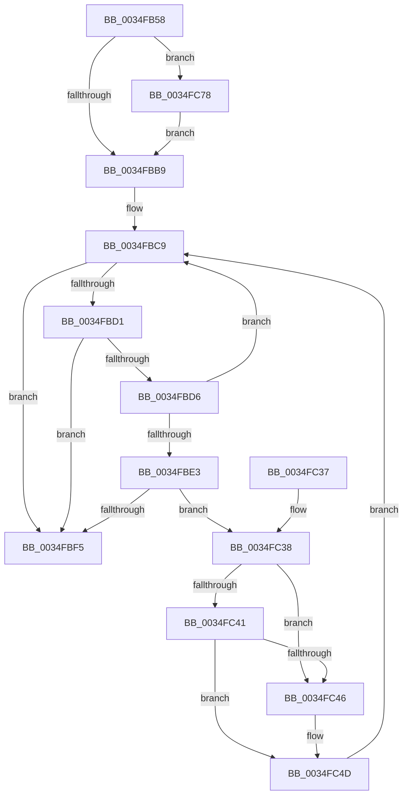

# KeTimeOutQueueWaiters

- RVA: `0x0034FB58`–`0x0034FC85` (길이 `301` bytes)
- VA: `0x000000014034FB58`
- 실행 섹션: `.text`
- PDB 이름 있음: `예`; PDB Function 태그: `아니요`
- unwind 정보 RVA: `0x00078CD4`
- 디코드: `82`개 명령, `301/301` bytes 표시
- 미해석 바이트: `0` (있으면 어셈블리에 `.byte`로 보존)

> 이 문서는 커널 이미지의 기계어와 PDB 기호를 분석해 생성했습니다. 4번과 5번은 함수 원형과 자료형을 바이너리 사용 방식에서 추정한 C 해석이며 원본 소스 복구 결과는 아닙니다.

## 1. Dependencies

- 직접 호출 지점: **4**; 고유 호출 대상: **4**
- 직접 호출자로 확인된 함수: **3**
- RIP 상대 이미지 참조: **3**

### Outgoing calls
- `0x0034FBBC` → [KiAcquireKobjectLockSafe](../25/KiAcquireKobjectLockSafe_function_00251C90.md) (function, `0x00251C90`)
- `0x0034FC13` → [KiExitDispatcher](../25/KiExitDispatcher_function_00251CF0.md) (function, `0x00251CF0`)
- `0x0034FC66` → [KiTryUnwaitThread](../35/KiTryUnwaitThread_function_003506D0.md) (function, `0x003506D0`)
- `0x0034FC7B` → [KiRaiseIrqlProcessIrqlFlags](../4F/KiRaiseIrqlProcessIrqlFlags_function_004F56FC.md) (function, `0x004F56FC`)

### Direct callers
- [NtSetInformationWorkerFactory](../35/NtSetInformationWorkerFactory_function_00350A30.md) at `0x0035106B`
- [ExpWorkerFactoryManagerThread](../65/ExpWorkerFactoryManagerThread_function_0065CCC0.md) at `0x0065CDD5`
- [ExpWorkQueueManagerThread](../../page/AF/ExpWorkQueueManagerThread_function_00AF6D60.md) at `0x00AF6F34`

### Static image references
- `0x0034FB88` → RVA `0x00FC6BC6` (`ALMOSTRO`; read)
- `0x0034FB92` → RVA `0x00FC7318` (`ALMOSTRO`; read)
- `0x0034FBAD` → RVA `0x00FC6D20` (`ALMOSTRO`; read)

## 2. Other-region calls and transfers

- 다른 실행 섹션으로 향하는 call: **0**
- 별도 외부 분기/꼬리 이동을 확인하지 못했습니다.

## 3. Assembly (complete function range)

```asm
0034FB58  48 89 5C 24 10                  mov qword ptr [rsp + 0x10], rbx
0034FB5D  48 89 6C 24 18                  mov qword ptr [rsp + 0x18], rbp
0034FB62  48 89 74 24 20                  mov qword ptr [rsp + 0x20], rsi
0034FB67  57                              push rdi
0034FB68  41 54                           push r12
0034FB6A  41 55                           push r13
0034FB6C  41 56                           push r14
0034FB6E  41 57                           push r15
0034FB70  48 83 EC 30                     sub rsp, 0x30
0034FB74  48 B8 20 03 00 00 80 F7 FF FF   movabs rax, 0xfffff78000000320
0034FB7E  48 8B F1                        mov rsi, rcx
0034FB81  33 ED                           xor ebp, ebp
0034FB83  45 8B E0                        mov r12d, r8d
0034FB86  8B 00                           mov eax, dword ptr [rax]
0034FB88  8A 0D 38 70 C7 00               mov cl, byte ptr [rip + 0xc77038]
0034FB8E  89 44 24 60                     mov dword ptr [rsp + 0x60], eax
0034FB92  48 8B 05 7F 77 C7 00            mov rax, qword ptr [rip + 0xc7777f]
0034FB99  48 F7 E2                        mul rdx
0034FB9C  48 8B DA                        mov rbx, rdx
0034FB9F  48 D3 EB                        shr rbx, cl
0034FBA2  45 0F 20 C6                     mov r14, cr8
0034FBA6  8D 55 02                        lea edx, [rbp + 2]
0034FBA9  44 0F 22 C2                     mov cr8, rdx
0034FBAD  39 2D 6D 71 C7 00               cmp dword ptr [rip + 0xc7716d], ebp
0034FBB3  0F 85 BF 00 00 00               jne 0x14034fc78
0034FBB9  48 8B CE                        mov rcx, rsi
0034FBBC  E8 CF 20 F0 FF                  call 0x140251c90
0034FBC1  48 8B 7E 10                     mov rdi, qword ptr [rsi + 0x10]
0034FBC5  4C 8D 7E 08                     lea r15, [rsi + 8]
0034FBC9  44 8B ED                        mov r13d, ebp
0034FBCC  49 3B FF                        cmp rdi, r15
0034FBCF  74 24                           je 0x14034fbf5
0034FBD1  41 3B EC                        cmp ebp, r12d
0034FBD4  73 1F                           jae 0x14034fbf5
0034FBD6  48 8B D7                        mov rdx, rdi
0034FBD9  48 8B 7F 08                     mov rdi, qword ptr [rdi + 8]
0034FBDD  80 7A 10 03                     cmp byte ptr [rdx + 0x10], 3
0034FBE1  75 E6                           jne 0x14034fbc9
0034FBE3  48 8B 42 18                     mov rax, qword ptr [rdx + 0x18]
0034FBE7  8B 4C 24 60                     mov ecx, dword ptr [rsp + 0x60]
0034FBEB  2B 88 B4 01 00 00               sub ecx, dword ptr [rax + 0x1b4]
0034FBF1  3B CB                           cmp ecx, ebx
0034FBF3  73 43                           jae 0x14034fc38
0034FBF5  F0 81 26 7F FF FF FF            lock and dword ptr [rsi], 0xffffff7f
0034FBFC  65 48 8B 0C 25 20 00 00 00      mov rcx, qword ptr gs:[0x20]
0034FC05  45 33 C9                        xor r9d, r9d
0034FC08  33 D2                           xor edx, edx
0034FC0A  44 88 74 24 20                  mov byte ptr [rsp + 0x20], r14b
0034FC0F  45 8D 41 01                     lea r8d, [r9 + 1]
0034FC13  E8 D8 20 F0 FF                  call 0x140251cf0
0034FC18  48 8B 5C 24 68                  mov rbx, qword ptr [rsp + 0x68]
0034FC1D  8B C5                           mov eax, ebp
0034FC1F  48 8B 6C 24 70                  mov rbp, qword ptr [rsp + 0x70]
0034FC24  48 8B 74 24 78                  mov rsi, qword ptr [rsp + 0x78]
0034FC29  48 83 C4 30                     add rsp, 0x30
0034FC2D  41 5F                           pop r15
0034FC2F  41 5E                           pop r14
0034FC31  41 5D                           pop r13
0034FC33  41 5C                           pop r12
0034FC35  5F                              pop rdi
0034FC36  C3                              ret
0034FC37  CC                              int3
0034FC38  48 8B 02                        mov rax, qword ptr [rdx]
0034FC3B  48 39 50 08                     cmp qword ptr [rax + 8], rdx
0034FC3F  75 05                           jne 0x14034fc46
0034FC41  48 39 17                        cmp qword ptr [rdi], rdx
0034FC44  74 07                           je 0x14034fc4d
0034FC46  B9 03 00 00 00                  mov ecx, 3
0034FC4B  CD 29                           int 0x29
0034FC4D  48 89 07                        mov qword ptr [rdi], rax
0034FC50  45 33 C9                        xor r9d, r9d
0034FC53  48 89 78 08                     mov qword ptr [rax + 8], rdi
0034FC57  41 B8 02 01 00 00               mov r8d, 0x102
0034FC5D  65 48 8B 0C 25 20 00 00 00      mov rcx, qword ptr gs:[0x20]
0034FC66  E8 65 0A 00 00                  call 0x1403506d0
0034FC6B  FF C5                           inc ebp
0034FC6D  84 C0                           test al, al
0034FC6F  41 0F 44 ED                     cmove ebp, r13d
0034FC73  E9 51 FF FF FF                  jmp 0x14034fbc9
0034FC78  41 8A CE                        mov cl, r14b
0034FC7B  E8 7C 5A 1A 00                  call 0x1404f56fc
0034FC80  E9 34 FF FF FF                  jmp 0x14034fbb9
```

## 4. C-style interpretation (structured pseudocode)

```c
__int64 __fastcall KeTimeOutQueueWaiters(__int64 a1, __int64 a2, int a3, int a4)
{
    __int64 result;
    __int64 v_rbp;
    __int64 v_rbx;
    __int64 v_rsp;
    unsigned __int8 v_stack_m38;
    unsigned __int64 v_stack_p10;
    unsigned __int64 v_stack_p18;
    unsigned __int64 v_stack_p20;
    unsigned int v_stack_p8;

    v_stack_p10 = v_rbx;
    v_stack_p18 = v_rbp;
    v_stack_p20 = v_rsi;
    v_rsp = (v_rsp) - (48);
    v_rbp = 0;
    v_stack_p8 = (unsigned int)((unsigned int)(*(unsigned int *)(result)));
    v_rbx = (a2) >> ((unsigned __int8)(*(unsigned __int8 *)(v_rip + 13070392)));
    if ((*(unsigned int *)(v_rip + 13070701)) != 0) goto loc_0034FC78;
loc_0034FBB9:
    result = KiAcquireKobjectLockSafe(a1, v_rbp + 2, a3, a4);
loc_0034FBC9:
    if ((*(unsigned __int64 *)(a1 + 16)) == (a1 + 8)) goto loc_0034FBF5;
    if (0 >= ((unsigned int)((unsigned int)(a3)))) goto loc_0034FBF5;
    if ((*(unsigned __int8 *)(*(unsigned __int64 *)(a1 + 16) + 16)) != 3) goto loc_0034FBC9;
    a1 = (unsigned int)(((unsigned int)(v_stack_p8)) - (*(unsigned int *)(*(unsigned __int64 *)(*(unsigned __int64 *)(a1 + 16) + 24) + 436)));
    if (((unsigned int)(a1)) >= ((unsigned int)(v_rbx))) goto loc_0034FC38;
loc_0034FBF5:
    a4 = 0;
    a2 = 0;
    v_stack_m38 = (unsigned __int8)(v_cr8);
    result = KiExitDispatcher(*(unsigned __int64 *)(gs_base + (0 + 32)), a2, a4 + 1, a4);
    v_rsp = (v_rsp) + (48);
    return 0;
loc_0034FC38:
    if ((*(unsigned __int64 *)(*(unsigned __int64 *)(a2) + 8)) != 0) goto loc_0034FC46;
    if ((*(unsigned __int64 *)(*(unsigned __int64 *)(*(unsigned __int64 *)(a1 + 16) + 8))) != 0) {
        a1 = 3;
    }
    *(unsigned __int64 *)(*(unsigned __int64 *)(*(unsigned __int64 *)(a1 + 16) + 8)) = *(unsigned __int64 *)(a2);
    a4 = 0;
    *(unsigned __int64 *)(*(unsigned __int64 *)(a2) + 8) = *(unsigned __int64 *)(*(unsigned __int64 *)(a1 + 16) + 8);
    result = KiTryUnwaitThread(*(unsigned __int64 *)(gs_base + (0 + 32)), a2, 258, a4);
    v_rbp = (unsigned int)((v_stack_p18) + 1);
    if ((unsigned __int8)(result) == 0) { v_rbp = 0; }
    goto loc_0034FBC9;
loc_0034FC78:
    result = KiRaiseIrqlProcessIrqlFlags((unsigned __int8)(v_cr8), a2, 258, a4);
    goto loc_0034FBB9;
}
```

## 5. (Beta) C Style

```c
int64_t KeTimeOutQueueWaiters(void *Arg1, int64_t Arg2, int32_t Arg3, int32_t Arg4)
{
    uint8_t *arg1 = (uint8_t *)Arg1;

    int64_t result;
    int64_t local_rbp;
    int64_t local_rbx;
    int64_t local_rsp;
    uint8_t v_stack_m38;
    uint64_t v_stack_p10;
    uint64_t v_stack_p18;
    uint64_t v_stack_p20;
    uint32_t v_stack_p8;

    v_stack_p10 = local_rbx;
    v_stack_p18 = local_rbp;
    v_stack_p20 = local_rsi;
    local_rsp = (local_rsp) - (48);
    local_rbp = 0;
    v_stack_p8 = (uint32_t)((uint32_t)(*(uint32_t *)(result)));
    local_rbx = (Arg2) >> ((uint8_t)(*(uint8_t *)(v_rip + 0xC77038)));
    if ((*(uint32_t *)(v_rip + 0xC7716D)) != 0) goto loc_0034FC78;
loc_0034FBB9:
    result = KiAcquireKobjectLockSafe(Arg1, local_rbp + 2, Arg3, Arg4);
loc_0034FBC9:
    if ((*(uint64_t *)(arg1 + 0x10)) == (Arg1 + 8)) goto loc_0034FBF5;
    if (0 >= ((uint32_t)((uint32_t)(Arg3)))) goto loc_0034FBF5;
    if ((*(uint8_t *)(*(uint64_t *)(arg1 + 0x10) + 0x10)) != 3) goto loc_0034FBC9;
    Arg1 = (uint32_t)(((uint32_t)(v_stack_p8)) - (*(uint32_t *)(*(uint64_t *)(*(uint64_t *)(arg1 + 0x10) + 0x18) + 0x1B4)));
    if (((uint32_t)(Arg1)) >= ((uint32_t)(local_rbx))) goto loc_0034FC38;
loc_0034FBF5:
    Arg4 = 0;
    Arg2 = 0;
    v_stack_m38 = (uint8_t)(v_cr8);
    result = KiExitDispatcher(*(uint64_t *)(gs_base + (0 + 0x20)), Arg2, Arg4 + 1, Arg4);
    local_rsp = (local_rsp) + (48);
    return 0;
loc_0034FC38:
    if ((*(uint64_t *)(*(uint64_t *)(Arg2) + 0x8)) != 0) goto loc_0034FC46;
    if ((*(uint64_t *)(*(uint64_t *)(*(uint64_t *)(arg1 + 0x10) + 0x8))) != 0) {
        Arg1 = 3;
    }
    *(uint64_t *)(*(uint64_t *)(*(uint64_t *)(arg1 + 0x10) + 0x8)) = *(uint64_t *)(Arg2);
    Arg4 = 0;
    *(uint64_t *)(*(uint64_t *)(Arg2) + 0x8) = *(uint64_t *)(*(uint64_t *)(arg1 + 0x10) + 0x8);
    result = KiTryUnwaitThread(*(uint64_t *)(gs_base + (0 + 0x20)), Arg2, 258, Arg4);
    local_rbp = (uint32_t)((v_stack_p18) + 1);
    if ((uint8_t)(result) == 0) { local_rbp = 0; }
    goto loc_0034FBC9;
loc_0034FC78:
    result = KiRaiseIrqlProcessIrqlFlags((uint8_t)(v_cr8), Arg2, 258, Arg4);
    goto loc_0034FBB9;
}
```

### 관측된 메모리 오프셋

구조체 형식이 확인되지 않은 접근은 인자 기준의 오프셋으로만 기록했습니다.

| 기준 인자 | 오프셋 표현 | 폭 (bit) | 접근 |
|---|---:|---:|---|
| `Arg1` | `+ 0x0` | `32` | `R/W` |
| `Arg1` | `+ 0x8` | `64` | `R` |
| `Arg1` | `+ 0x10` | `64` | `R` |

## 6. Execution-region graph

[열기: 2D/3D 그래프와 함수 탐색 컨트롤 패널](../../../control-panel.html?section=text&rva=0x0034FB58&view=graph)

- 2D 그래프는 위에서 아래로 흐르고, 3D 그래프는 빈 공간을 드래그해 회전합니다. Shift+드래그는 이동, 휠은 확대·축소, 함수 노드 선택은 대상 보고서 이동입니다.

### Static fallback


