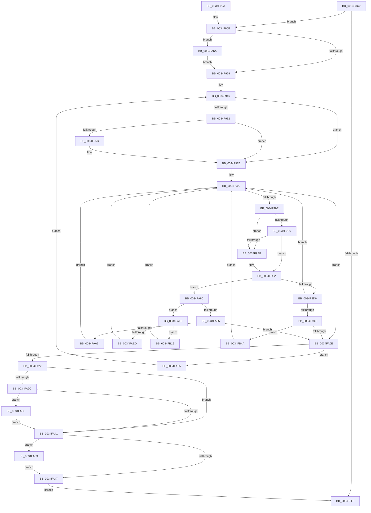

# KeWakeWaitChain

- RVA: `0x0034F8C0`–`0x0034FB4F` (길이 `655` bytes)
- VA: `0x000000014034F8C0`
- 실행 섹션: `.text`
- PDB 이름 있음: `예`; PDB Function 태그: `아니요`
- unwind 정보 RVA: `0x00078CB8`
- 디코드: `169`개 명령, `655/655` bytes 표시
- 미해석 바이트: `0` (있으면 어셈블리에 `.byte`로 보존)

> 이 문서는 커널 이미지의 기계어와 PDB 기호를 분석해 생성했습니다. 4번과 5번은 함수 원형과 자료형을 바이너리 사용 방식에서 추정한 C 해석이며 원본 소스 복구 결과는 아닙니다.

## 1. Dependencies

- 직접 호출 지점: **9**; 고유 호출 대상: **8**
- 직접 호출자로 확인된 함수: **3**
- RIP 상대 이미지 참조: **1**

### Outgoing calls
- `0x0034F976` → [KiAbConvertWaiterToOwnerEntry](../21/KiAbConvertWaiterToOwnerEntry_function_00219430.md) (function, `0x00219430`)
- `0x0034F97F` → [KiAcquireKobjectLockSafe](../25/KiAcquireKobjectLockSafe_function_00251C90.md) (function, `0x00251C90`)
- `0x0034F9E6` → [KiTryUnwaitThread](../35/KiTryUnwaitThread_function_003506D0.md) (function, `0x003506D0`)
- `0x0034FA33` → [KiRemoveBoostThread](../21/KiRemoveBoostThread_function_00219128.md) (function, `0x00219128`)
- `0x0034FA5B` → [KiExitDispatcher](../25/KiExitDispatcher_function_00251CF0.md) (function, `0x00251CF0`)
- `0x0034FA70` → [KiRaiseIrqlProcessIrqlFlags](../4F/KiRaiseIrqlProcessIrqlFlags_function_004F56FC.md) (function, `0x004F56FC`)
- `0x0034FA90` → [KiInsertQueueInternal](../21/KiInsertQueueInternal_function_00219B30.md) (function, `0x00219B30`)
- `0x0034FAFE` → [KiTryUnwaitThread](../35/KiTryUnwaitThread_function_003506D0.md) (function, `0x003506D0`)
- `0x0034FB2F` → [KeInsertQueueDpc](../20/KeInsertQueueDpc_function_00207C50.md) (function, `0x00207C50`)

### Direct callers
- [ExpConvertExclusiveToSharedLite](ExpConvertExclusiveToSharedLite_function_0034F7A8.md) at `0x0034F845`
- [ExpConvertFastResourceExclusiveToShared](../41/ExpConvertFastResourceExclusiveToShared_function_00416110.md) at `0x004161F0`
- [VrpRelinquishDiffHiveEntryTransitionOwner](../../page/93/VrpRelinquishDiffHiveEntryTransitionOwner_function_00936414.md) at `0x0093642B`

### Static image references
- `0x0034F91D` → RVA `0x00FC6D20` (`ALMOSTRO`; read)

## 2. Other-region calls and transfers

- 다른 실행 섹션으로 향하는 call: **0**
- 별도 외부 분기/꼬리 이동을 확인하지 못했습니다.

## 3. Assembly (complete function range)

```asm
0034F8C0  48 89 5C 24 10                  mov qword ptr [rsp + 0x10], rbx
0034F8C5  55                              push rbp
0034F8C6  56                              push rsi
0034F8C7  57                              push rdi
0034F8C8  41 54                           push r12
0034F8CA  41 55                           push r13
0034F8CC  41 56                           push r14
0034F8CE  41 57                           push r15
0034F8D0  48 83 EC 50                     sub rsp, 0x50
0034F8D4  48 8B 39                        mov rdi, qword ptr [rcx]
0034F8D7  33 DB                           xor ebx, ebx
0034F8D9  41 B9 01 00 00 00               mov r9d, 1
0034F8DF  41 8B E8                        mov ebp, r8d
0034F8E2  44 8B F2                        mov r14d, edx
0034F8E5  48 8B F1                        mov rsi, rcx
0034F8E8  45 8B F9                        mov r15d, r9d
0034F8EB  48 85 FF                        test rdi, rdi
0034F8EE  75 1B                           jne 0x14034f90b
0034F8F0  8B C3                           mov eax, ebx
0034F8F2  48 8B 9C 24 98 00 00 00         mov rbx, qword ptr [rsp + 0x98]
0034F8FA  48 83 C4 50                     add rsp, 0x50
0034F8FE  41 5F                           pop r15
0034F900  41 5E                           pop r14
0034F902  41 5D                           pop r13
0034F904  41 5C                           pop r12
0034F906  5F                              pop rdi
0034F907  5E                              pop rsi
0034F908  5D                              pop rbp
0034F909  C3                              ret
0034F90A  CC                              int3
0034F90B  44 0F 20 C0                     mov rax, cr8
0034F90F  48 89 44 24 40                  mov qword ptr [rsp + 0x40], rax
0034F914  B9 02 00 00 00                  mov ecx, 2
0034F919  44 0F 22 C1                     mov cr8, rcx
0034F91D  39 1D FD 73 C7 00               cmp dword ptr [rip + 0xc773fd], ebx
0034F923  0F 85 41 01 00 00               jne 0x14034fa6a
0034F929  65 48 8B 04 25 20 00 00 00      mov rax, qword ptr gs:[0x20]
0034F932  4C 8B E7                        mov r12, rdi
0034F935  48 89 44 24 38                  mov qword ptr [rsp + 0x38], rax
0034F93A  8B C5                           mov eax, ebp
0034F93C  83 E0 04                        and eax, 4
0034F93F  89 84 24 90 00 00 00            mov dword ptr [rsp + 0x90], eax
0034F946  4D 8D 2C 24                     lea r13, [r12]
0034F94A  4D 8B 24 24                     mov r12, qword ptr [r12]
0034F94E  85 C0                           test eax, eax
0034F950  74 29                           je 0x14034f97b
0034F952  49 8B 55 30                     mov rdx, qword ptr [r13 + 0x30]
0034F956  48 85 D2                        test rdx, rdx
0034F959  74 20                           je 0x14034f97b
0034F95B  48 8B 02                        mov rax, qword ptr [rdx]
0034F95E  48 8B CA                        mov rcx, rdx
0034F961  0F B6 42 08                     movzx eax, byte ptr [rdx + 8]
0034F965  83 E0 3F                        and eax, 0x3f
0034F968  4C 6B C0 58                     imul r8, rax, 0x58
0034F96C  49 2B C8                        sub rcx, r8
0034F96F  45 8B C1                        mov r8d, r9d
0034F972  48 8B 49 F0                     mov rcx, qword ptr [rcx - 0x10]
0034F976  E8 B5 9A EC FF                  call 0x140219430
0034F97B  49 8D 4D 18                     lea rcx, [r13 + 0x18]
0034F97F  E8 0C 23 F0 FF                  call 0x140251c90
0034F984  4D 8D 4D 18                     lea r9, [r13 + 0x18]
0034F988  45 89 7D 1C                     mov dword ptr [r13 + 0x1c], r15d
0034F98C  49 8B 49 08                     mov rcx, qword ptr [r9 + 8]
0034F990  49 8D 41 08                     lea rax, [r9 + 8]
0034F994  48 89 44 24 30                  mov qword ptr [rsp + 0x30], rax
0034F999  48 3B C8                        cmp rcx, rax
0034F99C  74 70                           je 0x14034fa0e
0034F99E  48 8B 11                        mov rdx, qword ptr [rcx]
0034F9A1  48 8B C1                        mov rax, rcx
0034F9A4  48 8B 49 08                     mov rcx, qword ptr [rcx + 8]
0034F9A8  48 89 94 24 A8 00 00 00         mov qword ptr [rsp + 0xa8], rdx
0034F9B0  48 39 42 08                     cmp qword ptr [rdx + 8], rax
0034F9B4  75 05                           jne 0x14034f9bb
0034F9B6  48 39 01                        cmp qword ptr [rcx], rax
0034F9B9  74 07                           je 0x14034f9c2
0034F9BB  B9 03 00 00 00                  mov ecx, 3
0034F9C0  CD 29                           int 0x29
0034F9C2  48 89 11                        mov qword ptr [rcx], rdx
0034F9C5  48 89 4A 08                     mov qword ptr [rdx + 8], rcx
0034F9C9  0F B6 48 10                     movzx ecx, byte ptr [rax + 0x10]
0034F9CD  41 3A CF                        cmp cl, r15b
0034F9D0  0F 85 AA 00 00 00               jne 0x14034fa80
0034F9D6  44 0F B7 40 12                  movzx r8d, word ptr [rax + 0x12]
0034F9DB  45 33 C9                        xor r9d, r9d
0034F9DE  48 8B 4C 24 38                  mov rcx, qword ptr [rsp + 0x38]
0034F9E3  48 8B D0                        mov rdx, rax
0034F9E6  E8 E5 0C 00 00                  call 0x1403506d0
0034F9EB  48 8B 8C 24 A8 00 00 00         mov rcx, qword ptr [rsp + 0xa8]
0034F9F3  4D 8D 4D 18                     lea r9, [r13 + 0x18]
0034F9F7  84 C0                           test al, al
0034F9F9  48 8B 44 24 30                  mov rax, qword ptr [rsp + 0x30]
0034F9FE  74 99                           je 0x14034f999
0034FA00  45 29 7D 1C                     sub dword ptr [r13 + 0x1c], r15d
0034FA04  4D 8D 4D 18                     lea r9, [r13 + 0x18]
0034FA08  0F 85 3C 01 00 00               jne 0x14034fb4a
0034FA0E  F0 41 81 65 18 7F FF FF FF      lock and dword ptr [r13 + 0x18], 0xffffff7f
0034FA17  FF C3                           inc ebx
0034FA19  4C 3B E7                        cmp r12, rdi
0034FA1C  0F 85 93 00 00 00               jne 0x14034fab5
0034FA22  48 8B 7C 24 38                  mov rdi, qword ptr [rsp + 0x38]
0034FA27  41 84 EF                        test r15b, bpl
0034FA2A  74 15                           je 0x14034fa41
0034FA2C  48 8B 57 08                     mov rdx, qword ptr [rdi + 8]
0034FA30  48 8B CF                        mov rcx, rdi
0034FA33  E8 F0 96 EC FF                  call 0x140219128
0034FA38  45 85 F6                        test r14d, r14d
0034FA3B  0F 85 95 00 00 00               jne 0x14034fad6
0034FA41  40 F6 C5 02                     test bpl, 2
0034FA45  75 7D                           jne 0x14034fac4
0034FA47  48 8B 44 24 40                  mov rax, qword ptr [rsp + 0x40]
0034FA4C  45 8B CE                        mov r9d, r14d
0034FA4F  45 8B C7                        mov r8d, r15d
0034FA52  88 44 24 20                     mov byte ptr [rsp + 0x20], al
0034FA56  33 D2                           xor edx, edx
0034FA58  48 8B CF                        mov rcx, rdi
0034FA5B  E8 90 22 F0 FF                  call 0x140251cf0
0034FA60  33 C0                           xor eax, eax
0034FA62  48 89 06                        mov qword ptr [rsi], rax
0034FA65  E9 86 FE FF FF                  jmp 0x14034f8f0
0034FA6A  0F B6 D1                        movzx edx, cl
0034FA6D  0F B6 C8                        movzx ecx, al
0034FA70  E8 87 5C 1A 00                  call 0x1404f56fc
0034FA75  41 B9 01 00 00 00               mov r9d, 1
0034FA7B  E9 A9 FE FF FF                  jmp 0x14034f929
0034FA80  80 F9 02                        cmp cl, 2
0034FA83  75 63                           jne 0x14034fae8
0034FA85  C6 40 11 05                     mov byte ptr [rax + 0x11], 5
0034FA89  48 8B D0                        mov rdx, rax
0034FA8C  48 8B 48 18                     mov rcx, qword ptr [rax + 0x18]
0034FA90  E8 9B A0 EC FF                  call 0x140219b30
0034FA95  45 29 7D 1C                     sub dword ptr [r13 + 0x1c], r15d
0034FA99  4D 8D 4D 18                     lea r9, [r13 + 0x18]
0034FA9D  0F 84 6B FF FF FF               je 0x14034fa0e
0034FAA3  48 8B 8C 24 A8 00 00 00         mov rcx, qword ptr [rsp + 0xa8]
0034FAAB  48 8B 44 24 30                  mov rax, qword ptr [rsp + 0x30]
0034FAB0  E9 E4 FE FF FF                  jmp 0x14034f999
0034FAB5  8B 84 24 90 00 00 00            mov eax, dword ptr [rsp + 0x90]
0034FABC  45 8B CF                        mov r9d, r15d
0034FABF  E9 82 FE FF FF                  jmp 0x14034f946
0034FAC4  41 83 FF 01                     cmp r15d, 1
0034FAC8  B8 01 00 00 00                  mov eax, 1
0034FACD  44 0F 44 F0                     cmove r14d, eax
0034FAD1  E9 71 FF FF FF                  jmp 0x14034fa47
0034FAD6  41 3B C6                        cmp eax, r14d
0034FAD9  41 BF 02 00 00 00               mov r15d, 2
0034FADF  44 0F 4F F0                     cmovg r14d, eax
0034FAE3  E9 59 FF FF FF                  jmp 0x14034fa41
0034FAE8  80 F9 04                        cmp cl, 4
0034FAEB  74 2C                           je 0x14034fb19
0034FAED  48 8B 4C 24 38                  mov rcx, qword ptr [rsp + 0x38]
0034FAF2  45 33 C9                        xor r9d, r9d
0034FAF5  41 B8 00 01 00 00               mov r8d, 0x100
0034FAFB  48 8B D0                        mov rdx, rax
0034FAFE  E8 CD 0B 00 00                  call 0x1403506d0
0034FB03  48 8B 8C 24 A8 00 00 00         mov rcx, qword ptr [rsp + 0xa8]
0034FB0B  4D 8D 4D 18                     lea r9, [r13 + 0x18]
0034FB0F  48 8B 44 24 30                  mov rax, qword ptr [rsp + 0x30]
0034FB14  E9 80 FE FF FF                  jmp 0x14034f999
0034FB19  C6 40 11 05                     mov byte ptr [rax + 0x11], 5
0034FB1D  4C 8B C0                        mov r8, rax
0034FB20  41 C7 41 04 00 00 00 00         mov dword ptr [r9 + 4], 0
0034FB28  49 8B D1                        mov rdx, r9
0034FB2B  48 8B 48 18                     mov rcx, qword ptr [rax + 0x18]
0034FB2F  E8 1C 81 EB FF                  call 0x140207c50
0034FB34  48 8B 8C 24 A8 00 00 00         mov rcx, qword ptr [rsp + 0xa8]
0034FB3C  4D 8D 4D 18                     lea r9, [r13 + 0x18]
0034FB40  48 8B 44 24 30                  mov rax, qword ptr [rsp + 0x30]
0034FB45  E9 4F FE FF FF                  jmp 0x14034f999
0034FB4A  E9 4A FE FF FF                  jmp 0x14034f999
```

## 4. C-style interpretation (structured pseudocode)

```c
__int64 __fastcall KeWakeWaitChain(__int64 a1, int a2, int a3)
{
    __int64 result;
    __int64 v_r14;
    __int64 v_rbx;
    __int64 v_rsp;
    unsigned __int64 v_stack_p10;
    unsigned __int8 v_stack_p20;
    unsigned __int64 v_stack_p30;
    unsigned __int64 v_stack_p38;
    unsigned __int64 v_stack_p40;
    unsigned int v_stack_p90;
    unsigned __int64 v_stack_pA8;

    v_stack_p10 = v_rbx;
    v_rsp = (v_rsp) - (80);
    v_rbx = 0;
    if (*(unsigned __int64 *)(a1) != 0) goto loc_0034F90B;
loc_0034F8F0:
    v_rsp = (v_rsp) + (80);
    return 0;
loc_0034F90B:
    v_stack_p40 = v_cr8;
    if ((*(unsigned int *)(v_rip + 13071357)) != ((unsigned int)(v_stack_p10))) goto loc_0034FA6A;
loc_0034F929:
    v_stack_p38 = *(unsigned __int64 *)(gs_base + (0 + 32));
    result = (unsigned int)(((unsigned int)((unsigned int)((unsigned int)(a3)))) & (4));
    v_stack_p90 = (unsigned int)(result);
loc_0034F946:
    if ((unsigned int)(result) == 0) goto loc_0034F97B;
    if (*(unsigned __int64 *)(*(unsigned __int64 *)(a1) + 48) != 0) {
        result = *(unsigned __int64 *)(*(unsigned __int64 *)(*(unsigned __int64 *)(a1) + 48));
        a1 = *(unsigned __int64 *)(*(unsigned __int64 *)(a1) + 48);
        result = *(unsigned __int8 *)(*(unsigned __int64 *)(*(unsigned __int64 *)(a1) + 48) + 8);
        result = (unsigned int)((result) & (63));
        a3 = (a3) * (result);
        a1 = (a1) - (a3);
        a3 = 1;
        a1 = *(unsigned __int64 *)(a1 - 16);
        result = KiAbConvertWaiterToOwnerEntry(a1, *(unsigned __int64 *)(*(unsigned __int64 *)(a1) + 48), a3, 1);
    }
    result = KiAcquireKobjectLockSafe(*(unsigned __int64 *)(a1) + 24, *(unsigned __int64 *)(*(unsigned __int64 *)(a1) + 48), a3, 1);
    *(unsigned int *)(*(unsigned __int64 *)(a1) + 28) = 1;
    v_stack_p30 = *(unsigned __int64 *)(a1) + 24 + 8;
loc_0034F999:
    if ((*(unsigned __int64 *)(*(unsigned __int64 *)(a1) + 24 + 8)) == (*(unsigned __int64 *)(a1) + 24 + 8)) goto loc_0034FA0E;
    v_stack_pA8 = *(unsigned __int64 *)(*(unsigned __int64 *)(*(unsigned __int64 *)(a1) + 24 + 8));
    if ((*(unsigned __int64 *)(*(unsigned __int64 *)(*(unsigned __int64 *)(*(unsigned __int64 *)(a1) + 24 + 8)) + 8)) != (*(unsigned __int64 *)(*(unsigned __int64 *)(a1) + 24 + 8))) goto loc_0034F9BB;
    if ((*(unsigned __int64 *)(*(unsigned __int64 *)(*(unsigned __int64 *)(*(unsigned __int64 *)(a1) + 24 + 8) + 8))) != (*(unsigned __int64 *)(*(unsigned __int64 *)(a1) + 24 + 8))) {
        a1 = 3;
    }
    *(unsigned __int64 *)(a1) = *(unsigned __int64 *)(*(unsigned __int64 *)(*(unsigned __int64 *)(a1) + 24 + 8));
    *(unsigned __int64 *)(*(unsigned __int64 *)(*(unsigned __int64 *)(*(unsigned __int64 *)(a1) + 24 + 8)) + 8) = a1;
    if (((unsigned __int8)(*(unsigned __int8 *)(*(unsigned __int64 *)(*(unsigned __int64 *)(a1) + 24 + 8) + 16))) != 1) goto loc_0034FA80;
    a4 = 0;
    result = KiTryUnwaitThread(v_stack_p38, *(unsigned __int64 *)(*(unsigned __int64 *)(a1) + 24 + 8), *(unsigned __int16 *)(*(unsigned __int64 *)(*(unsigned __int64 *)(a1) + 24 + 8) + 18), a4);
    if ((unsigned __int8)(result) == 0) goto loc_0034F999;
    if ((unsigned __int8)(result) != 0) goto loc_0034FB4A;
loc_0034FA0E:
    v_rbx = (unsigned int)((v_stack_p10) + 1);
    if ((*(unsigned __int64 *)(*(unsigned __int64 *)(a1))) != (*(unsigned __int64 *)(a1))) goto loc_0034FAB5;
    if (((1) & ((unsigned __int8)((unsigned int)(a3)))) == 0) goto loc_0034FA41;
    result = KiRemoveBoostThread(v_stack_p38, *(unsigned __int64 *)(v_stack_p38 + 8), *(unsigned __int16 *)(*(unsigned __int64 *)(*(unsigned __int64 *)(a1) + 24 + 8) + 18), *(unsigned __int64 *)(a1) + 24);
    if ((unsigned int)((unsigned int)(a2)) != 0) goto loc_0034FAD6;
loc_0034FA41:
    if ((((unsigned __int8)((unsigned int)(a3))) & (2)) != 0) goto loc_0034FAC4;
loc_0034FA47:
    v_stack_p20 = (unsigned __int8)(v_stack_p40);
    a2 = 0;
    result = KiExitDispatcher(v_stack_p38, a2, 1, (unsigned int)((unsigned int)((unsigned int)(a2))));
    result = 0;
    *(unsigned __int64 *)(a1) = 0;
    goto loc_0034F8F0;
loc_0034FA6A:
    result = KiRaiseIrqlProcessIrqlFlags(0, (unsigned __int8)(v_stack_p38), 1, (unsigned int)((unsigned int)((unsigned int)(a2))));
    goto loc_0034F929;
loc_0034FA80:
    if (0 != 2) goto loc_0034FAE8;
    *(unsigned __int8 *)(result + 17) = 5;
    result = KiInsertQueueInternal(*(unsigned __int64 *)(result + 24), result, 1, 1);
    if (0 == 2) goto loc_0034FA0E;
    goto loc_0034F999;
loc_0034FAB5:
    goto loc_0034F946;
loc_0034FAC4:
    v_r14 = (unsigned int)(a2);
    if (1 == 1) { v_r14 = 1; }
    goto loc_0034FA47;
loc_0034FAD6:
    if (1 > ((unsigned int)(v_r14))) { v_r14 = 1; }
    goto loc_0034FA41;
loc_0034FAE8:
    if (((unsigned __int8)(v_stack_pA8)) == 4) goto loc_0034FB19;
    a4 = 0;
    result = KiTryUnwaitThread(v_stack_p38, 1, 256, a4);
    goto loc_0034F999;
loc_0034FB19:
    *(unsigned __int8 *)(v_stack_p30 + 17) = 5;
    *(unsigned int *)(*(unsigned __int64 *)(a1) + 24 + 4) = 0;
    result = KeInsertQueueDpc(*(unsigned __int64 *)(v_stack_p30 + 24), *(unsigned __int64 *)(a1) + 24, v_stack_p30, *(unsigned __int64 *)(a1) + 24);
    goto loc_0034F999;
loc_0034FB4A:
    goto loc_0034F999;
}
```

## 5. (Beta) C Style

```c
int64_t KeWakeWaitChain(void *Arg1, int32_t Arg2, int32_t Arg3)
{
    uint8_t *arg1 = (uint8_t *)Arg1;

    int64_t result;
    int64_t local_r14;
    int64_t local_rbx;
    int64_t local_rsp;
    uint64_t v_stack_p10;
    uint8_t v_stack_p20;
    uint64_t v_stack_p30;
    uint64_t v_stack_p38;
    uint64_t v_stack_p40;
    uint32_t v_stack_p90;
    uint64_t v_stack_pA8;

    v_stack_p10 = local_rbx;
    local_rsp = (local_rsp) - (80);
    local_rbx = 0;
    if (*(uint64_t *)(arg1) != 0) goto loc_0034F90B;
loc_0034F8F0:
    local_rsp = (local_rsp) + (80);
    return 0;
loc_0034F90B:
    v_stack_p40 = v_cr8;
    if ((*(uint32_t *)(v_rip + 0xC773FD)) != ((uint32_t)(v_stack_p10))) goto loc_0034FA6A;
loc_0034F929:
    v_stack_p38 = *(uint64_t *)(gs_base + (0 + 0x20));
    result = (uint32_t)(((uint32_t)((uint32_t)((uint32_t)(Arg3)))) & (4));
    v_stack_p90 = (uint32_t)(result);
loc_0034F946:
    if ((uint32_t)(result) == 0) goto loc_0034F97B;
    if (*(uint64_t *)(*(uint64_t *)(arg1) + 0x30) != 0) {
        result = *(uint64_t *)(*(uint64_t *)(*(uint64_t *)(arg1) + 0x30));
        Arg1 = *(uint64_t *)(*(uint64_t *)(arg1) + 0x30);
        result = *(uint8_t *)(*(uint64_t *)(*(uint64_t *)(arg1) + 0x30) + 0x8);
        result = (uint32_t)((result) & (63));
        Arg3 = (Arg3) * (result);
        Arg1 = (Arg1) - (Arg3);
        Arg3 = 1;
        Arg1 = *(uint64_t *)(arg1 - 0x10);
        result = KiAbConvertWaiterToOwnerEntry(Arg1, *(uint64_t *)(*(uint64_t *)(arg1) + 0x30), Arg3, 1);
    }
    result = KiAcquireKobjectLockSafe(*(uint64_t *)(arg1) + 24, *(uint64_t *)(*(uint64_t *)(arg1) + 0x30), Arg3, 1);
    *(uint32_t *)(*(uint64_t *)(arg1) + 0x1C) = 1;
    v_stack_p30 = *(uint64_t *)(arg1) + 24 + 8;
loc_0034F999:
    if ((*(uint64_t *)(*(uint64_t *)(arg1) + 0x18 + 0x8)) == (*(uint64_t *)(arg1) + 24 + 8)) goto loc_0034FA0E;
    v_stack_pA8 = *(uint64_t *)(*(uint64_t *)(*(uint64_t *)(arg1) + 0x18 + 0x8));
    if ((*(uint64_t *)(*(uint64_t *)(*(uint64_t *)(*(uint64_t *)(arg1) + 0x18 + 0x8)) + 0x8)) != (*(uint64_t *)(*(uint64_t *)(arg1) + 0x18 + 0x8))) goto loc_0034F9BB;
    if ((*(uint64_t *)(*(uint64_t *)(*(uint64_t *)(*(uint64_t *)(arg1) + 0x18 + 0x8) + 0x8))) != (*(uint64_t *)(*(uint64_t *)(arg1) + 0x18 + 0x8))) {
        Arg1 = 3;
    }
    *(uint64_t *)(arg1) = *(uint64_t *)(*(uint64_t *)(*(uint64_t *)(arg1) + 0x18 + 0x8));
    *(void **)(*(uint64_t *)(*(uint64_t *)(*(uint64_t *)(arg1) + 0x18 + 0x8)) + 0x8) = Arg1;
    if (((uint8_t)(*(uint8_t *)(*(uint64_t *)(*(uint64_t *)(arg1) + 0x18 + 0x8) + 0x10))) != 1) goto loc_0034FA80;
    a4 = 0;
    result = KiTryUnwaitThread(v_stack_p38, *(uint64_t *)(*(uint64_t *)(arg1) + 0x18 + 0x8), *(uint16_t *)(*(uint64_t *)(*(uint64_t *)(arg1) + 0x18 + 0x8) + 0x12), a4);
    if ((uint8_t)(result) == 0) goto loc_0034F999;
    if ((uint8_t)(result) != 0) goto loc_0034FB4A;
loc_0034FA0E:
    local_rbx = (uint32_t)((v_stack_p10) + 1);
    if ((*(uint64_t *)(*(uint64_t *)(arg1))) != (*(uint64_t *)(arg1))) goto loc_0034FAB5;
    if (((1) & ((uint8_t)((uint32_t)(Arg3)))) == 0) goto loc_0034FA41;
    result = KiRemoveBoostThread(v_stack_p38, *(uint64_t *)(v_stack_p38 + 0x8), *(uint16_t *)(*(uint64_t *)(*(uint64_t *)(arg1) + 0x18 + 0x8) + 0x12), *(uint64_t *)(arg1) + 24);
    if ((uint32_t)((uint32_t)(Arg2)) != 0) goto loc_0034FAD6;
loc_0034FA41:
    if ((((uint8_t)((uint32_t)(Arg3))) & (2)) != 0) goto loc_0034FAC4;
loc_0034FA47:
    v_stack_p20 = (uint8_t)(v_stack_p40);
    Arg2 = 0;
    result = KiExitDispatcher(v_stack_p38, Arg2, 1, (uint32_t)((uint32_t)((uint32_t)(Arg2))));
    result = 0;
    *(uint64_t *)(arg1) = 0;
    goto loc_0034F8F0;
loc_0034FA6A:
    result = KiRaiseIrqlProcessIrqlFlags(0, (uint8_t)(v_stack_p38), 1, (uint32_t)((uint32_t)((uint32_t)(Arg2))));
    goto loc_0034F929;
loc_0034FA80:
    if (0 != 2) goto loc_0034FAE8;
    *(uint8_t *)(result + 0x11) = 5;
    result = KiInsertQueueInternal(*(uint64_t *)(result + 0x18), result, 1, 1);
    if (0 == 2) goto loc_0034FA0E;
    goto loc_0034F999;
loc_0034FAB5:
    goto loc_0034F946;
loc_0034FAC4:
    local_r14 = (uint32_t)(Arg2);
    if (1 == 1) { local_r14 = 1; }
    goto loc_0034FA47;
loc_0034FAD6:
    if (1 > ((uint32_t)(local_r14))) { local_r14 = 1; }
    goto loc_0034FA41;
loc_0034FAE8:
    if (((uint8_t)(v_stack_pA8)) == 4) goto loc_0034FB19;
    a4 = 0;
    result = KiTryUnwaitThread(v_stack_p38, 1, 256, a4);
    goto loc_0034F999;
loc_0034FB19:
    *(uint8_t *)(v_stack_p30 + 0x11) = 5;
    *(uint32_t *)(*(uint64_t *)(arg1) + 0x18 + 0x4) = 0;
    result = KeInsertQueueDpc(*(uint64_t *)(v_stack_p30 + 0x18), *(uint64_t *)(arg1) + 24, v_stack_p30, *(uint64_t *)(arg1) + 24);
    goto loc_0034F999;
loc_0034FB4A:
    goto loc_0034F999;
}
```

### 관측된 메모리 오프셋

구조체 형식이 확인되지 않은 접근은 인자 기준의 오프셋으로만 기록했습니다.

| 기준 인자 | 오프셋 표현 | 폭 (bit) | 접근 |
|---|---:|---:|---|
| `Arg1` | `+ 0x0` | `64` | `R` |
| `Arg1` | `+ 0x0` | `64` | `W` |

## 6. Execution-region graph

[열기: 2D/3D 그래프와 함수 탐색 컨트롤 패널](../../../control-panel.html?section=text&rva=0x0034F8C0&view=graph)

- 2D 그래프는 위에서 아래로 흐르고, 3D 그래프는 빈 공간을 드래그해 회전합니다. Shift+드래그는 이동, 휠은 확대·축소, 함수 노드 선택은 대상 보고서 이동입니다.

### Static fallback


