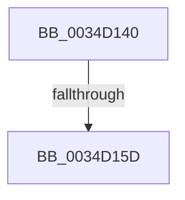

# KiIsThreadRankNonZero

- RVA: `0x0034D140`–`0x0034D16A` (길이 `42` bytes)
- VA: `0x000000014034D140`
- 실행 섹션: `.text`
- PDB 이름 있음: `예`; PDB Function 태그: `아니요`
- unwind 정보 RVA: `0x000788E8`
- 디코드: `10`개 명령, `42/42` bytes 표시
- 미해석 바이트: `0` (있으면 어셈블리에 `.byte`로 보존)

> 이 문서는 커널 이미지의 기계어와 PDB 기호를 분석해 생성했습니다. 4번과 5번은 함수 원형과 자료형을 바이너리 사용 방식에서 추정한 C 해석이며 원본 소스 복구 결과는 아닙니다.

## 1. Dependencies

- 직접 호출 지점: **0**; 고유 호출 대상: **0**
- 직접 호출자로 확인된 함수: **1**
- RIP 상대 이미지 참조: **0**

### Outgoing calls
- 직접 디코드된 call 명령이 없습니다.

### Direct callers
- [MiStoreUpdateMemoryConditions](MiStoreUpdateMemoryConditions_function_0034CF3C.md) at `0x0034D002`

### Static image references
- 디코드된 RIP-relative 메모리 참조가 없습니다.

## 2. Other-region calls and transfers

- 다른 실행 섹션으로 향하는 call: **0**
- call이 아닌 외부 분기/꼬리 이동: **2**
  - `0x0034D157` → [sub_0034D23E](Unknown_function_0034D23E.md) (`tail-transfer`)
  - `0x0034D164` → [sub_0034D23E](Unknown_function_0034D23E.md) (`tail-transfer`)

## 3. Assembly (complete function range)

```asm
0034D140  48 89 6C 24 18                  mov qword ptr [rsp + 0x18], rbp
0034D145  57                              push rdi
0034D146  48 83 EC 20                     sub rsp, 0x20
0034D14A  80 B9 C3 00 00 00 10            cmp byte ptr [rcx + 0xc3], 0x10
0034D151  48 8B EA                        mov rbp, rdx
0034D154  48 8B F9                        mov rdi, rcx
0034D157  0F 8D E1 00 00 00               jge 0x14034d23e
0034D15D  48 8B 41 68                     mov rax, qword ptr [rcx + 0x68]
0034D161  48 85 C0                        test rax, rax
0034D164  0F 84 D4 00 00 00               je 0x14034d23e
```

## 4. C-style interpretation (structured pseudocode)

```c
__int64 __fastcall KiIsThreadRankNonZero(__int64 a1, __int64 a2)
{
    __int64 v_rsp;
    unsigned __int64 v_stack_p18;

    v_stack_p18 = v_rbp;
    v_rsp = (v_rsp) - (32);
}
```

## 5. (Beta) C Style

```c
int64_t KiIsThreadRankNonZero(void *Arg1, int64_t Arg2)
{
    uint8_t *arg1 = (uint8_t *)Arg1;

    int64_t local_rsp;
    uint64_t v_stack_p18;

    v_stack_p18 = local_rbp;
    local_rsp = (local_rsp) - (32);
}
```

### 관측된 메모리 오프셋

구조체 형식이 확인되지 않은 접근은 인자 기준의 오프셋으로만 기록했습니다.

| 기준 인자 | 오프셋 표현 | 폭 (bit) | 접근 |
|---|---:|---:|---|
| `Arg1` | `+ 0x68` | `64` | `R` |
| `Arg1` | `+ 0xC3` | `8` | `R` |

## 6. Execution-region graph

[열기: 2D/3D 그래프와 함수 탐색 컨트롤 패널](../../../control-panel.html?section=text&rva=0x0034D140&view=graph)

- 2D 그래프는 위에서 아래로 흐르고, 3D 그래프는 빈 공간을 드래그해 회전합니다. Shift+드래그는 이동, 휠은 확대·축소, 함수 노드 선택은 대상 보고서 이동입니다.

### Static fallback


