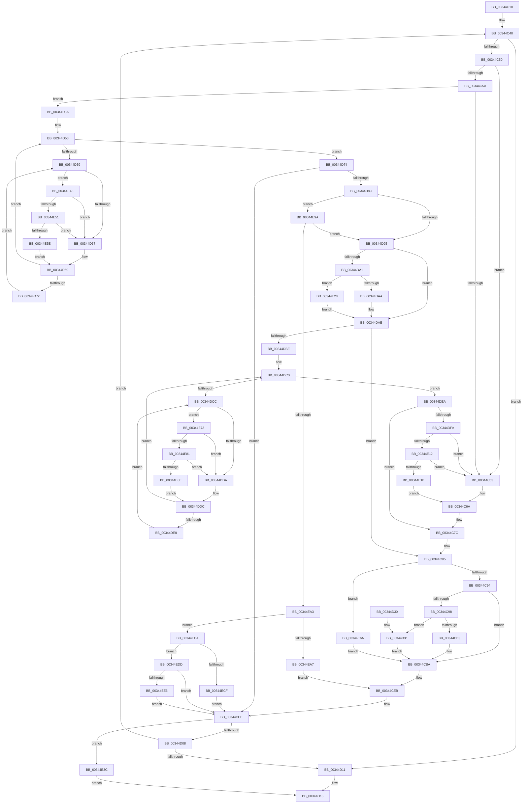

# KiWakeQueueWaiter

- RVA: `0x00344C10`–`0x00344EEF` (길이 `735` bytes)
- VA: `0x0000000140344C10`
- 실행 섹션: `.text`
- PDB 이름 있음: `예`; PDB Function 태그: `아니요`
- unwind 정보 RVA: `0x00077DEC`
- 디코드: `175`개 명령, `735/735` bytes 표시
- 미해석 바이트: `0` (있으면 어셈블리에 `.byte`로 보존)

> 이 문서는 커널 이미지의 기계어와 PDB 기호를 분석해 생성했습니다. 4번과 5번은 함수 원형과 자료형을 바이너리 사용 방식에서 추정한 C 해석이며 원본 소스 복구 결과는 아닙니다.

## 1. Dependencies

- 직접 호출 지점: **4**; 고유 호출 대상: **2**
- 직접 호출자로 확인된 함수: **8**
- RIP 상대 이미지 참조: **2**

### Outgoing calls
- `0x00344E51` → [KiCheckVpBackingLongSpinWaitHypercall](../30/KiCheckVpBackingLongSpinWaitHypercall_function_0030F490.md) (function, `0x0030F490`)
- `0x00344E60` → [HvlNotifyLongSpinWait](../30/HvlNotifyLongSpinWait_function_0030F460.md) (function, `0x0030F460`)
- `0x00344E81` → [KiCheckVpBackingLongSpinWaitHypercall](../30/KiCheckVpBackingLongSpinWaitHypercall_function_0030F490.md) (function, `0x0030F490`)
- `0x00344E90` → [HvlNotifyLongSpinWait](../30/HvlNotifyLongSpinWait_function_0030F460.md) (function, `0x0030F460`)

### Direct callers
- [AlpcpSignalAndWait](../2F/AlpcpSignalAndWait_function_002F9620.md) at `0x002F9814`
- [sub_003439EB](Unknown_function_003439EB.md) at `0x00343B4E`
- [sub_003C6884](../3C/Unknown_function_003C6884.md) at `0x003C689D`
- [KiActivateWaiterKQueue](../3C/KiActivateWaiterKQueue_function_003C6950.md) at `0x003C69CE`
- [IopPassiveInterruptDpc](../46/IopPassiveInterruptDpc_function_00469D40.md) at `0x00469DD9`
- [KeInsertQueue](../46/KeInsertQueue_function_0046C8F0.md) at `0x0046C980`
- [FsRtlpPostStackOverflow](../58/FsRtlpPostStackOverflow_function_0058351C.md) at `0x0058363D`
- [KeInsertHeadQueue](../5B/KeInsertHeadQueue_function_005BE5D0.md) at `0x005BE67B`

### Static image references
- `0x00344D5B` → RVA `0x00FC52AC` (`ALMOSTRO`; reference)
- `0x00344E43` → RVA `0x00FC6AB8` (`ALMOSTRO`; read)

## 2. Other-region calls and transfers

- 다른 실행 섹션으로 향하는 call: **0**
- 별도 외부 분기/꼬리 이동을 확인하지 못했습니다.

## 3. Assembly (complete function range)

```asm
00344C10  48 89 5C 24 08                  mov qword ptr [rsp + 8], rbx
00344C15  48 89 6C 24 10                  mov qword ptr [rsp + 0x10], rbp
00344C1A  48 89 74 24 18                  mov qword ptr [rsp + 0x18], rsi
00344C1F  57                              push rdi
00344C20  41 54                           push r12
00344C22  41 55                           push r13
00344C24  41 56                           push r14
00344C26  41 57                           push r15
00344C28  48 83 EC 20                     sub rsp, 0x20
00344C2C  4C 8B 72 08                     mov r14, qword ptr [rdx + 8]
00344C30  4C 8D 7A 08                     lea r15, [rdx + 8]
00344C34  4D 8B E0                        mov r12, r8
00344C37  4C 8B E9                        mov r13, rcx
00344C3A  66 0F 1F 44 00 00               nop word ptr [rax + rax]
00344C40  49 8B FE                        mov rdi, r14
00344C43  4D 8B 36                        mov r14, qword ptr [r14]
00344C46  80 7F 10 03                     cmp byte ptr [rdi + 0x10], 3
00344C4A  0F 85 C1 00 00 00               jne 0x140344d11
00344C50  48 8B 47 08                     mov rax, qword ptr [rdi + 8]
00344C54  49 39 7E 08                     cmp qword ptr [r14 + 8], rdi
00344C58  75 09                           jne 0x140344c63
00344C5A  48 39 38                        cmp qword ptr [rax], rdi
00344C5D  0F 84 D7 00 00 00               je 0x140344d3a
00344C63  B9 03 00 00 00                  mov ecx, 3
00344C68  CD 29                           int 0x29
00344C6A  48 89 11                        mov qword ptr [rcx], rdx
00344C6D  48 89 4A 08                     mov qword ptr [rdx + 8], rcx
00344C71  48 C7 83 C8 02 00 00 00 00 00 00  mov qword ptr [rbx + 0x2c8], 0
00344C7C  F0 48 83 A6 D0 83 00 00 00      lock and qword ptr [rsi + 0x83d0], 0
00344C85  0F B6 83 84 01 00 00            movzx eax, byte ptr [rbx + 0x184]
00344C8C  3C 01                           cmp al, 1
00344C8E  0F 84 D6 01 00 00               je 0x140344e6a
00344C94  3C 05                           cmp al, 5
00344C96  75 22                           jne 0x140344cba
00344C98  48 B8 20 03 00 00 80 F7 FF FF   movabs rax, 0xfffff78000000320
00344CA2  8B 08                           mov ecx, dword ptr [rax]
00344CA4  2B 8B B4 01 00 00               sub ecx, dword ptr [rbx + 0x1b4]
00344CAA  80 BB 87 01 00 00 00            cmp byte ptr [rbx + 0x187], 0
00344CB1  74 7E                           je 0x140344d31
00344CB3  48 01 8B E8 03 00 00            add qword ptr [rbx + 0x3e8], rcx
00344CBA  C6 83 84 01 00 00 07            mov byte ptr [rbx + 0x184], 7
00344CC1  48 8D 8B D8 00 00 00            lea rcx, [rbx + 0xd8]
00344CC8  49 8B 85 08 2D 00 00            mov rax, qword ptr [r13 + 0x2d08]
00344CCF  48 89 01                        mov qword ptr [rcx], rax
00344CD2  49 89 8D 08 2D 00 00            mov qword ptr [r13 + 0x2d08], rcx
00344CD9  4C 89 A3 C8 00 00 00            mov qword ptr [rbx + 0xc8], r12
00344CE0  48 C7 83 D0 03 00 00 00 00 00 00  mov qword ptr [rbx + 0x3d0], 0
00344CEB  40 B5 01                        mov bpl, 1
00344CEE  48 C7 43 40 00 00 00 00         mov qword ptr [rbx + 0x40], 0
00344CF6  0F B6 47 11                     movzx eax, byte ptr [rdi + 0x11]
00344CFA  FE C0                           inc al
00344CFC  88 47 11                        mov byte ptr [rdi + 0x11], al
00344CFF  40 84 ED                        test bpl, bpl
00344D02  0F 85 34 01 00 00               jne 0x140344e3c
00344D08  4D 3B F7                        cmp r14, r15
00344D0B  0F 85 2F FF FF FF               jne 0x140344c40
00344D11  32 C0                           xor al, al
00344D13  48 8B 5C 24 50                  mov rbx, qword ptr [rsp + 0x50]
00344D18  48 8B 6C 24 58                  mov rbp, qword ptr [rsp + 0x58]
00344D1D  48 8B 74 24 60                  mov rsi, qword ptr [rsp + 0x60]
00344D22  48 83 C4 20                     add rsp, 0x20
00344D26  41 5F                           pop r15
00344D28  41 5E                           pop r14
00344D2A  41 5D                           pop r13
00344D2C  41 5C                           pop r12
00344D2E  5F                              pop rdi
00344D2F  C3                              ret
00344D30  CC                              int3
00344D31  48 01 8B E0 03 00 00            add qword ptr [rbx + 0x3e0], rcx
00344D38  EB 80                           jmp 0x140344cba
00344D3A  4C 89 30                        mov qword ptr [rax], r14
00344D3D  40 32 ED                        xor bpl, bpl
00344D40  49 89 46 08                     mov qword ptr [r14 + 8], rax
00344D44  33 F6                           xor esi, esi
00344D46  48 8B 5F 18                     mov rbx, qword ptr [rdi + 0x18]
00344D4A  66 0F 1F 44 00 00               nop word ptr [rax + rax]
00344D50  F0 48 0F BA 6B 40 00            lock bts qword ptr [rbx + 0x40], 0
00344D57  73 1B                           jae 0x140344d74
00344D59  FF C6                           inc esi
00344D5B  85 35 4B 05 C8 00               test dword ptr [rip + 0xc8054b], esi
00344D61  0F 84 DC 00 00 00               je 0x140344e43
00344D67  F3 90                           pause
00344D69  48 8B 43 40                     mov rax, qword ptr [rbx + 0x40]
00344D6D  48 85 C0                        test rax, rax
00344D70  74 DE                           je 0x140344d50
00344D72  EB E5                           jmp 0x140344d59
00344D74  0F B6 83 84 01 00 00            movzx eax, byte ptr [rbx + 0x184]
00344D7B  3C 05                           cmp al, 5
00344D7D  0F 85 6B FF FF FF               jne 0x140344cee
00344D83  0F B6 4B 70                     movzx ecx, byte ptr [rbx + 0x70]
00344D87  8B C1                           mov eax, ecx
00344D89  83 E0 07                        and eax, 7
00344D8C  83 F8 01                        cmp eax, 1
00344D8F  0F 85 05 01 00 00               jne 0x140344e9a
00344D95  48 8B 93 E8 00 00 00            mov rdx, qword ptr [rbx + 0xe8]
00344D9C  48 85 D2                        test rdx, rdx
00344D9F  74 0D                           je 0x140344dae
00344DA1  0F B6 02                        movzx eax, byte ptr [rdx]
00344DA4  24 7F                           and al, 0x7f
00344DA6  3C 15                           cmp al, 0x15
00344DA8  74 76                           je 0x140344e20
00344DAA  F0 FF 42 28                     lock inc dword ptr [rdx + 0x28]
00344DAE  48 8B B3 C8 02 00 00            mov rsi, qword ptr [rbx + 0x2c8]
00344DB5  48 85 F6                        test rsi, rsi
00344DB8  0F 84 C7 FE FF FF               je 0x140344c85
00344DBE  33 ED                           xor ebp, ebp
00344DC0  F0 48 0F BA AE D0 83 00 00 00   lock bts qword ptr [rsi + 0x83d0], 0
00344DCA  73 1E                           jae 0x140344dea
00344DCC  FF C5                           inc ebp
00344DCE  85 2D D8 04 C8 00               test dword ptr [rip + 0xc804d8], ebp
00344DD4  0F 84 99 00 00 00               je 0x140344e73
00344DDA  F3 90                           pause
00344DDC  48 8B 86 D0 83 00 00            mov rax, qword ptr [rsi + 0x83d0]
00344DE3  48 85 C0                        test rax, rax
00344DE6  74 D8                           je 0x140344dc0
00344DE8  EB E2                           jmp 0x140344dcc
00344DEA  48 8B 83 C8 02 00 00            mov rax, qword ptr [rbx + 0x2c8]
00344DF1  48 85 C0                        test rax, rax
00344DF4  0F 84 82 FE FF FF               je 0x140344c7c
00344DFA  48 8D 83 D8 00 00 00            lea rax, [rbx + 0xd8]
00344E01  48 8B 10                        mov rdx, qword ptr [rax]
00344E04  48 8B 48 08                     mov rcx, qword ptr [rax + 8]
00344E08  48 39 42 08                     cmp qword ptr [rdx + 8], rax
00344E0C  0F 85 51 FE FF FF               jne 0x140344c63
00344E12  48 39 01                        cmp qword ptr [rcx], rax
00344E15  0F 85 48 FE FF FF               jne 0x140344c63
00344E1B  E9 4A FE FF FF                  jmp 0x140344c6a
00344E20  8B 83 1C 02 00 00               mov eax, dword ptr [rbx + 0x21c]
00344E26  0F B6 C0                        movzx eax, al
00344E29  89 83 1C 02 00 00               mov dword ptr [rbx + 0x21c], eax
00344E2F  F0 FF 84 82 18 02 00 00         lock inc dword ptr [rdx + rax*4 + 0x218]
00344E37  E9 72 FF FF FF                  jmp 0x140344dae
00344E3C  B0 01                           mov al, 1
00344E3E  E9 D0 FE FF FF                  jmp 0x140344d13
00344E43  8B 05 6F 1C C8 00               mov eax, dword ptr [rip + 0xc81c6f]
00344E49  A8 40                           test al, 0x40
00344E4B  0F 84 16 FF FF FF               je 0x140344d67
00344E51  E8 3A A6 FC FF                  call 0x14030f490
00344E56  84 C0                           test al, al
00344E58  0F 84 09 FF FF FF               je 0x140344d67
00344E5E  8B CE                           mov ecx, esi
00344E60  E8 FB A5 FC FF                  call 0x14030f460
00344E65  E9 FF FE FF FF                  jmp 0x140344d69
00344E6A  83 4B 74 02                     or dword ptr [rbx + 0x74], 2
00344E6E  E9 47 FE FF FF                  jmp 0x140344cba
00344E73  8B 05 3F 1C C8 00               mov eax, dword ptr [rip + 0xc81c3f]
00344E79  A8 40                           test al, 0x40
00344E7B  0F 84 59 FF FF FF               je 0x140344dda
00344E81  E8 0A A6 FC FF                  call 0x14030f490
00344E86  84 C0                           test al, al
00344E88  0F 84 4C FF FF FF               je 0x140344dda
00344E8E  8B CD                           mov ecx, ebp
00344E90  E8 CB A5 FC FF                  call 0x14030f460
00344E95  E9 42 FF FF FF                  jmp 0x140344ddc
00344E9A  83 F8 04                        cmp eax, 4
00344E9D  0F 84 F2 FE FF FF               je 0x140344d95
00344EA3  85 C0                           test eax, eax
00344EA5  75 23                           jne 0x140344eca
00344EA7  80 E1 FA                        and cl, 0xfa
00344EAA  80 C9 02                        or cl, 2
00344EAD  88 4B 70                        mov byte ptr [rbx + 0x70], cl
00344EB0  4C 89 A3 C8 00 00 00            mov qword ptr [rbx + 0xc8], r12
00344EB7  48 C7 83 D0 03 00 00 00 00 00 00  mov qword ptr [rbx + 0x3d0], 0
00344EC2  88 47 11                        mov byte ptr [rdi + 0x11], al
00344EC5  E9 21 FE FF FF                  jmp 0x140344ceb
00344ECA  83 F8 05                        cmp eax, 5
00344ECD  75 0E                           jne 0x140344edd
00344ECF  80 E1 FE                        and cl, 0xfe
00344ED2  80 C9 06                        or cl, 6
00344ED5  88 4B 70                        mov byte ptr [rbx + 0x70], cl
00344ED8  E9 11 FE FF FF                  jmp 0x140344cee
00344EDD  83 F8 03                        cmp eax, 3
00344EE0  0F 85 08 FE FF FF               jne 0x140344cee
00344EE6  C6 47 11 02                     mov byte ptr [rdi + 0x11], 2
00344EEA  E9 FF FD FF FF                  jmp 0x140344cee
```

## 4. C-style interpretation (structured pseudocode)

```c
__int64 __fastcall KiWakeQueueWaiter(__int64 a1, __int64 a2, __int64 a3)
{
    __int64 result;
    __int64 v_rbp;
    __int64 v_rsi;
    __int64 v_rsp;
    unsigned __int64 v_stack_p10;
    unsigned __int64 v_stack_p18;
    unsigned __int64 v_stack_p8;

    v_stack_p8 = v_rbx;
    v_stack_p10 = v_rbp;
    v_stack_p18 = v_rsi;
    v_rsp = (v_rsp) - (32);
loc_00344C40:
    if ((*(unsigned __int8 *)(*(unsigned __int64 *)(a2 + 8) + 16)) != 3) goto loc_00344D11;
    if ((*(unsigned __int64 *)(*(unsigned __int64 *)(*(unsigned __int64 *)(a2 + 8)) + 8)) != (*(unsigned __int64 *)(a2 + 8))) goto loc_00344C63;
    if ((*(unsigned __int64 *)(*(unsigned __int64 *)(*(unsigned __int64 *)(a2 + 8) + 8))) == (*(unsigned __int64 *)(a2 + 8))) goto loc_00344D3A;
loc_00344C63:
loc_00344C6A:
    *(unsigned __int64 *)(3) = a2;
    *(unsigned __int64 *)(a2 + 8) = 3;
    *(unsigned __int64 *)(v_rbx + 712) = 0;
loc_00344C7C:
loc_00344C85:
    if (((unsigned __int8)(*(unsigned __int8 *)(v_rbx + 388))) == 1) goto loc_00344E6A;
    if (((unsigned __int8)(*(unsigned __int8 *)(v_rbx + 388))) != 5) goto loc_00344CBA;
    a1 = (unsigned int)(((unsigned int)(*(unsigned int *)(*(unsigned __int8 *)(v_rbx + 388)))) - (*(unsigned int *)(v_rbx + 436)));
    if ((*(unsigned __int8 *)(v_rbx + 391)) == 0) goto loc_00344D31;
loc_00344CBA:
    *(unsigned __int8 *)(v_rbx + 388) = 7;
    *(unsigned __int64 *)(v_rbx + 216) = *(unsigned __int64 *)(a1 + 11528);
    *(unsigned __int64 *)(a1 + 11528) = v_rbx + 216;
    *(unsigned __int64 *)(v_rbx + 200) = a3;
    *(unsigned __int64 *)(v_rbx + 976) = 0;
loc_00344CEB:
loc_00344CEE:
    *(unsigned __int64 *)(v_rbx + 64) = 0;
    result = (unsigned __int8)((*(unsigned __int8 *)(*(unsigned __int64 *)(a2 + 8) + 17)) + 1);
    *(unsigned __int8 *)(*(unsigned __int64 *)(a2 + 8) + 17) = (unsigned __int8)(result);
    if (1 != 0) goto loc_00344E3C;
    if ((*(unsigned __int64 *)(*(unsigned __int64 *)(a2 + 8))) != (a2 + 8)) goto loc_00344C40;
loc_00344D11:
    result = 0;
loc_00344D13:
    v_rsp = (v_rsp) + (32);
    return result;
loc_00344D31:
    goto loc_00344CBA;
loc_00344D3A:
    *(unsigned __int64 *)(result) = *(unsigned __int64 *)(*(unsigned __int64 *)(a2 + 8));
    v_rbp = 0;
    *(unsigned __int64 *)(*(unsigned __int64 *)(*(unsigned __int64 *)(a2 + 8)) + 8) = 0;
    v_rsi = 0;
loc_00344D50:
    if (condition_is_above_or_equal) goto loc_00344D74;
loc_00344D59:
    v_rsi = (unsigned int)((v_rsi) + 1);
    if (((*(unsigned int *)(v_rip + 13108555)) & ((unsigned int)(v_rsi))) == 0) goto loc_00344E43;
loc_00344D67:
loc_00344D69:
    if (*(unsigned __int64 *)(*(unsigned __int64 *)(*(unsigned __int64 *)(a2 + 8) + 24) + 64) == 0) goto loc_00344D50;
    goto loc_00344D59;
loc_00344D74:
    if (((unsigned __int8)(*(unsigned __int8 *)(*(unsigned __int64 *)(*(unsigned __int64 *)(a2 + 8) + 24) + 388))) != 5) goto loc_00344CEE;
    result = (unsigned int)(((unsigned int)((unsigned int)(*(unsigned __int8 *)(*(unsigned __int64 *)(*(unsigned __int64 *)(a2 + 8) + 24) + 112)))) & (7));
    if (((unsigned int)(result)) != 1) goto loc_00344E9A;
loc_00344D95:
    if (*(unsigned __int64 *)(*(unsigned __int64 *)(*(unsigned __int64 *)(a2 + 8) + 24) + 232) == 0) goto loc_00344DAE;
    result = (unsigned __int8)((*(unsigned __int8 *)(*(unsigned __int64 *)(*(unsigned __int64 *)(*(unsigned __int64 *)(a2 + 8) + 24) + 232))) & (127));
    if (((unsigned __int8)(result)) == 21) goto loc_00344E20;
loc_00344DAE:
    if (*(unsigned __int64 *)(*(unsigned __int64 *)(*(unsigned __int64 *)(a2 + 8) + 24) + 712) == 0) goto loc_00344C85;
    v_rbp = 0;
loc_00344DC0:
    if (condition_is_above_or_equal) goto loc_00344DEA;
loc_00344DCC:
    v_rbp = (unsigned int)((v_rbp) + 1);
    if (((*(unsigned int *)(v_rip + 13108440)) & ((unsigned int)(v_rbp))) == 0) goto loc_00344E73;
loc_00344DDA:
loc_00344DDC:
    if (*(unsigned __int64 *)(*(unsigned __int64 *)(*(unsigned __int64 *)(*(unsigned __int64 *)(a2 + 8) + 24) + 712) + 33744) == 0) goto loc_00344DC0;
    goto loc_00344DCC;
loc_00344DEA:
    if (*(unsigned __int64 *)(*(unsigned __int64 *)(*(unsigned __int64 *)(a2 + 8) + 24) + 712) == 0) goto loc_00344C7C;
    if ((*(unsigned __int64 *)(*(unsigned __int64 *)(*(unsigned __int64 *)(*(unsigned __int64 *)(a2 + 8) + 24) + 216) + 8)) != (*(unsigned __int64 *)(*(unsigned __int64 *)(a2 + 8) + 24) + 216)) goto loc_00344C63;
    if ((*(unsigned __int64 *)(*(unsigned __int64 *)(*(unsigned __int64 *)(*(unsigned __int64 *)(a2 + 8) + 24) + 216 + 8))) != (*(unsigned __int64 *)(*(unsigned __int64 *)(a2 + 8) + 24) + 216)) goto loc_00344C63;
    goto loc_00344C6A;
loc_00344E20:
    *(unsigned int *)(*(unsigned __int64 *)(*(unsigned __int64 *)(a2 + 8) + 24) + 540) = (unsigned int)((unsigned __int8)((unsigned int)(*(unsigned int *)(*(unsigned __int64 *)(*(unsigned __int64 *)(a2 + 8) + 24) + 540))));
    goto loc_00344DAE;
loc_00344E3C:
    goto loc_00344D13;
loc_00344E43:
    if ((((unsigned __int8)((unsigned int)(*(unsigned int *)(v_rip + 13114479)))) & (64)) == 0) goto loc_00344D67;
    result = KiCheckVpBackingLongSpinWaitHypercall(*(unsigned __int64 *)(*(unsigned __int64 *)(*(unsigned __int64 *)(a2 + 8) + 24) + 216 + 8), *(unsigned __int64 *)(*(unsigned __int64 *)(*(unsigned __int64 *)(a2 + 8) + 24) + 216), a3, a4);
    if ((unsigned __int8)(result) == 0) goto loc_00344D67;
    result = HvlNotifyLongSpinWait((unsigned int)((unsigned int)(*(unsigned __int64 *)(*(unsigned __int64 *)(*(unsigned __int64 *)(a2 + 8) + 24) + 712))), *(unsigned __int64 *)(*(unsigned __int64 *)(*(unsigned __int64 *)(a2 + 8) + 24) + 216), a3, a4);
    goto loc_00344D69;
loc_00344E6A:
    goto loc_00344CBA;
loc_00344E73:
    if ((((unsigned __int8)((unsigned int)(*(unsigned int *)(v_rip + 13114431)))) & (64)) == 0) goto loc_00344DDA;
    result = KiCheckVpBackingLongSpinWaitHypercall((unsigned int)((unsigned int)(*(unsigned __int64 *)(*(unsigned __int64 *)(*(unsigned __int64 *)(a2 + 8) + 24) + 712))), *(unsigned __int64 *)(*(unsigned __int64 *)(*(unsigned __int64 *)(a2 + 8) + 24) + 216), a3, a4);
    if ((unsigned __int8)(result) == 0) goto loc_00344DDA;
    result = HvlNotifyLongSpinWait((unsigned int)((unsigned int)(v_rbp)), *(unsigned __int64 *)(*(unsigned __int64 *)(*(unsigned __int64 *)(a2 + 8) + 24) + 216), a3, a4);
    goto loc_00344DDC;
loc_00344E9A:
    if (((unsigned int)(result)) == 4) goto loc_00344D95;
    if ((unsigned int)(result) != 0) goto loc_00344ECA;
    a1 = (unsigned __int8)(((unsigned int)((unsigned int)(v_rbp))) & (250));
    a1 = (unsigned __int8)((a1) | (2));
    *(unsigned __int8 *)(*(unsigned __int64 *)(*(unsigned __int64 *)(a2 + 8) + 24) + 112) = (unsigned __int8)(a1);
    *(unsigned __int64 *)(*(unsigned __int64 *)(*(unsigned __int64 *)(a2 + 8) + 24) + 200) = a3;
    *(unsigned __int64 *)(*(unsigned __int64 *)(*(unsigned __int64 *)(a2 + 8) + 24) + 976) = 0;
    *(unsigned __int8 *)(*(unsigned __int64 *)(a2 + 8) + 17) = (unsigned __int8)(result);
    goto loc_00344CEB;
loc_00344ECA:
    if (((unsigned int)(result)) != 5) goto loc_00344EDD;
    a1 = (unsigned __int8)((a1) & (254));
    a1 = (unsigned __int8)((a1) | (6));
    *(unsigned __int8 *)(*(unsigned __int64 *)(*(unsigned __int64 *)(a2 + 8) + 24) + 112) = (unsigned __int8)(a1);
    goto loc_00344CEE;
loc_00344EDD:
    if (((unsigned int)(result)) != 3) goto loc_00344CEE;
    *(unsigned __int8 *)(*(unsigned __int64 *)(a2 + 8) + 17) = 2;
    goto loc_00344CEE;
}
```

## 5. (Beta) C Style

```c
int64_t KiWakeQueueWaiter(void *Arg1, void *Arg2, int64_t Arg3)
{
    uint8_t *arg1 = (uint8_t *)Arg1;
    uint8_t *arg2 = (uint8_t *)Arg2;

    int64_t result;
    int64_t local_rbp;
    int64_t local_rsi;
    int64_t local_rsp;
    uint64_t v_stack_p10;
    uint64_t v_stack_p18;
    uint64_t v_stack_p8;

    v_stack_p8 = local_rbx;
    v_stack_p10 = local_rbp;
    v_stack_p18 = local_rsi;
    local_rsp = (local_rsp) - (32);
loc_00344C40:
    if ((*(uint8_t *)(*(uint64_t *)(arg2 + 0x8) + 0x10)) != 3) goto loc_00344D11;
    if ((*(uint64_t *)(*(uint64_t *)(*(uint64_t *)(arg2 + 0x8)) + 0x8)) != (*(uint64_t *)(arg2 + 0x8))) goto loc_00344C63;
    if ((*(uint64_t *)(*(uint64_t *)(*(uint64_t *)(arg2 + 0x8) + 0x8))) == (*(uint64_t *)(arg2 + 0x8))) goto loc_00344D3A;
loc_00344C63:
loc_00344C6A:
    *(void **)(3) = Arg2;
    *(uint64_t *)(arg2 + 0x8) = 3;
    *(uint64_t *)(local_rbx + 0x2C8) = 0;
loc_00344C7C:
loc_00344C85:
    if (((uint8_t)(*(uint8_t *)(local_rbx + 0x184))) == 1) goto loc_00344E6A;
    if (((uint8_t)(*(uint8_t *)(local_rbx + 0x184))) != 5) goto loc_00344CBA;
    Arg1 = (uint32_t)(((uint32_t)(*(uint32_t *)(*(uint8_t *)(local_rbx + 0x184)))) - (*(uint32_t *)(local_rbx + 0x1B4)));
    if ((*(uint8_t *)(local_rbx + 0x187)) == 0) goto loc_00344D31;
loc_00344CBA:
    *(uint8_t *)(local_rbx + 0x184) = 7;
    *(uint64_t *)(local_rbx + 0xD8) = *(uint64_t *)(arg1 + 0x2D08);
    *(uint64_t *)(arg1 + 0x2D08) = local_rbx + 216;
    *(uint64_t *)(local_rbx + 0xC8) = Arg3;
    *(uint64_t *)(local_rbx + 0x3D0) = 0;
loc_00344CEB:
loc_00344CEE:
    *(uint64_t *)(local_rbx + 0x40) = 0;
    result = (uint8_t)((*(uint8_t *)(*(uint64_t *)(arg2 + 0x8) + 0x11)) + 1);
    *(uint8_t *)(*(uint64_t *)(arg2 + 0x8) + 0x11) = (uint8_t)(result);
    if (1 != 0) goto loc_00344E3C;
    if ((*(uint64_t *)(*(uint64_t *)(arg2 + 0x8))) != (Arg2 + 8)) goto loc_00344C40;
loc_00344D11:
    result = 0;
loc_00344D13:
    local_rsp = (local_rsp) + (32);
    return result;
loc_00344D31:
    goto loc_00344CBA;
loc_00344D3A:
    *(uint64_t *)(result) = *(uint64_t *)(*(uint64_t *)(arg2 + 0x8));
    local_rbp = 0;
    *(uint64_t *)(*(uint64_t *)(*(uint64_t *)(arg2 + 0x8)) + 0x8) = 0;
    local_rsi = 0;
loc_00344D50:
    if (condition_is_above_or_equal) goto loc_00344D74;
loc_00344D59:
    local_rsi = (uint32_t)((local_rsi) + 1);
    if (((*(uint32_t *)(v_rip + 0xC8054B)) & ((uint32_t)(local_rsi))) == 0) goto loc_00344E43;
loc_00344D67:
loc_00344D69:
    if (*(uint64_t *)(*(uint64_t *)(*(uint64_t *)(arg2 + 0x8) + 0x18) + 0x40) == 0) goto loc_00344D50;
    goto loc_00344D59;
loc_00344D74:
    if (((uint8_t)(*(uint8_t *)(*(uint64_t *)(*(uint64_t *)(arg2 + 0x8) + 0x18) + 0x184))) != 5) goto loc_00344CEE;
    result = (uint32_t)(((uint32_t)((uint32_t)(*(uint8_t *)(*(uint64_t *)(*(uint64_t *)(arg2 + 0x8) + 0x18) + 0x70)))) & (7));
    if (((uint32_t)(result)) != 1) goto loc_00344E9A;
loc_00344D95:
    if (*(uint64_t *)(*(uint64_t *)(*(uint64_t *)(arg2 + 0x8) + 0x18) + 0xE8) == 0) goto loc_00344DAE;
    result = (uint8_t)((*(uint8_t *)(*(uint64_t *)(*(uint64_t *)(*(uint64_t *)(arg2 + 0x8) + 0x18) + 0xE8))) & (127));
    if (((uint8_t)(result)) == 21) goto loc_00344E20;
loc_00344DAE:
    if (*(uint64_t *)(*(uint64_t *)(*(uint64_t *)(arg2 + 0x8) + 0x18) + 0x2C8) == 0) goto loc_00344C85;
    local_rbp = 0;
loc_00344DC0:
    if (condition_is_above_or_equal) goto loc_00344DEA;
loc_00344DCC:
    local_rbp = (uint32_t)((local_rbp) + 1);
    if (((*(uint32_t *)(v_rip + 0xC804D8)) & ((uint32_t)(local_rbp))) == 0) goto loc_00344E73;
loc_00344DDA:
loc_00344DDC:
    if (*(uint64_t *)(*(uint64_t *)(*(uint64_t *)(*(uint64_t *)(arg2 + 0x8) + 0x18) + 0x2C8) + 0x83D0) == 0) goto loc_00344DC0;
    goto loc_00344DCC;
loc_00344DEA:
    if (*(uint64_t *)(*(uint64_t *)(*(uint64_t *)(arg2 + 0x8) + 0x18) + 0x2C8) == 0) goto loc_00344C7C;
    if ((*(uint64_t *)(*(uint64_t *)(*(uint64_t *)(*(uint64_t *)(arg2 + 0x8) + 0x18) + 0xD8) + 0x8)) != (*(uint64_t *)(*(uint64_t *)(arg2 + 0x8) + 0x18) + 216)) goto loc_00344C63;
    if ((*(uint64_t *)(*(uint64_t *)(*(uint64_t *)(*(uint64_t *)(arg2 + 0x8) + 0x18) + 0xD8 + 0x8))) != (*(uint64_t *)(*(uint64_t *)(arg2 + 0x8) + 0x18) + 216)) goto loc_00344C63;
    goto loc_00344C6A;
loc_00344E20:
    *(uint32_t *)(*(uint64_t *)(*(uint64_t *)(arg2 + 0x8) + 0x18) + 0x21C) = (uint32_t)((uint8_t)((uint32_t)(*(uint32_t *)(*(uint64_t *)(*(uint64_t *)(arg2 + 0x8) + 0x18) + 0x21C))));
    goto loc_00344DAE;
loc_00344E3C:
    goto loc_00344D13;
loc_00344E43:
    if ((((uint8_t)((uint32_t)(*(uint32_t *)(v_rip + 0xC81C6F)))) & (64)) == 0) goto loc_00344D67;
    result = KiCheckVpBackingLongSpinWaitHypercall(*(uint64_t *)(*(uint64_t *)(*(uint64_t *)(arg2 + 0x8) + 0x18) + 0xD8 + 0x8), *(uint64_t *)(*(uint64_t *)(*(uint64_t *)(arg2 + 0x8) + 0x18) + 0xD8), Arg3, a4);
    if ((uint8_t)(result) == 0) goto loc_00344D67;
    result = HvlNotifyLongSpinWait((uint32_t)((uint32_t)(*(uint64_t *)(*(uint64_t *)(*(uint64_t *)(arg2 + 0x8) + 0x18) + 0x2C8))), *(uint64_t *)(*(uint64_t *)(*(uint64_t *)(arg2 + 0x8) + 0x18) + 0xD8), Arg3, a4);
    goto loc_00344D69;
loc_00344E6A:
    goto loc_00344CBA;
loc_00344E73:
    if ((((uint8_t)((uint32_t)(*(uint32_t *)(v_rip + 0xC81C3F)))) & (64)) == 0) goto loc_00344DDA;
    result = KiCheckVpBackingLongSpinWaitHypercall((uint32_t)((uint32_t)(*(uint64_t *)(*(uint64_t *)(*(uint64_t *)(arg2 + 0x8) + 0x18) + 0x2C8))), *(uint64_t *)(*(uint64_t *)(*(uint64_t *)(arg2 + 0x8) + 0x18) + 0xD8), Arg3, a4);
    if ((uint8_t)(result) == 0) goto loc_00344DDA;
    result = HvlNotifyLongSpinWait((uint32_t)((uint32_t)(local_rbp)), *(uint64_t *)(*(uint64_t *)(*(uint64_t *)(arg2 + 0x8) + 0x18) + 0xD8), Arg3, a4);
    goto loc_00344DDC;
loc_00344E9A:
    if (((uint32_t)(result)) == 4) goto loc_00344D95;
    if ((uint32_t)(result) != 0) goto loc_00344ECA;
    Arg1 = (uint8_t)(((uint32_t)((uint32_t)(local_rbp))) & (250));
    Arg1 = (uint8_t)((Arg1) | (2));
    *(uint8_t *)(*(uint64_t *)(*(uint64_t *)(arg2 + 0x8) + 0x18) + 0x70) = (uint8_t)(Arg1);
    *(uint64_t *)(*(uint64_t *)(*(uint64_t *)(arg2 + 0x8) + 0x18) + 0xC8) = Arg3;
    *(uint64_t *)(*(uint64_t *)(*(uint64_t *)(arg2 + 0x8) + 0x18) + 0x3D0) = 0;
    *(uint8_t *)(*(uint64_t *)(arg2 + 0x8) + 0x11) = (uint8_t)(result);
    goto loc_00344CEB;
loc_00344ECA:
    if (((uint32_t)(result)) != 5) goto loc_00344EDD;
    Arg1 = (uint8_t)((Arg1) & (254));
    Arg1 = (uint8_t)((Arg1) | (6));
    *(uint8_t *)(*(uint64_t *)(*(uint64_t *)(arg2 + 0x8) + 0x18) + 0x70) = (uint8_t)(Arg1);
    goto loc_00344CEE;
loc_00344EDD:
    if (((uint32_t)(result)) != 3) goto loc_00344CEE;
    *(uint8_t *)(*(uint64_t *)(arg2 + 0x8) + 0x11) = 2;
    goto loc_00344CEE;
}
```

### 관측된 메모리 오프셋

구조체 형식이 확인되지 않은 접근은 인자 기준의 오프셋으로만 기록했습니다.

| 기준 인자 | 오프셋 표현 | 폭 (bit) | 접근 |
|---|---:|---:|---|
| `Arg1` | `+ 0x2D08` | `64` | `R` |
| `Arg1` | `+ 0x2D08` | `64` | `W` |
| `Arg2` | `+ 0x8` | `64` | `R` |

## 6. Execution-region graph

[열기: 2D/3D 그래프와 함수 탐색 컨트롤 패널](../../../control-panel.html?section=text&rva=0x00344C10&view=graph)

- 2D 그래프는 위에서 아래로 흐르고, 3D 그래프는 빈 공간을 드래그해 회전합니다. Shift+드래그는 이동, 휠은 확대·축소, 함수 노드 선택은 대상 보고서 이동입니다.

### Static fallback


