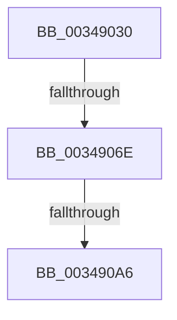

# MiAddMappedPtes

- RVA: `0x00349030`–`0x003490AD` (길이 `125` bytes)
- VA: `0x0000000140349030`
- 실행 섹션: `.text`
- PDB 이름 있음: `예`; PDB Function 태그: `아니요`
- unwind 정보 RVA: `0x000782B0`
- 디코드: `31`개 명령, `125/125` bytes 표시
- 미해석 바이트: `0` (있으면 어셈블리에 `.byte`로 보존)

> 이 문서는 커널 이미지의 기계어와 PDB 기호를 분석해 생성했습니다. 4번과 5번은 함수 원형과 자료형을 바이너리 사용 방식에서 추정한 C 해석이며 원본 소스 복구 결과는 아닙니다.

## 1. Dependencies

- 직접 호출 지점: **1**; 고유 호출 대상: **1**
- 직접 호출자로 확인된 함수: **2**
- RIP 상대 이미지 참조: **0**

### Outgoing calls
- `0x0034908D` → [MiOffsetToProtos](../24/MiOffsetToProtos_function_0024D880.md) (function, `0x0024D880`)

### Direct callers
- [MiInsertInSystemSpace](../3B/MiInsertInSystemSpace_function_003B2F5C.md) at `0x003B34BD`
- [MiMapSystemImage](../../page/AA/MiMapSystemImage_function_00AA3558.md) at `0x00AA35E2`

### Static image references
- 디코드된 RIP-relative 메모리 참조가 없습니다.

## 2. Other-region calls and transfers

- 다른 실행 섹션으로 향하는 call: **0**
- call이 아닌 외부 분기/꼬리 이동: **2**
  - `0x00349068` → [sub_003493AA](Unknown_function_003493AA.md) (`tail-transfer`)
  - `0x003490A0` → [sub_0034933D + 0x1](Unknown_function_0034933D.md) (`tail-transfer`)

## 3. Assembly (complete function range)

```asm
00349030  4C 89 4C 24 20                  mov qword ptr [rsp + 0x20], r9
00349035  48 89 4C 24 08                  mov qword ptr [rsp + 8], rcx
0034903A  53                              push rbx
0034903B  56                              push rsi
0034903C  57                              push rdi
0034903D  41 55                           push r13
0034903F  41 56                           push r14
00349041  48 81 EC 80 00 00 00            sub rsp, 0x80
00349048  33 F6                           xor esi, esi
0034904A  48 8B FA                        mov rdi, rdx
0034904D  8B CE                           mov ecx, esi
0034904F  48 89 74 24 40                  mov qword ptr [rsp + 0x40], rsi
00349054  4D 8B F1                        mov r14, r9
00349057  89 8C 24 B8 00 00 00            mov dword ptr [rsp + 0xb8], ecx
0034905E  8D 56 01                        lea edx, [rsi + 1]
00349061  39 8C 24 E0 00 00 00            cmp dword ptr [rsp + 0xe0], ecx
00349068  0F 85 3C 03 00 00               jne 0x1403493aa
0034906E  48 8B 94 24 D0 00 00 00         mov rdx, qword ptr [rsp + 0xd0]
00349076  4E 8D 2C C7                     lea r13, [rdi + r8*8]
0034907A  4C 8D 44 24 40                  lea r8, [rsp + 0x40]
0034907F  48 89 74 24 48                  mov qword ptr [rsp + 0x48], rsi
00349084  49 8B CE                        mov rcx, r14
00349087  48 8B DE                        mov rbx, rsi
0034908A  48 8B 12                        mov rdx, qword ptr [rdx]
0034908D  E8 EE 47 F0 FF                  call 0x14024d880
00349092  48 89 84 24 C0 00 00 00         mov qword ptr [rsp + 0xc0], rax
0034909A  4C 8B D0                        mov r10, rax
0034909D  48 85 C0                        test rax, rax
003490A0  0F 84 98 02 00 00               je 0x14034933e
003490A6  49 8B 06                        mov rax, qword ptr [r14]
003490A9  49 8B 4A 08                     mov rcx, qword ptr [r10 + 8]
```

## 4. C-style interpretation (structured pseudocode)

```c
__int64 __fastcall MiAddMappedPtes(__int64 a1, __int64 a2, __int64 a3, __int64 a4, __int64 a5, __int64 a6, unsigned int a7)
{
    __int64 result;
    __int64 v_rsi;
    __int64 v_rsp;
    unsigned __int64 v_stack_m60;
    unsigned __int64 v_stack_m68;
    unsigned int v_stack_p10;
    unsigned __int64 v_stack_p18;
    unsigned __int64 v_stack_p20;
    unsigned __int64 v_stack_p8;

    v_stack_p20 = a4;
    v_stack_p8 = a1;
    v_rsp = (v_rsp) - (128);
    v_rsi = 0;
    v_stack_m68 = 0;
    v_stack_p10 = 0;
    v_stack_m60 = 0;
    result = MiOffsetToProtos(a4, *(unsigned __int64 *)(a5), v_stack_m68, a4);
    v_stack_p18 = result;
    return *(unsigned __int64 *)(a4);
}
```

## 5. (Beta) C Style

```c
int64_t MiAddMappedPtes(int64_t Arg1, void *Arg2, int64_t Arg3, void *Arg4, void *Arg5, uint64_t Arg6, uint32_t Arg7)
{
    uint8_t *arg2 = (uint8_t *)Arg2;
    uint8_t *arg4 = (uint8_t *)Arg4;
    uint8_t *arg5 = (uint8_t *)Arg5;

    int64_t result;
    int64_t local_rsi;
    int64_t local_rsp;
    uint64_t v_stack_m60;
    uint64_t v_stack_m68;
    uint32_t v_stack_p10;
    uint64_t v_stack_p18;
    uint64_t v_stack_p20;
    uint64_t v_stack_p8;

    v_stack_p20 = Arg4;
    v_stack_p8 = Arg1;
    local_rsp = (local_rsp) - (128);
    local_rsi = 0;
    v_stack_m68 = 0;
    v_stack_p10 = 0;
    v_stack_m60 = 0;
    result = MiOffsetToProtos(Arg4, *(uint64_t *)(arg5), v_stack_m68, Arg4);
    v_stack_p18 = result;
    return *(uint64_t *)(arg4);
}
```

### 관측된 메모리 오프셋

구조체 형식이 확인되지 않은 접근은 인자 기준의 오프셋으로만 기록했습니다.

| 기준 인자 | 오프셋 표현 | 폭 (bit) | 접근 |
|---|---:|---:|---|
| `Arg2` | `+ 0x0 + r8*8` | `64` | `R` |
| `Arg4` | `+ 0x0` | `64` | `R` |
| `Arg5` | `+ 0x0` | `64` | `R` |

## 6. Execution-region graph

[열기: 2D/3D 그래프와 함수 탐색 컨트롤 패널](../../../control-panel.html?section=text&rva=0x00349030&view=graph)

- 2D 그래프는 위에서 아래로 흐르고, 3D 그래프는 빈 공간을 드래그해 회전합니다. Shift+드래그는 이동, 휠은 확대·축소, 함수 노드 선택은 대상 보고서 이동입니다.

### Static fallback


