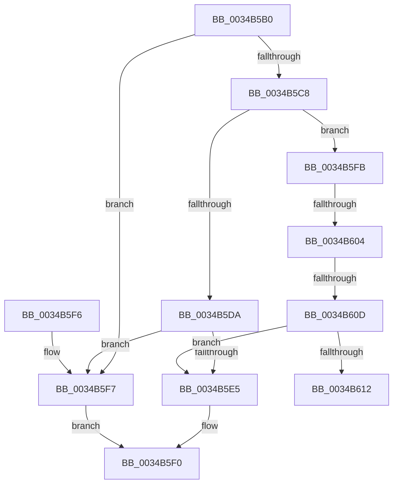

# MiAllowGuardFault

- RVA: `0x0034B5B0`–`0x0034B617` (길이 `103` bytes)
- VA: `0x000000014034B5B0`
- 실행 섹션: `.text`
- PDB 이름 있음: `예`; PDB Function 태그: `예`
- unwind 정보 RVA: `0x00069370`
- 디코드: `32`개 명령, `103/103` bytes 표시
- 미해석 바이트: `0` (있으면 어셈블리에 `.byte`로 보존)

> 이 문서는 커널 이미지의 기계어와 PDB 기호를 분석해 생성했습니다. 4번과 5번은 함수 원형과 자료형을 바이너리 사용 방식에서 추정한 C 해석이며 원본 소스 복구 결과는 아닙니다.

## 1. Dependencies

- 직접 호출 지점: **1**; 고유 호출 대상: **1**
- 직접 호출자로 확인된 함수: **4**
- RIP 상대 이미지 참조: **0**

### Outgoing calls
- `0x0034B5DC` → [KeInvalidAccessAllowed](KeInvalidAccessAllowed_function_0034B3F0.md) (function, `0x0034B3F0`)

### Direct callers
- [MiResolveProtoPteFault](../32/MiResolveProtoPteFault_function_00321750.md) at `0x00322089`
- [MiUserFault](../32/MiUserFault_function_00329840.md) at `0x00329F99`
- [MiAccessCheck](../32/MiAccessCheck_function_0032B720.md) at `0x0032B86E`
- [sub_0032DD4A](../32/Unknown_function_0032DD4A.md) at `0x0032DD52`

### Static image references
- 디코드된 RIP-relative 메모리 참조가 없습니다.

## 2. Other-region calls and transfers

- 다른 실행 섹션으로 향하는 call: **0**
- call이 아닌 외부 분기/꼬리 이동: **3**
  - `0x0034B5FE` → [sub_006E2246](../6E/Unknown_function_006E2246.md) (`tail-transfer`)
  - `0x0034B607` → [sub_006E2246](../6E/Unknown_function_006E2246.md) (`tail-transfer`)
  - `0x0034B612` → [sub_006E2246](../6E/Unknown_function_006E2246.md) (`tail-transfer`)

## 3. Assembly (complete function range)

```asm
0034B5B0  40 53                           push rbx
0034B5B2  48 83 EC 20                     sub rsp, 0x20
0034B5B6  65 48 8B 1C 25 88 01 00 00      mov rbx, qword ptr gs:[0x188]
0034B5BF  80 BB 4A 02 00 00 01            cmp byte ptr [rbx + 0x24a], 1
0034B5C6  74 2F                           je 0x14034b5f7
0034B5C8  48 8B C1                        mov rax, rcx
0034B5CB  48 8B D1                        mov rdx, rcx
0034B5CE  83 E0 01                        and eax, 1
0034B5D1  48 83 E2 FE                     and rdx, 0xfffffffffffffffe
0034B5D5  48 85 C0                        test rax, rax
0034B5D8  75 21                           jne 0x14034b5fb
0034B5DA  33 D2                           xor edx, edx
0034B5DC  E8 0F FE FF FF                  call 0x14034b3f0
0034B5E1  84 C0                           test al, al
0034B5E3  75 12                           jne 0x14034b5f7
0034B5E5  8A 43 7D                        mov al, byte ptr [rbx + 0x7d]
0034B5E8  F6 D0                           not al
0034B5EA  C1 E8 02                        shr eax, 2
0034B5ED  83 E0 01                        and eax, 1
0034B5F0  48 83 C4 20                     add rsp, 0x20
0034B5F4  5B                              pop rbx
0034B5F5  C3                              ret
0034B5F6  CC                              int3
0034B5F7  33 C0                           xor eax, eax
0034B5F9  EB F5                           jmp 0x14034b5f0
0034B5FB  80 3A 01                        cmp byte ptr [rdx], 1
0034B5FE  0F 84 42 6C 39 00               je 0x1406e2246
0034B604  80 3A 03                        cmp byte ptr [rdx], 3
0034B607  0F 84 39 6C 39 00               je 0x1406e2246
0034B60D  80 3A 06                        cmp byte ptr [rdx], 6
0034B610  75 D3                           jne 0x14034b5e5
0034B612  E9 2F 6C 39 00                  jmp 0x1406e2246
```

## 4. C-style interpretation (structured pseudocode)

```c
__int64 __fastcall MiAllowGuardFault(__int64 a1)
{
    __int64 result;
    __int64 v_rsp;

    v_rsp = (v_rsp) - (32);
    if ((*(unsigned __int8 *)(*(unsigned __int64 *)(gs_base + (0 + 392)) + 586)) == 1) goto loc_0034B5F7;
    result = (unsigned int)((a1) & (1));
    a2 = (a1) & (-2);
    if (result != 0) goto loc_0034B5FB;
    a2 = 0;
    result = KeInvalidAccessAllowed(a1, a2, a3, a4);
    if ((unsigned __int8)(result) != 0) goto loc_0034B5F7;
loc_0034B5E5:
    result = (unsigned __int8)(~(*(unsigned __int8 *)(*(unsigned __int64 *)(gs_base + (0 + 392)) + 125)));
    result = (unsigned int)((result) >> (2));
    result = (unsigned int)((result) & (1));
loc_0034B5F0:
    v_rsp = (v_rsp) + (32);
    return result;
loc_0034B5F7:
    result = 0;
    goto loc_0034B5F0;
loc_0034B5FB:
    if ((*(unsigned __int8 *)(a2)) != 6) goto loc_0034B5E5;
}
```

## 5. (Beta) C Style

```c
int64_t MiAllowGuardFault(void *Arg1)
{
    uint8_t *arg1 = (uint8_t *)Arg1;

    int64_t result;
    int64_t local_rsp;

    local_rsp = (local_rsp) - (32);
    if ((*(uint8_t *)(*(uint64_t *)(gs_base + (0 + 0x188)) + 0x24A)) == 1) goto loc_0034B5F7;
    result = (uint32_t)((Arg1) & (1));
    a2 = (Arg1) & (-2);
    if (result != 0) goto loc_0034B5FB;
    a2 = 0;
    result = KeInvalidAccessAllowed(Arg1, a2, a3, a4);
    if ((uint8_t)(result) != 0) goto loc_0034B5F7;
loc_0034B5E5:
    result = (uint8_t)(~(*(uint8_t *)(*(uint64_t *)(gs_base + (0 + 0x188)) + 0x7D)));
    result = (uint32_t)((result) >> (2));
    result = (uint32_t)((result) & (1));
loc_0034B5F0:
    local_rsp = (local_rsp) + (32);
    return result;
loc_0034B5F7:
    result = 0;
    goto loc_0034B5F0;
loc_0034B5FB:
    if ((*(uint8_t *)(a2)) != 6) goto loc_0034B5E5;
}
```

### 관측된 메모리 오프셋

구조체 형식이 확인되지 않은 접근은 인자 기준의 오프셋으로만 기록했습니다.

| 기준 인자 | 오프셋 표현 | 폭 (bit) | 접근 |
|---|---:|---:|---|
| `Arg1` | `+ 0x0` | `8` | `R` |

## 6. Execution-region graph

[열기: 2D/3D 그래프와 함수 탐색 컨트롤 패널](../../../control-panel.html?section=text&rva=0x0034B5B0&view=graph)

- 2D 그래프는 위에서 아래로 흐르고, 3D 그래프는 빈 공간을 드래그해 회전합니다. Shift+드래그는 이동, 휠은 확대·축소, 함수 노드 선택은 대상 보고서 이동입니다.

### Static fallback


