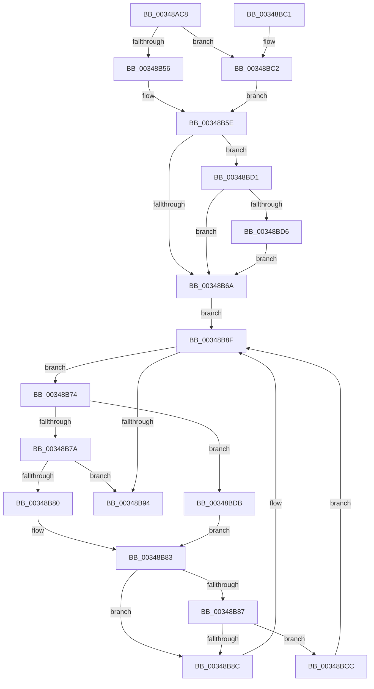

# MiCheckSlabPage

- RVA: `0x00348AC8`–`0x00348BE1` (길이 `281` bytes)
- VA: `0x0000000140348AC8`
- 실행 섹션: `.text`
- PDB 이름 있음: `예`; PDB Function 태그: `아니요`
- unwind 정보 RVA: `0x00078250`
- 디코드: `80`개 명령, `281/281` bytes 표시
- 미해석 바이트: `0` (있으면 어셈블리에 `.byte`로 보존)

> 이 문서는 커널 이미지의 기계어와 PDB 기호를 분석해 생성했습니다. 4번과 5번은 함수 원형과 자료형을 바이너리 사용 방식에서 추정한 C 해석이며 원본 소스 복구 결과는 아닙니다.

## 1. Dependencies

- 직접 호출 지점: **4**; 고유 호출 대상: **4**
- 직접 호출자로 확인된 함수: **4**
- RIP 상대 이미지 참조: **1**

### Outgoing calls
- `0x00348B23` → [MiPageToNode](../33/MiPageToNode_function_00338CD0.md) (function, `0x00338CD0`)
- `0x00348B59` → [ExAcquireSpinLockSharedAtDpcLevel](../24/ExAcquireSpinLockSharedAtDpcLevel_function_00248E30.md) (function, `0x00248E30`)
- `0x00348B9A` → [MiReleaseSpinLockShared](MiReleaseSpinLockShared_function_00348BF0.md) (function, `0x00348BF0`)
- `0x00348BC2` → [ExAcquireSpinLockShared](../24/ExAcquireSpinLockShared_function_0024DCE0.md) (function, `0x0024DCE0`)

### Direct callers
- [MiWalkEntireImage](../36/MiWalkEntireImage_function_00365D70.md) at `0x00366A8E`
- [MiMakeDriverPagesPrivate](../38/MiMakeDriverPagesPrivate_function_00384C60.md) at `0x00384FD4`
- [MiFinalizeImageHeaderPage](../4A/MiFinalizeImageHeaderPage_function_004A89A8.md) at `0x004A8AB4`
- [MiProtectDriverSectionPte](../67/MiProtectDriverSectionPte_function_006706C0.md) at `0x006708AB`

### Static image references
- `0x00348AE7` → RVA `0x00E30088` (`.data`; read)

## 2. Other-region calls and transfers

- 다른 실행 섹션으로 향하는 call: **0**
- 별도 외부 분기/꼬리 이동을 확인하지 못했습니다.

## 3. Assembly (complete function range)

```asm
00348AC8  48 89 5C 24 08                  mov qword ptr [rsp + 8], rbx
00348ACD  48 89 6C 24 10                  mov qword ptr [rsp + 0x10], rbp
00348AD2  48 89 74 24 18                  mov qword ptr [rsp + 0x18], rsi
00348AD7  57                              push rdi
00348AD8  41 56                           push r14
00348ADA  41 57                           push r15
00348ADC  48 83 EC 20                     sub rsp, 0x20
00348AE0  48 8B 41 28                     mov rax, qword ptr [rcx + 0x28]
00348AE4  41 8B F0                        mov esi, r8d
00348AE7  4C 8B 0D 9A 75 AE 00            mov r9, qword ptr [rip + 0xae759a]
00348AEE  48 8B E9                        mov rbp, rcx
00348AF1  48 C1 E8 2B                     shr rax, 0x2b
00348AF5  25 FF 03 00 00                  and eax, 0x3ff
00348AFA  48 63 FA                        movsxd rdi, edx
00348AFD  49 8B 1C C1                     mov rbx, qword ptr [r9 + rax*8]
00348B01  48 B8 00 00 00 00 00 DE FF FF   movabs rax, 0xffffde0000000000
00348B0B  48 2B E8                        sub rbp, rax
00348B0E  48 B8 AB AA AA AA AA AA AA AA   movabs rax, 0xaaaaaaaaaaaaaaab
00348B18  48 C1 FD 04                     sar rbp, 4
00348B1C  48 0F AF E8                     imul rbp, rax
00348B20  48 8B CD                        mov rcx, rbp
00348B23  E8 A8 01 FF FF                  call 0x140338cd0
00348B28  4C 8B 73 10                     mov r14, qword ptr [rbx + 0x10]
00348B2C  8B C8                           mov ecx, eax
00348B2E  49 81 C6 50 3D 00 00            add r14, 0x3d50
00348B35  48 69 D1 80 DF 00 00            imul rdx, rcx, 0xdf80
00348B3C  48 69 CF E8 00 00 00            imul rcx, rdi, 0xe8
00348B43  48 03 D1                        add rdx, rcx
00348B46  4C 03 F2                        add r14, rdx
00348B49  4D 8D 7E 10                     lea r15, [r14 + 0x10]
00348B4D  49 8B CF                        mov rcx, r15
00348B50  40 F6 C6 04                     test sil, 4
00348B54  74 6C                           je 0x140348bc2
00348B56  40 B6 11                        mov sil, 0x11
00348B59  E8 D2 02 F0 FF                  call 0x140248e30
00348B5E  49 8B 1E                        mov rbx, qword ptr [r14]
00348B61  33 FF                           xor edi, edi
00348B63  41 F6 46 08 01                  test byte ptr [r14 + 8], 1
00348B68  75 67                           jne 0x140348bd1
00348B6A  41 0F B6 46 08                  movzx eax, byte ptr [r14 + 8]
00348B6F  83 E0 01                        and eax, 1
00348B72  EB 1B                           jmp 0x140348b8f
00348B74  48 3B 6B 30                     cmp rbp, qword ptr [rbx + 0x30]
00348B78  77 61                           ja 0x140348bdb
00348B7A  48 3B 6B 28                     cmp rbp, qword ptr [rbx + 0x28]
00348B7E  73 14                           jae 0x140348b94
00348B80  48 8B 0B                        mov rcx, qword ptr [rbx]
00348B83  85 C0                           test eax, eax
00348B85  74 05                           je 0x140348b8c
00348B87  48 85 C9                        test rcx, rcx
00348B8A  75 40                           jne 0x140348bcc
00348B8C  48 8B D9                        mov rbx, rcx
00348B8F  48 85 DB                        test rbx, rbx
00348B92  75 E0                           jne 0x140348b74
00348B94  40 8A D6                        mov dl, sil
00348B97  49 8B CF                        mov rcx, r15
00348B9A  E8 51 00 00 00                  call 0x140348bf0
00348B9F  48 8B 6C 24 48                  mov rbp, qword ptr [rsp + 0x48]
00348BA4  48 85 DB                        test rbx, rbx
00348BA7  48 8B 5C 24 40                  mov rbx, qword ptr [rsp + 0x40]
00348BAC  48 8B 74 24 50                  mov rsi, qword ptr [rsp + 0x50]
00348BB1  40 0F 95 C7                     setne dil
00348BB5  8B C7                           mov eax, edi
00348BB7  48 83 C4 20                     add rsp, 0x20
00348BBB  41 5F                           pop r15
00348BBD  41 5E                           pop r14
00348BBF  5F                              pop rdi
00348BC0  C3                              ret
00348BC1  CC                              int3
00348BC2  E8 19 51 F0 FF                  call 0x14024dce0
00348BC7  40 8A F0                        mov sil, al
00348BCA  EB 92                           jmp 0x140348b5e
00348BCC  48 33 D9                        xor rbx, rcx
00348BCF  EB BE                           jmp 0x140348b8f
00348BD1  48 85 DB                        test rbx, rbx
00348BD4  74 94                           je 0x140348b6a
00348BD6  49 33 DE                        xor rbx, r14
00348BD9  EB 8F                           jmp 0x140348b6a
00348BDB  48 8B 4B 08                     mov rcx, qword ptr [rbx + 8]
00348BDF  EB A2                           jmp 0x140348b83
```

## 4. C-style interpretation (structured pseudocode)

```c
__int64 __fastcall MiCheckSlabPage(__int64 a1, int a2, int a3)
{
    __int64 result;
    __int64 v_r14;
    __int64 v_rbp;
    __int64 v_rbx;
    __int64 v_rdi;
    __int64 v_rsp;
    unsigned __int64 v_stack_p10;
    unsigned __int64 v_stack_p18;
    unsigned __int64 v_stack_p8;

    v_stack_p8 = v_rbx;
    v_stack_p10 = v_rbp;
    v_stack_p18 = v_rsi;
    v_rsp = (v_rsp) - (32);
    result = (*(unsigned __int64 *)(a1 + 40)) >> (43);
    result = (unsigned int)((result) & (0x3FFULL));
    v_rbp = (a1) - (result);
    v_rbp = (v_rbp) >> (4);
    v_rbp = (v_rbp) * (result);
    result = MiPageToNode(v_rbp, a2, a3, *(unsigned __int64 *)(v_rip + 11433370));
    v_r14 = (*(unsigned __int64 *)(*(unsigned __int64 *)(*(unsigned __int64 *)(v_rip + 11433370) + result * 8) + 16)) + (0x3D50ULL);
    a2 = (a2) * ((unsigned int)((unsigned int)(result)));
    a1 = ((unsigned int)((unsigned int)(result))) * ((int)(a2));
    a2 = (a2) + (a1);
    v_r14 = (v_r14) + (a2);
    if ((((unsigned __int8)((unsigned int)(a3))) & (4)) == 0) goto loc_00348BC2;
    result = ExAcquireSpinLockSharedAtDpcLevel(v_r14 + 16, a2, a3, *(unsigned __int64 *)(v_rip + 11433370));
loc_00348B5E:
    v_rdi = 0;
    if (((*(unsigned __int8 *)(v_r14 + 8)) & (1)) != 0) goto loc_00348BD1;
loc_00348B6A:
    result = (unsigned int)((*(unsigned __int8 *)(v_r14 + 8)) & (1));
    goto loc_00348B8F;
loc_00348B74:
    if (v_rbp > (*(unsigned __int64 *)(*(unsigned __int64 *)(v_r14) + 48))) goto loc_00348BDB;
    if (v_rbp >= (*(unsigned __int64 *)(*(unsigned __int64 *)(v_r14) + 40))) goto loc_00348B94;
loc_00348B83:
    if ((unsigned int)(result) == 0) goto loc_00348B8C;
    if (*(unsigned __int64 *)(*(unsigned __int64 *)(v_r14)) != 0) goto loc_00348BCC;
loc_00348B8C:
loc_00348B8F:
    if (*(unsigned __int64 *)(*(unsigned __int64 *)(v_r14)) != 0) goto loc_00348B74;
loc_00348B94:
    result = MiReleaseSpinLockShared(v_r14 + 16, 17, a3, *(unsigned __int64 *)(v_rip + 11433370));
    v_rdi = (*(unsigned __int64 *)(*(unsigned __int64 *)(v_r14)) != 0) ? 1 : 0;
    v_rsp = (v_rsp) + (32);
    return (unsigned int)((unsigned int)(v_rdi));
loc_00348BC2:
    result = ExAcquireSpinLockShared(v_r14 + 16, 17, a3, *(unsigned __int64 *)(v_rip + 11433370));
    goto loc_00348B5E;
loc_00348BCC:
    v_rbx = (v_stack_p8) ^ (v_r14 + 16);
    goto loc_00348B8F;
loc_00348BD1:
    if (v_rbx == 0) goto loc_00348B6A;
    v_rbx = (v_rbx) ^ (v_r14);
    goto loc_00348B6A;
loc_00348BDB:
    goto loc_00348B83;
}
```

## 5. (Beta) C Style

```c
int64_t MiCheckSlabPage(void *Arg1, int32_t Arg2, int32_t Arg3)
{
    uint8_t *arg1 = (uint8_t *)Arg1;

    int64_t result;
    int64_t local_r14;
    int64_t local_rbp;
    int64_t local_rbx;
    int64_t local_rdi;
    int64_t local_rsp;
    uint64_t v_stack_p10;
    uint64_t v_stack_p18;
    uint64_t v_stack_p8;

    v_stack_p8 = local_rbx;
    v_stack_p10 = local_rbp;
    v_stack_p18 = local_rsi;
    local_rsp = (local_rsp) - (32);
    result = (*(uint64_t *)(arg1 + 0x28)) >> (43);
    result = (uint32_t)((result) & (0x3FFULL));
    local_rbp = (Arg1) - (result);
    local_rbp = (local_rbp) >> (4);
    local_rbp = (local_rbp) * (result);
    result = MiPageToNode(local_rbp, Arg2, Arg3, *(uint64_t *)(v_rip + 0xAE759A));
    local_r14 = (*(uint64_t *)(*(uint64_t *)(*(uint64_t *)(v_rip + 0xAE759A) + result * 8) + 0x10)) + (0x3D50ULL);
    Arg2 = (Arg2) * ((uint32_t)((uint32_t)(result)));
    Arg1 = ((uint32_t)((uint32_t)(result))) * ((int32_t)(Arg2));
    Arg2 = (Arg2) + (Arg1);
    local_r14 = (local_r14) + (Arg2);
    if ((((uint8_t)((uint32_t)(Arg3))) & (4)) == 0) goto loc_00348BC2;
    result = ExAcquireSpinLockSharedAtDpcLevel(local_r14 + 16, Arg2, Arg3, *(uint64_t *)(v_rip + 0xAE759A));
loc_00348B5E:
    local_rdi = 0;
    if (((*(uint8_t *)(local_r14 + 0x8)) & (1)) != 0) goto loc_00348BD1;
loc_00348B6A:
    result = (uint32_t)((*(uint8_t *)(local_r14 + 0x8)) & (1));
    goto loc_00348B8F;
loc_00348B74:
    if (local_rbp > (*(uint64_t *)(*(uint64_t *)(local_r14) + 0x30))) goto loc_00348BDB;
    if (local_rbp >= (*(uint64_t *)(*(uint64_t *)(local_r14) + 0x28))) goto loc_00348B94;
loc_00348B83:
    if ((uint32_t)(result) == 0) goto loc_00348B8C;
    if (*(uint64_t *)(*(uint64_t *)(local_r14)) != 0) goto loc_00348BCC;
loc_00348B8C:
loc_00348B8F:
    if (*(uint64_t *)(*(uint64_t *)(local_r14)) != 0) goto loc_00348B74;
loc_00348B94:
    result = MiReleaseSpinLockShared(local_r14 + 16, 17, Arg3, *(uint64_t *)(v_rip + 0xAE759A));
    local_rdi = (*(uint64_t *)(*(uint64_t *)(local_r14)) != 0) ? 1 : 0;
    local_rsp = (local_rsp) + (32);
    return (uint32_t)((uint32_t)(local_rdi));
loc_00348BC2:
    result = ExAcquireSpinLockShared(local_r14 + 16, 17, Arg3, *(uint64_t *)(v_rip + 0xAE759A));
    goto loc_00348B5E;
loc_00348BCC:
    local_rbx = (v_stack_p8) ^ (local_r14 + 16);
    goto loc_00348B8F;
loc_00348BD1:
    if (local_rbx == 0) goto loc_00348B6A;
    local_rbx = (local_rbx) ^ (local_r14);
    goto loc_00348B6A;
loc_00348BDB:
    goto loc_00348B83;
}
```

### 관측된 메모리 오프셋

구조체 형식이 확인되지 않은 접근은 인자 기준의 오프셋으로만 기록했습니다.

| 기준 인자 | 오프셋 표현 | 폭 (bit) | 접근 |
|---|---:|---:|---|
| `Arg1` | `+ 0x28` | `64` | `R` |

## 6. Execution-region graph

[열기: 2D/3D 그래프와 함수 탐색 컨트롤 패널](../../../control-panel.html?section=text&rva=0x00348AC8&view=graph)

- 2D 그래프는 위에서 아래로 흐르고, 3D 그래프는 빈 공간을 드래그해 회전합니다. Shift+드래그는 이동, 휠은 확대·축소, 함수 노드 선택은 대상 보고서 이동입니다.

### Static fallback


